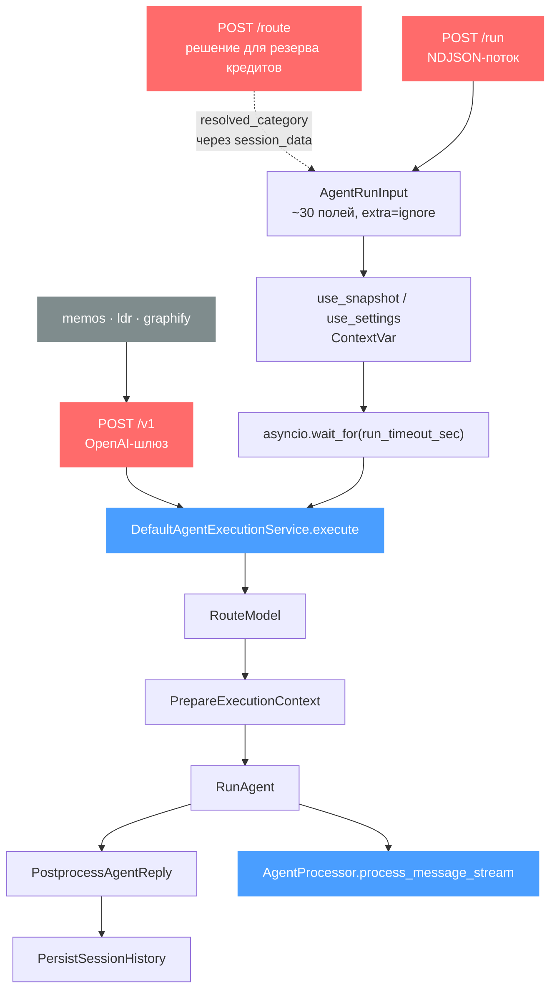
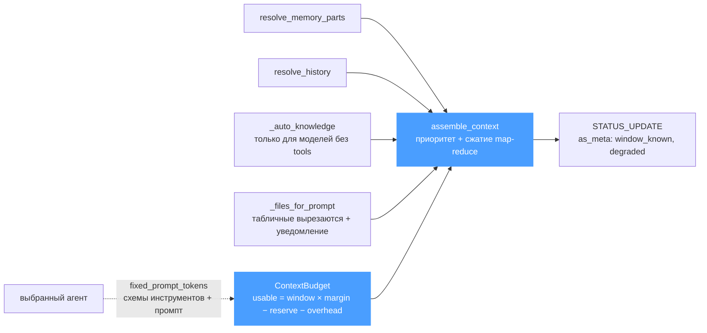
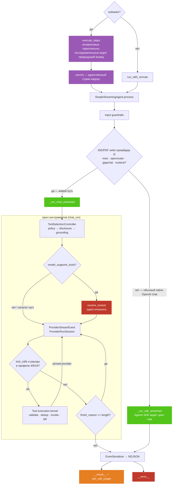
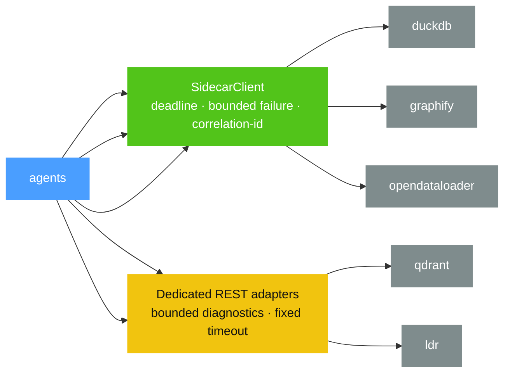

# Агентский слой: как он устроен сейчас

## Dev-приёмка harness: подтверждённые части и открытые границы, 21.10.2026

Dev снова доступен, схема уже047; повторный upgrade не выполнялся. Workspace/runtime
пересобраны, оба HTTP входа dev отвечают200. IDE/PDF/command flags остаются OFF,
13 прежних PROCESSING не отменялись. Текущий протокол приёмки и свидетельства —
в [HARNESS_LIVE_ACCEPTANCE.md](../../docs/HARNESS_LIVE_ACCEPTANCE.md).

Реальный Docker подтвердил шесть command lifecycle сценариев и обнаружил null
`ExitCode` до запуска exec. Исправленный driver развёрнут; null не доказывает cleanup.
На047 расширен PG corpus: persisted recipes/evidence, two-repair ceiling, pass→fail
той же версии и конкретные SQL body/state constraints. Подтверждённый отказ рецепта
теперь закрывает effect backend-owned failed receipt до какого-либо process create;
unknown/storage failures остаются fail-closed. Это не разрешение для adapter success.

Разрешённый GigaChat preflight прошёл через обычный queue/worker/settlement:
847 tokens,16 credits; повторная доставка не изменила payload и единственное usage
событие. Это проверка provider/billing component, не автономного harness задания.
Продолжение приёмки: настоящий backend→agents→workspace и Celery/prefork worker
подтвердили hello-world/repair, admission/settlement, duplicate delivery, in-flight
SIGKILL и authenticated Stop. Model-only transport проверен для трёх adapters.
Потерянные committed checkpoint/write/usage ACK и workspace GO-ACK сверяются без
повторения эффекта. IDE command observation выделено в отдельный helper: unknown
ACK допускает только bounded status того же operation ID, не новый запуск.
Замена process image workspace подтверждает inspect/Stop после потери observer cache;
без stdout проверка остаётся blocked даже при подтверждённой cleanup. Это не restart
всего контейнера и не in-flight restart agents. Новая048 исправляет retention trigger,
но пока проверена только на полной disposable PG-цепочке; основной dev остаётся047.
Реальный платный harness-run, continuation, unknown cleanup/races и общий rollout
ещё открыты; browser-проверки UI не закрывают эти межсервисные требования.

## IDE-команды: executor подключён в исходниках, 20.10.2026

Новый подсрез продолжает foundation046 ниже; **live-готовность ещё не подтверждена**.

- В прежнем Docker driver добавлены create/start/inspect по одному Engine exec ID.
  Read-only runtime содержит root-owned supervisor: READY с PID/starttime, отдельный
  GO после backend admission, bounded stdout/stderr, subreaper cleanup потомков.
  Stop использует pidfd и сверяет starttime, не общий `/tmp/.ws-exec.pgid`. Неполный
  GO не блокирует Stop/handshake deadline. Project/stdout не служат lifecycle receipt.
- Agent-entry существующей IdeConsoleService связывает snapshot publication/pin,
  phase-CAS, сохранение Engine ID и READY, последний допуск внутри workspace lock
  и отдельное наблюдение. После потери ACK только status того же exec; нет replay.
  Перезапуск backend запускает bounded read/Stop recovery, включая flags OFF;
  временная недоступность PostgreSQL не завершает recovery loop навсегда.
- Private protocol и три manifest-копии расширены command v1 run/status/stop.
  `ide_run_command` / `ide_command_status` включаются доверенным run-контекстом.
  Capability, Engine ID и адрес сервиса не входят в tool schemas. Опрос работающего
  процесса не считается отсутствием прогресса. Отдельной command надбавки нет.
- Доменный verifier разделяет process exit и результат Python/stdout/unittest/pytest.
  Рецепт критерия сохраняется до dispatch; его нельзя заменить после провала.
  Непустые не-all-skipped tests обязательны. Два repair cycles сохраняются в TaskState;
  общий16-round ceiling не сбрасывается. Dependencies не устанавливаются.
- Только backend command receipt обновляет source revision/evidence. File readback
  закрывает критерий лишь при совпадении digest ранее подтверждённой записи нужного
  target. Последующая агентская запись и подписанный UI mutation admission делают
  прежние проверки stale. Checkpoint agents не назначает новую ревизию самостоятельно.
  Повторная failed/blocked проверка заменяет старый passed-факт даже при том же digest.
  Перед публикацией снова проверяются Stop, ownership, generation и deadline.
- Подтверждённая cleanup снимает gate даже при потере вывода/итогового source read;
  проверка остаётся blocked. Неподтверждённая cleanup сохраняет pin/gate. Ни удаления
  контейнера, ни автоматического restore нет. Snapshot failure до Engine create
  фиксируется как blocked preparation, без запуска пользовательского кода.
- Owner-only REST history показывает безопасные stages/checks в существующей консоли.
  Вывод ограничен и не передаётся в публичные traces. Панели не переразмечены; dirty
  буфер остаётся редактируемым при запрете Save/Ctrl+S, чтение файлов доступно.
  Refresh не заменяет несохранённый текст; чтение истории scoped/abortable.
- Новая аддитивная047 (`047_command_receipts`) сохраняет verification recipes,
  ограничивает размер command JSON и индексирует recovery.046 не переписана.

Offline-проверки этого подсреза: backend114 адресных тестов; workspace29 driver/Stop/
capture/policy; agents139 harness/IDE/contract tests; frontend24 hook/IDE/buffer tests.
Ruff/format, MyPy593,
complexity, protocol/shared-copy/run-quality/privacy checks прошли на указанных
срезах. Frontend strict audit:0 findings; DESIGN lint:0 errors/7 прежних warnings.
Это не полный итоговый gate, не фактический запуск supervisor и не browser acceptance.

Текущий live-блокер: Docker Engine недоступен (нет dockerDesktopLinuxEngine pipe),
runtime image build не выполнен, opt-in driver probe оборвался по timeout. В Windows
около0,8 ГБ свободной RAM; прежний оборванный full gate не засчитывается. Миграция047
не применена, сервисы не перезапущены, command/autonomy flags этим подсрезом не включены.
Открыты настоящий backend/agents/workspace hello-world/repair/ACK/SIGKILL/Stop corpus,
browser/a11y/build и один последовательный полный gate после восстановления ресурсов.
Production, PDF auto-apply/build, dependencies и платные provider calls не затронуты.

## История: IDE command journal и защита проекта, 20.10.2026

Первый подсрез командного исполнения, **не готовая agent console**:

- Backend расширяет существующий `harness_operation` полями команды (046), без второй
  очереди/БД. Admission сверяет owner/attempt/epoch, project generation, разрешение exec,
  Stop, резерв и неопределённый расход. Повтор возвращает ту же операцию; изменение
  рецепта запрещено. Частичные уникальные индексы исключают две активные команды
  одного repository/workspace. Никакой публичный execute endpoint пока не добавлен.
- `persistence/harness/commands/` разделяет admission/transitions, pins и mutation gate;
  DTO/закрытые рецепты shell/Python/unittest/pytest лежат в `domain/ide/commands.py`.
  Это контракты, ещё не реализация запусков этих проверок.
- Снимок привязывается только к опубликованной metadata с подтверждённым upload ACK
  нужного владельца/generation/digest. Командный pin исключает его из retention/orphan
  cleanup; терминальный переход и однократное освобождение pin транзакционны.
- Долговечная блокировка переживает Redis expiry и новый экземпляр repository. Она
  включена в существующий coordinator, UI save/Git preflight и restore admission.
  Read-only capture выделен из Git/history mutation `snapshot`. Повторный preflight
  проверяется внутри workspace operation lock; policy использует существующий lock
  через before-update callback без повторного захвата non-reentrant lock.
- `unknown` не возвращается в dispatch. Неподтверждённая cleanup не разрешает terminal
  release; неполный/усечённый вывод не даёт command success. Подтверждённая остановка
  с отсутствующим выводом может закрыть failed-операцию, не подтверждая критерии задачи.
  Generic adapter receipt не может объявить `ide_run_command` успешным: terminal receipt
  фиксирует backend. Даже exit0 не создаёт evidence для CompletionVerifier.

Проверки: адресный backend-корпус227 passed/2 skipped и дополнительные расширенные
регрессии; workspace1228 passed/135 skipped до финального изменения policy callback,
после него71 адресная проверка (включая реальный registry lock). Три opt-in PG probes
прошли на одноразовых базах: command journal13 сценариев, runtime8, restore23.
В command probe Engine IDs — фиктивные данные контракта: команды не запускались.
Все временные базы удалены. Общий backend suite не завершён: MemoryError на collection
и Windows paging error0x800705AF. Это не зелёный итоговый gate.

На dev read-only проверена уже поднятая схема046; upgrade/restart этим подсрезом не
выполнялись. `HARNESS__IDE_COMMANDS_ENABLED` по умолчанию false; автономность не включена.
Для reload обновлённого backend нужна046 даже с flags OFF: coordinator/retention SQL
используют её поля. На проверенном dev все три IDE/PDF/commands flags OFF, открытых
command gates0; прежние13 CHAT PROCESSING не отменялись и не перезапускались.
Не подключены: адресуемый Docker exec create/start/inspect, command-bound supervisor,
status/Stop/reconciliation процесса, агентские инструменты, versioned verification/
repair и отображение command receipts. До их сквозной приёмки флаг не включать.
PDF auto-apply/build, установка зависимостей, production и платные модели не затронуты.

## Предыдущий срез harness — source/offline и PostgreSQL, 20.10.2026

- Принятый harness резерв удерживается независимо от TTL и обычного release через
  `token_reservations.harness_task_id`. Подтверждённый settlement закрывает его прежним
  способом. Это не продление dispatch: срок и task binding проверяются отдельно.
- После поднятия dev пользователем проверена схема045 (`045_harness_holds`); upgrade
  повторно не выполнялся. Downgrade с открытыми удержаниями блокируется.
- Checkpoint фиксирует исполнителя. Resume обходит routing/planning/context rebuild;
  старый checkpoint без owner или удалённый исполнитель блокируется без fallback.
  Human-question не обходит неизвестный ACK платного вызова.
- Из committed adapter receipt восстанавливается точная тарификация local tool после
  потерянного ACK, без повторного исполнения и нового списания. Legacy/неизвестный
  provider расход не выводится эвристически из текста и остаётся заблокированным.
- Настоящий PostgreSQL на одноразовых базах подтвердил journal/runtime043–045, hold TTL,
  конкурентную fee reconciliation, human-question counters/provider/fencing и Stop.
  Исправлен обнаруженный live asyncpg UUID/text binding. Это не трёхсервисный E2E.
- Agent console, зависимости, PDF auto-apply/build, фактический reconciliation эффектов
  и сквозная crash/SIGKILL приёмка остаются открытыми. Флаги OFF; платных вызовов не было.

Итоговый gate этого среза: agents3797 passed/25 skipped; backend4452 passed/135 skipped
(без integration), coverage80,17%. Отдельно2 opt-in PostgreSQL probes прошли, одноразовых
баз после них не осталось. Ruff/format/complexity обоих сервисов, MyPy572,
protocol/shared-copy/run-quality/privacy checks прошли. Рабочие dev-процессы этим срезом
не перезапускались; PG probes исполняли текущие bind-mounted исходники отдельно.

Историческая последовательность foundation/runtime/refactoring ниже описывает отдельные
срезы; актуальные ограничения и следующий порядок — в `architecture-target.md`.

> Актуализировано после S25 и в ходе S26. Исторические красные узлы ниже оставлены только там,
> где долг всё ещё существует; контракты usage, terminal latch, S11 и GigaChat описывают
> фактический production-код, а не прежний roadmap.

> Защитный self-harness срез 20.10.2026: IDE/PDF всех поддержанных provider runtime
> используют общий chat/tool loop; native OpenAI больше не отправляет их в SDK.
> Добавлены typed PDF proposal failures, IDE ceiling16, in-memory progress guard,
> запрет новых мутаций после неизвестного write ACK и bounded read-back файлов перед
> итогом. `task_result` v1 описывает только неподтверждённые/остановленные запуски.
> Это source/offline срез, не dev deployment и не общая autonomous acceptance.
> Агентские команды IDE и auto-apply/build открытого PDF пока не подключены;
> полный список оставшихся контрактов — в разделе Self-harness целевой архитектуры.

> Следующий persistence-срез: общий TaskContract/TaskState/CompletionVerifier, v2 codec,
> PostgreSQL043 journal и once-only dispatch admission проверены отдельно. Run-контекст
> сохраняет общий IDE round ceiling и умеет принимать состояние, но worker/ACK/resume,
> monetary grants и executor receipts ещё не соединены. Dev043 не применялась; это
> не включённая автономность и не сквозная проверка команд/PDF.

> Последующий runtime-срез 20.10.2026 подключает эти исходники к worker и приватному ACK
> API: admission/attempt fencing, transcript/provider continuation, paid-call grants и
> cumulative settlement. Для него добавлена044, но она не применена; IDE/PDF harness flags
> по умолчанию OFF. Offline-проверки не подтверждают restart/SIGKILL/unknown-ACK E2E.
> Неизвестные эффекты блокируют повторный dispatch; полное reconciliation ещё открыто.
> Стенды недоступны, их запуск/перезапуск запрещён пользователем. Agent console и PDF
> auto-apply/build не добавлены этим срезом. Подробности и ограничения — в целевой архитектуре.

> Офлайн-структуризация backend завершила погашение complexity debt без повышения порогов:
> agent settings/whitelist, history session и WS admission отделены от композиции. Dispatch
> повторно проверяет неизвестные эффекты/расход; IDE adapters возвращают typed outcomes.
> Backend4201 offline tests и agents2979 tests прошли; это не live-приёмка восстановления.

## Итоговая приёмка рефакторинга — 20.10.2026

Пакетная структуризация и шесть in-module срезов завершены offline в рабочем дереве.
Проверено финальное production state, а не только исторические промежуточные green runs.
Self-harness команды/auto-apply/reconciliation/live acceptance остаются отдельной работой.

| Требование | Итоговое подтверждение |
| --- | --- |
| Разделить перечисленные harness/provider/model/tool/authoring/evidence/context families | Целевые пакеты существуют; прежние flat prefixes отсутствуют в прямо указанных parent directories |
| Не создавать новый скрытый runtime в feature init |10 representative/new package initializers — docstring-only; публичные client/runners/documents facades сохранены и покрыты runtime contract tests |
| Отделить смешанные обязанности orchestration | Worker quote/content/staging, chat preparation, WS options/admission и early-route preparation имеют отдельных владельцев; charge/commit/publication порядок остаётся явным |
| Обновить imports, tests, probes и CLI | Статически проверены953 production modules и203 relative imports, missing local modules/static package exports:0; embedded/CLI guard green без исполнения probes |
| Не скрывать долг baseline-ослаблением | Оба complexity gate green на прежних thresholds, backend `allowed={}`; Ruff/format обоих сервисов и MyPy560 green |
| Сохранить результат/usage/error semantics | Agents3789 passed/25 skipped; backend4412 passed/134 skipped, coverage80,02%; protocol/shared-copy/capability/profile/privacy guards и71 root guard test passed |

Финальный cleanup удалил два obsolete helpers. Проверка archive compaction теперь
вызывает реальный tool transition и доказывает single compaction перед следующим
model round, сохранение instruction/tool receipts и безопасный no-op. Новая запись
не подменяет старый helper второй функцией-прокладкой. Backend vector requests
по-прежнему создаются своим существующим client factory.

Backend gate запускался без integration, live/provider приёмка не включалась. Стенды,
миграции, rollout flags и production не затрагивались; commit/push не выполнялись.
Production source digest:
`fb8cb0249322a40e52ae720c0003a9c8826749c7343506ab4e23d99e7649e128`.

## Навигация по пакетам — 20.10.2026

После пакетной структуризации начат рефакторинг реализаций. В backend worker
`billing/quote.py` отделяет тарифный расчёт/floor/selected-model ceiling от списания:
типизированные UsagePricingInput/ChargeQuote не содержат owner/job/reservation handles.
Pricing collaborator передаётся явно и создаётся только внутри прежней failure boundary.
`charging.py` по-прежнему владеет hold release, idempotent debit и post-commit observation;
harness-owned settlement продолжает проверяться до legacy quote path. Формула, ставки,
выбранный-model cap, фактическая provider cost и surcharge/fallback semantics не менялись.
Новый helper включён в source-parity inventories четырёх opt-in SQL probes; сами probes
не исполнялись. Проверены66 targeted cases,4 compile-only probes и backend4299 passed/
21 skipped (без integration/live), coverage79,87%, MyPy556, Ruff/format/complexity и
contract/import/privacy guards. Это отдельный in-module срез, не новая harness feature;
пакетный аудит ниже остаётся историческим результатом предыдущего этапа.

Следующий срез выделил `results/persistence.py`: запись хода, приватного document outbox
intent и terminal job status внутри caller-owned transaction. Helper не выполняет commit,
broker wakeup или публикацию ответа; эти границы остаются в `execution/run.py` после charge.
Продолжения используют исходный пользовательский ход, document origin ID остаётся стабильным,
приватные delivery descriptors удаляются до публичной записи. Recovery probe проверяет digest
нового компонента.113 targeted cases подтверждают порядок charge → turn → outbox → status →
commit → wakeup → publish и отсутствие публикации при ошибках записи/commit. MyPy557,
Ruff/format/complexity и contract/import/privacy guards прошли; live probes не запускались.
Итоговый backend без integration:4379 passed/134 skipped, coverage79,98% при прежнем67%;
opt-in live проверки не включались. Непреднамеренные импорты enum/UUID через execution
module заменены прямыми импортами в тестах, без совместимых runtime-прокладок.

Agents chat preparation теперь имеет отдельного владельца `runners/chat/preparation.py`:
typed PreparedChatRun восстанавливает transcript и выбирает инструменты только после
policy/model/config gates. `events()` сохраняет disclosure → availability → omissions;
`start_loop()` вызывается после них и открывает chat usage scope, context/cache и loop state.
При раннем закрытии stream activation/primary model/tool не запускаются. Stream, interruptions,
usage projection и terminal остаются в `chat/run.py`; transport/tool executor не дублируются.
IDE round ceiling при activation получает explicit execution owner: смена ambient context
не сбрасывает16-round остаток.12 новых cases включают red→green проверку15→1, transcript
precedence, неизменность checkpoints/history, authorized executor index и preparation failure.
Полный agents:3769 passed/25 skipped, Ruff/format/complexity и межсервисные gates прошли.
Backend production не менялся; live/provider проверки и запуск стендов не выполнялись.

Backend WS entry дополнительно собран в `application/use_cases/ws_message/`: handler
владеет authenticated identity, offer claim, job/queue dispatch и ACK boundary; admission —
workspace validation и route resolution; options — чистый типизированный разбор сообщения,
server-owned continuation и явные worker/fallback projections. Чистый options component
не получает job service, queue или identity; browser session_data не копируется в worker.
После неизвестного enqueue/accept ACK claim не освобождается; legacy fallback не получает
новых полномочий. WS consumer и test patch targets используют новые прямые импорты.
Это ещё один feature-пакет после исторического280-module пакетного аудита ниже.
19 новых regressions покрывают tri-state/default options, canonical continuation,
identity/job/queue allowlist, lifecycle failures и прежнюю fallback проекцию. Полный
backend без integration:4398 passed/134 skipped, coverage80,00%; Ruff/format/complexity,
MyPy559 и protocol/import/privacy gates прошли. Agents production этим срезом не менялся.

Agents early route stage отделён в `processing/routing/{contracts,preparation}.py`:
нормализация модальностей → explicit source consent → auto-plan → confirmation/apply.
Ожидание согласия возвращается до fan-out, workflow/decomposition, agent route и planning;
эти downstream операции по-прежнему видимы в steps. Private RouteInputs/RoutePreparation
не попадают в public wire; прежний RouteDecision остаётся доступен через steps facade.
`processing/settings.py` — единый call-time settings adapter для processor/context/steps,
без второго snapshot или module-import caching.14 новых cases проверяют границы стадий,
источник prompt facts, normalized ModalityAttachment, orthogonal multimodal/chain и
сохранение receipts/counters при failure без retry. Source guards проверяют фактический
новый call site; проверка prompt fact усилена AST. Полный agents3783 passed/25 skipped;
Ruff/format/complexity и межсервисные guards прошли. Backend production не менялся.

Worker result content preparation выделена в `results/preparation.py`: terminal usage
validation → result/attempt fence → canonical acceptance → artifacts/display projection →
prepared checkpoint. Typed PreparedTurnContent не содержит pricing/reservation handles.
Execution orchestrator сохраняет question fence, charge, message/outbox staging, commit
и финальную publication; checkpoint hooks сохраняют свои прежние durable commits.
Restore использует копию metadata, по-прежнему проверяет attempt и не повторяет materialization/
catalog/checkpoint/stream-complete effects.14 новых regression cases и121 focused checks
подтверждают порядок и failure boundaries; SQL recovery probe обновил source/digest inventory,
но не запускался. Запрос человека доходит до snapshot через новый реальный call site.
Полный backend без integration:4412 passed/134 skipped, coverage80,02%; MyPy560,
Ruff/format/complexity и protocol/import/privacy guards прошли. Agents production не менялся.

Связанные компоненты сгруппированы по ответственности, а не оставлены плоскими рядами
`harness_*`, `provider_*`, `tool_*`, `authoring_*`. За шесть срезов перенесено280 модулей
в65 новых feature-пакетов; существующий cache оформлен явно, без лишнего cache/redis:

```text
agents/service/
  application/
    harness/                       admission · result projection
    admission/                     IDE/PDF scope · document tool consent
    processing/                    processor · context · steps · call-time settings
      routing/                     private contracts · modality/consent/early-auto preparation
    human_questions/               admission · same-task continuation
  infrastructure/
    harness/                       client · HTTP exchange · ACK reconciliation
    document_audit/                process · private registry
  domain/
    execution/                     run context · invocation · grounding/progress · handoffs
    usage/                         receipts/ledger · response tracking · legacy projection
    runners/harness/               loop resume · journaled tools
    runners/chat/                  preparation · common run · stream loop/state · tools · terminal
    runners/sdk/                   SDK run · setup (not the IDE/PDF execution owner)
    runners/ide/                   factual verification · bounded completion repair
    tools/workspace/               legacy file transport · adapters · declarations
    tools/ide/                     selected-project files · terminal report
    tools/search/                  client · tool · parsers · per-run sources
    client/
      models/                      catalog · requirements · qualification · caches
      providers/
        management/                admission · generations · inventory · lifecycle
        gigachat/                  adapter · auth · images · schema · function dialect
        openai/                    adapter · compatible call protocol
        transports/                HTTP/proxy · optional SDK binding
    capabilities/tools/            spec · registry · disclosure
    documents/
      authoring/                   execution · checkpoint · protocol · repair
      evidence/                    citations · bundle · projection
      semantic/                    typed graph · edits · outline/sections · renderer
      skills/                      editorial contracts · catalog · profile identities
    pipeline/context/              assembler · budget · compressor · enricher
    routing/auto/                  decision · prompt · signals · metered router
    workflows/research/            deck · PDF document · PDF presentation
  presentation/cli/gigachat/        qualification · tools · workspace · private support
backend/service/
  infrastructure/cache/            Redis manager · JSON cache · session indexes
  services/files/application/scanning/ scanner · bounded outcome metrics
  services/admin/application/settings/ registry · spec · agents/billing/integrations
  services/analytics/application/memory/ service · cache · transcript · usage
  infrastructure/ide/              workspace client · verified blob storage
    transports/                    capture · restore · console · writes · Git
  infrastructure/agents_client/document_audit/ client · stream · recovery
  services/chat/
    application/use_cases/ws_message/ handler · workspace admission · pure options/projections
    application/
      ide/                         runtime · repositories · reads/edits · console
        checkpoints/               capture · publish · history · restore · cleanup
      documents/                   context · sources · edits · initial preparation
        audit/                     invocation · reconciliation · recovery
        publication/               lease · Library delivery
      human_questions/             owned replies · child dispatch
      video_stt/                   metered execution · grants · stream · settlement
    domain/ide/                    scope · generations · files/edits · console
      checkpoints/                 blob · revision · budget · restore
    domain/human_questions/        codec · cost · reply · dispatch · continuation
    domain/confirmation/           offer · mode · continuation
    domain/documents/              target identity · preparation
    persistence/
      harness/                     journal · runtime · grants · effects · inspection
      ide/                         repositories · clones · runtime
        checkpoints/               publication · retention · orphans · restore
      human_questions/             owned journal · cost · dispatch
      documents/                   preparation · publication
        audit/                     attempts · private checkpoint ACK
      workflows/                   catalog SQL · metrics
    infrastructure/chat_worker/
      harness/                     admission · recovery · accounting
      execution/                   admission · lease · attempt · dispatch · run
      billing/                     acceptance · accounting · quote · charging · cancellation
        reservation/               prepare · preflight · recovery · cleanup
        usage/                     private journal · ACK · consistency · provenance
      results/                     latches · artifacts · persistence · publish · events
      materialization/             immutable replay plan · bounded recovery
      context/                     attachments · targets · history · metadata
      continuation/                confirmation · human-question dispatch/pause/resume
    presentation/routers/chat_api/
      ide/                         repositories · runtime · files · checkpoints · console
      workspace/                   router · access · contracts · coordination · operations
```

Новые `__init__.py` описывают границу пакета, без запуска клиентов и скрытого изменяемого
состояния. Импорты используют конкретный модуль; старых файлов-прокладок нет. Существующий
публичный фасад `domain.client` сохранён. Runtime digest PDF учитывает новые пути файлов.
Публичный фасад `domain.runners` также сохранён; его описание отличает общий IDE/PDF loop
от SDK-пути остальных задач. Лишняя прокладка `runners/tool_execution.py` удалена: импорты
ведут непосредственно в существующее типизированное ядро `runners/tool_runtime`.

Граница пакета определяется ответственностью, а не только общим префиксом. Внутри убран
избыточный prefix; application/domain/persistence/transports не смешаны. Новые init
не запускают клиентов, регистры или tasks. Переезды обновляют canonical/relative imports,
monkeypatch targets, explicit capability source lists, CLI entrypoints и source inventories,
а не создают постоянные совместимые файлы-прокладки.

Итоговая offline-проверка: agents3759 passed/25 skipped/один upstream warning;
backend4287 passed/21 skipped без integration/live, coverage79,84% при пороге67%; MyPy555.
Ruff/format/complexity обоих сервисов, contract/protocol/shared-copy/profile/privacy gates
прошли. Privacy scan покрывает226 файлов; root guard tests59 passed. Все280 новых/старых
адресов проверены: старых файлов-прокладок нет. Все66 добавленных package init содержат
только описание границы, без исполнения runtime. Пороги и исключения не расширялись.

Для37 переносимых модулей AST без imports/docstrings сначала совпал37/37. После отдельного
privacy исправления совпадает36/37: memory/cache.py больше не пишет traceback, Redis
exceptions и user/cache contents, а возвращает прежние safe fallbacks. Route decorators,
permissions, URL declarations, composition order и workflow/CLI тела перенесены без изменения.
Это source/offline evidence, не сравнительный live OpenAPI/browser или provider acceptance.

В21 opt-in probe/fixture файле исправлены пропущенные quoted `from package import module`.
`scripts/check_embedded_probe_imports.py` теперь проверяет actual и embedded local import
paths статически, не исполняя код и не загружая service config. Cross-service snippets
получают явную привязку к agents/backend; отсутствующий checkout даёт отказ, не пустой pass.
Checker с unit tests включён в CI и Makefile; также проверяет агентские CLI recipes,
не запуская их. Полная история шести срезов и их отдельные
цифры сохранены в [PROJECT_TODO](../../docs/PROJECT_TODO.md).

Стенды не запускались/не перезапускались,043/044 не применялись, harness flags OFF;
paid calls и commit/push не выполнялись. Консоль агента, PDF auto-apply, полная долговечная
reconciliation и SIGKILL/Stop/unknown-ACK E2E не объявляются реализованными этим переездом.

### Результат структурного аудита

Последний срез вынес execution context/model invocation/grounding/progress/handoffs и
usage ledger/tracking/legacy projection в разные пакеты agents. Scanner и metrics имеют
свой application/scanning backend; Redis helpers остались в существующем cache с короткими
именами manager/cache/sessions. AST всех16 последних переносов без imports/docstrings
совпал16/16. Legacy usage guard теперь проверяет точный путь и aliases/relative imports;
исключение по одному basename убрано, а не расширено.

Исходные запросы по infrastructure/harness, client provider/model, GigaChat/OpenAI,
capabilities/tools, documents authoring/evidence и pipeline/context закрыты соответствующими
пакетами на карте и тестами отсутствия старых flat files. Аналогично проверены остальные
подсистемы обоих деревьев. Local-import audit388 agents и555 backend модулей, включая
relative imports, не нашёл неразрешённых модулей/статических package exports. Dynamic facade
symbols дополнительно покрываются runtime unit/deferred-import tests, не этим AST audit.

Оставшиеся повторяющиеся имена проверены по ответственности, не проигнорированы:

| Существующая граница | Решение и причина |
| --- | --- |
| jobs/application | Сохранена: API/profile/cancel facade, job lifecycle service и training poller — разные роли внутри уже выделенного jobs |
| chat/domain и chat/persistence | Сохранено ядро чата: contracts/errors, orchestration и CRUD/history/worker queries; IDE/PDF/harness/question subsystem код уже вынесен отдельно |
| files/domain | Media-type, bounded read и scan-result — разные чистые контракты feature files; не вложены в бессодержательный files/domain/files |
| infrastructure/agents_client | providers/tools/vector — независимые RPC API внутри уже выделенного adapter boundary, не один новый workflow |
| client/providers | MWS/RouterAI/OpenRouter имеют по одному adapter module; credentials/runtime/spec общие. Image privacy используется GigaChat и общим streaming, поэтому не копируется в provider-specific пакет |

Запрошенный пакетный рефакторинг и его offline-приёмка завершены. Это не объявление
автономного harness готовым: команды/auto-apply, durable reconciliation и live restart/
SIGKILL/Stop acceptance остаются отдельной открытой работой в целевой архитектуре.

Схема снята с кода, а не с намерений. Каждый узел — существующая функция; подписи на рёбрах
называют условие, по которому ветка выбирается. Целевое устройство — в
[architecture-target.md](architecture-target.md).

Сайдкар **не хранит состояния**: история, память, резюме, текст вложений и презайнед-ссылки
приезжают в теле `/run`. Это и есть свойство, ради которого контракт такой большой, и оно
ограничивает всё остальное — в частности, поэтому workspace в целевой схеме получает
идентификатор в теле, а не каталог на диске сайдкара.

---

## 1. Вход и оболочка прогона



⚠️ `/route` на живом пути **не вызывается**: чат ходит по WebSocket в backend, а тот зовёт
`/run`. `/route` существует ради резерва кредитов на REST-пути, и его ответ приезжает обратно
через `session_data["_resolved_category"]` — именно поэтому в фазе 1 есть ветка «маршрут уже
решён на входе».

---

## 2. Фаза 1 — кто отвечает (`_resolve_route_and_plan`)

```mermaid
graph TB
    In["user_input + вложения"]
    Norm["normalize_attachments"]
    MM{"≥2 модальностей?<br/>should_fan_out"}

    subgraph Fanout["Готовит КОНТЕКСТ, не задачу"]
        Fan["run_modality_fanout — parallel"]
        Analysts["Image · Audio · Data · Code · Document<br/>ContextAgent"]
        Agg["агрегированный контекст"]
    end

    Block{"_blocking_reason?"}
    Pass["AutoPlan.passthrough()<br/>всё как раньше"]
    Short{"shortcut_decision?<br/>закрытый словарь"}
    Decide["decide_modes<br/>create_chat_completion(AUTO_PROMPT)"]
    NormD["normalize_decision<br/>пофильная деградация"]
    Dec["AutoDecision<br/>route · confidence · needs_fresh_data<br/>needs_plan · multi_step · reason_code · source"]

    Conf{"route ∈ confirm_modes?"}
    Offer["mode_offer — кнопка<br/>route ← general"]
    Plan["AutoPlan<br/>route_hint · planning · multi_intent<br/>web_tool · force_decompose"]

    Legacy["Orchestrator.route<br/>только policy, LLM-роутер удалён"]
    Cat["resolved_category"]

    WF{"маршрут — объявленный workflow?"}
    DecAllow{"decomposition_allowed?"}
    Decomp["decompose_intents<br/>force обходит regex-префильтр"]
    Sub["subtasks"]

    PB{"plan_blockers?"}
    Complex["assess_is_complex<br/>эвристика + LLM"]
    Build["build_plan"]

    Decision["RouteDecision<br/>agent_name · subtasks · plan_context · multimodal"]

    In --> Norm --> MM
    MM -- "да" --> Fan --> Analysts --> Agg --> Block
    MM -- "нет" --> Block
    Block -- "форс / не-текст / мультимодал<br/>/ маршрут уже решён" --> Pass
    Block -- "можно решать" --> Short
    Short -- "смолток, продолжение<br/>0 вызовов модели" --> Dec
    Short -- "промах" --> Decide --> NormD --> Dec
    Dec --> Conf
    Conf -- "да" --> Offer --> Plan
    Conf -- "нет" --> Plan

    Plan -- "route_hint" --> Cat
    Pass --> Legacy --> Cat
    Cat --> WF
    WF -- "да: готовые шаги" --> Sub
    WF -- "нет" --> DecAllow
    Plan -. "web_tool → context.web_tool_enabled" .-> DecAllow
    DecAllow -- "да" --> Decomp --> Sub --> Decision
    DecAllow -- "нет" --> PB
    PB -- "нет блокеров, planning=None" --> Complex --> Build --> Decision
    PB -- "заблокировано" --> Decision

    style Fan fill:#9b59b6,stroke:#9b59b6,color:#fff
    style Analysts fill:#9b59b6,stroke:#9b59b6,color:#fff
    style Agg fill:#9b59b6,stroke:#9b59b6,color:#fff
    style Decide fill:#ffa500,stroke:#ffa500,color:#fff
    style Dec fill:#ffa500,stroke:#ffa500,color:#fff
    style Plan fill:#ffa500,stroke:#ffa500,color:#fff
    style Legacy fill:#ffa500,stroke:#ffa500,color:#fff,stroke-dasharray: 6 4
    style Complex fill:#ffa500,stroke:#ffa500,color:#fff
    style Build fill:#ffa500,stroke:#ffa500,color:#fff
    style Decision fill:#4a9eff,stroke:#4a9eff,color:#fff
```



Что здесь важно и чего не видно из имён функций:

🔴 **Категорийный LLM-роутер УДАЛЁН.** Он был вторым мнением о том же тексте и звался только
при обходе оркестратора: при явном выборе человека (там он и не нужен — это policy) либо при
СБОЕ решателя, когда второй вызов шёл к тому же провайдерскому стеку, который только что не
справился. `Orchestrator.route` остался чистой policy с безопасным `general`, а каждый обход
считается событием `legacy_route_used` — по нему видно, не понадобился ли он снова.

🔴 **Приоритет форса обеспечен НЕИСПОЛНЕНИЕМ.** `_blocking_reason` отсекает вызов оркестратора
целиком, а не игнорирует его результат: иначе мы платили бы за выброшенное решение, и однажды
ветка ниже потеряла бы приоритет.

⚠️ **`assess_is_complex` достижим ТОЛЬКО через `plan_blockers`** и только когда тумблер
планирования не сказан вслух. Старая схема в `docs/agents.md` рисовала его гейтом всех
категорий — это было неверно.

⚠️ **Мульти-интент и модальности ортогональны.** Fan-out готовит КОНТЕКСТ, декомпозиция делит
ЗАДАЧУ. Здесь уже была регрессия: декомпозиция жила в `else` к `if multimodal`, и любые два
вложения молча её отменяли.

⚠️ Короткий путь (`shortcut_decision`) **не рассуждает о стратегиях**: он вправе удешевить
решение, но не тратить деньги, поэтому `planning`/`multi_intent` остаются как были.

---

## 3. Фаза 2 — что он видит (`_build_context`)



🔴 **Порядок фаз — не стиль, а зависимость.** Бюджет считается от `fixed_prompt_tokens`
ВЫБРАННОГО агента, то есть контекст нельзя собрать до маршрутизации. Старая схема рисовала
сборку контекста перед выбором агента.

---

## 4. Фаза 3 — исполнение и цикл инструментов



**Отсев больше не молчаливый.** Сначала `resolve_toolset` применяет configuration/model/
confirmation policy и формирует typed omissions. При 15+ кандидатах S11 раскрывает tier; для
детерминированного обязательного grounding контроллер может отработать и на меньшем наборе.
Selector не способен вернуть запрещённый инструмент, а fallback оставляет полный уже разрешённый
набор. Trace содержит только bounded counts/status/reason.

**Usage и финализация однозначны.** Каждый принятый model-call регистрирует один
`UsageReceipt` в `RunExecutionContext.usage`; `ReplyAssembler` строит прежний wire-format из
ledger. На границе agents→backend первый валидный `__result__` неизменяем, поздние terminal/event
линии считаются протокольными аномалиями и не создают второй billing envelope.

⚠️ **Почему живой путь не SDK.** `chat_run` существует ради фейловера до первой принятой дельты,
жёсткого пиннинга после неё, grounding latch и provider-specific private state. GigaChat adapter
компилирует актуальный `functions/function_call`, переносит `functions_state_id` только внутри run
и не отправляет OpenAI-specific `stream_options`.

---

## 5. Интеграционные границы



Graphify, OpenDataLoader и DuckDB используют общий `SidecarClient`; Qdrant и LDR пока имеют
отдельные REST-адаптеры со своими фиксированными timeout и bounded diagnostics. Разница показана
явно, а не выдана за уже завершённую унификацию. Raw body, URL и exception text не выходят в
events, health или production-log. MCP автоматически повторяет только безопасный discovery, но
никогда не `tools/call`.

---

## 6. Цена расширения и защитные реестры

`CapabilityRegistry` уже является источником `AgentSpec`/`WorkflowSpec`: routable/forceable/
decomposable категории, prompt hints, русские labels и billing names выводятся из spec, а не из
набора несвязанных литералов. `ToolSpec` тем же способом несёт policy, schema, effect,
concurrency/dedup и grounding role.

Остаются несколько намеренно раздвоенных межсервисных контрактов:

| контракт | почему копий несколько | защита |
| --- | --- | --- |
| `AgentEvent` | agents производит, backend принимает без общего Python package | byte parity + runtime tests |
| `ProtocolManifest` | frontend не импортирует Python, сервисы выкатываются по очереди | root offline parity gate |
| model catalog / billing names | разные владельцы routing и charging | contract/shared-copy gates |

Provider выбирается не только по имени: `ModelRequirement(chat/tools/vision)` квалифицирует
фактически обнаруженную модель до pinning. Холодный каталог без результатов проверки может
использовать объявленный статический fallback; известный отказ discovery исключает его из
трафика до фонового восстановления. Валидный embedding-only каталог не превращается в
chat-capable. После первой принятой
дельты или успешного non-stream ответа `ProviderRunSession` запрещает failover.

На `/run` и `/v1` admission читает только готовые каталоги соответствующей credential generation.
Фоновый lifecycle-task обновляет их каждые 30 секунд, только после получения явной политики.
Выключенные и заблокированные провайдеры не пробуются запросом; если все в cooldown, повторного
полного обхода нет. Доставка ключей не ждёт `/models`. SDK retries выключены: повторы принадлежат
gateway, ограничены числом попыток и `llm_retry_budget_sec` (по умолчанию 5 секунд с начала первой
попытки). Первая попытка сохраняет транспортный read timeout; это не SLA времени генерации.
Автоматическая health-проверка использует catalog probe, платный chat ping остаётся только у
явной force-проверки. Источники диагностики различаются полем `probe_kind`.

Генерация изображений: Auto использует существующий порядок предпочтения генераторов
внутри admitted-каталога, а не алфавитный первый элемент. RouterAI/OpenRouter image-only
модели вызываются через `/images`; диалоговые image-модели — через `chat/completions`.
Протокол определяется по замороженным capabilities до вызова, без платного перебора
endpoint после сбоя. Неизвестный ACK не повторяет запрос. Пустой подтверждённый ответ
не тарифицируется пользователю как изображение; успешный ответ без token usage получает
прежний фикс-эквивалент в том же ledger receipt. Прямой image transport при активном
durable harness запрещён до поддержки соответствующих grants/receipts.
Регрессии: `tests/test_image_api_protocol.py` использует настоящий SDK и admission,
подменяя HTTP внешнего провайдера. Это offline-проверка, не платная live-приёмка.
Image-only API оставлен OFF (`image_only_api_enabled=false`): read-only preflight
22.10.2026 выявил, что импорт `image_output` как цены за токен и фикс-эквивалент1024
дают оценку3 769 963 кредита для FLUX.3. Платный запрос не выполнен. До отдельной
unit-aware тарификации этот путь блокируется перед SDK, без платного промпт-фолбэка.
Диалоговые генераторы изображений сохраняют прежний путь. Проверочный скрипт разрешает
ровно один Image API POST, но также не доставляет задание при превышении ценового потолка.

Новый OpenAI-совместимый провайдер подключается через `ProviderSpec` + `ProviderRuntime` и одну
регистрацию `_PROVIDER_SOURCES`; дополнительные сетевые диалекты оформляются runtime hooks.
Возможности и размерности моделей объявляются явно, а не угадываются по имени провайдера.
Проверка расширяемости: `tests/test_new_provider_requires_one_place.py`.

Главный оставшийся риск композиционный, а не локальный: один и тот же run проходит router,
служебные model calls, tool rounds, backend terminal latch и charging. Поэтому S26 держится на
парном golden corpus, полном manifest и privacy sentinel, а не на ещё одном production heuristic.

Dev continuation21.10.2026: реальный private console HTTP→snapshot storage→workspace/Engine
probe прошёл, включая versioned verification и повтор того же operation ID без нового запуска.
READY supervisor разрешён при fingerprint только по driver-owned unsent Engine session и
точной PID/start-time/argv identity; обычный capture остаётся quiescent. Private v1 failures
не проходят через публичный error-envelope adapter. Отсутствующий agent write receipt
в probe не позволяет task_result completed. Agents/worker/model parity и crash corpus этим
не подтверждены; flags OFF, три старых unknown fixture сохранены для reconciliation.
Полная матрица: [HARNESS_LIVE_ACCEPTANCE.md](../../docs/HARNESS_LIVE_ACCEPTANCE.md).

Позднейшее подтверждение21.10: настоящий agents common loop и Celery worker проверены
с model-only transport для трёх провайдеров, hello-world/repair, ACK-loss, SIGKILL и Stop.
Реальный платный GigaChat-2-Max hello-world отдельно завершён backend verifier:
4 rounds,0 repairs,4310 tokens,1424 кредита, актуальные file/command evidence. Duplicate
и restart redelivery не меняют private journal/баланс; повторных paid calls не было.
Основной dev048; IDE/PDF/command flags OFF. Последний платный acceptance script и
архивированные исходники не подменяют source deployment, continuation/PDF/unknown-cost
и весь оставшийся crash/race корпус. Подробные отрицательные runs и границы в root report.

Продолжение22.10: реальный console verification corpus11/11 подтвердил установленный
pytest, включая pass/fail/empty/all-skipped, наряду с unittest/stdout/ограниченным выводом.
Проверочный runtime отдельный; зависимостей в пользовательские проекты не устанавливает.
Backend различает exit5 с подтверждённым пустым набором и ошибку проекта. Успех процесса
не заменяет agent file receipt и не завершает задачу. Это не pytest repair через agents
или worker continuation: pre-seal human-question и остальные открытые границы остаются
в корневом HARNESS_LIVE_ACCEPTANCE.md. Постоянные harness-флаги остаются OFF.
