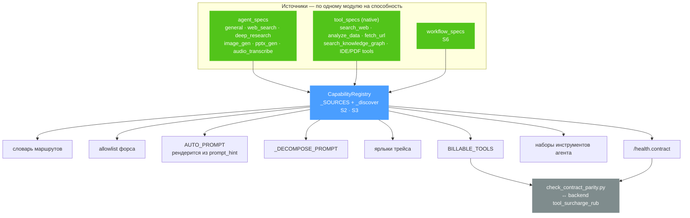
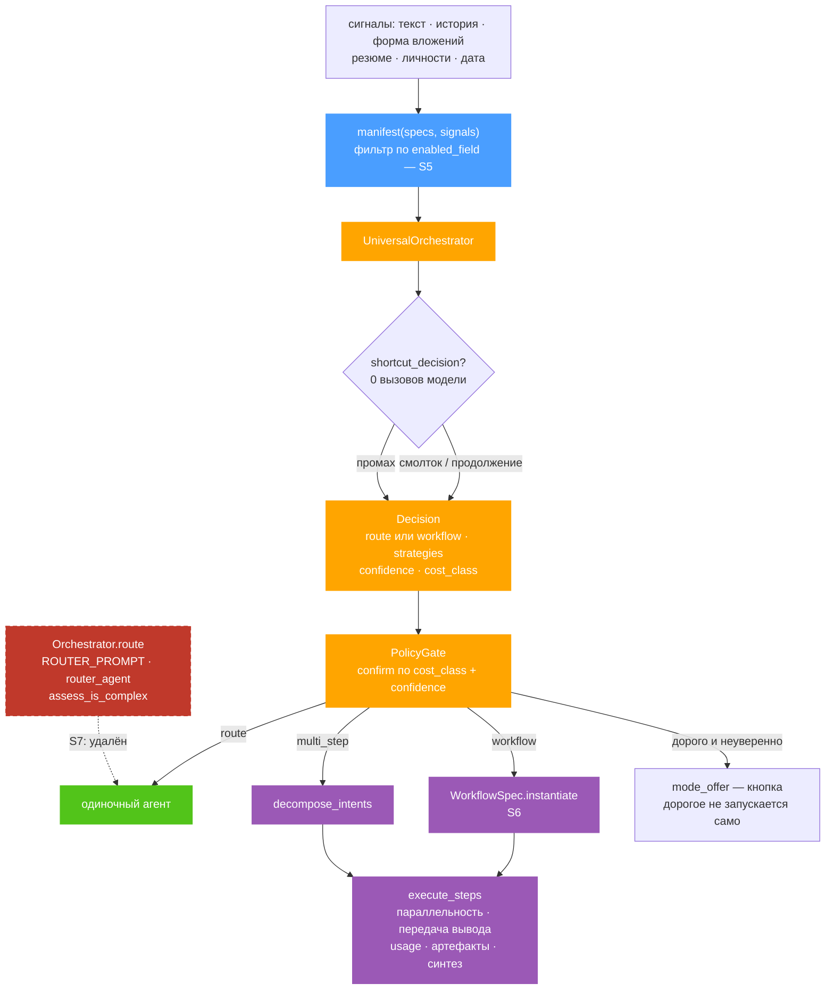
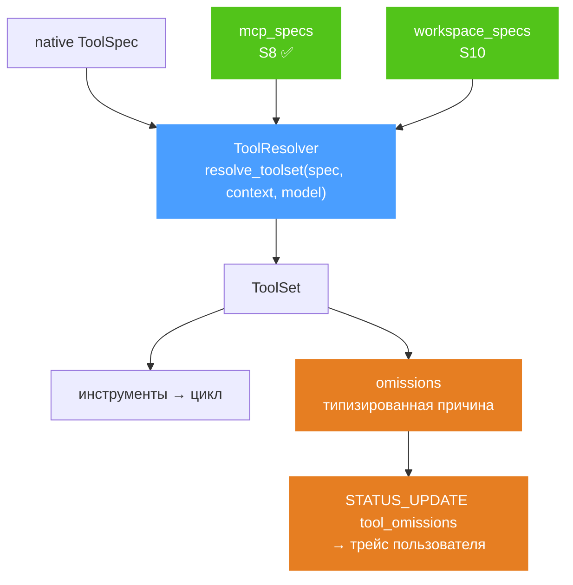
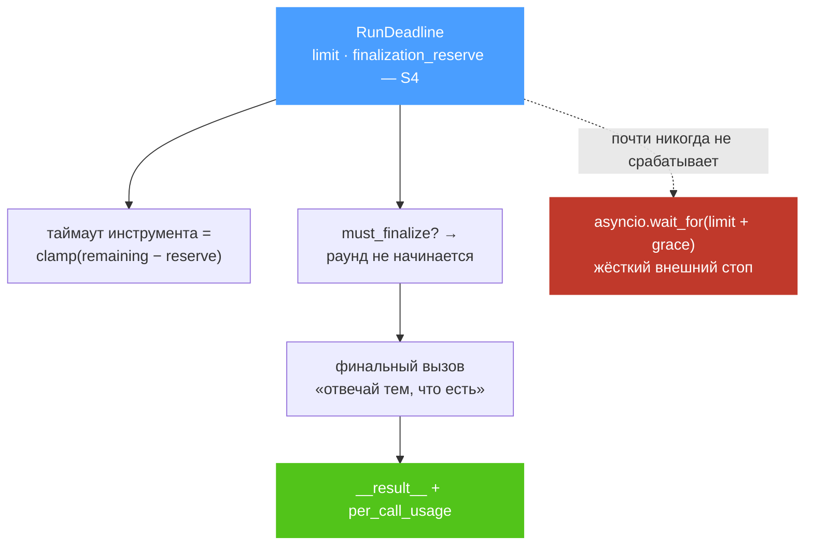
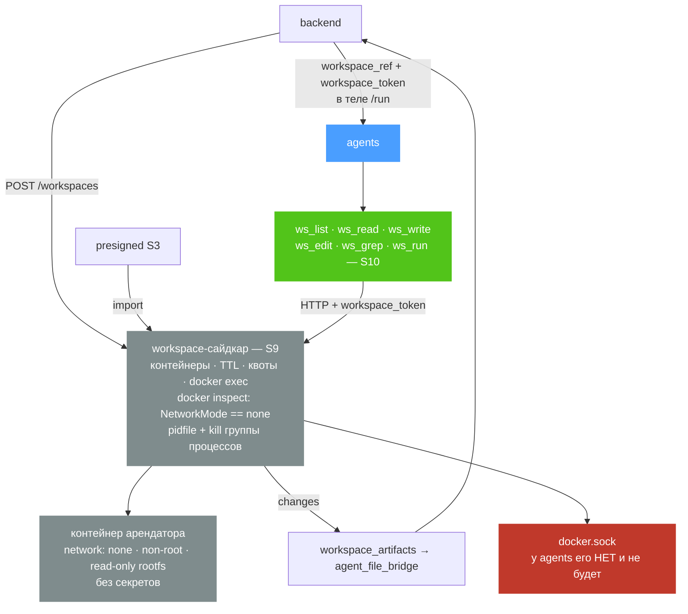

# Агентский слой: целевое устройство

### Пауза24.10 перед публикацией

По просьбе владельца новые доработки/полные прогоны остановлены, идёт бамп/коммит/push.
Последний дополнительный precontract-question repeat RED: blocked_requests до answer,
не объяснён. Новый sealed-question corpus3/3 green не подменяет этот результат.
Последние изменения question/local-gate ещё не обновлялись в dev. Подробная передача
состояния: [приёмка](../../docs/HARNESS_LIVE_ACCEPTANCE.md).

### Срез24.10: human-question не сохраняет устаревшее evidence

Пользовательская запись инвалидирует sealed-task и во время ожидания вопроса:
backend учитывает pending-вопрос и accepted child до завершения, проверяя scope.
Завершённая история/чужая identity/истёкший непринятый вопрос не меняются. Real-services
GigaChat/RouterAI/OpenAI3 passed/221,21с: тот же контракт/provider, rounds2→4, свежий read,
сохранённая пользовательская правка, receipts и parent/child settlement. Replay/restart
не добавляет эффектов/расхода; model HTTP — единственная подмена.

Human-question допущен и для local при прежнем обязательном серверном флаге/target.
Это совместимость исполнения, не подтверждение качества решений реальной LFM.
Подробности: [приёмка](../../docs/HARNESS_LIVE_ACCEPTANCE.md). Новых API/миграций нет.

### Срез24.10: актуальная версия чтения и авторитетная финализация

Backend-owned private admission включает workspace_id: пользовательская запись
инвалидирует чтение даже у analysis-task без command operation. Legacy continuation
получает проверенную привязку, но не актуализирует задним числом прежнее evidence.
Перед первым принятым terminal backend проецирует текущие критерии/receipts; при
понижении completed текст успеха скрывается без изменения canonical terminal/usage.
Уже принятый terminal не переоценивается; task_result v1 читается совместимо.
Private manifests синхронизированы, схема048 и публичный transport terminal прежние.

Real-services пользовательская правка на барьере после read:3 passed/183,71с,
GigaChat/RouterAI/OpenAI, только model HTTP double. Partial/blocked, сохранённая правка,
один settlement, без новых эффектов после replay/restart. Полная LFM/PDF автономность
не подтверждена: новые CPU split admission-профили4/6 проваливают обе неоднозначные
цели и не приняты. Подробности: [приёмка](../../docs/HARNESS_LIVE_ACCEPTANCE.md).

Свежий полный gate среза: agents4341/26 skipped, backend5004/213 skipped,
coverage80,69%, MyPy622; Ruff/format/complexity и shared/privacy gates passed.
Правка во время parked human-question и повторное evidence child continuation
выделены следующей проверкой; активный read-barrier этого сценария не заменяет.

Срез выложен только в разрешённые3процесса GPTHub dev15:10 МСК: health/API200,
local/free/ready, прежние13PROCESSING неизменны, очередь пуста, схема048 без миграций.

### Продолжение 24.10: контракт чтения и проверяемые уроки

Незакрытое чтение sealed IDE analysis-контракта теперь включает существующий grounding
независимо от auto-маршрута. Report/question не заменяют обязательный read; policy-denied
инструменты не возвращаются. Backend сохраняет проверенное read evidence атомарно с
receipt, не меняя версию исходников и не актуализируя устаревший receipt.

До чтения уроков фиксируется выбранный provider/model существующим пустым checkpoint.
Refinement подтверждается только bound model grant с фактически переданной рекомендацией;
повторное использование требует конечный валидный completed/verified v2, а не SUCCESS
транспорта. Схемы/полномочия/usage ownership не менялись.

Свежий двухзадачный real-services корпус с model HTTP double: 1 passed/64,64с.
Второй запуск использует урок без нового refinement; replay/restart worker не меняют
операции и два settlement. Исправления чтения: 54 agents и 76 backend адресных тестов
passed; ранний 500 до admission остаётся неисследованным. Свежий полный gate:
agents4339/26 skipped, backend4978/209 skipped, coverage80,62%, MyPy630,
Ruff/format/complexity/shared parity passed. По явному разрешению обновлены только
backend/agents/agent-worker dev. 13 PROCESSING неизменны, очередь пуста; production
и другие проекты не перезапускались. Исправлен env forward alias без ротации секрета:
настоящие dev API/browser393/1440px подтвердили local/free/ready и правильный picker.
Подробные факты и исторические RED: [план Harness²](../../docs/HARNESS2_LOCAL_MODEL_PLAN.md).
Полная composition и автономность CPU LFM не приняты.

### Завершающее дополнение24.10

Итоговый offline gate:4322 passed/26 skipped; Ruff/format/complexity passed из
каталога agents, baseline не увеличен. Backend4947 passed, coverage80,58%, MyPy629.

Repair note входит в атомарный checkpoint результатов; старое продолжение не теряет
replay оплаченного ответа. Progress guard сравнивает criterion_id/recipe, а не
необязательные wire-поля. Публикация IDE отделена от транспорта, complexity проходит
прежний порог30; checker запрещает пустой/неверный root, baseline не увеличен.
Сервисные repair/16-round6 passed/350,32с, skipped-report1/52,79с;
restart/Stop/settlement5 passed/427,29с. Модельный HTTP подменён, платный повтор не шёл.
Согласованные env-флаги IDE/PDF/commands ON, старые OFF ниже — история. Refinement
остаётся отдельным экспериментальным OFF. CPU admission optional0/6 и enum1/6 не
приняты; автономность LFM/PDF auto-apply и rollout основных процессов ещё открыты.

### Текущий срез24.10: проверка → исправление, не преждевременный отчёт

Реальная разрешённая GigaChat-3-Lightning проба завершилась blocked: лишний перевод
строки в stdout, один файл/одна команда,0 repairs;263 кредита учтены один раз.
Модель ошибочно заявила об успешной проверке. Платный повтор не выполнялся.

`runners/ide/repair` использует только доверенные command receipts и уже разрешённые
policy инструменты. Подсказка сохраняется в приватном transcript по operation ID;
named read совместим с GigaChat, RouterAI и OpenAI. До повторной проверки finish
не предлагается, но ask-user остаётся доступным в пределах исходных полномочий.
Реальные repairs считает backend; раунды, Stop, held cost и fencing не обходятся.
Текст durable IDE change публикуется только через серверную проверку completed,
не по самооценке модели. При отсутствии отчёта возможен безопасный детерминированный
итог из тех же receipts, без дополнительного LLM-критика. Чат/анализ/PDF не менялись.

Промежуточный real-services/model-HTTP-double корпус3 passed/169,15с; первая попытка
обнаружила GigaChat required incompatibility, исправленную named read. Полный agents
gate4301 passed/26 skipped; контрастный double проверяет каждый шаг repair отдельно.
Окончательный усиленный сервисный корпус:9 passed/446,87с, по3 сценария для каждого
адаптера — обычное исполнение, repair, пропущенный отчёт. Реальный paid-сценарий
не объявляется зелёным. Основные процессы dev и production не обновлялись.

### Исчерпанное восстановление:24.10, подтверждение worker-пути

Backend завершает исчерпанный транспортный retry из доверенных grant receipts,
используя существующий prepared checkpoint и settlement. Нет нового executor,
новой финансовой подсистемы или разрешения повторить инструмент. Сохраняются
исходные receipt IDs, fencing, подтверждённые критерии и blocked; unknown cost/effect
не освобождаются. Паузы3/9/27с зависят от durable счётчика, максимум3 повтора прежний.
122 адресных backend-проверки и настоящая dev-проба1 passed/108,17с подтвердили
одну запись,0 команд, один settlement и неизменность при повторной доставке.
Модельный транспорт и управляемый сетевой отказ приёмочные; production не затронут.
Обычный restart всё ещё нестабилен до write-boundary при нагрузке, общая приёмка
не объявляется зелёной. Старые проблемные fixtures сохранены без автоматического Stop.

### Локальный провайдер и итоговый offline-срез24.10

Локальный CPU runtime — самостоятельный подмодуль `local_llm`; agent loop и
полномочия остаются у agents/backend/workspace. Статусы используют прежний cache,
key generation, admin policy и breaker, без отдельного платного probe из UI.
Бесплатный ID не может перейти облачному провайдеру даже при совпадении имени:
проверяются inventory, квалификация и frozen admission. Нулевая цена/нулевой резерв
проходят тот же grant/receipt/journal; платные вызовы и инструменты не обнуляются.
Wire-contract синхронизирован, бюджет0 не увеличивает лимиты и не выдаёт новых прав.

Полный agents-прогон:4243 passed/26 skipped; исправлены устаревшие test doubles
после разбиения stream_state/prompt budget и русская инструкция structural tool.
Ruff/format/complexity прошли без ослабления baseline. Backend4926 passed и80,58%
coverage, workspace1314 passed. Это offline gate, а не доказательство новой
автономности LFM: её сквозной IDE-сценарий пока blocked до эффектов. Текущие live
свидетельства и оставшиеся границы см. в документах суперпроекта; ранние числа ниже
сохраняются историей.

### Уточнение текущего состояния24.10: инструменты, чтение и PDF continuation

Закрытый список адаптеров вынесен в capabilities/tools/harness: его используют
выдача и dispatch. Права берутся из пересечения admission с запечатанным контрактом;
analysis не получает write/exec только потому, что их допускал исходный envelope.
Неподдержанные legacy/MCP-операции не предлагаются в durable IDE/PDF; обычный чат
сохранён.9 адресных offline-регрессий прошли.

Read evidence больше не возникает из усечённого исходника или дерева. Whole-флаг
принадлежит адаптеру, tree observations приватны и ограничены; запись/команда их
инвалидирует. Две регрессии воспроизвели старый ложный успех,51 адресная IDE/read
проверка прошла после исправления. Сжатое/частичное содержимое не становится proof.

Backend сохраняет root document scope до платных шагов и проверяет target критерия.
Worker admission продолжения перечитывает scope и сверяет generation/версию/digest/
block IDs. Реальный сервисный PDF-корпус с model HTTP double и потерей двух committed
ACK прошёл1 passed/74,65с: один proposal, один stable build,3 страницы версии3;
продолжение после пользовательского apply блокируется без смены counters/usage.
Это ручной UI apply и проверка worker admission, не полный Celery/auto-apply/audit.
PDF auto-apply, полная Harness² composition и автономность IDE локальной LFM ещё
не приняты; нижеследующие ранние числа оставлены историей, не итоговым release gate.

### PDF structural review и trusted evidence24.10

Добавлен совместимый negotiated v2: атомарные replace/delete/insert/move,
32 операции, base version и выделение, new_* IDs. Разделены semantic/structure,
tools/documents и portable block_patch/document_review; схемы компилируются для
GigaChat, RouterAI, native OpenAI и local без расширения прав. Предложение не меняет
исходники и не подтверждает готовый документ. Отдельный helper восстанавливает ACK
чтением стабильного ID; неизвестность сохраняется в общем guard/journal и удерживает
стоимость. Replay доверенного receipt восстанавливает review reference без исполнения.

Backend не принимает PDF-evidence от proposal/adapter и новую source_revision из
checkpoint. PG-проба1 passed/8,01с, agents document/harness607 passed/19 skipped.
Существующий frontend показывает структурное сравнение; Chromium/WebKit по3 ширины
прошли с API/WS double. Это не auto-apply/build/audit и не сквозная готовность LFM.
Следующим остаётся адресуемая сборка с сохранённым намерением до compiler create,
затем безопасное применение и только executor-owned подтверждение актуального PDF.

Продолжение: optional operation_id уже связывает immutable build intent, manifest и
compiler ID; повтор наблюдает прежнюю сборку, неизвестный ранний create блокируется.
Настоящий сервисный корпус1 passed/71,28с получил PDF из3 страниц актуальной version3
после structural review и отдельного UI apply; renderer/compiler не подменены.
Это ещё не автономный PDF task/worker и не финальная визуальная проверка.
Новые private journals исключены из Git snapshot, исторические blobs не стираются.
Admission criteria получили отдельный application/harness/criteria; backend sealing —
admission/sealing. Неверный вид критериев получает contract error, не checkpoint outage.

### Точность admission24.10

Схема submit_task_contract синхронизирована с существующими DTO-ограничениями:
pattern идентификатора,1–62 критерия, длина target. Несогласованный вопрос получает
закрытую русскую причину для прежней единственной protocol repair; пустой question
при needs_clarification=true не доходит до park. Validation input не попадает в
диагностику. Адресный корпус239 passed, complexity baseline не изменён.

Реальная LFM в read-only корпусе пока не извлекает надёжно даже три синтетических
IDE-контракта; короткий вариант инструкции и одна repair не решили проблему.
Ни принудительного false, ни подмены модели, ни принятия этого candidate нет.
Её автономность не принята; транспорт16 циклов остаётся отдельным свидетельством.

### Закрытая граница управления24.10

Проверка collaboration pause/Stop больше не работает fail-open: IDE/PDF разрешают
только пустой служебный boundary-запрос с приватной capability, неизвестный ответ
или transport failure останавливают цикл с checkpoint_unavailable, не с выдуманной
отменой пользователя. Контроль выполняется до модельного вызова, перед инструментами
и перед продолжением сохранённого tool round. Авторитетный workspace_ref берётся из
RunExecutionContext, не из prompt-safe контекста. Резерв финального ответа сохранён.
Исправлен также frozen Exception: contextlib больше не подменяет типизированный отказ
на TypeError при смене traceback. Две красные регрессии подтвердили причину.

Адресно:15 boundary-регрессий и74 integration/tool tests прошли. Реальные сервисы с
model HTTP double: Stop между retry intent/delivery1 passed /68,06с; длинный16-round
IDE1 passed /55,40с. Это не новый PDF apply/build или полный итоговый gate.
Допуск IDE-отчёта отделён от исполнения; pause/Stop проверяется также до и после
его repair-вызова.17 адресных тестов и сервисная проба1 passed /46,74с прошли.

PDF proposal validation выделен в semantic/review: вместо немого invalid модель
получает закрытую причину и русскую подсказку, без документа/capabilities в ошибке.
Неверная версия, неизвестный ID и выход за выделение различаются; недоступный draft
не предлагает слепой повтор. Общий цикл исправляет неверный ID и сохраняет ровно
одно предложение. Документный corpus354 passed/19 opt-in skipped; auto-apply и новый
артефакт этим не подтверждены.

### Длинный цикл и информационные окна24.10

Пройдена настоящая многомодульная IDE-задача на16 раундов для трёх provider adapters
(только model HTTP double). Двойной legacy prompt guard больше не подменяет денежный
admission sealed-задач: конечная клиентская граница выводится из admission, серверные
credits/calls/deadline не повышались. Чат без durable state сохраняет40k-настройку.
Исправлено окно pre-seal:2 contract calls на backend-owned job; human answer даёт
новую информацию, не новый бюджет. Retry того же job не сбрасывает счётчик, planning
meta не расходует contract repairs. Private journal metadata не меняет wire digest.
Это подтверждено PG и HTTP-answer/outbox/worker с проверкой однократного расхода.
Адресно: agents208 passed, backend305 passed/67 opt-in skipped. Полный gate и весь
исходный scope, включая LFM autonomy и PDF apply/build/audit, не завершены.

### Приёмка ограниченной адаптации24.10

Refine прошёл через настоящий worker/backend/PostgreSQL/agents/workspace с подменой
только model HTTP: новый intent, реальные запись/snapshot/команда, evidence, принятие
backend и один settlement. Redelivery и delivery после перезапуска worker не изменили
digest/баланс/команды. Отдельно пройдена provider parity GigaChat/RouterAI/OpenAI.
Это не приёмка реальных внешних LLM или автономности LFM. Исправлен также пропущенный
IDE-отчёт: новый paid slot/checkpoint и общие protocol/round limits. Адресный corpus204
passed; его service probes прошли для GigaChat/RouterAI/OpenAI. Остальные цели и полный
gate открыты. После известной ошибки test oracle удалена только собственная разрешённая
fixture со snapshot/runtime; резервная копия одноразовой fixture не создавалась,
сам сценарий воспроизводит новые данные. Чужие/пользовательские данные не удалялись.

### Новая цель24.10: Harness² и локальный CPU-провайдер

Исследуется Google Harness² (`1cfe254e8d25b15f37048c3730134686abe60335`): отдельные
task-level Propose→Probe→Compose и накопление принятой конфигурации с подтверждёнными
уроками. В GPTHub это должно работать внутри существующих прав/бюджета/checkpoints,
не переписывая backend guards или подтверждения результата. Первый срез подключён
под OFF-флагом: одна рекомендация при missing_call, обычный repair как probe,
приватный candidate в checkpoint, принятие backend после новых receipts/evidence и
completed. Принятые уроки переиспользуются только в том же owner/project/generation/
surface/provider/model; prompt не становится полномочием. Реальная LFM выдала
валидную русскую рекомендацию; PG-проверка принятия и scope прошла. Общая интеграция,
измеренная польза, произвольная композиция инструментов и мутационные пробы ещё открыты.

Повторное использование в первом профиле требует также точного совпадения цели и вида
задачи; один урок добавляется как рекомендация, а не system authority. Proposal имеет
стабильный operation ID на задание, включая смену step; изменившийся запрос безопасно
блокируется, а не оплачивается повторно. Последние адресные проверки: harness-prefix
agents157 passed, backend65 passed с двумя PG-пробами. Реальный IDE hello-world с LFM
пока blocked до seal из-за лишнего вопроса об исполнении — автономность не принята.

Новый ProviderSpec `local` использует общий runtime, каталог, admission и usage.
Отдельный LFM2.5-1.2B CPU-сайдкар запущен на dev без обновления остальных процессов.
Native corpus выявил отказ на третьем раунде. После введения проверяемого JSON transport
реальная модель прошла auto/required/named: по16 циклов с непрогнозируемыми tool results.
Required/forced вновь объявлены после проверки. Это доказательство транспорта, не готовый
локальный автономный IDE/PDF-агент. Восстановление теперь сохраняет finish_reason и
монотонный length counter; repair/continuation занимают новый paid slot. Адресные
agents84/backend50/local37 тестов и отдельная PostgreSQL-проба прошли. Полный gate,
рабочие serving-процессы и новая worker/IDE/PDF-приёмка остаются открытыми.
План, ограничения и live/offline доказательства:
[HARNESS2_LOCAL_MODEL_PLAN.md](../../docs/HARNESS2_LOCAL_MODEL_PLAN.md).

Куда идём и зачем. Текущее состояние — в [architecture-current.md](architecture-current.md);
читать имеет смысл подряд, потому что каждый узел здесь удаляет конкретную боль оттуда.

**Задача не «сделать красивее», а снизить стоимость расширения.** До реестра добавление субагента
трогало 13-14 файлов, и пропуск любого деградировал молча. Провайдер при этом добавляется двумя
файлами, потому что всё выводится из `ProviderSpec` и это держит тест, объявляющий фиктивного
провайдера целиком внутри себя. Целевая схема — распространение ровно этого приёма на агентов,
инструменты и workflow.

S1–S25 здесь считаются поставленным baseline. Открытая цель S26 — не новая способность, а
production-конвергенция: единый ledger, полная offline parity, квалификация моделей, безопасный
transport и доказанный browser/live contract.

### Восстановление и Stop: обновление 23.10.2026

Дополнение по продолжению ядра: backend cancellation recovery теперь вызывает ту
же сверку локальных надбавок по committed executor receipts, что обычное recovery
и settlement. Потерянный ACK надбавки не блокирует известный расход, если совпадают
operation ID, digest и явное подтверждение стоимости. Неизвестный model usage или
receipt без такого подтверждения остаются `blocked`; новые dispatch не разрешаются.
Две исходно красные регрессии исправлены; адресный offline corpus95 passed.
Свежая live-приёмка этого дополнения и полный gate ещё не выполнены из-за нехватки
RAM; прежние live-свидетельства ниже относятся к предшествующему срезу.

Продолжается прежний общий цикл; второй executor или журнал не создаются. Backend
восстанавливает usage отменённой попытки из долговечных grant receipts. Отсутствие
текущего usage-журнала не разрешает legacy refund или вывод о нулевом расходе.
Нулевая отмена требует доказанного отсутствия платного dispatch во всём задании;
неизвестный расход остаётся удержанным. До фиксации контракта Stop отмечает сам
контракт непроверенным, не создавая фиктивных критериев.

Два новых настоящих worker-сценария прошли отдельно: Stop между committed retry
и доставкой (без новых эффектов/вызовов и двойного settlement), а также Stop до
первого платного dispatch (ноль списаний, replay неизменен). Итоговый последовательный
live-корпус — 5/5, включая восстановление, активную команду/cleanup и expiry-trigger.
Полный offline gate: backend4777, agents4011, workspace1278 passed; Ruff/format,
MyPy backend, complexity и межсервисные manifest/parity/privacy-проверки прошли.
Skipped не засчитываются как live-приёмка. Подробные результаты и сохранённые
неуспешные fixtures — в [HARNESS_LIVE_ACCEPTANCE.md](../../docs/HARNESS_LIVE_ACCEPTANCE.md).

Порядок следующих поставок не меняется: оставшиеся browser-регрессии → зависимости
из lock-файлов → PDF structural apply/build/audit и актуальный preview. Согласованные
ON-флаги сохраняются, production не изменяется. Ниже сохранена история этапов;
прежние указания OFF не заменяют более позднее решение владельца о флагах.

### Self-harness: история реализации и оставшейся работы, 20.10.2026

Обновление21.10: Docker/dev восстановлены,047 уже присутствует; runtime/workspace
пересобраны. Реальные driver и расширенные PG проверки обнаружили и закрыли null
Engine ExitCode и неопределённость после подтверждённого отказа recipe admission.
GigaChat ordinary-worker preflight и once-only redelivery проверены отдельно.
Это частичная приёмка, не закрытый self-harness: полный трёхсервисный/crash/browser
корпус и dev rollout остаются открытыми. Актуальные команды/границы — в
[HARNESS_LIVE_ACCEPTANCE.md](../../docs/HARNESS_LIVE_ACCEPTANCE.md).

#### IDE-команды: executor в исходниках; приёмка и включение остаются открытыми

Следующий подсрез уже реализует create/READY/GO/inspect/Stop в существующем driver,
agent-entry console, snapshot pins, immutable recipes, server-owned versioned evidence
и вывод receipts в прежней фиксированной консоли. Добавлена047, не изменяя046.
Подробная карта модулей, выполненные offline-проверки и ограничения — в начале
`architecture-current.md`. Наличие этих исходников не означает успешной live-приёмки.

Осталось до включения:

1. Восстановить Docker/ресурсы Windows; собрать read-only runtime, применить047 только
   на dev и обновить нужные сервисы. Не отменять прежние PROCESSING автоматически.
2. Пройти настоящий backend/agents/workspace корпус с подменой только model transport:
   hello-world/stdout, fail→repair→pass, ACK-loss, повтор доставки, handoff/attempt race,
   Stop и detached descendants/PID reuse, SIGKILL/restarts, missing/truncated output,
   snapshot failure, revision conflict и сохранность dirty buffer.
3. Подтвердить фактическую SQL invalidation/verification и once-only settlement на047,
   затем browser/a11y/build и единый последовательный полный gate. Пока Docker не
   отвечает, а RAM ограничена, эти пункты остаются открытыми, не «пройдены offline».
4. Только после приёмки проверить незавершённые задания и включать command flag на dev.
   Новые dispatch OFF по умолчанию; status/Stop/reconciliation не зависят от включения.

Ниже — историческая foundation-поставка046, не описание отсутствия нового executor.

046 расширяет прежний operation journal: закрытый command intent, fenced admission,
идентичность exec, snapshot pin и терминальные receipts. PostgreSQL mutation gate
используется существующей координацией, сохранением файлов/Git и restore; read-only
capture больше не освобождает Git/history mutations от проверки. Retention и orphan
cleanup исключают pinned snapshots. Unknown держит gate до подтверждённой cleanup;
повторная доставка не возвращает команду к dispatch. Backend terminal receipt не
равен evidence успешной проверки: произвольный exit0 не закрывает критерии задачи.

Подтверждены13 PG command-journal сценариев, runtime8 и restore23 на временных базах,
без команд/оплаченных моделей. Dev уже на046, командный флаг остаётся OFF. Полный
backend gate не завершился из-за MemoryError Windows на collection; адресные проверки
зелёные. Точные границы source/offline/live — в начале `architecture-current.md`.

Исторический порядок следующего подсреза (теперь реализован в исходниках; live открыт):

1. Добавить в существующий Docker driver адресуемые create/start/inspect. До запуска
   сохранить Engine exec ID и canonical intent в backend; не использовать общий PGID
   или доверять данным из project/tmp. Supervisor/Stop должны подтверждать cleanup
   потомков; отсутствие подтверждения сохраняет gate, не удаляет контейнер.
2. Подключить task-bound agent-entry к IdeConsoleService и private harness protocol:
   capability/Stop/budget/revision recheck, pin подтверждённого blob и metadata, bounded
   timeout по workspace/task policy. Не держать operation lock весь процесс.
3. Подключить registry execute/status и deterministic Python/unittest/pytest verification
   с сохранённым рецептом и versioned evidence; два repair cycles в общем16-round budget.
   Обычная команда остаётся отличной от проверки. Runtime/dependency missing — blocked.
4. Подключить безопасные command stages/results к существующим фиксированным панелям,
   не заменять несохранённый буфер; затем реальный backend/agents/workspace корпус
   hello-world/failing-test/ACK-loss/Stop/SIGKILL и один итоговый gate. Только потом dev
   command flag; до этого новая колонка/DTO не означает доступного агенту exec.

#### Предыдущий срез: удержание обязательств и frozen-owner resume

Billing использует прежний `token_reservations`, а не второй денежный журнал.
Аддитивная045 (`045_harness_holds`) добавляет nullable `harness_task_id`: admission и
human-question handoff удерживают принадлежащий пользователю активный резерв в своей
транзакции. Истечение TTL и generic release не освобождают этот резерв и не исключают
его из суммы занятого баланса. Подтверждённое списание закрывает его существующим
идемпотентным settlement. Retention не продлевает право dispatch: `_funds` по-прежнему
проверяет срок и дополнительно принадлежность резерва задаче. Downgrade запрещён при
незакрытых retained holds. До запуска обновлённого backend требуется миграция045:
новые billing SQL используют её колонку даже при выключенных autonomy flags.

Continuation сохраняет `agent_name`; после рестарта processor пропускает routing,
planning и сборку контекста, продолжая frozen transcript тем же исполнителем.
Checkpoint не позволяет заменить/удалить записанного исполнителя. Старый checkpoint
без owner или недоступный исполнитель дают `provider_state_incompatible`, а не
fallback на general. Human-question handoff запрещён при dispatched/unknown paid call.
Обычный чат без harness сохраняет прежние пути. Frozen outer workflow continuation
по-прежнему не реализован: смена исполнителя не обходится новым routing.

После поднятия dev пользователем схема проверена на045; повторный upgrade не выполнялся.
IDE/PDF flags остаются OFF. В настоящем PostgreSQL на одноразовых базах пройдены journal
корпус и runtime043–045: admission/seal, конкурентное восстановление local tool fee,
TTL/release retention, expiry dispatch gate, once-only закрытие hold, human-question
handoff с сохранением criteria/provider/rounds/repairs и fencing старого job, Stop и
удержание неизвестной стоимости после Stop/TTL. Базы удалены. Это backend/PG приёмка,
не трёхсервисный E2E, не SIGKILL и не фактическое исполнение команды или списание денег.
Live-прогон обнаружил и устранил ошибку asyncpg UUID/text binding в admission/owner/handoff;
одних offline-проверок SQL и codecs было недостаточно.

`EffectResult.charged` — приватный факт typed adapter. При потере ACK тарификации после
committed effect receipt backend под task lock сверяет task/operation IDs, канонический
intent digest и исходный local grant, затем восстанавливает только succeeded/waived fee.
Инструмент не повторяется, reserve и billing event здесь не меняются. Legacy receipt без
charge disposition и неизвестный provider spend остаются заблокированными. Recovery,
handoff и settlement используют один helper; модель не назначает свой billing outcome.

Не реализованы этим срезом: reconciliation фактических workspace/provider эффектов,
agent console, подготовка зависимостей и PDF auto-apply/build. Платные provider-прогоны
и полный backend/agents/workspace restart/SIGKILL корпус остаются отдельной приёмкой.

Итоговый source gate: agents3797 passed/25 skipped, backend4452 passed/135 skipped
без integration, coverage80,17%; Ruff/format/complexity, MyPy572 и protocol/shared/privacy
checks зелёные. Отдельные2 PG probes прошли; их базы удалены. Running backend/worker/agents
не перезапускались: это ещё не rollout исправлений в их уже загруженные модули.

#### Организация модулей

Следующий in-module срез отделил backend worker pricing policy в `billing/quote.py`:
typed quote/input и узкий RequestPricing collaborator не имеют settlement authority.
Legacy orchestrator сохраняет release/debit/idempotency/committed-spend порядок, frozen
harness settlement остаётся отдельным первым branch. Floor при missing usage, strict
pricing failure, selected-model ceiling и actual raw cost/surcharge semantics сохранены.
Проверки: backend4299 passed/21 skipped без integration/live, coverage79,87%, MyPy556;
66 targeted cases и4 compile-only probes, Ruff/format/complexity/contract/import/privacy
green. Это первый результат следующего общего refactoring goal, не завершение всего
in-module рефакторинга и не расширение автономных полномочий.

Второй in-module срез отделил staging сообщений, document outbox и terminal job state
в `results/persistence.py`. Новый компонент не владеет commit/publication; charge,
commit, post-commit delivery wakeup и публикация остаются видимыми в оркестраторе.
113 targeted cases включают failures на каждой границе записи/commit, continuation,
приватность outbox и compile-only recovery probe. MyPy557 и статические gates прошли.
Итоговый backend без integration:4379 passed/134 skipped, coverage79,98%, пороги прежние.
Изменения не включают стенды и не доказывают live recovery/автономное завершение задач.

Третий in-module срез отделил agents chat preparation от stream/terminal orchestration.
`chat/preparation.py` владеет восстановлением transcript, settings/round profile,
post-policy disclosure и typed PreparedChatRun; activation выполняется после выдачи
preparation events. Streaming/usage projection/terminal не переехали и не получили
второго владельца. IDE ceiling при activation использует explicit task owner даже при
смене ambient execution context.12 новых preparation cases и полный agents3769 passed/
25 skipped; Ruff/format/complexity и межсервисные gates прошли. Это offline refactoring,
не подтверждение live recovery, provider acceptance или полного IDE/PDF self-harness.

Четвёртый in-module срез собрал WS entry в `application/use_cases/ws_message/`.
Handler сохраняет identity/claim/job/dispatch/ACK ownership, admission — workspace
authority, options — чистую типизированную нормализацию и закрытые payload projections.
Continuation берётся из server anchor; unknown ACK не освобождает claim для повторного
платного запуска. Legacy fallback contract и protocol fields не расширялись. Это
дополнительный feature-пакет после280-module baseline, не новый execution/reservation path.
19 новых regression cases и полный backend без integration:4398 passed/134 skipped,
coverage80,00%, MyPy559, Ruff/format/complexity и protocol/import/privacy gates прошли.
Стенды и opt-in live/provider проверки не запускались; прежние acceptance пробелы остаются.

Пятый in-module срез отделил early route preparation в `processing/routing/`:
modality normalization, explicit source consent, auto-plan и confirmation boundary
возвращают типизированный private результат до downstream orchestration. Identity
execution/ledger/counters сохраняется; отдельного бюджета/провайдера/transport loop нет.
Processor/context/steps используют один call-time settings adapter без нового snapshot.
14 новых regression cases и полный agents3783 passed/25 skipped, Ruff/format/complexity
и межсервисные guards прошли. Публичный wire не расширялся; live harness acceptance
не запускалась. Следующий кандидат — оставшаяся worker result preparation и итоговый
аудит responsibility boundaries, а не дробление всех функций до произвольного размера.

Шестой in-module срез выделил `results/preparation.py`: canonical acceptance и display/
artifact preparation имеют типизированный private результат до settlement. Usage validation
и attempt fencing не ослаблены; restore не повторяет materialization effects. Question fence,
charge, turn staging/commit и final publication остаются в execution orchestrator, existing
checkpoint commits — в прежних hooks.14 новых regressions и121 focused cases прошли;
recovery fixture source inventory синхронизирован без её live запуска. Повторный аудит953
production modules обнаружил два небольших obsolete helpers; финальный cleanup удалил
их и перенёс проверку на реальный compaction path перед итоговой приёмкой рефакторинга.
Итог backend без integration:4412 passed/134 skipped, coverage80,02%, MyPy560;
Ruff/format/complexity и protocol/import/privacy guards прошли, пороги не менялись.

Итоговая offline-приёмка всего рефакторинга, а не только пакетного baseline: agents3789
passed/25 skipped; backend4412 passed/134 skipped, coverage80,02%, MyPy560; оба complexity
gate на прежних thresholds, contract/capability/profile/import/privacy gates и71 root guard
test прошли.953 production modules/203 relative imports без missing local module/static
package export; public dynamic facades подтверждены runtime contract tests. Все прямо
запрошенные flat prefix families перенесены; пять оставшихся backend groups сохранены
по предметной ответственности, без бессодержательных дополнительных уровней. Код закрыт
в рабочем дереве без commit/push. Запуск стендов запрещён пользователем и не выполнялся.
Это завершение refactoring scope, не свидетельство автономного завершения IDE/PDF задач
или прохождения restart/SIGKILL/Stop/live provider acceptance. Матрица подтверждений —
в [architecture-current.md](architecture-current.md).

Структурный рефакторинг завершён offline: package map с280 переносами в65 новых feature
пакетов и отдельно оформленным существующим cache находится в начале
[architecture-current.md](architecture-current.md).
Harness, client/provider internals, tools, semantic documents/evidence/skills, routing,
workflow declarations и worker subsystems больше не являются плоскими prefix families.
Backend IDE/PDF/question application, SQL journals и transports разделены; IDE/workspace
routes, setting declarations и memory helpers имеют свои пакеты.

Правила: init новых пакетов не создаёт runtime state; consumers импортируют конкретный
модуль, без новых compatibility shims. Existing public client/runners/documents facades
сохранены. Меняются imports, monkeypatch/dynamic paths, capability source lists, source
digests и CLI references. Повторение prefix само по себе не требует ещё одной папки в
уже цельной DDD-границе. Итоговый аудит закрыл Redis/jobs/file-service/core usage/state
и provider helpers: execution/usage и scanning выделены, уже цельные jobs/chat/files
и shared-provider adapter boundaries оставлены с явным обоснованием в текущей карте.

Итог проверен offline: agents3759 passed/25 skipped, backend4287 passed/21 skipped
без integration/live, coverage79,84% при67%; MyPy555. Ruff/format/complexity и contract/
protocol/shared-copy/profile/privacy gates green;226 privacy files,59 root guard tests.
Все280 адресов проверены, все66 package init не исполняют runtime. Local imports943
production modules проверены статически; последние16 AST без imports/docstrings совпали.
Legacy usage guards учитывают aliases/relative paths, исключения не расширены. AST без
imports/docstrings перенесённых файлов совпал37/37 до отдельной правки диагностики cache;
итоговое единственное отличие — bounded memory cache logging с прежним fallback.

В21 probe/fixture файле исправлены старые quoted package-child imports. Новый source-only
embedded-import/CLI recipe guard с explicit service owner встроен в CI/Makefile; он не исполняет
SQL/Docker/providers и не выдаёт static pass при отсутствующем checkout. История этапов
и прежние результаты сохранены в [PROJECT_TODO](../../docs/PROJECT_TODO.md).
Структурная цель закрыта, но не функциональная цель self-harness ниже. Стенды не запускались,
flags OFF; это не live/harness completion, migrations/deployment/paid acceptance не выполнялись.

#### Подключение runtime: исходники реализованы, сквозная приёмка открыта

Приватный HTTP transport и ACK reconciliation выделены в
`infrastructure/harness/{exchange,reconciliation}.py`. Backend даёт owner/attempt-fenced
read-only `operation_status`; это не право dispatch. Потерянный ACK grants/receipts или
checkpoint разрешается чтением только точного уже committed состояния. Отсутствующий
receipt, неизвестный эффект/расход и потерянный dispatch ACK не запускают повтор операции.
Это не reconciliation фактической записи по состоянию workspace или расхода у провайдера.

Последующая офлайн-структуризация backend устранила четыре оставшихся complexity
превышения без изменения порогов: agent settings и whitelist имеют отдельные модули,
буфер истории отделён от сбора контекста, WS workspace admission — от создания задания.
Исторический settings baseline погашен (allowed пуст). Dispatch повторно проверяет
unknown cost/effects, включая ранее prepared intents; выключение поверхности запрещает
новые dispatch и сохраняет receipts/checkpoints/result. IDE-адаптеры явно возвращают
типизированные outcomes; неописанный строковый эффект не считается успешным.

Предыдущий структурный срез: backend4201 passed/21 skipped с покрытием79,65% (без каталога
integration и live-файлов), отдельно7 новых recovery/fencing tests; agents2979 passed/
25 skipped. Backend Ruff/format/MyPy/complexity и agents Ruff/format/complexity green.
Приведённые числа относятся к offline acceptance, не к backend/agents/workspace E2E.

Следующий за foundation срез соединяет worker (`harness_admission`, `harness_recovery`),
приватный backend `/internal/harness/v1/exchange`, отдельный runtime repository и
agents `HarnessClient`. Аддитивная044 хранит admission, continuation, tariff, active job,
epoch и paid-call grants. Backend остаётся владельцем PostgreSQL; собственной БД sidecar нет.

В текущих исходниках контракт запечатывается backend до эффектов, grants выдаются до
provider/tool dispatch, receipts и checkpoints подтверждаются после commit. Продолжение
использует сохранённые transcript, provider binding, counters и известный usage; старый
attempt не должен публиковать итог после fencing. Worker использует существующий task-level
lease и BillingService settlement. Накопленная frozen-тарификация не начисляет minimum и
tool surcharge заново на каждый внутренний вызов. Неизвестный расход не заменяется floor.

TaskResult v2 теперь получает серверную completion projection; транспортный terminal и
settlement latch остаются отдельными механизмами. IDE command criterion обязателен для
изменений, но agent console ещё не подключён: такой результат пока blocked. Открытый PDF
остаётся proposal-only, без объявления старого артефакта результатом новой задачи.

Проверены отдельно offline client/protocol/pricing guards, worker compatibility, readback
после resume и компиляция PostgreSQL DDL044. Это **не** трёхсервисный E2E и не подтверждение
нулевых повторных эффектов при SIGKILL. Не завершены reconciliation всех unknown ACK,
долговечное удержание неизвестного расхода при reservation TTL, live source/generation
conflicts и полный admission/human-question/restart корпус. Потеря ACK сейчас безопасно
блокирует дальнейший dispatch, но не всегда разрешается автоматически.

На предыдущем этапе пользователь запрещал запуск стендов. Теперь dev поднят пользователем,
схема проверена на045; IDE/PDF flags остаются OFF до сквозной приёмки. SIGKILL и платные
provider-прогоны по-прежнему не выполнены.
Исторические foundation-проверки ниже относятся к прежнему срезу, не к runtime044.

S26 — исторический release contract, а не полный перечень сегодняшнего кода. После него
появились S27–S36 (workbench, provider admission/generations, semantic PDF authoring,
checkpoints и audits), IDE repository tools и human-question continuation. Наличие этих
компонентов не означает сквозной готовности автономной IDE/PDF; проверки и незакрытые
native/browser-сценарии ведутся отдельно в корневом `docs/PROJECT_TODO.md`.

Цель: **понять → выполнить → проверить → исправить → подтвердить результат** внутри
выбранного проекта, полномочий и бюджета. Автоматическое изменение собственного production
harness, внешняя публикация и снятие ценовых/permission gates в эту цель не входят.

Поставленный исходниками защитный срез:

- `tex_propose_patch` возвращает typed invalid/policy/integration/protocol outcomes;
  ошибка не удовлетворяет grounding и не разрешает tool surcharge.
- IDE/PDF, включая native OpenAI, исполняются через общий chat/tool kernel. SDK остаётся
  compatibility-путём обычного чата, не альтернативным циклом продуктовых задач.
- Лимит IDE — 16 tool-rounds; прочая файловая работа определяется metadata реестра, не
  префиксом имени. Deadline и prompt budget остаются независимыми более строгими лимитами.
- Run-scoped `TaskProgress` останавливает три эквивалентных вызова без прогресса; хранит
  только fingerprints аргументов/результатов, не выдаёт их в trace. Успех последующего
  исправленного вызова снимает соответствующий незакрытый отказ.
- Потерянный ACK записи блокирует дальнейшие мутации того же IDE-run. Stop повторно
  проверяется после ожидания semaphore/group lock, непосредственно перед invocation.
- Перед итогом IDE текущие байты подтверждённых файлов читаются и сверяются с digest;
  проверка ограничена временем, не повторяет записи и не доказывает исполнение кода.
- `task_result` v1 — **только отрицательная bounded projection**: partial/cancelled,
  закрытый blocker, число раундов/repair cycles, verified=false. Backend валидирует её
  перед сохранением. Это ещё не полный TaskContract и не сертификат завершённой задачи.
- Семь исходных нарушений complexity устранены выделением admission/context composition,
  route/chain execution, provider selection/lifecycle и transcript validation. Baseline
  и пороги не повышаются.

Следующий срез — TaskContract и backend-owned journal (реализован частично):

- Общий закрытый `shared/task_contract.py` в agents/backend: immutable TaskContract,
  TaskState, criterion/target/revision/operation evidence и CompletionVerifier. Чтение,
  запись, команда и PDF имеют разные критерии; expected digest при необходимости
  проверяется детерминированно. Старые версии, неизвестный расход/операция и незакрытый
  план не разрешают completed. RunExecutionContext умеет принять доверенное состояние
  и сохранить counters при повторном входе. На момент foundation worker его ещё не
  передавал; подключение реализовано последующим runtime-срезом выше.
- IDE ceiling16 теперь расходуется общим run-контекстом, включая вложенные входы в loop,
  а не выдаётся заново каждому вызову. Ошибка IDE-файла A не снимается успехом файла B;
  исправленный вызов для того же target может снять свой отказ.
- Аддитивная миграция backend043 добавляет PostgreSQL task checkpoints и operation intents/
  receipts. Отдельный HarnessRepository использует owner/thread/job/attempt fencing,
  row locks и CAS revisions. Контракт/evidence нельзя удалить или ослабить;
  provider binding/counters не сбрасываются. Неизвестный ACK сверяется чтением, повторный
  dispatch не разрешается; unknown effect блокирует новые мутации. При Stop разрешена
  запись receipt уже запущенной операции, но не новый dispatch/checkpoint.
- `task_result` v2 codec и backend persistence совместимы с v1; три manifest-копии и
  shared codec сверяются. V2 parser сам по себе **не подтверждает происхождение evidence**.
  Foundation-финализация сохраняла прежний отрицательный v1. Последующий runtime
  выше подключает серверную v2 projection; это не сквозной сертификат готовности.
- Проверена настоящая PostgreSQL в одноразовой базе: create/replay, чужой scope,
  concurrent dispatch, CAS и потеря commit ACK, обязательный reconciliation неизвестного
  эффекта, evidence только после receipt, Stop и upgrade/downgrade043. База удалена.
  Это проверка persistence, **не backend/agents/workspace E2E** и не SIGKILL acceptance.
- На момент foundation не были подключены ACK-протокол agents/backend, worker
  admission/rebind/resume и серверные grants. Последующий runtime выше соединяет
  эти исходники; live pricing/recovery acceptance по-прежнему не пройдена.
  Актуальность runtime generation и snapshot перед командой должен проверить будущий
  application executor: journal проверяет scope сохранённого контракта, не live allocation.
  Миграция043 на dev не применялась; autonomy flags не включались.

Оставшаяся последовательность (не объявлять выполненной по локальным unit tests):

1. **TaskContract и CompletionVerifier:** критерии исходной задачи, целевые файлы,
   фактические command/build receipts и связь проверок с версией исходников. Grounding
   успешного чтения и краткий finish-report не заменяют проверку всей задачи.
2. **Проверки IDE:** отдельное agent-разрешение к существующему console service, durable
   command intent/status, sandbox/resource limits; два ограниченных цикла исправления.
   Пока агентские команды не выданы, нельзя говорить, что код проверен исполнением.
3. **Автономный PDF:** versioned apply и структурные insert/delete/move; сборка выбранного
   проекта существующими authoring/build/audit-компонентами, актуальные артефакты,
   ограниченный source/visual repair. Сейчас открытый PDF по-прежнему review-only.
4. **Общий durable continuation:** подключить реализованный PostgreSQL journal к приватному
   ACK-протоколу, admission, live generation fencing и human-question rebind/resume;
   сохранять transcript/provider continuation без capabilities и секретов. Сохранить тот
   же settlement; sidecar без собственной БД. Наличие repository не доказывает resume.
5. **Общий денежный бюджет и контекст:** учитывать routing/synthesis/repair до каждого
   платного шага; сохранять цели и evidence anchors при compacting. Prompt-token ceiling
   сам по себе не является денежным лимитом всего задания.
6. **MCP и остальные адаптеры:** admin ∩ user ∩ task permissions; не повторять неизвестные
   внешние эффекты; общие deadlines/failure contracts без потери сетевого dialect.
7. **Выпуск:** отдельные IDE/PDF autonomy flags; deterministic сквозной backend/agents/
   workspace corpus с подменой только model transport, затем бюджетированная provider
   acceptance. Ноль ложных успехов, повторных эффектов и двойных списаний в critical corpus.

Готовность — проверенный пользовательский результат, а не количество инструментов или
зелёный health. Полная автономность этим защитным срезом ещё не достигнута.

---

## 1. Реестр способностей — центр тяжести

**Веер рёбер из `CapabilityRegistry` и есть весь аргумент схемы.** Сегодня каждое из этих восьми
мест — отдельный литеральный список, который правится руками; здесь все они выводятся из спеки.

🔴 **Промпт — это данные.** `AUTO_PROMPT` перестаёт быть константой и собирается из статичной
прозы плюс блока маршрутов, отрендеренного по `prompt_hint`. Правка пробела в промпте есть правка
поведения модели, поэтому рендер сверяется **побайтово** с золотым файлом, снятым с сегодняшних
констант: без этого рефакторинг молча пере-настроил бы модель.

⚠️ **Открытие — явным кортежем `_SOURCES`, а не `pkgutil`.** Детерминированный порядок импорта,
опечатка даёт красный тест вместо пропавшей способности, и список можно сверить с
`extra="forbid"`-настройками. Автооткрытие нужно плагин-хосту; у нас монорепозиторий.

**Гарантия** — `tests/test_new_agent_requires_one_place.py`: объявляет фиктивного агента целиком
внутри теста, регистрирует настоящим путём открытия и требует его появления во всех восьми
выводимых местах. Убрать агента из любого — тест краснеет.

---

## 2. Универсальный оркестратор

🔴 **Workflow и мульти-интент сходятся в ОДИН узел.** `execute_steps` уже умеет всё, что нужно
workflow-агенту: параллелит независимые шаги, передаёт вывод предыдущего следующему, пере-эмитит
`token_usage` и артефакты списком, рисует прогресс и синтезирует один ответ. Объявленный workflow —
это предзаданный `list[SubTask]` вместо LLM-декомпозиции, и в конвейер добавляется ~12 строк.
**Новой машинерии не строится**, и схема обязана это показывать. Страж: объявленный workflow и
декомпозиция с теми же шагами дают побайтово одинаковый поток событий.

⚠️ **Манифест фильтруется по `enabled_field`.** Выключенный админом агент модели не предлагается
вовсе — вместо того чтобы быть предложенным и затем упасть.

⚠️ **Дорогие рычаги остаются только два — `route` и `workflow`**, и оба проходят гейт. Свободный
выбор инструментов моделью отвергнут: контроль стоимости принадлежит политике, а не модели.

**Legacy удаляется по измерению, а не по решению.** Сначала телеметрия `legacy_route_used` на
каждом passthrough, затем снятие условий `_blocking_reason` по одному, каждое за своим флагом.
Когда счётчик падает до genuine `route_override` (это выбор человека, а не маршрутизация) —
удаление. Необратимый шаг делается последним.

---

## 3. Инструменты: один резолвер для трёх источников

🔴 **Отсев перестаёт быть молчаливым.** Сегодня инструмент без нужных данных просто исчезает из
списка, и снаружи это неотличимо от «модель решила им не пользоваться» — а модель тем временем
уверенно отвечает по памяти вместо того, чтобы поискать. Вводится закрытый словарь причин:

`missing_data · disabled_by_config · model_no_tool_support · catalog_unknown · not_in_tier ·
missing_credential · mcp_discovery_error · resource_blocked`

Различие `catalog_unknown` («мы не смогли выяснить») и `model_no_tool_support` («модель не умеет»)
сегодня доступно только по логу — существующий тест на молчаливую деградацию так и проверяет,
записи в логе, потому что другого следа нет. С типизированным отчётом он проверяет событие.

**Это же и есть точка слияния MCP и workspace**: обе новые группы инструментов регистрируются
обычными `ToolSpec` и наследуют гейт, лимиты, таймауты, биллинг и отчёт об отказах — без единой
своей строки на каждый из этих механизмов.

⚠️ **Лимит результата — per-tool, а не общий.** Сегодняшние 6000 символов остаются дефолтом, но
`ws_read` и канонические чтения MCP получают исключение: молча обрезанное чтение файла — это
неверное чтение, а не короткое.

---

## 4. Дедлайн: цикл, который успевает ответить

🔴 **Здесь закрывается потеря денег.** Сегодня по дедлайну уходит только `__error__`, а
накопленный `per_call_usage` отменяется вместе с задачей — прогон, сжёгший десятки тысяч токенов,
тарифицируется по мин-флору. Мягкий дедлайн возвращает **обычный** result-dict с пометкой
`deadline_exceeded`, а `wait_for` остаётся жёстким внешним стопом, который в норме не срабатывает.

⚠️ **Кламп нужен не ради аккуратности.** Один медленный `fetch_url` сегодня способен съесть весь
бюджет, оставшийся на то, чтобы вообще сформулировать ответ.

---

## 5. Workspace: агент работает с файлами

🔴 **Сайдкар `agents` не получает docker.sock ни при каких условиях.** Он исполняет управляемый
моделью поток управления и обслуживает всех арендаторов одним процессом; сокет в нём — это root на
хосте. Ровно поэтому у Уробороса, откуда взят приём, жизненный цикл контейнера живёт **вне**
runtime: тот только *использует* контейнер, а *создаёт* его внешний харнесс. Отсутствующее ребро
нарисовано намеренно — оно часть контракта.

🔴 **Токен владения обязателен.** Backend подписывает `HMAC(secret, workspace_id | user_id | exp)`,
workspace-сайдкар проверяет. Без него угаданный `workspace_id` — это доступ к чужой файловой
системе, а идентификаторы попадают в трейсы и логи.

🔴 **Изоляция проверяется, а не заявляется.** `docker inspect` подтверждает `NetworkMode == none`,
иначе сервис отказывается работать. Незаверенное заявление о песочнице однажды разойдётся с фактом,
и заметить это будет нечем.

⚠️ **Statelessness сохраняется.** Идентификатор — это состояние, и оно живёт там, где состояние уже
живёт: в PG у backend, на строке треда, в теле `/run` — ровно как `tabular_files` и `repo_graph_ids`
сегодня. Никакого workspace-состояния внутри `agents` не появляется, иначе ломается горизонтальное
масштабирование, ради которого контракт `/run` и такой большой.

⚠️ **`type: "none"` — полноценный режим.** Без выданного workspace инструменты отбираются с
причиной `resource_blocked`, то есть тесты и обычный чат идут прежним путём, а код агента один и
тот же. Отдельного «локального» исполнителя не будет: «без песочницы» обязано означать «инструментов
нет», а не «выполняем команды на хосте сайдкара».

⚠️ **Байты агент не трогает.** Файлы внутрь импортирует сам workspace-сайдкар по presigned-ссылке,
наружу отдаёт список изменений — тот же приём, что уже работает для табличных файлов.

---

## 6. MCP: чужие инструменты как свои ✅

**Отгружено (S8).** Клиент, не сервер. Инструменты внешних MCP-серверов превращаются в объекты формы `FunctionTool` и
регистрируются обычными `ToolSpec(source="mcp")` — дальше они неотличимы от родных.

⚠️ **Почему свой клиент, а не `agents.mcp` из SDK.** `Agent(mcp_servers=…)` исполняется только на
SDK-пути, а живой путь для всех четырёх рабочих провайдеров — `chat_run`. Получилась бы
способность, работающая в тестах и на нативном OpenAI, и больше нигде. Библиотека `mcp` при этом
уже стоит транзитивно — новой зависимости не требуется.

🔴 **URL сервера никогда не приходит из тела `/run`.** Это прямой SSRF во внутреннюю сеть, где
Postgres, Redis, MinIO, Qdrant и все сайдкары доступны без аутентификации по топологии, — из поля,
которым управляет пользователь. Серверы объявляет админка, тенанту приезжает **allowlist
идентификаторов**.

🔴 **Содержимое чужого сервера — данные, а не инструкции.** Имена, описания, текстовые поля схем и
результаты оборачиваются как недоверенный контент, иначе описание инструмента становится каналом
инъекции промпта.

⚠️ **Биллинг — ОДНА запись `mcp_tool`**, не по серверу и не по инструменту. Иначе каждый новый
сервер превращается в согласованный релиз двух репозиториев через парити-гейт.

⚠️ Потолки на число инструментов и байты схем обязательны: манифест одного разговорчивого сервера
иначе вытеснит из бюджета контекста файл пользователя. Их два: на сервер (`MAX_TOOLS_PER_SERVER`) и
на весь прогон (`MAX_TOOLS_TOTAL`) — второй не выводится из первого, пока серверов больше одного.

**Как это устроено по факту.** `infrastructure/mcp/`: `naming` (имя вида `mcp_<сервер>__<инструмент>`
— источник виден, столкновение с родным именем невозможно), `sanitize` (рамка недоверенного
источника и потолки), `server_ref` (объявлено админом ∩ разрешено тенанту ∩ включено — ПЕРЕСЕЧЕНИЕ,
любое «нет» означает «нет»), `adapter` (описание → `ToolSpec`), `transport` (JSON-RPC поверх
streamable-HTTP: `initialize` → `tools/list` → `tools/call`, разбор и JSON, и SSE), `runtime`
(набор одного прогона в ContextVar).

🔴 **Редиректы не ходим вовсе.** Проверка адреса делается на открытии сессии, и 3xx на внутренний
хост — классический способ её обойти. Отказ проще перепроверки каждого хопа и не оставляет щели
между ними. ⚠️ От DNS rebinding это не защищает: закрыть его на этом уровне нечем, и заявлять
обратное было бы хуже, чем не заявлять.

⚠️ **Сервер, который лёг, пропускается — прогон продолжается.** Инструмент, чей сервер умер уже
после выдачи модели, возвращает МОДЕЛИ текст «сервер не ответил, скажи об этом прямо», а не
исключение: ход не роняется, и выдумывать результат модели не предлагается.

⚠️ **Персонального разрешения пока не существует** — его негде задать (ни колонки в БД, ни экрана в
панели), поэтому backend шлёт идентификаторы всех серверов, включённых админом. Пересечение на
стороне сайдкара при этом не декоративно: как появится персональное право, сузить набор нужно будет
в одном месте — в `build_engine_env`.

---

## 7. Порядок

| # | Этап | Отгружается сам | Обратимо |
| --- | --- | --- | --- |
| S1 | `settings.py` → пакет | да | да |
| S2 | Реестр `AgentSpec` + генерируемые промпты | да | да |
| S3 | `ToolSpec` + отчёт об отказах + per-tool лимиты | да | да |
| S4 | `tool_loop.py` + `RunDeadline` + частичный результат | да | флагом `reserve=0` |
| S5 | Оркестратор на манифесте + телеметрия legacy | да | да |
| S6 | Workflow-агенты на `execute_steps` ✅ | да | да |
| S7 | Удаление legacy-роутера ✅ | да | **нет** |
| S8 | MCP-клиент ✅ | да | флагом на сервер |
| S9 | Сайдкар `workspace` | новый сервис | да |
| S10 | Workspace-инструменты | нужен backend | `type:"none"` |
| S11 | Прогрессивное раскрытие инструментов | да | да |
| S12 | MCP resilience, typed tool outcomes, catalog outbox | да | rollout mode |
| S13 | Safe in-flight/completed dedup + golden tool-loop | да | rollout mode |
| S14 | Full-run privacy/budget corpus | да | да |
| S15 | First-valid-result terminal latch | да | нет |
| S16 | Cross-service deterministic quality gate | да | да |
| S17 | Policy-first auto-mode, bounded rationale | да | нет |
| S18 | Durable atomic workspace | да | да |
| S19 | Coordination room, leases and fencing | да | да |
| S20–S22 | Work Hub and reliable intake | да | URL surface |
| S23 | Stateful provider/tool protocol and subagent runtime | да | provider policy |
| S24–S25 | Run context, ledger and grounding latch | да | deterministic scope |
| S26 | Production convergence and complete parity | release gate | нет |

**Извлечение предшествует добавлению.** Production-модули agents удерживаются в пределах
complexity gate; orchestration, provider protocol, tool runtime и subagent stages разнесены по
узким пакетам. Новая логика сначала получает владельца состояния и тестовый contract, а затем
подключается в composition layer — пороги CI ради роста не повышаются.

**Автономный workflow-каталог уже внутренний.** Backend владеет версиями, executions, feedback,
агрегатами и outbox; пользовательского pin/offer UI нет. Qdrant содержит только безопасную
проекцию, а точные примеры запросов остаются в PostgreSQL под retention. Выбранный дорогой
workflow заново проходит актуальный confirmation/cost policy.

**S11 работает только после policy.** Обычный selector включается при 15+ уже разрешённых
инструментах; `observe` не сокращает основной набор. Исключение — детерминированный
`GroundingRequirement`: он может запустить selection на меньшем наборе, но не открыть omitted или
confirmation-locked tool. Один repair-round допустим только для missing/wrong/invalid вызова;
реальный integration failure автоматически не повторяется.

## 8. S26 release contract

- `RunExecutionContext` и `UsageLedger` — единственные production-владельцы usage и private state.
- `ProtocolManifest` полностью сверяет `/run`, events, bounded codes, usage kinds и Work snapshot
  между agents/backend/frontend без сети.
- `ModelRequirement(chat/tools/vision)` применяется до pinning; embedding-only каталог не делает
  провайдера chat-capable, а vision никогда не деградирует на незрячую модель.
- Backend terminal latch принимает только первый валидный result и проводит один idempotent
  charging/persistence path.
- Live GigaChat и Work Hub остаются acceptance, а не CI-зависимостью; offline golden/parity/privacy
  corpus является обязательным merge-gate.
- Перед production-релизом оператор ротирует ранее использованные dev DB credentials; Alembic и
  integration diagnostics не печатают DSN или значения секретов.

### Dev acceptance —21.10.2026, не release completion

Изолированный настоящий backend/private HTTP→storage→workspace/Engine command probe
прошёл с snapshot pin, ожидаемым stdout и once-only operation replay. Найденные
композиционные дефекты READY/quiescent capture и формы private failures исправлены.
Файл в этом probe подготавливает fixture через UI leases/CAS, а не модель;
отсутствующий agent file receipt оставляет task_result незавершённым. Это проверено,
а не заменено сообщением модели об успехе.67 адресных backend checks, MyPy594 и
workspace1274 offline tests зелёные; полный release gate не заявляется.

Продолжение21.10: настоящий agents common loop подключён.6 трёхсервисных сценариев
hello-world/repair × GigaChat/RouterAI/native OpenAI прошли; подменён только HTTP
транспорт модели ниже SDK/auth/compiler. Файл создаёт agents, snapshot/процесс/вывод,
immutable recipe, актуальная версия и backend task_result completed подтверждены.
Repair:9 rounds/1 repair; исходный exit0 с неверным stdout правильно считается failed.
Найден лишний платный вызов после уже подтверждённого finish-report, приводивший
к prompt-budget blocker. `runners/harness/completion` завершает только backend-verified
итог без этого вызова; summary без evidence/при Stop/unknown не даёт успеха, лимиты
не повышались. Это не worker admission/settlement или paid-provider приёмка.

Продолжение: настоящий Celery/prefork worker подключён.4 E2E подтвердили reserve,
admission, execution, settlement, повтор доставки и restart завершённого job,
включая committed checkpoint/write/paid-receipt ACK loss (503 вместо success ACK).
Найден и исправлен typed write-receipt reconciliation: backend-нормализация версии
подтверждается повторным чтением snapshot, без повторной записи, стирания held cost
или принятия отличающихся receipt facts. Полный in-flight recovery этим не доказан.

Продолжение: SIGKILL незавершённого prefork job и authenticated Stop подтверждены
на настоящем worker/backend/agents/workspace. Broker redelivery сохраняет контракт,
provider binding и counters, меняет attempt/fencing, не повторяет file/command/charge.
Stop останавливает родителя и отделившегося потомка по supervisor receipt; late dispatch
отклоняется, gate/pins освобождаются. Полный worker-корпус6/6; после финальной защиты
terminal/Stop race затронутый Stop-сценарий отдельно прошёл ещё раз.
Backend cancellation projection допускает только durable Stop и текущий attempt,
не выдавая старому исполнителю право публиковать completed или выполнять эффекты.
Новая048 исправляет исторический expiry trigger: retained reserve и terminal settlement
не теряются после TTL. Полная migration-chain проверена только в disposable PostgreSQL;
на момент того прогона основной dev оставался047; позднее048 применена только на dev
(см. актуальное дополнение ниже). Полный backend gate того среза:
4573 passed/152 skipped, coverage79.73%.

Следующее продолжение: workspace GO отправлен настоящему supervisor, но response ACK
заменён503. Agents теперь ограниченно наблюдает status того же operation ID, включая
unknown, вместо преждевременного tool_failed. Нет нового dispatch, paid round или evidence
без backend receipt. Дедлайн/Stop/fencing сохраняются; helper выделен в ide/observation.
Console и worker GO-ACK сценарии прошли; worker reserve/settlement/replay не повторяются.
Два workspace process-image restart сценария подтвердили addressable inspect/Stop и
cleanup без observer cache. Потерянный stdout не восстанавливается догадкой и не даёт
успешной проверки. Это не доказательство restart всего контейнера или in-flight agents.
Финальный последовательный console+worker live-корпус:11 passed441.91s. Полные gates
на текущем product code: agents3849/25 skipped, backend4576/156 skipped, coverage79.73%;
Ruff/MyPy597/complexity и protocol/run-quality manifest прошли без изменения порогов.

Следующие проверки: unknown cleanup, agents restart, continuation,
unknown-cost/races и платный GigaChat harness-run. Три pre-fix unknown command fixture сохраняют
журнал/pins/gate до подтверждённой reconciliation. Постоянные IDE/PDF/command flags OFF;
прежние13 PROCESSING сохранены. Scoped source corpus не заменяет deployment final fix.
Подробные свидетельства и ограничения:
[HARNESS_LIVE_ACCEPTANCE.md](../../docs/HARNESS_LIVE_ACCEPTANCE.md) в корневом superproject.

Актуальное дополнение21.10: основной dev на048, флаги IDE/PDF/commands OFF.
Реальный GigaChat-2-Max завершил hello-world:4 rounds/0 repairs, backend completed/verified,
актуальные file+command receipts и точный stdout,4310 tokens/1424 кредита. Повторная
доставка и restart worker проверены без agents transport и новых платных вызовов:
журнал, баланс и settlement неизменны. Семь прежних blocked paid runs и весь расход8270
также отражены в acceptance, не выданы за успех. Fixtures архивированы и удалены только
после известных terminal receipts; старые3 unknown fixture сохранены.

Contract proposal использует forced metadata function, строгую surface/schema-проверку
и durable потолок двух pre-contract grants. ide_run_command сохраняет optional fields
в итоговой SDK/compiler schema; portable/backend CommandSpec по-прежнему строго проверяет
профиль до эффекта. SDK strict normalization не является executor validation.
Неверный spec до dispatch не создаёт операцию; подтверждённый отказ backend закрывает
лишь exact invalid canonical intent без command record. stdout не допускает лишних LF.
Общая live-приёмка пока открыта: unknown cleanup, in-flight agents restart, continuation,
денежные гонки, честная PDF boundary и итоговый deployment/gate. Наличие одного реального
completed не означает готовность всего self-harness или разрешение глобального rollout.

Последний подтверждённый gate: agents3873 passed/25 skipped, backend4604/157 skipped,
coverage79.74%, MyPy599/Ruff/format/complexity и manifests без ослабления порогов.
Реальный console+agents+worker corpus повторён последовательно:18/18 за946.92s.
Отдельные7 framework/stdout cases и8 PostgreSQL suites passed; последующий реальный
console corpus22.10 расширен до11/11: установленный pytest pass/fail/empty/all-skipped
в отдельном pinned/hash-checked тестовом runtime. Пустой pytest с exit5 подтверждается
доверенным отчётом и даёт blocked, а не ошибку проекта или успех. Это не agents/worker
repair через pytest; human-question continuation не закрывается repository-only проверками.
Предконтрактный needs_clarification теперь использует существующий checkpoint с
phase=admitting: контракт остаётся незапечатанным, полномочий на эффекты нет.
Backend проверяет точный вопрос по подтверждённому meta-usage receipt. Принятый
ответ берётся из backend-owned human-question записи; исходная цель, провайдер,
активное время и общий предел двух pre-seal вызовов сохраняются. Ответ переживает
сбой после sealing до первого рабочего checkpoint. Offline и настоящий PG
repository-корпус пройдены. Теперь подтверждён и waiting_user→HTTP answer→outbox→
worker→проверенный файл через настоящие сервисы с подменой только HTTP модели:
один command, два delta settlement за разные части, повторные доставки и restart
без новых эффектов/расхода. Ответ при остановленном worker сохраняется как NEW и
продолжается новым worker. Дополнение23.10 подтвердило HTTP cancel/expiry вопроса,
Stop child до исполнения, decline/expiry цены и post-commit ACK цены/checkpoint/usage:
8 service-сценариев без повторных эффектов/списаний. Это не неизвестный inference
или физический TCP-разрыв. Реальные платные provider-вопросы, неизвестная фактическая
стоимость и in-flight аварии остаются границей до dev rollout. Повторная неоднозначность или
исчерпание pre-seal лимита остаются честным blocked, не новым разрешением.

Pre-seal вызов теперь явно получает ProviderRunSession. Wakeup и outbox-публикация
используют конкретный настроенный celery_app: shared_task в фоновом потоке мог
разрешаться в default app с другим брокером. Стабильные operation/delivery IDs,
usage ownership и первый terminal не менялись. Подробные границы и результаты
приёмки — в HARNESS_LIVE_ACCEPTANCE.md.

На23.10 добавлена ограниченная сверка записи точного model usage: после чтения
operation разрешена одна повторная запись того же receipt, без нового inference.
Если сам ответ/usage не получен, unknown остаётся удержанным. Backend принимает
точный late model receipt после unknown даже при Stop/OFF, но не даёт нового
dispatch и не меняет terminal задачи. Estimated usage, waiver и tool fee этим
путём не разрешаются. PG и два настоящих worker/service-прогона подтвердили
сверку для non-stream/stream без повторного эффекта или charge. Безусловный
fail_call больше не заменяет известный ответ нулевым unknown после ошибки записи.
Private provider state теперь сохраняется в model receipt с исходными provider/model.
Backend сверяет binding с grant; cache replay восстанавливает именно это состояние,
включая явное отсутствие state ID. Старый GigaChat tool receipt без binding не
подменяет его состоянием checkpoint: возвращается provider_state_incompatible.
На23.10 два SIGKILL service-сценария прошли с меняющимся state ID: прежняя граница
после записи файла и новая после receipt до checkpoint (108.58s, model transport double).
В ходе новой приёмки устранён повторный платный запрос из-за content:null,
исчезавшего при сериализации checkpoint. Начальный call_payload codec v1
канонизирует transcript до digest. Legacy checkpoint с непустой историей без этой
версии не переходит на новый digest молча: продолжение блокируется до отдельной
проверенной миграции. Это не отмена задания или освобождение неизвестного расхода.
Полная provider/in-flight приёмка и rollout по-прежнему открыты; подробности в
HARNESS_LIVE_ACCEPTANCE.md.
Новый codec также прошёл service-проверку human-question/outbox/restart23.10:
1 passed/72.51s, без повторного исполнения или settlement.

Следующий срез23.10 вводит codec v2: canonical request и continuation_step
сохраняются в существующем PostgreSQL grant до dispatch. Отдельный persistence
модуль model_requests проверяет digest, provider/model, токенные пределы и текущую
фазу/шаг backend-owned continuation. Под task row lock допускается только один
chat grant на шаг; изменение tools/параметров с новым operation ID не обходит
предыдущий grant. Неизменный запрос читает прежний receipt, несовместимый даёт
provider_state_incompatible. Pre-seal original/repair сохраняют отдельный лимит2.
Legacy codec0/1 остаётся читаемым, но непустая история не запускается новым codec
без отдельной проверенной миграции. Существующие jobs автоматически не отменяются,
unknown holds не освобождаются. Новые поля хранятся в JSON journal без миграции БД;
финансовая сверка старых receipts и task_result v1 остаются совместимыми.
PG гонка запросов и повтор двух worker SIGKILL-границ прошли (102.60s). Это bounded
freeze/replay текущего chat-loop, не полная live-матрица обновления runtime или
изменения provider/tool schema. Остальные доменные платные stages требуют своей
привязки к шагам; production и полный release gate этим не подтверждены.
С новым codec шесть реальных service-сценариев hello/repair для трёх adapters
прошли267.50s (model-only HTTP double). PG и offline gate отделены от платной
provider-приёмки и полного worker settlement; см. HARNESS_LIVE_ACCEPTANCE.md.

Дополнение23.10: совместимый completed-slot replay вынесен в отдельный backend-модуль
`persistence/harness/model_replay`. Если ответ уже подтверждён, изменение sampling
или лимита ответа не вызывает новый inference: возвращаются исходные operation ID,
usage receipt и provider state. Transcript сверяется с backend-owned continuation,
а схема каждого реально вызванного инструмента должна остаться прежней. Новый
неиспользованный инструмент не отменяет оплаченный ответ; смена вызванной схемы,
tool choice, формата ответа или текста блокируется. Allocated/dispatched/unknown
не превращаются в повторное выполнение. Agents учитывает именно исходный receipt,
не синтетический ID изменённого запроса. Backend запрещает downgrade codec v2
и молчаливую смену codec непустого continuation; legacy-миграция не реализована.
Проверен реальный prefork SIGKILL после committed model receipt с изменением
runtime max_tokens до продолжения: completed/verified, шесть model completions,
одна запись, одна команда, одно списание, прежний attempt fenced. Внешний model HTTP
заменён транспортным double; runtime-настройка изменена только в изолированном
процессе приёмки. Это не доказывает произвольный upgrade кода/схем, восстановление
утраченного provider response или готовность rollout. Постоянные флаги OFF.

Продолжение23.10: backend теперь обрабатывает typed обрыв /run через повтор той же
Celery-доставки. Перед отправкой в существующем job journal фиксируется bounded
attempt counter (не более3 повторов), без нового executor, БД или схемы биллинга.
Pending intent запрещает дальнейший dispatch старому attempt; новый владелец
проходит прежний lease/fencing и восстанавливает continuation, а не исходный запрос.
Ошибки допуска не превращаются в network retry, первый валидный terminal остаётся
авторитетным. Исчерпание даёт честный blocked, неизвестный расход/gate/pins сохраняются.
MemOS retrieval не вызывается повторно для восстановленного harness.
98 адресных проверок и статические gates прошли; новый live restart-тест требует
автоматического SUCCESS после одного deliver, но его приёмка пока не выполнена.
DEV/production-флаги по-прежнему OFF; подробности — HARNESS_LIVE_ACCEPTANCE.md.

Следующий шаг23.10 подтвердил in-flight замену процесса agents после committed
checkpoint: новая доставка того же задания продолжила контракт с новым fencing,
не повторив model call, запись, команду и settlement. Состояние транспортного double
переносится только в fixture; собственной постоянной БД сайдкар не получил.
Автоматическая постановка retry после обработанного сетевого обрыва этим не доказана.
Workspace основного dev обновлён при отсутствии активных сред, live freshness прошёл.
Подготовлено согласованное dev-only включение API/workers/beat с default OFF;
флаги до final gates остаются OFF. Текущие условия — в HARNESS_LIVE_ACCEPTANCE.md.

Дополнение22.10: отдельная реальная PostgreSQL-проверка runtime подтвердила
сериализацию grants в общем бюджете, один dispatch при конкурентных повторах,
идемпотентность usage receipts и единый тарифный минимум на задание. Unknown
блокирует новые grants и уже выделенный dispatch; Stop сохраняет обязательство,
не запрещая поздний receipt ранее запущенного вызова. Это компонентная проверка
репозитория, не сквозная приёмка конкурентного worker settlement или разрешения
неизвестной стоимости внешнего провайдера. Подробности — в HARNESS_LIVE_ACCEPTANCE.md.

### Память и сжатие контекста — 22.10.2026

В `/v1` добавлены логические профили `gpthub-memory` и `gpthub-memory-embedding`.
Они используют существующий provider admission и реальные usage receipts текстового
цикла. Явный отказ до исполнения допускает ограниченный резерв; неизвестный ACK не
переигрывается. Следующие запросы обходят временно недоступную модель. Смена эмбеддера
выдаёт отдельную идентичность пространства; MemOS не смешивает векторы даже при равной
размерности. Это не выдаёт новых IDE/PDF-полномочий и не завершает harness rollout.

Backend вынес кэш/покрытие/доставку/сохранение ограничений резюме в модуль context.
Рабочий paid dev-корпус подтвердил факты, сжатие, отсутствие повторного вызова кэша и
semantic write/read через настоящие хранилища и GigaChat/RouterAI. Аварийные сценарии
смены моделей дополнительно проверены offline; live-outage и scheduler не заявлены.
Подробные расходы, результаты и ограничения:
[MEMORY_STABILITY_ACCEPTANCE.md](../../docs/MEMORY_STABILITY_ACCEPTANCE.md).

Дополнение приёмки: реальный общий memory context loader уложился в 679 мс;
проверен GigaChat embedding 1024 наряду с RouterAI 1536. Найденное различие native
per-item usage исправлено в GigaChat adapter, без глобальных JSON-эвристик.
Итоговые agents3951/25 skipped и backend4634/168 skipped (coverage80,08%) зелёные.
Операторские платные проверки: подтверждено44 кредита, ещё17 оставлены верхней оценкой
предшествующего неподтверждённого usage; общий предел61 из500. Пользовательские балансы
не списывались. Это не доказывает live-outage/reindex/scheduler и не расширяет harness rollout.
