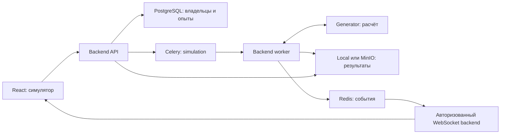

# Архитектурные решения

Статус: целевая архитектура, код не создан. Основания существующих функций — в [карте платформы](01-platform-map.md).

## ADR-01. Один научный сайдкар и существующая платформа

Создать `generator/` рядом с backend/frontend/agents, с собственным окружением и версией. В текущем проходе каталог не создаётся. Размещение как самостоятельного Git-сайдкара подготовить при восстановлении структуры суперпроекта; публикация новой ветки не входит в документацию.

Внутренняя структура: `service/domain/` — модели величин и интерфейсы адаптеров; `service/application/` — выполнение сценария; `service/infrastructure/` — NEURON/LFPy, форматы и процессный исполнитель; `service/presentation/` — HTTP/CLI; `configs/` — проверяемые пресеты; `tests/`, `docker/`, `scripts/`, `docs/`. В корне — pyproject.toml, lock-файл, README, TODO, SKILL, sidecar.json и правила исключения временных данных. Контракт не импортирует тяжёлые библиотеки при офлайн-проверке.

Связь проектов — HTTP и версионированные данные. Межпроектные импорты `service.*`, общая виртуальная среда и копирование предметной логики в backend исключаются. Отдельный CLI generator вызывает то же вычислительное ядро для автономных тестов; в приложении запуски проходят через backend.

Backend отвечает за авторизацию, проверку входов, очередь, статус, публикацию и выдачу результатов. Generator — за научный расчёт и временные файлы своей попытки. У generator нет PostgreSQL, брокера, пользовательского каталога, Docker socket и прав администратора платформы.

## ADR-02. Расширение внутри сервиса

Реестр адаптеров содержит зарегистрированные реализации геометрии/связности, динамики, воздействия, регистрации, обработки, распознавания и экспорта. Новая модель добавляется через реализацию интерфейса, декларацию возможностей, тесты и пресет. Параметры входа валидируются; произвольные Python-классы, команды и пути из браузера не исполняются.

Первый движок — NEURON/LFPy. Возможность работы с другим движком закладывается интерфейсами, а не предварительным созданием множества микросервисов. Совместимость определяется наблюдаемыми величинами, единицами и временной сеткой, а не одинаковым размером массивов.

Для записи необходимы трансмембранные токи, геометрия источников и электродов, модель проводящей среды и опорный электрод. Сумма спайков или мембранных напряжений не подменяет потенциал внешнего электрода. LFPy предоставляет соответствующие методы расчёта, но его примерные параметры не являются измеренными параметрами Drosophila: [документация](https://lfpy.readthedocs.io/en/latest/readme.html).

Каждое значение параметра маркируется как источник/измерение, литературный диапазон или модельное допущение. Проверка биологического соответствия отделена от проверки исполнения.

## ADR-03. Очередь, попытки и масштабирование

Использовать существующий Celery app и брокер, добавить очередь `simulation` и отдельный backend-worker. Не направлять симуляции в очередь agents по умолчанию. Первая конфигурация — один worker с concurrency=1 и один generator. Это начальная конфигурация исполнения, а не заявление о предельной производительности машины.

Брокер первой конфигурации — Redis `/0`, результаты Celery — Redis `/1`, как в фактической среде GPTHub. Первоначальное указание RabbitMQ основано на программном fallback и отменено после проверки среды. Beat, maintenance и simulation работают отдельными процессами; agents worker сохранён для дополнительного профиля. Все адреса задаются единым набором настроек. Уточнение переноса, production и подключения research — в [решении 12](12-platform-infrastructure.md).

Backend сохраняет опыт и намерение отправки в транзакции PostgreSQL. Диспетчер доставляет задание из outbox; повторная доставка использует тот же логический идентификатор. Worker получает право выполнения попытки через транзакционный захват и периодически подтверждает владение. Внутренний запрос generator содержит attempt ID и хеш конфигурации: повтор того же запроса возвращает тот же запуск, конфликтующая конфигурация отклоняется.

Generator запускает вычислительный дочерний процесс, но не имеет собственной долговечной очереди. При занятом исполнителе возвращает явное состояние занятости; повтор регулируется backend. Потеря HTTP-ответа приводит к запросу состояния известной попытки, а не к слепому новому запуску.

Масштабирование — дополнительные пары worker/executor на общей очереди. Worker закреплён за адресом исполнителя; попытка сохраняет это назначение. Нельзя отправлять запрос состояния активной попытки случайной реплике через балансировщик. Маршрутизация CPU/GPU и пакетные серии добавляются позднее через те же контракты.

Остановка: сначала сохраняется намерение в backend, затем запрашивается остановка дочернего расчёта. При отсутствии кооперативного завершения останавливается только процессная группа этой попытки. Подтверждение отмены даётся после прекращения расчёта; отзыв сообщения Celery сам по себе этого не доказывает. Запоздавший результат не получает право публикации.

Повторная доставка и идемпотентность должны проверяться отдельно: [Celery tasks](https://docs.celeryq.dev/en/stable/userguide/tasks.html), [routing](https://docs.celeryq.dev/en/stable/userguide/routing.html).

## ADR-04. Владение данными и публикация

| Данные | Владелец и место |
|---|---|
| Опыт, конфигурация, права, попытки, итоговый статус | Backend, PostgreSQL |
| Полные сигналы, таблицы, изображения, отчёты | Backend, выбранный Local/MinIO provider |
| Оперативные события, быстрые сводки, ссылки на кэш | Backend, Redis |
| Промежуточные токи и файлы активной попытки | Generator, отдельный scratch-каталог |
| Научные основания | Research, с сохранением версии/локатора |
| Проверки сторонних реализаций | Simulations, существующий реестр SIM |

Backend потоково принимает артефакты, проверяет длину и SHA-256, сохраняет через `FileSaverService` и связывает с опытом. Передача больших массивов в JSON/base64 не используется. Все скачивания идут по файловому ID с проверкой владельца; путь хоста и ключ объекта не являются публичной ссылкой.

Состояние `completed` устанавливается после регистрации полного набора обязательных файлов. Частично сохранённый набор не выдаётся как полный результат. Идемпотентность регистрации определяется опытом, попыткой, ролью артефакта и хешем.

После подтверждения публикации backend отправляет acknowledgement generator, и scratch этой попытки очищается. При ошибке записи сохраняются диагностические сведения и возможность повторной доставки. Для неподтверждённых файлов действует задаваемый срок хранения с учётом состояния опыта; очистка не удаляет активную попытку или единственную копию результата молча. Обслуживание использует существующую очередь maintenance, с отдельными правилами для симуляций.

В runtime scratch располагается в выделенном непубличном томе. При локальной разработке — в игнорируемой `.work/` проекта-владельца. Постоянные пользовательские результаты не размещаются в Git или каталоге исходников SIM.

## ADR-05. Кэш и события

Ключ стадии включает версию контракта и реализации, хеши входных данных и конфигурации, seed, численный режим. Для приватных данных добавляется область владельца. Кэш не меняет права доступа.

Разделить стадии: нейронные токи → оператор электрода → шум/обработка → распознавание. Положение электрода меняет ключ регистрации, но не обязательно ключ токов; seed шума не меняет нейронную динамику. Для каждой стадии записывается происхождение попадания в кэш. Изменение версии адаптера или входного файла запрещает использование прежнего результата как нового.

Большие промежуточные результаты при необходимости сохраняются через общий файловый сервис; Redis хранит ссылки. Потеря Redis не удаляет научный результат. При недоступности обязательного транспорта событий/очереди новый запуск не подтверждается как принятый в работу без долговечного намерения.

События несут run ID, attempt ID, последовательный номер и модельное время. У каждой вкладки свой курсор. Переподключение восстанавливает события; если история обрезана, frontend получает актуальный снимок и явно начинает с его позиции. Частота передачи превью ограничивается, полная запись сохраняется отдельно. Финальный статус читается из PostgreSQL, а не выводится из закрытия WebSocket.

## ADR-06. Профиль приложения без удаления GPTHub

Backend определяет профиль `gpthub` или `simulation` и публикует несекретный bootstrap: доступные функции, домашний маршрут и версию профиля. При отсутствии нового параметра сохраняется gpthub; демонстрационный Compose явно выбирает simulation.

В simulation доступны `/simulator`, просмотр сохранённого опыта на той же странице и необходимые auth-маршруты. Старые страницы отсутствуют в разрешённом реестре, не подгружаются заранее и недоступны по прямой ссылке. `/` и переход после входа ведут в симулятор. Настройки профиля используются одновременно меню, маршрутизатором и backend-политикой новых операций. Во время ошибки загрузки профиля интерфейс не открывает старые функции по умолчанию.

Общие auth/files/jobs операции сохраняются. Чатовые и платёжные операции в simulation не запускаются; старые данные не удаляются. Beat-профиль не включает ненужные платёжные/агентные задания. Переход между профилями не меняет владельцев, не мигрирует файловое хранилище и не очищает тома.

Сохраняются графический Logo, favicon, типографика и общие токены GPTHub. По последнему уточнению пользователя текстовое имя GPTHub не показывается в макете симулятора; новое название не придумывается. Для шапки пригоден существующий режим `BrandMark iconOnly`. Кнопки, формы, уведомления, API-клиент и пригодные viewer-компоненты берутся из текущего frontend. Thread-зависимые компоненты получают отдельный адаптер данных, а не фиктивный chat ID; список опытов получает иконки запусков вместо сообщений. Симулятор добавляется как новая страница существующей платформы. Её [концепты](visuals/README.md) показывают композицию, но не переопределяют дизайн-систему и компоненты. Предметные компоненты выбираются также из [SIM по карте переиспользования](10-simulation-reuse.md).
