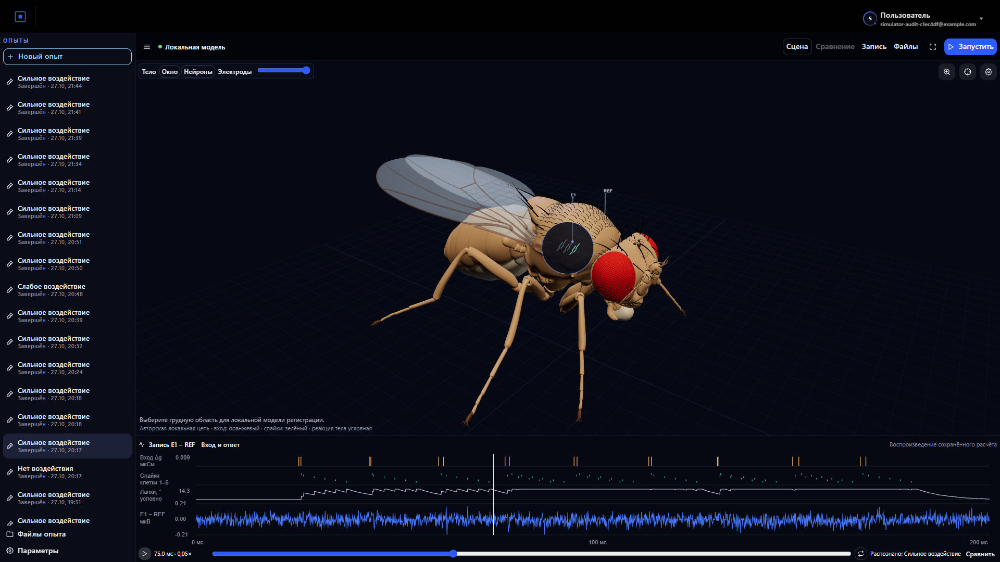
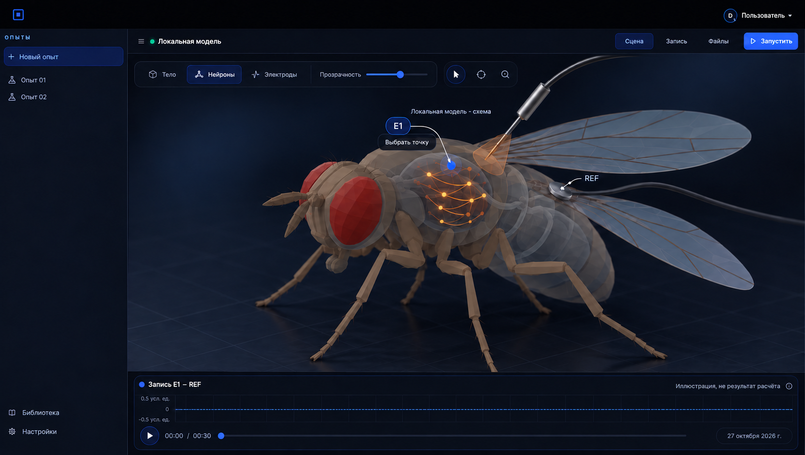
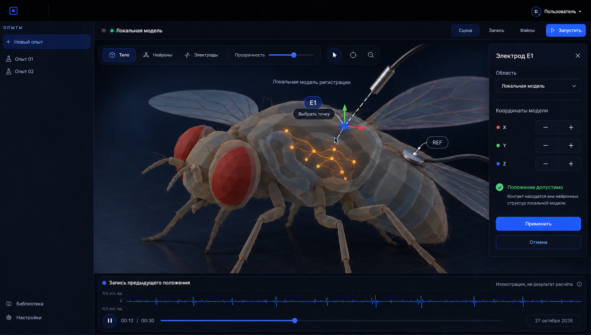

# Симуляция как новая страница GPTHub

Редакция: 27.10.2026. В [runtime](runtime/README.md) находятся скриншоты работающего
интерфейса с FlyBody из SIM-003, локальным окном и сравнением сохранённых расчётов.
Они получены в браузере; происхождение и SHA-256 перечислены в отдельном реестре.
Файлы `01`–`05` ниже — исторические imagegen-концепты, а не снимки реализации.

## Работающий интерфейс

Основной экран сохраняет большую сцену. Локальное окно открывает вид на авторскую
нейронную цепь и регистрирующие контакты. Две синхронные сцены доступны отдельно;
их камера, время и амплитудная шкала согласованы. Скриншоты подтверждают внешний
вид, а интерактивные сценарии проверяются отдельно в `frontend/tests/simulator`.
Ни изображение, ни браузерный тест не устанавливают биологическую достоверность.

## Исторические концепты

## Что изменено

Прежние три изображения слишком далеко отошли от оболочки GPTHub: постоянные панели вытесняли сцену, изменилась навигация. Они больше не являются целевым макетом. Новая композиция сохраняет компактную шапку, левую навигацию, строку рабочего пространства и стиль раскрываемых настроек с предоставленных скриншотов. Основное место занимает симуляция; запись остаётся узкой полосой снизу.

В реализации используются исходные [Header](../../../../frontend/src/shared/ui/layout/Header.jsx), [Logo](../../../../frontend/src/shared/ui/assets/common/logo.svg), [тема чата](../../../../frontend/src/features/chat/constants/theme.js) и пригодные общие компоненты. Сгенерированный логотип не заменяет существующий ассет. Скриншоты пользователя важнее расхождений в деталях растрового концепта.

Последнее уточнение: надпись GPTHub убрана, графический знак сохранён. В боковой панели — «Опыты» и иконки эксперимента вместо облачков сообщений. Это изменение видимого текста и семантики навигации, а не замена платформенных компонентов. Другие SIM также являются источниками компонентов: см. [карту переиспользования](../10-simulation-reuse.md).

## Общая сцена

Муху можно будет вращать и приближать, включать прозрачность тела и выбирать отображение нейронной активности. Локальная цепь и электроды находятся непосредственно в сцене. Это единое пространство наблюдения, а не набор независимых панелей.

## Выбор области и положения электрода

Клик по телу задаёт якорь области. Далее раскрывается локальная модель: контакт перемещается относительно нейронных источников, отдельно задаётся референс. Небольшая панель появляется только на время настройки; после применения закрывается. Кнопка «Отмена» возвращает предыдущее размещение.

Изображённая анатомия схематична. Внешняя точка на меше не подменяет координаты физического контакта, а прозрачность не означает возможность измерять потенциал через целое тело без модели тканей. Установка разрешается только в зарегистрированных областях; остальные доступны для просмотра. Подробный [контракт взаимодействия](../09-scene-interaction.md) имеет приоритет над расположением деталей на картинке.

## Что подтверждено в SIM-003

Ориентир внешнего вида — [скриншот SIM-003](../../../../simulations/artifacts/SIM-003/browser-inspector.png). В его [коде карты](../../../../simulations/sidecars/cnqso--infinite-sugar/web/neural-map.ts) используется 2D-проекция координат и выборки рёбер; вспышка следует времени спайка исходного нейрона. Это не расчёт перемещения импульса по аксону. Для текущей сцены отдельно перенесён FlyBody: его собственная Apache-2.0 и первичный XML проверены независимо от приложения SIM-003. [Реестр модели](../../../../frontend/public/assets/simulator/flybody/README.md) содержит версии, хеши и преобразования. Прозрачность и локальное окно уже доступны, но помещённая внутрь авторская цепь не становится полным коннектомом.

Для пятницы первичен режим событий активности. Движущийся фронт по отростку появляется как численный результат только при наличии пространственно-временного расчёта; декоративная схема передачи должна быть обозначена отдельно. Все виды синхронизируются с одним модельным временем, включая замедленное воспроизведение.

## Происхождение и приёмка

Новые запросы и референсы перечислены в [prompts-scene.md](prompts-scene.md), размеры и SHA-256 — в [manifest-scene.json](manifest-scene.json). Проверяется читаемость композиции и сохранность файлов; работа мыши, физическая достоверность, FPS и расчёт не подтверждаются PNG.

Предыдущие изображения `01-workbench.png`, `02-stimulation.png`, `03-comparison.png` сохранены как прежняя итерация, без новых копий. Их [промпты](prompts.md) и [manifest](manifest.json) остаются для прослеживаемости; они не задают текущую компоновку.
