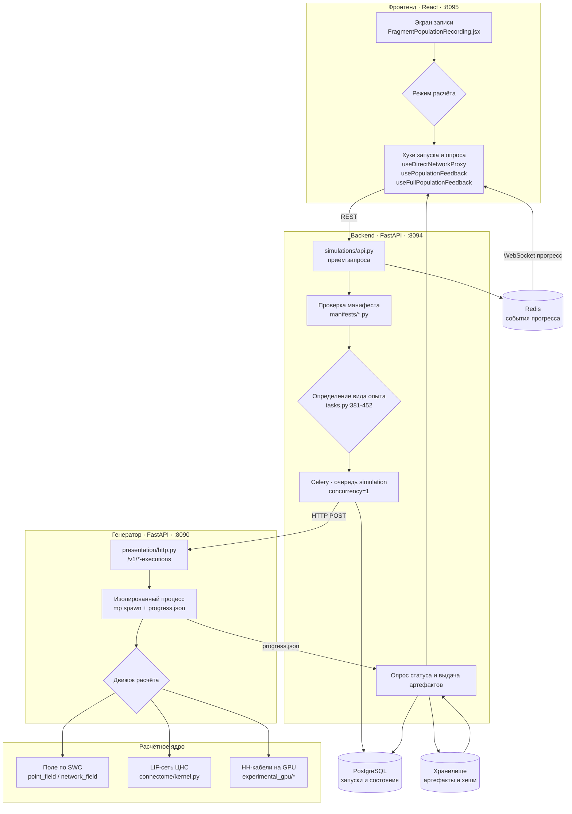
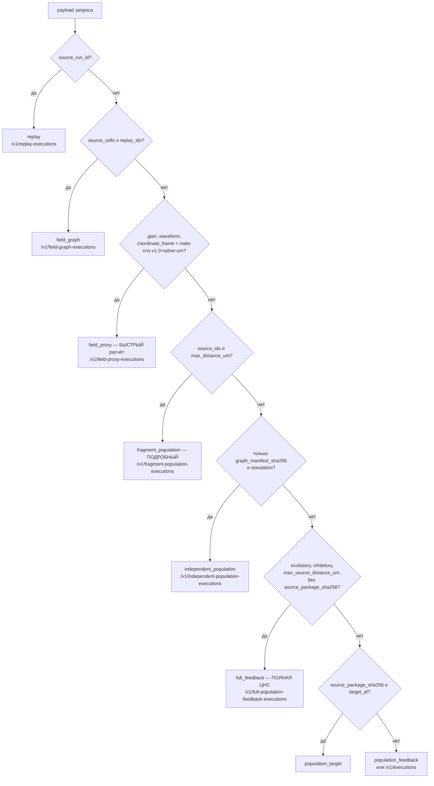
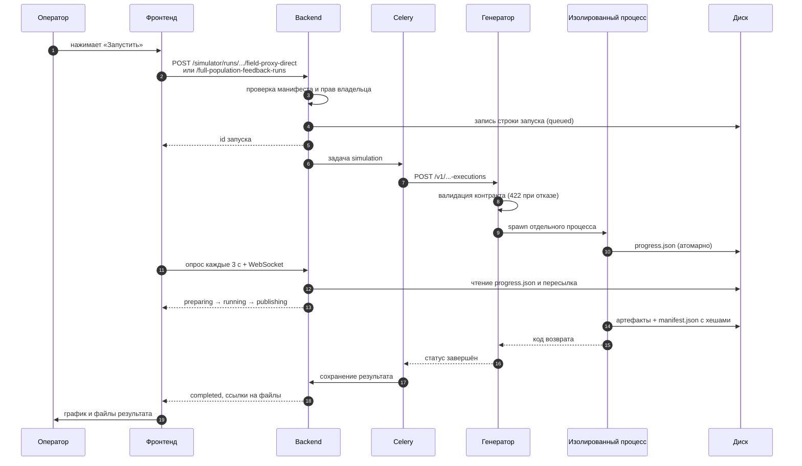
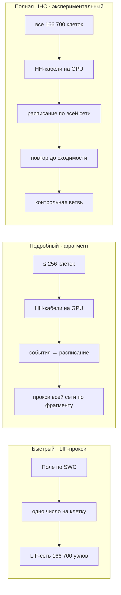

# 01. Общая архитектура: путь одного опыта

## 1.1 Компоненты и кто за что отвечает

Роли разделены жёстко. Backend отвечает за авторизацию, проверку входов, очередь,
статус и публикацию; генератор — только за научный расчёт и временные файлы своей
попытки. У генератора нет ни PostgreSQL, ни брокера, ни docker-сокета: если он упадёт,
backend останется с непрочитанной попыткой, а не с испорченной базой.

## 1.2 Как backend выбирает, что запускать

Вид опыта определяется не полем `kind`, а составом полезной нагрузки
(`R:/Aspa/backend/service/services/simulations/tasks.py:381-452`):

Порядок проверок важен: `full_feedback` — самый широкий набор полей, поэтому он
проверяется после узких. Любая правка манифеста обязана сохранять это свойство, иначе
запрос полного опыта уедет в ветку фрагмента.

## 1.3 Жизненный цикл одного запуска

Статусы одинаковы для всех видов опыта: `queued → preparing → running → publishing`,
плюс `cancelling` при отмене. Фронтенд считает активными ровно эти пять состояний и
прекращает опрос на любом другом.

## 1.4 Три режима с точки зрения физики

Ключевое различие: быстрый режим не решает уравнение кабеля вообще (одна точка на
клетку), подробный решает его для сотен клеток, полный — для всех. Поэтому время
растёт не пропорционально числу клеток, а пропорционально числу сегментов: у полной
ЦНС это 270 009 259 сегментов.

## 1.5 Где что лежит

| Слой | Каталог |
| --- | --- |
| Фронтенд | `R:/Aspa/frontend/src/features/simulator/` |
| Backend API и задачи | `R:/Aspa/backend/service/services/simulations/` |
| HTTP генератора | `R:/Aspa/generator/service/presentation/http.py` |
| Прикладные сценарии | `R:/Aspa/generator/service/application/{field,population,feedback,replay}/` |
| GPU-ядро | `R:/Aspa/generator/service/infrastructure/stimulation/experimental_gpu/` |
| Контракты | `R:/Aspa/generator/service/domain/contracts/` |
