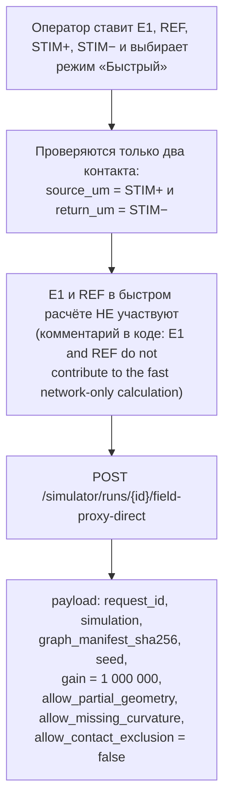
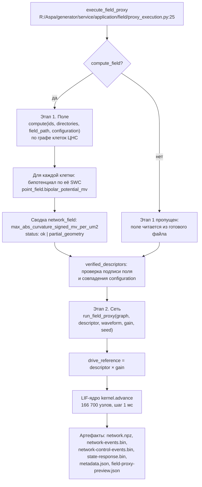
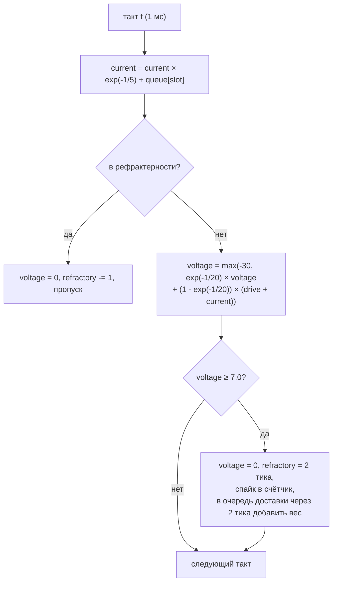
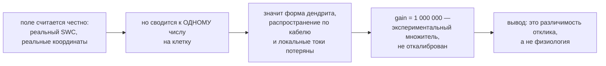
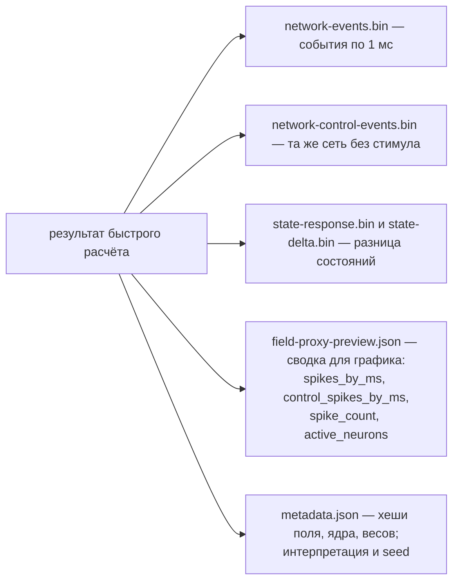

# 02. Простой расчёт: поле по SWC и LIF-прокси всей сети

Это режим «Быстрый» на экране записи. Он отвечает на вопрос «что примерно произойдёт
в сети целиком», не решая ни одного уравнения кабеля. Физики клетки здесь нет:
каждая клетка — один узел с одной переменной напряжения.

## 2.1 Что делает оператор и что уходит на сервер

Отсюда первое важное ограничение: быстрый режим не даёт записи E1–REF. Если нужна
запись от электрода, это подробный или полный режим.

## 2.2 Два этапа внутри генератора

## 2.3 Ядро LIF: что именно интегрируется

`R:/Aspa/generator/service/infrastructure/connectome/kernel.py:11` — это точный код,
перенесённый из Fly Arena, и он намеренно простой:

Три числа задают всю динамику: постоянная мембраны 20 мс, постоянная тока 5 мс, порог
7.0 в безразмерных единицах. Вес связи — `counts × signs × 0.075`, где `counts` —
число синапсов между клетками, `signs` — знак (возбуждающий/тормозной). Задержка
доставки фиксирована: 2 тика. Рефрактерность — 2 тика.

## 2.4 Почему это «прокси», а не модель

В коде это сказано прямо: `metadata.json` получает поле
`interpretation: 'uncalibrated LIF events; not measured neural activity'`, а
`network_weight_gain: 0.075` записывается в метаданные, чтобы результат нельзя было
прочитать как измерение.

## 2.5 Управляющие флаги и когда расчёт отказывает

| Флаг | Что разрешает | Если выключен |
| --- | --- | --- |
| `allow_partial_geometry` | клетки с неполной геометрией | отказ `field_partial_geometry` |
| `allow_missing_curvature` | клетки без кривизны | отказ `field_missing_curvature` |
| `allow_contact_exclusion` | контакты, исключённые из поля | отказ `field_contact_exclusion` |
| `capture_delta` | второй прогон с нулевым стимулом | нет `state-delta.bin` |

Флаги не «чинят» данные: они разрешают опубликовать результат с явной пометкой
`partial_geometry` в квитанции. Разница между «посчитано» и «посчитано частично»
видна в манифесте, а не скрыта.

## 2.6 Что получает оператор

Контрольный прогон (нулевой стимул) идёт тем же ядром с тем же seed, поэтому разница
`active − control` — это вклад стимула, а не случайность инициализации.
