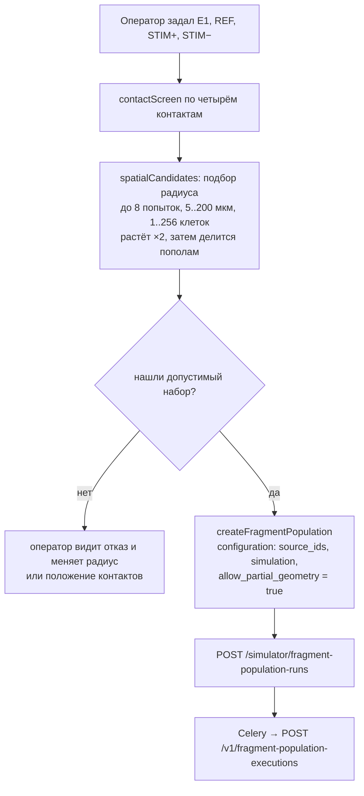
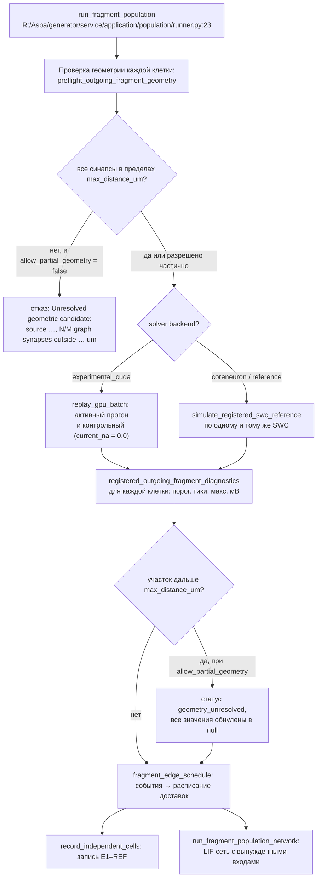
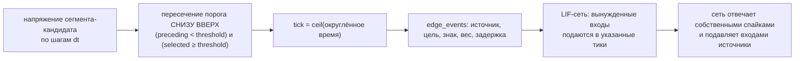
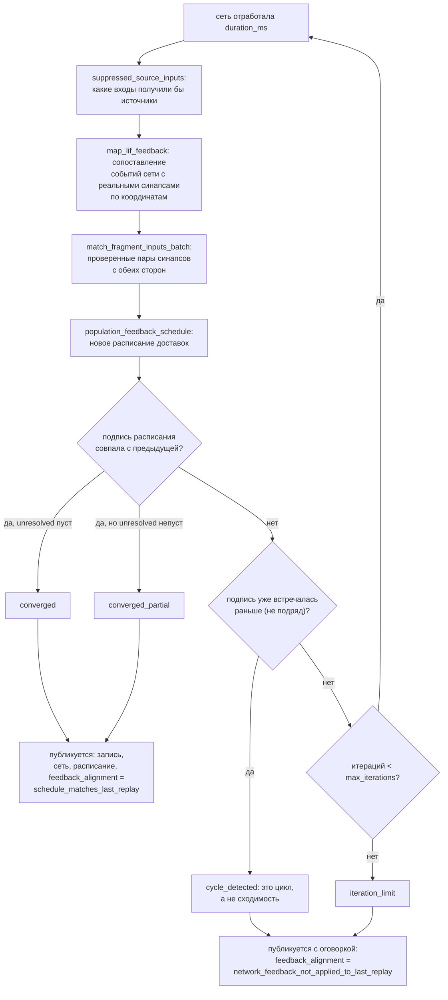
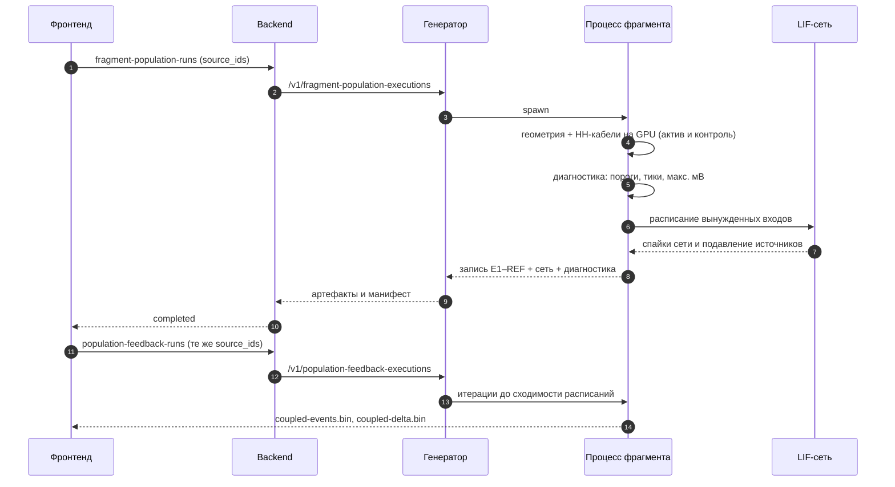
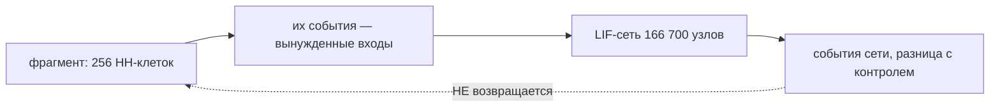

# 03. Подробный расчёт: фрагмент из клеток с реальными кабелями

Режим «Подробный» решает уравнение кабеля для настоящих клеток — но только для
небольшого фрагмента (до 256 клеток), найденного по координатам контактов. Дальше
события этого фрагмента подаются в сеть ЦНС как вынужденные входы.

## 3.1 Поиск фрагмента по контактам

Радиус подбирается автоматически, потому что плотность клеток вдоль разных нервов
разная: у нерва с сотней волокон шаг 5 мкм даёт тысячи кандидатов, у тонкого — ноль.

## 3.2 Что делает генератор: run_fragment_population

Здесь важно, что активный и контрольный прогоны отличаются ТОЛЬКО током стимула:
`{**simulation_parameters, 'current_na': 0.0}`. Всё остальное — та же геометрия, тот же
порог, тот же dt. Поэтому разница между ними и есть вклад стимула.

## 3.3 Как события клетки превращаются в расписание сети

Пересечение ищется однократно и только снизу вверх: сегмент, который уже был выше
порога, не даёт нового события, пока не вернётся ниже. Это делает события функцией
формы сигнала, а не шага дискретизации.

## 3.4 Обратная связь по фрагменту: iterate_population_feedback

Различие между «сошлось» и «зациклилось» принципиально: повтор подряд означает, что
расписание перестало меняться; повтор через другие расписания означает, что система
ходит по кругу и предела не имеет. `converged_partial` — это сходимость при
неразрешённых парах (разрешена флагом `allow_partial_geometry`); `iteration_limit` и
`cycle_detected` публикуют результат, но с явной пометкой `feedback_alignment`, что
последнее сетевое расписание НЕ применено к последней физической записи.

## 3.5 Полный путь подробного режима

Фронтенд запускает эти два шага подряд автоматически: сначала физический фрагмент,
потом обратную связь. Между ними оператор не участвует, но результат первого шага
уже сохранён — если второй упадёт, запись E1–REF останется.

## 3.6 Затем вся сеть: прокси по фрагменту

Третий шаг подробного режима — `createFieldProxyFromFragment`: те же события
фрагмента подаются в LIF-сеть всей ЦНС с экспериментальным gain = 1 000 000. Это нужно,
чтобы увидеть, как локальное воздействие расходится по сети, но это по-прежнему
прокси: сеть не возвращает обратную связь в физические клетки.

Пунктир на схеме — самое важное место всего документа: в подробном режиме сеть не
влияет обратно на физические клетки. Замкнутый контур появляется только в полном
связном опыте.
