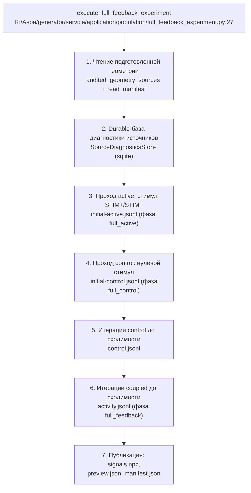
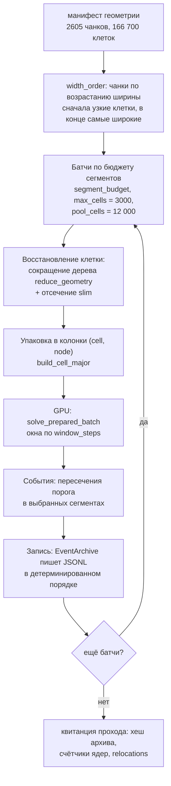
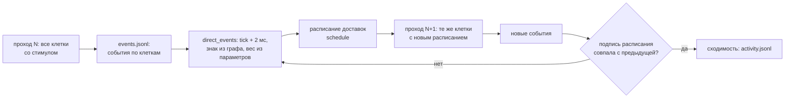
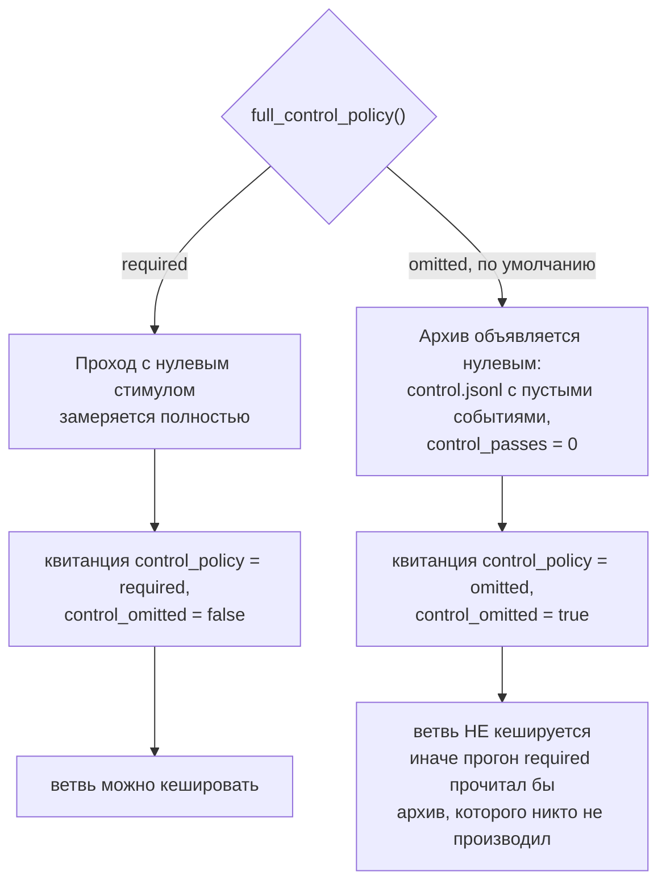
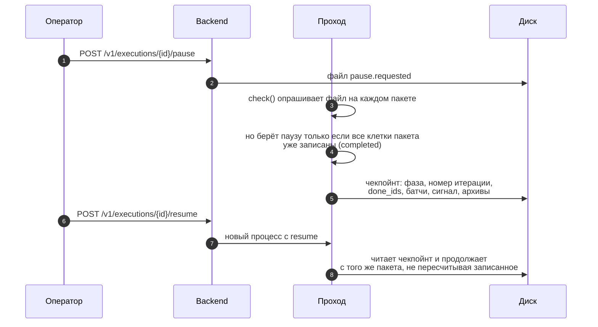
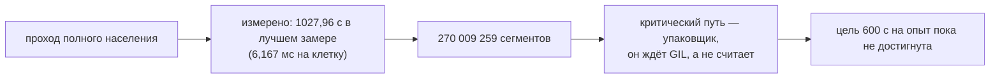

# 04. Полный связанный опыт: вся ЦНС, 166 700 клеток

Режим «Полная ЦНС · экспериментальный». Единственный режим, где обратная связь
замкнута на всех клетках: события всей популяции становятся входами следующего
прохода всей популяции.

## 4.1 Фазы одного запуска

Фаза `full_active` — это один проход всей популяции с внешним стимулом. Фаза
`full_control` — тот же проход с нулевым стимулом; она нужна, чтобы отличить вклад
стимула от собственной динамики сети.

## 4.2 Один проход: что происходит с популяцией

Порядок по возрастанию ширины выбран не для красоты: чанки хранят морфологии в порядке
body-id, а body-id не отсортированы по ширине, поэтому любое малое скользящее окно
смешивало клетку на 100 сегментов с клеткой на 40 000, и ограничение по паддингу
сбрасывало крошечные батчи. Манифест уже хранит число вершин каждой клетки
(`width_order`, `population_replay.py:63`), так что порядок декодирования планируется
заранее, без декодирования, а позиции чанков сохраняются, поэтому проверки идентичности
по чанкам не меняются. Побочный эффект важен для интерпретации замеров: дорогие широкие
клетки идут в конце, отсюда рост мс/клетку к концу прохода.

## 4.3 Как замыкается обратная связь

Событие — это не спайк клетки, а пересечение порога конкретным сегментом. В коде это
сказано в `direct_events.py:1-5`: «These events are model threshold crossings, not proof
of biological spikes». Задержка доставки жёстко равна 2 мс, знак берётся из графа
(`graph.signs[pre]`), вес и постоянные времени — из запроса.

Отдельная ветвь, которую надо знать при чтении результатов: если расписание доставок
пустое (`empty_feedback`), оно неподвижно по построению, и сходимость наступает на
первой итерации без нового прохода (`archive_replay.py:212-228`). Именно это произошло
в боевом прогоне: «сходимость за одну итерацию» означала не устойчивое состояние сети, а
то, что ни одна клетка не пересекла порог при стимуле −300 нА и пороге −20 мВ.

## 4.4 Контрольная ветвь и политика контроля

Нулевой стимул не может деполяризовать клетку из состояния покоя, поэтому в этой
ветви пересечений порога нет по построению. Это не подделка результата: архив пишется
в той же форме, а отличие объявлено в манифесте.

## 4.5 Пауза и возобновление

Два дефекта, найденных полным прогоном, стоят упоминания, потому что они объясняют
форму схемы. Первый: контроллер запоминал первый ответ и не видел запрос, созданный
после старта — теперь он опрашивает до появления запроса. Второй: пауза бралась на
пакете, который ещё в полёте, и чекпойнт публиковал больше клеток, чем было в архиве —
теперь условие `received.issubset(recording.completed)`.

## 4.6 Что стоит проход и где предел

Разложение лучшего прохода: decode 560,65 с, reduce 539,78 с, solve 478,51 с — но эти
величины пересекаются, и совпадение decode+reduce с временем прохода оказалось
следствием простоя производителя в полном буфере, а не причиной. Упаковщик держит
пакет 242,56 с из 315,74 с, но исполняется меньше половины этого времени: он стоит
за GIL.

## 4.7 Ограничения режима

| Ограничение | Следствие |
| --- | --- |
| `nseg_per_edge == 1` | на каждую связь один сегмент, не полноценная дендритная интеграция |
| `duration_ms` целое, ≥ 1 мс | субмиллисекундные протоколы не поддерживаются |
| порог −20 мВ при −300 нА | за 10 мс не пересекает ни одна клетка (проверено) |
| `max_iterations` ≤ 100 | больше итераций не запрашивается |
| 8,2 ГБ памяти docker VM | два процесса полного населения не помещаются |
