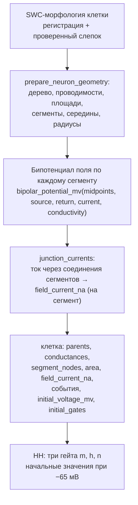
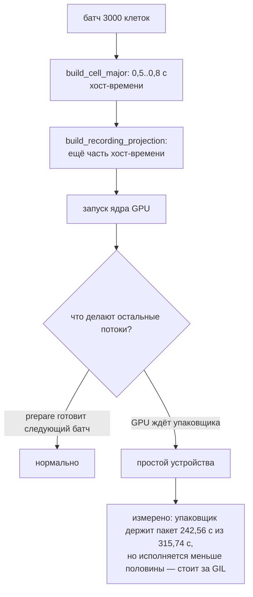
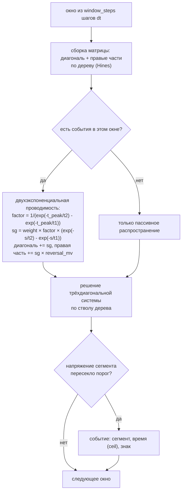

# 05. Ядро: модель клетки и конвейер до GPU

Здесь показан уровень, на котором считается одна клетка и один батч. Это самый
дорогой по времени и самый важный по достоверности слой.

## 5.1 Что такое клетка в расчёте

Начальное состояние фиксировано ровно для того, чтобы батч можно было упаковать:
`HH_INITIAL_GATES = [0.05293248525724958, 0.5961207535084603, 0.3176769140606974]`,
`HH_INITIAL_VOLTAGE_MV = -65.0`, комментарий в коде — «NEURON hh rates at −65 mV and
23 degC». Если у клеток в батче разные начальные состояния, ускоренный путь
отказывается и возвращает `(None, None, None)` — тогда считает общий путь.

## 5.2 Сокращение дерева перед решением

Именно сокращённая клетка весит 77,4 байта на сегмент, и именно из этого числа
следует, что вся популяция — это 20,89 ГБ в оперативной памяти, если держать её
целиком. Поэтому проход идёт чанками.

## 5.3 Конвейер одного прохода: три потока

Три потока, а не один, потому что каждая стадия ждёт разного: prepare ждёт диск,
pack ждёт память и Python, solve ждёт GPU. Разделение было измерено: перенос
упаковки на поток подготовки дал 475 → 555 с (стадии стали сериализоваться), а
отдельный поток упаковки убрал её из-под запуска.

## 5.4 Почему упаковщик — критический путь

Отсюда единственный вывод, объясняющий все измерения: ускорять надо не арифметику
упаковщика (его собственная работа мала), а его ожидание GIL. Все опробованные
обходные пути — кеш сокращённых клеток, кеш коэффициентов записи, таблица выбора
компартментов, плоский кеш широкого хвоста, процессный упаковщик — либо не дали
выигрыша, либо упирались в память.

## 5.5 Что делает ядро Hines на GPU

Задержка доставки синапса в ядре считается как `floor(event_time/dt + 0.5) × dt`, то
есть событие привязывается к ближайшему шагу. Время синапса отсчитывается от момента
доставки, а не от момента события — это делает результат независимым от того, в каком
окне событие попало в расчёт.

## 5.6 Запись: как получается сигнал E1–REF

Коэффициенты записи — чистая функция геометрии; их кеш
(`recording_cache.py`, формат `malecns-recording-coefficients-v1`) экономит около 25 %
времени конструктора на широком срезе. Первая версия кеша хешировала сами массивы
геометрии (88 байт на сегмент, 5,4 мс на клетку) и была медленнее, чем сам расчёт;
после перехода на идентичность клеток ключ стоит 0,0062 мс на клетку.

## 5.7 Масштаб чисел

| Величина | Значение |
| --- | --- |
| клеток в ЦНС | 166 700 |
| сегментов всего | 270 009 259 |
| сегментов на клетку в среднем | 1 620 |
| доля сегментов в топ-10 % клеток | 41 % |
| сокращённая клетка | 77,4 байт/сегмент |
| батч | до 3 000 клеток, бюджет сегментов 40 000 |
| пул памяти батча | 12 000 клеток, 40 млн сегментов |
| лучший полный проход | 1027,96 с (6,167 мс/клетку) |
