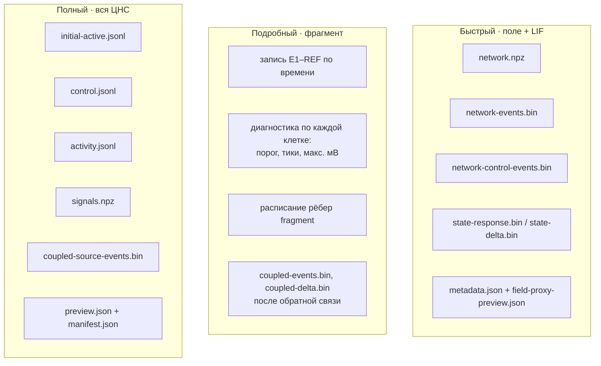
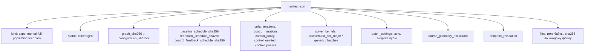
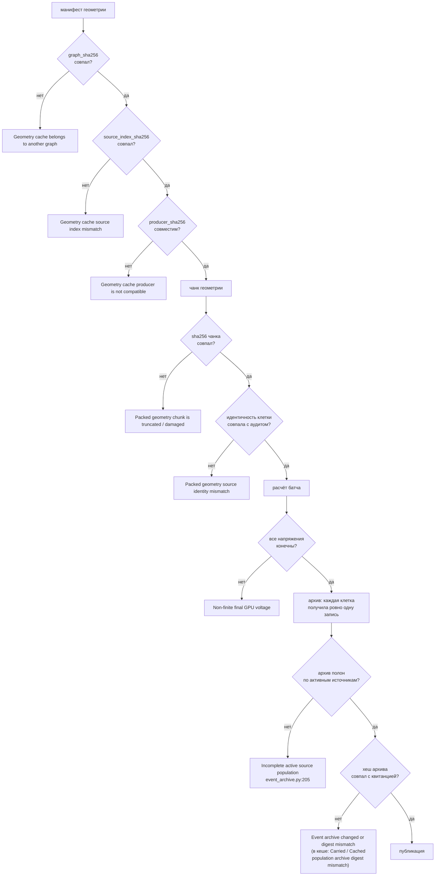
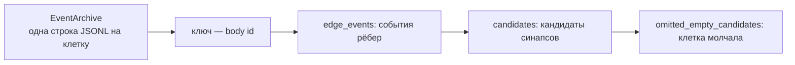
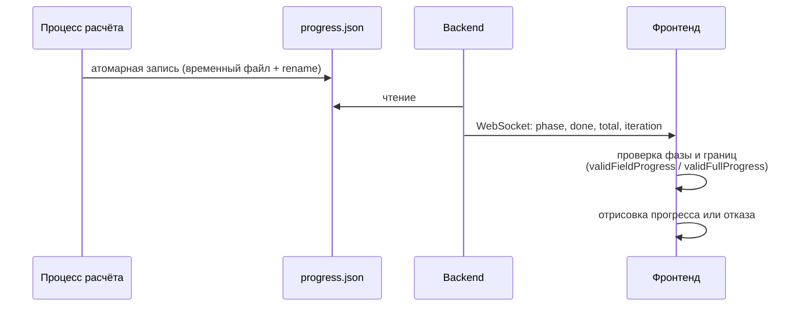
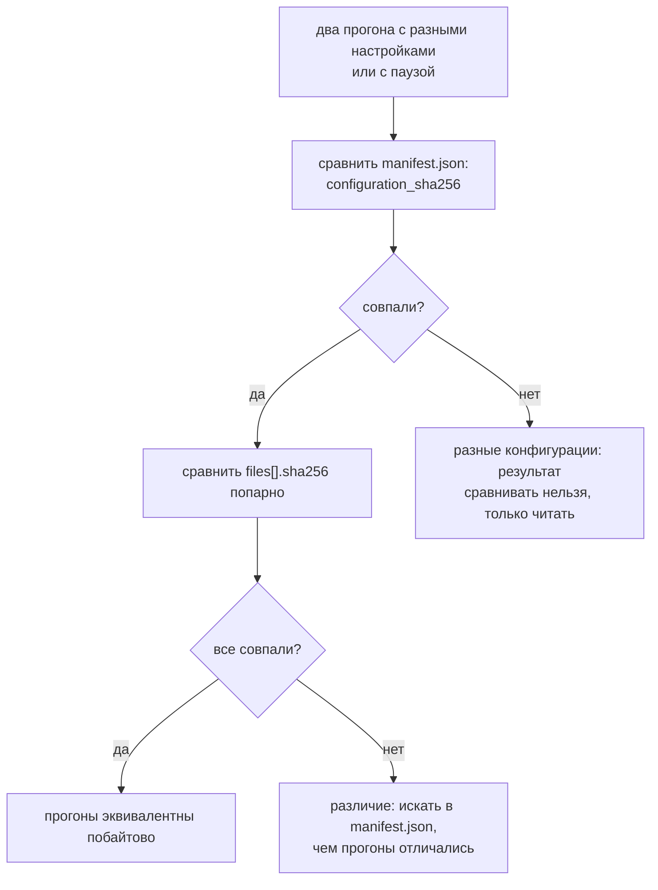

# 06. Артефакты и проверки: что доказывает результат

Каждый запуск оставляет на диске набор файлов и манифест с их хешами. Смысл манифеста
не в красоте: он позволяет проверить, что показанный результат — это ровно те байты,
которые посчитаны, и что они посчитаны той конфигурацией, которую запросили.

## 6.1 Что создаёт каждый режим

## 6.2 Манифест полного опыта

Четыре числа в этом манифесте — самые информативные. `control_omitted` говорит,
замерялась ли контрольная ветвь или объявлена. `solver_kernels` говорит, каким именно
ядром считали (ускоренным или общим). `source_geometry_exclusions` перечисляет клетки,
чьи синапсы вышли за допуск и были исключены явно, а не молча. `endpoint_relocation`
фиксирует, переносился ли электрод на другой участок.

## 6.3 Цепочка проверок внутри прохода

Каждый отказ здесь — не аварийная ситуация, а штатный результат: система
предпочитает не опубликовать, чем опубликовать неизвестно что.

## 6.4 Формат архива событий

Порядок строк детерминирован: это позволяет сравнивать архивы побайтово. Именно так
проверялась эквивалентность: архивы прогонов с разными кешами и с паузой совпали с
базовым прогоном побайтово — `initial-active.jsonl`
`60cee23e…`, `control.jsonl` `7c4ae747…`, `signals.npz` `95376b52…`.

## 6.5 Квитанция прогресса

Атомарность записи через rename — не формальность: без неё backend иногда читал
половину JSON и показывал оператору скачок прогресса назад. Фронтенд дополнительно
проверяет, что `done ≤ total`, `total` не больше числа клеток, а номер итерации в
пределах 1..100: некорректный прогресс не рисуется вообще.

## 6.6 Как проверить результат самостоятельно

Отдельного скрипта сверки в репозитории нет: сверка — это несколько строк на
`hashlib.sha256` по каждому файлу из `files[]`. В рабочем каталоге измерений лежит
`R:/Aspa/.work/connectome-routing-20261028/compare-archives.py`, которым проверялись
кеши и пауза. Правило, которое он проверяет, важнее самого скрипта: любой кеш обязан
давать побайтово тот же архив, иначе он выключается.
