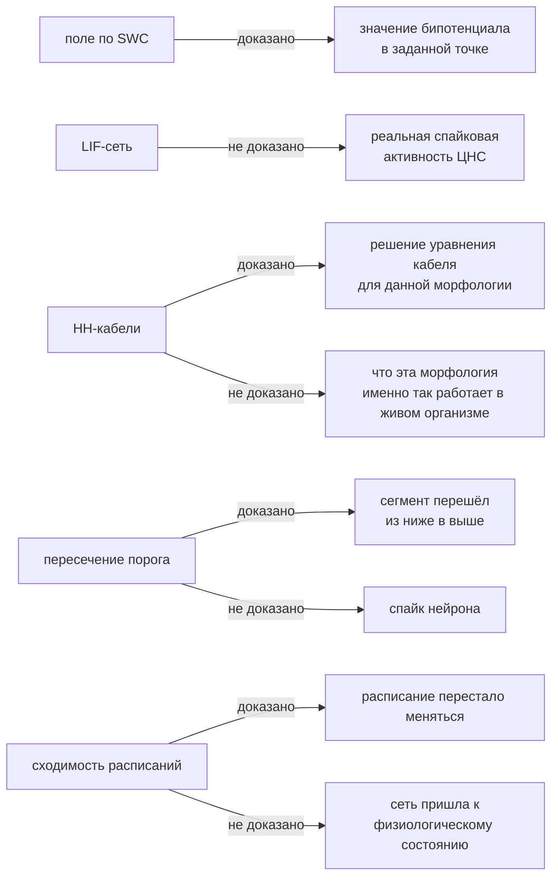
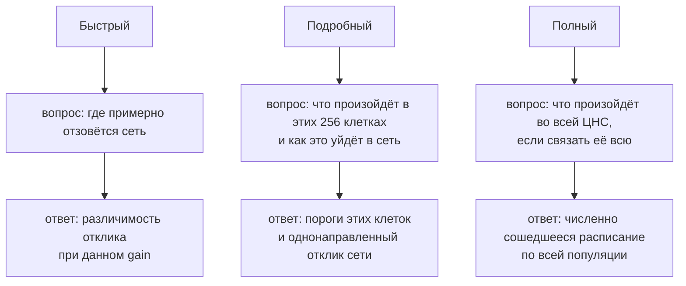
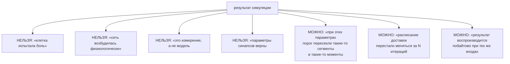

# 07. Границы достоверности: где кончается расчёт и начинается утверждение

Этот файл — не оговорка, а часть модели. Каждый режим отвечает на свой вопрос, и
ни один из них не отвечает на вопрос «болит ли». Ниже — что именно доказано
измерением, а что является соглашением.

## 7.1 Что чем является

В коде эти границы записаны буквально: `direct_events.py:1-5` — «These events are model
threshold crossings, not proof of biological spikes»; `loop.py:1-5` — «does not
establish physiology»; `runner.py` — «Independently simulated fragments are not
connected»; манифест полного опыта — «numerical schedule convergence; not biological
validation».

## 7.2 Уровни доверия по режимам

Ни на одном уровне нет калибровки на измеренный биологический сигнал: параметры
синапсов (вес 0,001 мкСм, tau1 0,2 мс, tau2 2 мс, reversal 0 / −80 мВ) заданы
оператором, а не выведены из эксперимента.

## 7.3 Что уже измерено на этой машине

| Проверка | Результат |
| --- | --- |
| Полный проход 166 700 клеток | 1027,96 с в лучшем замере, 6,167 мс/клетку |
| Эквивалентность при кешах | архивы побайтово равны базовому прогону |
| Эквивалентность после паузы | архивы побайтово равны, ядер 292 вместо 336 |
| Отклик на −300 нА за 10 мс при пороге −20 мВ | ни одна клетка порог не пересекла |
| Кеш сокращённых клеток на полном населении | 1,03× — выигрыша нет, выключен |
| Процессное шардирование | 1112 с против 1141 с — выигрыша нет, закрыто |
| Fork-параллелизм reduce | speedup 0,28–0,62 — pickle дороже работы |

Строка про отклик — самая важная для интерпретации: три архива совпали побайтово, и
«сходимость за одну итерацию» означала не устойчивое состояние сети, а отсутствие
событий. Это открытый пункт в `R:/Aspa/generator/TODO.md:14` — калибровка стимула.

## 7.4 Что нельзя утверждать по результатам

Запрет выдавать расчёт за измерение боли зафиксирован отдельно в
`R:/Aspa/docs/Материалы/План_генератора_2026-10/05-demo-2026-10-30.md:13`.

## 7.5 Что нужно, чтобы утверждать больше

Рамка для этих шагов уже описана в `R:/Aspa/docs/Материалы/План_генератора_2026-10/06-scientific-validation.md`
(58 строк): разделять численную корректность, соответствие наблюдениям, разнообразие,
полезность downstream и устойчивость; делить выборку по независимой единице; сравнивать
«реальные → тест», «синтетика → тест», «реальные + синтетика → тест» и абляцию
ограничения.

## 7.6 Правило, которое стоит держать в голове

Синтетическая метка, назначенная по правилу симулятора, подтверждает только
различимость этого правила. Она не подтверждает ни физиологию, ни биологию, ни боль.
Всё, что симуляция доказывает сама о себе — воспроизводимость и внутреннюю
согласованность; всё остальное требует внешнего измерения.
