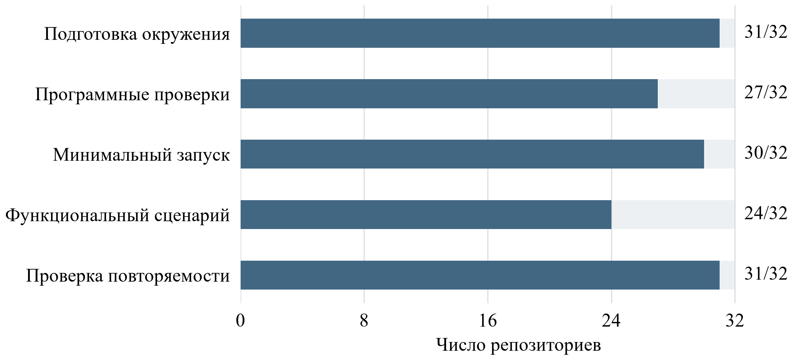

# Программные средства моделирования нейронных систем: коннектомы, динамика и формирование сигналов

**Рабочая редакция.** Текст и библиография находятся в проверке; результаты собственных испытаний необходимо дополнительно сверить с первичными квитанциями и подготовить доступное читателю приложение. Существующий `manuscript.md` содержит прежнюю статью и сохраняется до завершения переноса в PUB-003.

## Аннотация

Цель работы — сопоставить программные средства подготовки коннектомных данных, моделирования нейронной динамики и движения, а также формирования электрических сигналов с точки зрения построения воспроизводимого генератора биологически ограниченных данных. Рассмотрены 32 репозитория, ранее включённые в целевой реестр проекта. Для каждого использованы закреплённая версия исходного кода и записи об испытаниях. Раздельно рассмотрены подготовка окружения, программные проверки, выполнение функционального сценария и воспроизводимость. Для обсуждения научных ограничений привлечены публикации о коннектомах, моделях Drosophila и расчёте внеклеточных потенциалов. Отбор не претендует на полноту; сценарии проверки различаются по данным, длительности и вычислительной среде. В реестре успешный функциональный сценарий отмечен для 24 из 32 репозиториев. Этот результат относится к выбранным сценариям и не означает воспроизведения всех функций или проверки биологической достоверности. Подготовка окружения отмечена как успешная для 31 репозитория, программные проверки — для 27, минимальный запуск — для 30. Критерии не являются взаимозаменяемыми. Инструменты подготовки графа, модели динамики и среды решают различные задачи; наличие связности и событий нейронов само по себе не задаёт внеклеточный потенциал. Предложены оси сопоставления инструментов и вопросы проверки совместимости их данных и интерфейсов. Формирование синтетической записи требует явного сочетания источника динамики и оператора регистрации, согласования координат, единиц и времени, а также независимой проверки предполагаемой области применения. Определить преимущество отдельного пакета по результатам неоднородных испытаний нельзя.

**Ключевые слова:** нейронная динамика, коннектом, Drosophila, внеклеточный потенциал, синтетические данные, верификация, воспроизводимость.

## Введение

Коннектомные реконструкции задают анатомические ограничения на связи между нейронами, но не определяют однозначно их динамические свойства. Например, модель зрительной системы Drosophila сочетает ограничения, полученные из реконструкции связности, с параметрами нейронов и синапсов, подбираемыми для конкретной задачи; её предсказания сопоставлялись с экспериментальными наблюдениями [1]. Модель мозга на основе коннектома FlyWire использовалась для исследования сенсомоторной обработки [2]. Каждая из таких моделей определяется не только графом, но также уравнениями, входными воздействиями и способом настройки параметров.

Задача формирования синтетических биомедицинских сигналов добавляет ещё один уровень: активность сети необходимо связать с моделью измерения. Пакет LFPy рассчитывает внеклеточные потенциалы на основе трансмембранных токов и выбранной модели проводящей среды [3]. Выход нейронной сети в виде событий или состояния узлов не эквивалентен такому сигналу без дополнительного оператора. Рассматриваемый в этой работе вызванный составной потенциал действия при стимуляции спинного мозга человека не возникает автоматически из модели мухи.

Для проектирования генератора важно оценивать не только заявленные возможности программ, но и фактически проверенные условия их работы. Цель настоящего обзора — сопоставить назначения и результаты ограниченных испытаний доступных инструментов, выделить требования к их сопряжению и границы допустимых выводов. Обзор посвящён техническим средствам; вопрос о научной полезности межвидового переноса требует самостоятельного исследования.

## Материалы и методы

Использован целевой реестр 32 репозиториев, созданный при подготовке проекта моделирования Drosophila и биомедицинских сигналов. Исходный инвентарь датирован 4 октября 2026 г.; даты последующих испытаний и повторных проверок указаны в отдельных записях. В реестр включены модели динамики, инструменты подготовки и анализа коннектома, модели тела и среды, а также отдельные методические инструменты и примеры моделирования человека. Один инструмент может иметь несколько назначений, поэтому категории носят описательный характер и пересекаются.

Для каждого репозитория учитывали адрес и закреплённую ревизию кода, сведения о данных и их версии, среду выполнения, статусы установки, программных и функциональных проверок, повторяемость, доступные результаты и ограничения. Отсутствующие сведения отмечали в инвентаре. Успех выбранного сценария не распространяли на непроверенные возможности. Неудачные проверки и блокировки, в том числе из-за отсутствия исходных данных, фиксировали отдельно и не считали опровержением научных результатов авторов. Документированные изменения среды или рабочей копии отличали от исходного кода.

Сравнение результатов ограничено условиями отдельных сценариев. Для сопоставления структуры, частоты событий и производительности необходимы условия, соответствующие цели сравнения: в частности, версия и фильтрация входного графа, модель нейронов, параметры, длительность и определение выходов; при сравнении скорости и памяти необходимо учитывать также оборудование и среду выполнения. Это не систематический обзор всех существующих пакетов и не единое соревнование производительности. Отбор и извлечение сведений выполнялись в рамках одного проекта без независимого двойного рецензирования; описание процедур и данные испытаний требуют публичного приложения перед подачей.

## Результаты сопоставления

### Исходные данные и подготовка коннектома

В состав реестра входят инструменты подготовки графов и анализа реконструкций. Они различаются единицами описания и полнотой: граф синаптических связей, аннотации типов клеток и геометрические реконструкции решают разные задачи. Коннектом взрослого мозга FlyWire и объединённая реконструкция мозга с вентральной нервной цепочкой отличаются областью охвата и не должны подменяться друг другом [4, 5]. Понятие полного графа далее всегда относится к конкретному выпуску и применённым фильтрам, а не ко всей периферической нервной системе животного.

В одном из проверенных сценариев аналитический инструмент подготовки MaleCNS построил граф из 166 700 нейронов и 25 582 938 строк связности; повторное построение совпало по содержимому массивов. Сумма весов в этих строках составила 124 177 617: её нельзя отождествлять с числом строк. Это свидетельство воспроизводимости конкретного формирования графа, но не результат динамической симуляции. В отдельном сценарии flyconnectome/2025malecns удалось прочитать шесть вспомогательных таблиц, тогда как повторный полный запуск анализа v0.9 завершился кодом 137 при загрузке данных. Причина этого завершения только по коду не установлена; чтение отдельных таблиц не заменяет полный анализ. Подробные версии и локаторы сведены в приложении к рабочему инвентарю.

При передаче графа модели необходимы как минимум идентификаторы источника и приёмника, правило интерпретации кратности связей, признаки типа передачи и версия набора данных. Если используются геометрические реконструкции, дополнительно требуется документировать систему координат и соответствие между идентификаторами графа и морфологиями. Несовпадение этих полей способно изменить расчёт даже при одинаковом названии исходного коннектома.

Значение имеет и версия аннотаций внутри одного выпуска данных. В проверке OpticLobe.jl независимый пересчёт исходного CSV совпал с результатом пакета, но после исключения выходящих связей клеток T1 сумма оказалась на 1540 синапсов меньше контрольной суммы штатного теста. История назначений T1 не восстановлена, поэтому причина расхождения не установлена. Повторяемость расчёта на сохранённом срезе не устраняет этого ограничения и не подтверждает совпадение с авторским контрольным срезом.

### Нейродинамика и модели тела

Shiu и соавторы [2] сопоставляли отдельные предсказания модели с экспериментальными данными, включая оптогенетическую активацию и поведенческие наблюдения. В нашей проверке их репозиторий испытан на исходном графе версии v630 в CPU-сценарии длительностью 100 мс. Для 127 400 нейронов и 14 687 178 строк связей проверены конечность выходных состояний и совпадение результатов при повторе одного начального зерна. Независимое чтение экспорта подтвердило соответствие событий в форматах NPZ, CSV и Parquet с учётом единиц времени: в NPZ использованы миллисекунды, в CSV и Parquet — секунды. Это пример необходимости проверки единиц даже при обмене результатами одного запуска. Использован выбранный набор входных нейронов и прямой модельный вход. Полная серия авторских экспериментов и физическое воспроизведение сенсорной трансдукции этим запуском не подтверждены.

Другая реализация использовала выбранный граф MaleCNS и браузерный WebGPU, однако отличается представлением чисел, набором узлов и правилами динамики. Она показывает возможность выполнения определённого сценария на GPU, но не доказывает ускорения или численной эквивалентности относительно других моделей. В отдельном PyTorch-сценарии FlyWire были выявлены функциональные ограничения; наличие поддержки платформы не следует приравнивать к проверке всех её режимов.

Модели тела дополняют нейронную динамику и не заменяют её. В NeuroMechFly v2 описаны средства моделирования сенсомоторного управления, включая примеры сопряжения с моделью зрительной системы [6]. В собственной проверке FlyGym 2.1.0 выполнялись короткие CPU-сценарии тела с авторским контроллером центрального генератора ритма; полный граф нейронов в этом сценарии не подключался. Конечность состояний, смещение тела и повторяемость после сброса подтверждают выполнение конкретного сценария, но не воспроизведение нейронного механизма поведения или устойчивость движения по заданному критерию.

Авторы зрительной модели FlyVis [1] сопоставили её предсказания с опубликованными измерениями нейронных ответов из 26 исследований; эта проверка относится к зрительной системе мухи. Модель построена для 64 типов клеток путей обработки движения и использует периодическое продолжение локального коннектома по зрительному полю; параметры подбирались для задачи оценки оптического потока. В нашем испытании использованы подготовленный модельный граф и архив предобученных параметров; функционально проверена одна модель из 50, включая отдельные входы и вмешательства. Это не повторение полного набора экспериментов статьи. Экспортируемые идентификаторы описывают модельные узлы и их ретинотопическое положение, а не исходные идентификаторы нейронов FlyWire; их нельзя автоматически использовать для сопряжения с другим графом.

В проверенном сценарии отдельного репозитория nalin-dhiman/ScaleBreak-FlyVis повтор базового ответа дал совпадающий экспорт, однако при перестановке сил связей между парами типов получены неконечные значения состояния. В диагностическом повторе при уменьшении шага с 0,005 до 0,0025 с и сохранении физической длительности входа проблема сохранялась. Результат ограничивает именно эту конфигурацию вмешательства: одного совпадения базового повтора недостаточно для вывода об устойчивости других вариантов, но и причина неконечных значений по этим наблюдениям не установлена. Проверка всей опубликованной серии и ансамбля моделей не проводилась.

Сходство исходного графа не обеспечивает сопоставимости динамики. В проверенных сценариях авторской модели Shiu и её реализации на snnTorch использовались входные данные FlyWire v630 с 127 400 узлами и 14 687 178 строками связности. Сценарии отличались программной реализацией и временным шагом: 0,1 мс и 1 мс соответственно; их длительности также различались. При проверке snnTorch 164 запрошенных идентификатора из сенсорных списков не были найдены в закреплённом графе, хотя все 21 идентификатор входа для сахарного стимула сопоставились. Поэтому успех одного выбранного входа не подтверждает корректность остальных сенсорных групп. Зарегистрированные числа событий нельзя считать результатом прямого сравнения точности или быстродействия. Для такого сравнения потребовались бы одинаковые входы, длительность в физических единицах, параметры и определение события; даже тогда совпадение программных выходов само по себе не подтвердило бы биологическую достоверность.

Структура синаптических контактов не определяет временные постоянные, свойства мембраны, эффективность передачи и входы. Сохранение рёбер при замене модели нейрона не гарантирует сохранения ответа, а совпадение отдельного показателя при разных параметрах не устанавливает единственного биологического механизма [2, 7].

В проверенном экспорте snedea/flybrain группа NOCI обозначена как сенсорная, но не содержит нейронов. Это свойство конкретного экспорта, а не свидетельство отсутствия ноцицептивных нейронов у мухи. Название группы или реакция модели на воздействие не доказывают воспроизведения ноцицептивного пути: необходимы проверка аннотаций, сопоставление идентификаторов и независимые наблюдения.

Таблица 1. Примеры инструментов и проверенных сценариев

| Инструмент | Назначение и испытанный сценарий | Граница вывода |
|---|---|---|
| maleCNS-depth | Подготовка графа MaleCNS и проверка повторяемости массивов | Структурная подготовка; нейродинамика не рассчитывается |
| Модель Shiu | Выбранный короткий CPU-сценарий динамики графа FlyWire v630 | Физическая сенсорная трансдукция и вся серия статьи не проверены |
| soup-connectome | Выбранный граф MaleCNS; CPU и браузерный WebGPU дали одинаковый экспорт для проверенного сценария | Дискретная модель с фиксированной точкой; временная шкала и нейрофизиологическая калибровка не установлены |
| FlyGym | Короткие сценарии тела и среды, проверка повторного запуска | Движение без подключения полного нейронного графа в проверенном профиле |
| FlyVis | Модель зрительной сети и экспорт в выбранном сценарии | Не модель всей ЦНС и не модель ноцицепции |
| LFPy | Опубликованный пакет расчёта внеклеточных потенциалов [3] | Приведены возможности из публикации; собственное испытание в серии 32 не заявляется |

Таблица сочетает разные типы свидетельств: для первых пяти строк использованы сохранённые локальные испытания, для последней — первичная публикация. Единая проверка производительности этих инструментов не проводилась.

Таблица 2. Условия сопоставления результатов разных инструментов

| Объект сравнения | Что требуется согласовать | Что остаётся вне вывода |
|---|---|---|
| Структура графа | Выпуск данных, идентификаторы клеток, фильтрацию и определение ребра | Совпадение графа не устанавливает параметры динамики |
| Нейронная динамика | Уравнения, параметры, входы, шаг, длительность и определение события | Совпадение событий на одном входе не подтверждает ответ на другие воздействия |
| Движение тела | Морфологию, среду, управляющий сигнал и измеряемые координаты | Движение при заданном управлении не доказывает происхождение команды в сети |
| Электродная запись | Источники токов, геометрию, среду, референс и обработку | Сходство напряжения не гарантирует единственности источника |
| Повторяемость | Версии данных и кода, seed, оборудование и численный режим | Повторяемость расчёта не равнозначна независимой биологической валидации |

Эти условия формулируют минимальные требования к интерпретации сравнения; выполнение части условий не превращает разные исходные сценарии в единый эксперимент. В частности, физический оператор нельзя проверить только повторением сетевой симуляции: необходимы отдельные проверки решения и независимые измерения для конкретной геометрии.

### Наблюдаемые величины и регистрация

Сетевое состояние, время модельного события, движение тела и напряжение между электродами являются различными выходами. Для первых трёх могут существовать собственные средства экспорта; получение четвёртого требует явно заданного оператора наблюдения. В подходе LFPy вклад в потенциал рассчитывается из трансмембранных токов с учётом геометрии и принятого проводника [3]. Поэтому модель точечных нейронов, сохраняющая лишь события, не позволяет без дополнительных предположений восстановить распределённые мембранные токи. В компьютерной модели вызванных потенциалов при спинальной стимуляции [8] возбуждение волокон и измерительный канал описаны отдельно.

В рассматриваемой постановке LFPy для замкнутой клетки суммарный трансмембранный ток удовлетворяет закону сохранения; однокомпартментное представление не задаёт пространственного разделения входящих и выходящих токов, необходимого для такого расчёта поля [3]. Если вместо детальных токов используется выбранный шаблон ответа на модельное событие, его форма и положение источника становятся дополнительными допущениями. Такая аппроксимация может быть полезной, но её нельзя представлять как восстановленную морфологическую электрофизиологию без отдельной проверки.

Для измерительного контура следует отдельно задать геометрию источников и контактов, электрические свойства среды, референс, временную дискретизацию, шум и артефакт стимуляции. Проверка численной реализации может опираться на аналитические частные случаи и исследование сходимости. Валидация же требует сопоставления с независимыми измерениями при известной постановке; эти направления проверки имеют разные задачи [9]. Статистическое сравнение активности сетей требует заранее определить наблюдаемые признаки и допустимые различия [10]. Визуальное сходство отдельных кривых недостаточно для подтверждения механизма или идентифицируемости параметров [7].

Граница воспроизведения существенна и для обработки измерений. При проверке репозитория modular-bionic-interface-2026 были построены пять авторских рисунков; полный сценарий формирования рисунка 5 остался заблокирован, поскольку требуемый файл amp_sweep_128steps_200usec.csv не найден в проверенном выпуске данных. Наличие других файлов с близкими именами не подтверждает их взаимозаменяемость. Этот пример касается обработки опубликованных измерений и не является испытанием генератора нейронной динамики или модели ECAP.

### Проверенные функции и их ограничения

По состоянию реестра из 32 кандидатов установка окружения отмечена как успешная для 31, программные проверки — для 27, минимальный запуск — для 30, выбранный функциональный сценарий — для 24. Эти числа отражают разные критерии, которые могли проверяться разными способами и в разные даты; их нельзя суммировать или интерпретировать как оценку научного качества инструментов. Для 31 кандидата в реестре отмечена проверка повторяемости в пределах собственного сценария, а не одинаковый протокол для всех проектов.

На рисунке 1 представлены числа положительных отметок по каждому критерию. Различия между строками отражают также неоднородность сценариев и не являются оценкой причин неудачных проверок.

Знаменатель здесь задан составом целевого реестра, а не всей совокупностью существующих программ. Отсутствие положительной отметки может отражать недоступные данные, ограниченный сценарий или техническую ошибку; причины требуют просмотра соответствующей записи. Напротив, наличие отметки о повторном запуске относится к конкретному проверенному действию и не устанавливает повторяемости всех заявленных функций. Поэтому эти числа характеризуют покрытие собственного обследования и не пригодны для оценки доли качественных проектов в области.

Пересечение критериев показывает, почему их нельзя представить как последовательную воронку. Среди 24 проектов с успешным функциональным сценарием только у 20 программные проверки также имеют статус успеха; в четырёх случаях функциональный сценарий выполнен при заблокированной программной проверке. У семи проектов повторяемость некоторого доступного сценария отмечена как успешная, хотя функциональная проверка заблокирована. Это не свидетельствует о противоречии испытаний: проверялись разные действия. Для интерпретации каждого случая необходимы его протокол и конкретный результат.

Рисунок 1. Положительные отметки отдельных проверок в реестре 32 репозиториев. Критерии перекрываются; проверка повторяемости относится к доступному сценарию каждого проекта.

Отдельные испытания включали исправления окружения, малые синтетические сети, неполные исходные данные или анализ готовых результатов. Подробная карта по каждому кандидату, включая неуспешные сценарии, необходима для воспроизведения этих чисел. Проверка наличия протокола и повторяемого экспорта не устанавливает, что модель количественно воспроизводит поведение живого организма.

## Обсуждение

Для выбора инструментов предлагаем рассматривать пять связанных вопросов: какое явление моделируется; какие данные ограничивают структуру; как формируются и наблюдаются состояния; какие интерфейсы и условия позволяют соединить компоненты; какая независимая проверка соответствует предполагаемому выводу. Эта схема является предложением авторов и сама по себе ещё не прошла независимой оценки полезности.

При композиции пакетов первый этап — совместить версию графа и идентификаторы клеток. Далее необходимо проверить смысл весов и задержек, единицы сигналов, шаг времени и способ обмена состоянием. Согласованность геометрии и электрических свойств особенно существенна для оператора регистрации. Совпадение форматов файлов не подтверждает совпадения биологических и математических смыслов переменных.

Генератор может быть построен как собственная реализация, адаптация отдельного пакета или композиция нескольких инструментов. Биофизические и более быстрые суррогатные модели могут отвечать на различные вопросы исследования нейропротезных интерфейсов [11]; применимость каждой зависит от предполагаемого использования. Рассмотренные свидетельства не позволяют заранее выбрать победителя: требуется сравнить варианты на одной задаче и общих данных, сохраняя различия в предположениях и ограничениях. При использовании сторонних компонентов условия кода, обученных весов, данных и изображений необходимо проверять раздельно.

Проблема определения динамики по структуре имеет и методическое подтверждение. В исследовании рекуррентных сетей с коннектомными ограничениями предсказание активности изучали при заданной связности и частичных наблюдениях модельной сети-учителя [12]. Истинное состояние в этой постановке было получено симуляцией, поэтому результат не является самостоятельной проверкой предсказаний на живом организме. Для сравнения инструментов это означает необходимость отдельно исследовать вклад структурного ограничения, выбора параметров и доступных наблюдений, а не приписывать эффект одному лишь коннектому.

В препринте Dhiman [13] сравнение зрительной модели FlyVis с контрольными графами показало зависимость вывода от схемы инициализации и построения контроля: различие ранней функции потерь практически исчезло при общей случайной инициализации, а различие активности — при перестройке графа с сохранением степеней. Сравнение ограничено одной зрительной задачей, 5 и 10 шагами оптимизации и небольшим числом запусков; сохранение степеней не обеспечивает совпадения всех структурных свойств графа. Результат не устанавливает отсутствия эффекта топологии во всех моделях. Собственное испытание соответствующего репозитория не воспроизводило всю серию авторских сравнений. При проверке вклада коннектомных ограничений следует заранее согласовывать инициализацию, правила обучения и свойства контрольного графа.

Подробная морфология также может использоваться непосредственно в моделях цепей Drosophila: в препринте о зрительной системе построена компартментная модель на основе коннектомных реконструкций и исследованы удаления путей [14]. Это литературный аналог, не входивший в наши испытания. Авторы рассматривают зрительную задачу и проверяемые модельные предсказания, включая мембранные потенциалы; работа не устанавливает достоверности ноцицептивной реакции или внеклеточной электродной записи. Сопоставление с моделями точечных нейронов поэтому должно учитывать не только размер графа, но и какие пространственные и электрические свойства действительно заданы и на каких наблюдениях они проверяются.

Дополнительный методический пример относится к другому организму. В исследовании C. elegans ответы, измеренные при оптогенетическом воздействии и кальциевой визуализации, отличались от предсказаний модели, ограниченной анатомической связностью [15]. В рассмотренном авторами сравнении функции распространения, полученные из измерений, лучше воспроизводили корреляции спонтанной активности, чем исследованная модель по анатомии. В этом сравнении результаты также зависели от выбора нейронов, активируемых в модели. Это результат конкретной постановки, а не доказательство для Drosophila или независимая межвидовая валидация. Он показывает, что структурные данные и функциональные наблюдения дополняют друг друга при проверке динамической модели.

Возможность исследования ноцицептивных реакций не означает, что сетевое событие является измерением субъективной боли. Модель Drosophila, физическая регистрация и клиническое состояние человека относятся к различным уровням описания. Полезность синтетических данных для человеческой задачи необходимо проверять отдельно на соответствующих реальных данных и независимых участниках; заранее предполагать положительный результат нельзя.

## Заключение

Целевое сопоставление 32 репозиториев показывает разнообразие доступных средств и неоднородность их проверенных возможностей. В рассмотренных сценариях отдельные компоненты позволяют готовить графы, рассчитывать модельную динамику и описывать движение. Для формирования электрической записи рассмотрен также LFPy по опубликованному описанию, вне серии собственных испытаний. Воспроизводимая композиция требует согласования данных, уравнений и оператора наблюдения, а также проверки результатов на независимых наблюдениях. Полученные результаты ограничены выбранными версиями и сценариями и не устанавливают клиническую применимость моделей.

## Extended abstract

### Software tools for modelling neural systems: connectomes, dynamics and signal generation

**Objective.** Connectivity-constrained neural models may provide synthetic activity for investigating biomedical measurement systems. A connectivity graph, neural dynamics, embodied simulation and physical recording address different parts of this problem. We compare selected software tools and identify requirements and limitations for a reproducible data generator.

**Materials and methods.** We examined 32 project-registered repositories for connectome preparation, neural dynamics, body and environment modelling, and methodological comparison. We recorded pinned commits, data versions, environments, software checks, functional scenarios, repeatability and limitations. The inventory was compiled on 4 October 2026; subsequent checks were dated individually. Tests did not use a uniform benchmark: differences in hardware, graph, implementation and duration preclude performance ranking. The selection is neither exhaustive nor a systematic review, and independent duplicate screening was not performed. Primary studies explain model assumptions and scope.

**Results.** The registry records successful environment preparation for 31 of 32 candidates, software checks for 27, a minimum run for 30 and a selected functional scenario for 24. Repeatability was marked as passed for 31, with varying scope. These statuses do not establish biological validity. Examples include MaleCNS graph preparation, a short FlyWire network run, a fixed-point implementation on CPU and WebGPU, and FlyGym without the full neural graph. A published extracellular recording framework is considered separately from the 32 trials.

**Discussion.** A model yielding spike times or abstract network states does not by itself provide compartmental transmembrane currents or a voltage between electrodes. Combining software therefore requires explicit mapping of data versions and cell identifiers, connection semantics, physical units, time scales and coordinate frames. Even within one data release, revised annotations can change a filtered graph; the exact inputs and filtering rules must therefore be retained. A recording operator requires additional assumptions about sources, contacts and the conductive medium. Verification of numerical behaviour, repeatability and validation against independent biological observations address distinct questions. Local evidence files are identified by hashes, but their current location does not guarantee public accessibility or permission for redistribution.

**Conclusion.** The tools support complementary stages of the intended workflow. Heterogeneous tests do not establish the superiority or clinical applicability of any tool. Fly neural activity, nociception, human pain and clinical outcomes are distinct. The proposed criteria and utility of synthetic data require independent evaluation.

**Keywords:** neural dynamics, connectome, Drosophila, extracellular potential, synthetic data, verification, reproducibility.

## Литература: предварительный перечень

1. Lappalainen J. K. et al. Connectome-constrained networks predict neural activity across the fly visual system. Nature. 2024. DOI: 10.1038/s41586-024-07939-3.
2. Shiu P. K. et al. A Drosophila computational brain model reveals sensorimotor processing. Nature. 2024. Vol. 634. P. 210–219. DOI: 10.1038/s41586-024-07763-9.
3. Lindén H. et al. LFPy: a tool for biophysical simulation of extracellular potentials generated by detailed model neurons. Frontiers in Neuroinformatics. 2014. Vol. 7. Article 41. DOI: 10.3389/fninf.2013.00041.
4. Dorkenwald S. et al. Neuronal wiring diagram of an adult brain. Nature. 2024. DOI: 10.1038/s41586-024-07558-y.
5. Bates A. S. et al. Distributed control circuits across a brain-and-cord connectome. Nature. 2026. Vol. 656. P. 957–970. DOI: 10.1038/s41586-026-10735-w.
6. Wang-Chen S. et al. NeuroMechFly v2: simulating embodied sensorimotor control in adult Drosophila. Nature Methods. 2024. Vol. 21. P. 2353–2362. DOI: 10.1038/s41592-024-02497-y.
7. Villaverde A. F. Observability and Structural Identifiability of Nonlinear Biological Systems. Complexity. 2019. Art. 8497093. DOI: 10.1155/2019/8497093.
8. Anaya C. J. et al. Evoked Potentials Recorded From the Spinal Cord During Neurostimulation for Pain: A Computational Modeling Study. Neuromodulation. 2020. Vol. 23. No. 1. P. 64–73. DOI: 10.1111/ner.12965.
9. Сальников А. В. и др. Верификация и валидация компьютерных моделей. Известия высших учебных заведений. Машиностроение. 2022. № 9. С. 100–115. DOI: 10.18698/0536-1044-2022-9-100-115.
10. Gutzen R. et al. Reproducible Neural Network Simulations: Statistical Methods for Model Validation on the Level of Network Activity Data. Frontiers in Neuroinformatics. 2018. Vol. 12. Art. 90. DOI: 10.3389/fninf.2018.00090.
11. Verardo C. et al. The optimization of neuroprosthetic interfaces relying on biophysical and surrogate digital twins. npj Biomedical Innovations. 2026. Vol. 3. Art. 28. DOI: 10.1038/s44385-026-00076-8.
12. Beiran M., Litwin-Kumar A. Prediction of neural activity in connectome-constrained recurrent networks. Nature Neuroscience. 2025. Vol. 28. No. 12. P. 2561–2574. DOI: 10.1038/s41593-025-02080-4.
13. Dhiman N. Topological Sensitivity in Connectome-Constrained Neural Networks. arXiv:2604.04033v1. 2026. Preprint. DOI: 10.48550/arXiv.2604.04033.
14. Liu Z. et al. Connectome-based biophysical modeling of a figure-ground discrimination circuit. bioRxiv. 2026. Preprint, version 1. DOI: 10.64898/2026.09.17.752514.
15. Randi F., Sharma A. K., Dvali S., Leifer A. M. Neural signal propagation atlas of Caenorhabditis elegans. Nature. 2023. Vol. 623. No. 7986. P. 406–414. DOI: 10.1038/s41586-023-06683-4.
