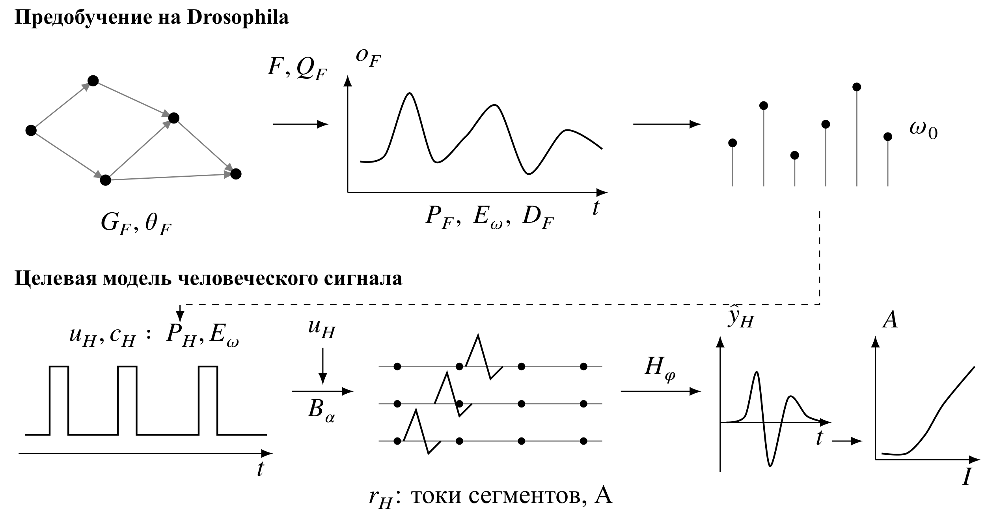

# Коннектомно-ограниченное предобучение для биофизического моделирования вызванных составных потенциалов действия при стимуляции спинного мозга: предпосылки и критерии проверки

## Аннотация

Коннектомные модели позволяют исследовать связь анатомической структуры с динамикой нейронных систем, однако их использование для предобучения моделей человеческих электрофизиологических сигналов требует отдельного обоснования. В критическом нарративном обзоре сопоставлены исследования нейродинамики Drosophila, ноцицептивных цепей, обучения представлений и биофизического моделирования вызванных составных потенциалов действия при стимуляции спинного мозга. Цель работы — определить проверяемые предпосылки переноса и условия, при которых его предполагаемая польза может быть оценена без отождествления процессов разных видов. Основной целевой задачей выбрано моделирование кривой роста амплитуды регистрируемого ответа. Предложена формальная схема, в которой переносится начальная параметризация временного модуля, а человеческое рекрутирование волокон и регистрация сигнала описываются отдельными компонентами. Результат литературного сопоставления представлен доказательной матрицей четырёх связей: коннектом и динамика; динамика и представление; рекрутирование и измеряемый сигнал; предобучение и дополнительная техническая ценность. Для каждой связи определены доступные основания, ограничения и необходимая проверка. Рассмотрены контрольные условия, позволяющие разделить эффекты топологии, обученной динамики, источника предобучения и физического оператора. Основным показателем предложена среднеквадратическая ошибка амплитуды кривой роста: её следует рассчитывать для каждого участника, затем усреднять между участниками. Практически значимое преимущество, отсутствие практически значимого различия, ухудшение и неопределённый результат рассматриваются раздельно. До независимой проверки оператора вычислительный результат обозначается как ECAP-подобный сигнал. Литература обосновывает изучение отдельных компонентов, но не устанавливает пользу переноса Drosophila для данной задачи. Предлагаемая схема определяет предмет будущего сравнения, требования к данным и границы допустимого вывода; экспериментальные результаты переноса в работе не заявляются.

**Ключевые слова:** коннектом, Drosophila, предобучение, временное представление, вызванный составной потенциал действия, стимуляция спинного мозга, биофизическая модель, валидация.

## Введение

Вызванный составной потенциал действия (ECAP) отражает суммарный электрический ответ рекрутированных нервных волокон. При стимуляции спинного мозга (SCS) зависимость амплитуды ответа от интенсивности воздействия — кривая роста — используется для характеристики измерительного канала. Её изменение определяется не только рекрутированием, но и геометрией регистрации, положением тела и параметрами импульса [1–3]. Пороги восприятия, сопоставляемые с ECAP, не являются показателями обезболивания [4].

Предобучение временного модуля на динамике коннектомной модели Drosophila представляет возможный способ задания начальных параметров. Его дополнительная ценность относительно человеческой биофизической модели и простой кривой роста не установлена. Предмет обзора — основания и критерии проверки этой гипотезы; анатомическое соответствие мухи и спинного мозга человека не предполагается.

## Материалы и методика

Выполнен критический нарративный обзор: пересмотрены 20 исходных работ, проведено тематическое дополнение. 5 октября 2026 г. в PubMed и Crossref применены 10 англоязычных запросов — по два для коннектомной динамики, ноцицепции, переноса представлений, физического моделирования ECAP, измерения либо управления SCS — и два русскоязычных. Период — с 2015 года до даты поиска; просмотрены первые 20 результатов каждого запроса по релевантности либо вся меньшая выдача. Запросы, ранги и решения сохранены в реестре.

Включались работы о механизме, ограничениях или проверке одного из четырёх звеньев; исключались дубликаты, отдельные рецензии, непрофильные работы и повторные клинические описания. К исходной подборке добавлены работа FlyVis, первичная публикация взрослого коннектома и патентная заявка. Среди 195 просмотренных записей выявлены 13 точных повторов; из выдачи добавлено исследование артефактов. Отобраны 24 источника. Выводы по частичным текстам ограничены доступными разделами. В просмотренной русскоязычной выдаче подходящих работ не найдено. Полнота охвата и отсутствие иных аналогов не заявляются.

## Результаты литературного сопоставления

### Основания и границы источников

Таблица 1. Включённые источники, проверенный результат и граница вывода. П — журнальная публикация; Пр — препринт. Полный текст означает доступность текста и проверку относящихся к выводу разделов, а не независимое воспроизведение работы.

| Источник; версия и доступ | Результат для сопоставления | Ограничение |
|---|---|---|
| [1]; П, полный текст | Поза и ширина импульса изменяют ECAP | Постоянная амплитуда не гарантирует постоянное рекрутирование; не прогноз боли |
| [2]; П, полный текст | Вычислительная оценка направленных электродов | Нет проверки на независимых участниках |
| [3]; П, полный текст | Последовательное моделирование возбуждения и регистрации | Упрощённая анатомия; пороги восприятия заданы предположениями |
| [4]; П, полный текст | ECAP и пороги восприятия у 14 участников | 112 кривых — повторные измерения; не исход обезболивания |
| [5]; П, полный текст | Восстановление динамики при коннектомных ограничениях | Общие веса, входы и начальные состояния; вычислительный эталон |
| [6]; П, полный текст | Проверка отдельных сенсомоторных цепей взрослой мухи | Абсолютные частоты модели ограниченно интерпретируемы |
| [7]; П, полный текст | Разные механизмы острой ноцицепции и гиперчувствительности | Личинка; защитное поведение не субъективная боль |
| [8]; П, полный текст | Нисходящие нейроны регулируют длительность защитной реакции | Нет межвидового переноса |
| [9]; Пр v1, проверенные разделы | Восходящие пути взрослой мухи и избегание | Стадия и воздействие отличны от личиночных исследований |
| [10]; Пр v3, проверенные разделы | Совместное рассмотрение анатомии и кальциевых ответов | Возрастные группы и наблюдаемые величины различаются |
| [11]; Пр v2, полный текст | Кольцевой аттрактор и кальциевые наблюдения | Направление головы, не ноцицепция |
| [12]; Пр v1, проверенные разделы | Динамика двигательной сети | Без тела и обратной связи; нет проверки фаз по регистрации |
| [13]; Пр v1, проверенные разделы | Контроли инициализации и переподключения графа | Вывод зависит от задачи и метрики |
| [14]; Пр v1, проверенные разделы | Латентное представление графа для резервуарных задач | Коннектом мыши; нет ECAP |
| [15]; П, полный текст | Синтетические данные и адаптация для оценки боли | Исключение тестовых участников из неразмеченной адаптации не обеспечено |
| [16]; П, проверенные разделы | Признаки ECAP восьми выбранных участников | Проверка по сигналам, а не по исключённым участникам |
| [17]; П, проверенные разделы | Модель удаления артефакта | Два участника; неоднозначность определения итоговой метрики |
| [18]; П с исправлением, полный текст | Техническая осуществимость автоматизированного программирования | Исходы обезболивания не собирались |
| [19]; П с исправлением, аннотация и проверенные сведения | Клиническое сравнение EVOKE, 24 месяца | Вторичный анализ; не новая независимая когорта |
| [20]; П, полный текст | Клиническое сравнение EVOKE, 36 месяцев | Та же когорта; анализ 36 месяцев не предзадан |
| [21]; П, полный текст | FlyVis: обучение неизвестных параметров и прогноз зрительных ответов | Зрительная задача; не перенос к человеку |
| [22]; П, полный текст | Коннектом мозга взрослой самки | Структура не задаёт единственную динамику; не ресурс личинки |
| [23]; патентная заявка, описание и формула | Синтетические ECAP и предобучение классификатора | Раскрытие способа не подтверждает эффективность |
| [24]; П, первичная аннотация | Артефакты могут имитировать нейронный ответ | Свинья; вывод ограничен доступной аннотацией |

В FlyVis анатомические ограничения сочетаются с обучением параметров на зрительной задаче [21]. Восстановление активности вычислительного эталона [5] и контроли топологии [13] относятся к конкретным условиям. Публикация взрослого мозга [22] описывает анатомический ресурс; программный доступ к нему представляет отдельную задачу.

В личиночной модели [10] веса и знаки связей заданы по коннектому и предсказанным медиаторам. Проверялись знаки и ранжирование ответов, а не абсолютные мембранные потенциалы. Связность брали из эталонного объёма после морфологического сопоставления клеток. Стадия развития, версия графа и оператор наблюдения требуют согласования: личиночные цепи [7, 8, 10], взрослые пути [9] и динамика ориентации либо ходьбы [11, 12] не образуют одной экспериментальной системы.

Методическими аналогами служат генеративное представление графов [14] и синтетическое обучение с адаптацией [15]. В [15] не обеспечено строгое исключение тестовых участников из неразмеченного пула адаптации; фактическое пересечение и размер возможного смещения не установлены. Отсутствие меток не подтверждает независимость адаптации. В [16] внешний цикл вложенной проверки выделяет каждый одиннадцатый сигнал, а не участника; анализ главных компонент описан для всех форм сигнала без указания настройки внутри обучающих разбиений.

Техническая регистрация и пользовательский опыт [18] отличаются от клинических исходов. Продолжения EVOKE [19, 20] не являются независимыми репликациями. Патентная заявка [23] не позволяет считать само сочетание синтетических ECAP и предобучения установленной новизной предлагаемой схемы.

### Формальная схема переноса

Граф G_F и параметры θ_F задают исходную динамику F, определяющую состояние x_F при воздействии u_F. Оператор Q_F определяет наблюдение o_F, включая преобразование нейронной активности в кальциевый сигнал, если используются такие данные. Адаптер P_F подаёт историю наблюдений на временной модуль E_ω. Предлагаемая исходная задача — прогноз последующего наблюдения декодером D_F; будущий целевой отсчёт исключается из входа. Полученные параметры модуля обозначены ω₀.

@@equation source

В целевой задаче используются адаптер P_H, компонент динамики волокон B_α и оператор регистрации H_φ. Биофизический оператор ECAP включает B_α и H_φ. Условия c_H задают параметры импульса, анатомии и регистрации. Параметры ω инициализируются значением ω₀; адаптеры, декодер, параметры θ_F, граф и состояния мухи не переносятся. Индексы F и H обозначают виды, h > 0 — горизонт прогноза, ŷ_H — расчётное напряжение нейронного компонента.

@@equation target

В предлагаемой схеме (рисунок 1) r_H — трансмембранные токи сегментов человеческой модели в амперах на заданной пространственно-временной сетке. B_α получает заданный стимул u_H и описывает возбуждение и распространение. Сопряжение с E_ω должно сохранять ограничения и единицы уравнений; латентные координаты токами не являются. В линейном квазистатическом приближении резистивного проводника H_φ суммирует токи с коэффициентами в омах, получая напряжение в вольтах [1, 3]. Распространение не повторяется; параметры H_φ описывают проводимость, геометрию и отведение. Определимость α и φ проверяется отдельно: совпадение ECAP не устанавливает единственности внутренних токов, а число активированных волокон не заменяет их распределения. Артефакт и шум учитываются отдельно.

Рисунок 1. Предлагаемое сопряжение предобучения и человеческой модели. Пунктир — перенос только начальных параметров ω₀, без графа и состояний мухи. B_α определяет возбуждение и распространение при заданном стимуле u_H; H_φ преобразует токи r_H в напряжение. A(I) — амплитуда, выделенная из сигнала. Граф и кривые условны; преимущество переноса не установлено.

E_ω преобразует историю входа рекуррентно либо эквивалентным временным способом; архитектура не фиксируется. Необходимость памяти проверяется относительно простой кривой роста. Для одиночного импульса память может быть избыточна; использование истории стимуляции и восстановления возбудимости потребует пригодных временных наблюдений.

Таблица 2. Сопоставимые свойства и статус предположений.

| Свойство | Условие сопоставления | Статус |
|---|---|---|
| Вход и наблюдение | Воздействие и выбранная активность мухи; история стимуляции и рекрутирование человека | Разные физические величины; общий закон не установлен |
| Размерность | Раздельные адаптеры в пространство размерности k | Авторский способ согласования, не анатомическое тождество |
| Время | Отдельные шаги и окна; масштаб определяется на обучающих данных | Кальциевый сигнал и электрический ответ нельзя приравнять |
| Нормировка | Отдельно по видам и обучающим разбиениям; выход в микровольтах | Нормировка сама по себе не доказывает сходство |
| Переносимое свойство | Предсказательная структура отклика на историю входа | Гипотеза; без обоснованного свойства перенос не обосновывается |

### Проверки, вытекающие из литературы

Таблица 3. Четыре звена доказательной схемы.

| Звено | Основание | Необходимая проверка и граница |
|---|---|---|
| Коннектом → динамика | [5, 6, 10, 21, 22] | Совместимые граф и наблюдения; контроли инициализации и степеней [13] |
| Динамика → представление | [11, 12] | Предсказание исходных наблюдений; исключение утечки и сравнение динамических контролей |
| Рекрутирование → сигнал | [1–3, 17, 24] | Независимая проверка регистрации и артефактов; возбуждение не дублируется |
| Предобучение → ценность | Методические аналоги [15, 16, 23] | Независимые участники и обязательные контроли; польза пока не установлена |

Таблица 4. Контрольные условия будущего сравнения.

| Условие | Проверяемый эффект | Требование |
|---|---|---|
| Простая кривая роста без памяти | Необходимость временного модуля | Те же входные сведения и разбиения |
| Человеческая модель без предобучения | Эффект переноса | Сопоставимые размерность и бюджет настройки |
| Предобучение на ECAP-подобных сигналах человеческой модели | Выбор исходного домена | Тот же оператор и доступные данные |
| Неноцицептивная динамика мухи | Специфичность источника | Сопоставимый объём и задача обучения |
| Перемешанное время | Польза временной организации | Сохранение распределения входов |
| Переподключённый граф | Польза топологии | Сохранение степеней и общая инициализация |
| Топология без обученной динамики | Структура и обучение | Раздельная оценка вклада параметров |
| Замороженный и дообучаемый модуль | Адаптация параметров | Общие разбиения; настройки внутри обучения |
| Модель без оператора регистрации | Нефизический обход задачи | Только диагностический контроль |

Полный набор комбинаций факторов не предписывается. Человеческие данные должны содержать идентификаторы участников, стимуляцию, геометрию и кривые роста; требуется разрешение на использование. Назначение групп фиксируется заранее. Участники проверки оператора, повлиявшей на выбор модели или протокола, исключаются из окончательного теста переноса. Заранее определённый совместный анализ общей отложенной группы не считается независимой репликацией.

Для участника i основная предложенная ошибка E_i — среднеквадратическая ошибка (RMSE) амплитуды кривой роста в микровольтах. Итог E — среднее E_i по участникам, независимо от числа повторных сигналов. Преимущество Δ определяется как ошибка контроля минус ошибка переноса.

@@equation metric

Здесь A_ij и Â_ij — зарегистрированная и прогнозируемая амплитуды в j-й точке кривой участника i; m_i — число сопоставимых точек, N — число участников.

Повторные импульсы, сеансы и конфигурации не увеличивают число независимых участников. Определение амплитуды, окна, масштабы времени, калибровка и подбор параметров фиксируются внутри обучающих разбиений. Допуски практически значимого различия, объём выборки и статистический протокол определяются после проверки пригодности данных, до доступа к окончательной тестовой выборке. Форма, латентность и устойчивость регистрации остаются дополнительными характеристиками.

## Обсуждение

Авторский результат обзора — схема сопоставления доказательств и постановка будущего сравнения. Для разности ошибок Δ предлагается заранее установить практически значимый допуск δ > 0. Преимущество подтверждается, если доверительный интервал Δ расположен выше δ; ухудшение — ниже −δ; отсутствие практически значимого различия — внутри [−δ, δ]. В остальных случаях результат считается неопределённым. Основное сравнение, уровень доверия и способ расчёта интервала выбираются заранее. Такой порядок не позволяет принять статистическую незначимость за отсутствие эффекта.

Отсутствие обоснованного сопоставимого свойства, несовместимые наблюдения, непроверенный оператор или непригодные человеческие данные исключают вывод об эффективности переноса. Потребуется пересмотреть постановку либо ограничиться модельными исследованиями. До независимой проверки выход остаётся ECAP-подобным. Недоступность данных не опровергает гипотезу и не заменяет проверку на человеке.

Обзор ограничен тематическим отбором, глубиной поискового дополнения, частичной доступностью текстов и наличием препринтов. Нейродинамика и ноцицептивное поведение мухи, субъективная боль человека, ECAP и клинические исходы лечения рассматриваются раздельно. Точность моделирования кривой роста сама по себе не подтверждает клиническую эффективность нейростимуляции.

## Заключение

Рассмотренные работы обосновывают исследование коннектомной динамики и биофизического измерительного канала SCS как отдельных компонентов. Польза предобучения на Drosophila для кривой роста ECAP остаётся гипотезой. Определены переносимые параметры, требования к описанию рекрутирования, контрольные сравнения и ошибка, усредняемая по независимым участникам. Предложенная схема связывает каждый будущий вывод с необходимыми данными и различает преимущество, отсутствие практически значимого различия, ухудшение и неопределённость.

## Extended abstract

### Connectome-constrained pretraining for biophysical modelling of evoked compound action potentials during spinal cord stimulation: rationale and evaluation criteria

**Objective.** This critical narrative review examines connectome-constrained Drosophila pretraining for modelling human evoked compound action potential (ECAP) growth curves during spinal cord stimulation. Transfer benefits remain hypothetical; no original experiments are reported.

**Materials and methods.** Twenty prior studies were reassessed. On 5 October 2026, ten English queries covering five research areas and two Russian queries were applied to PubMed and Crossref, covering 2015 to the search date. The first twenty relevance-ranked records per query, or the entire shorter set, were inspected. Twenty-four sources were included. Queries, selection decisions, versions, corrections and primary locators were recorded. Partial texts restrict conclusions to accessible sections; coverage is not exhaustive.

**Results.** Four evidential links were distinguished: connectome to dynamics, dynamics to representation, human recruitment to recording, and pretraining to technical benefit. The source model predicts later observations from past inputs; prediction targets are excluded from its input. Only temporal-module parameters are transferred; anatomy, graph, source states and adapters are not. A human axon model receives the prescribed stimulus and supplies compartment transmembrane currents; excitation and propagation retain their equations and units. A separate recording operator maps these currents to electrode voltage in a linear, quasi-static resistive conductor. Its parameters describe conductivity, geometry and recording; fitted axon and recording parameters require identifiability analysis. Recruitment count alone is insufficient. Controls include a static growth curve, human-only training, human synthetic pretraining, nonnociceptive fly dynamics, temporal shuffling, rewired graphs, topology without learned dynamics, and frozen versus adapted parameters. Removing the recording operator serves only as a diagnostic control. No network architecture is prescribed. Source calcium measurements and target electrical recordings require separate observation maps and temporal scales. Similar representations do not establish anatomical equivalence or clinical validity.

**Discussion and conclusions.** The proposed endpoint is root mean square error (RMSE) of amplitude in microvolts, computed for each participant's growth curve and averaged equally across participants. Selection and calibration use training partitions only. Operator-validation data used for selection cannot enter the final transfer test; shared held-out data are not independent replication. For a prespecified error contrast, confidence intervals above the positive practical margin, below its negative, or wholly within these bounds indicate advantage, deterioration or no practically meaningful difference. Other results are inconclusive; nonsignificance does not establish equivalence. Numerical tolerances and sample size depend on confirmed data suitability. Missing data do not falsify the hypothesis. The combined axon–recording model requires independent human ECAP testing. Output agreement does not establish unique internal currents; unvalidated outputs remain ECAP-like. Fly nociception, subjective pain, electrophysiological response and clinical outcomes remain distinct.

**Keywords:** connectome, Drosophila, pretraining, temporal representation, evoked compound action potential, spinal cord stimulation, biophysical model, validation.
