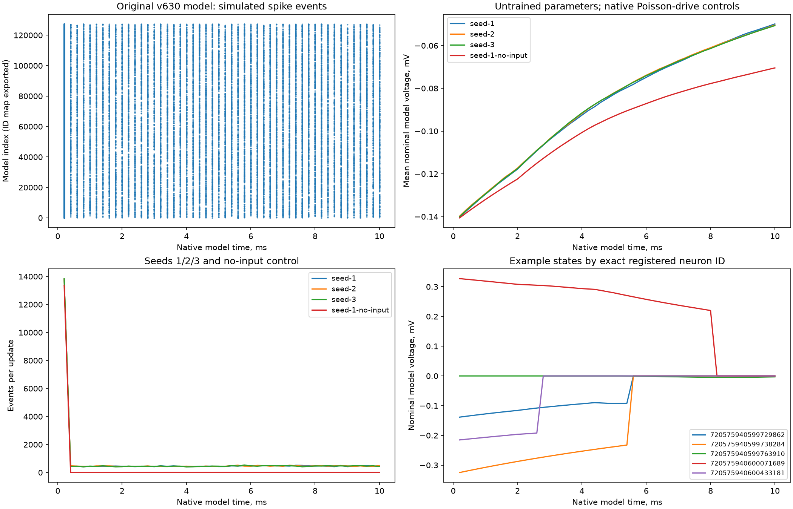

# SIM-002 — chaobrain/fitting_drosophila_whole_brain_spiking_model

[Результат испытаний](../../REPORT.md#sim-002) · [Все проекты](../README.md)

Исходники: `f1389ba8b0e7c9f4059d2538b6b799c3e88342ee`.

## Фактические события и состояния исходной полной v630-модели: три seeds, повтор и нулевой Poisson-вход; точные ID сохранены без float-преобразования.

Короткий тест API FiringRateNetwork с необученными параметрами и масштабом конструктора 0,0117857 мВ; это не default CLI 0,000825 мВ и не воспроизведение результатов подгонки. Мс/мВ — номинальные единицы модели, без независимой калибровки. Большой начальный транзиент и ненулевой no-input не трактуются как сенсорный ответ.

Первичный файл: [full-v630-firing-model.png](<../../../research/.work/simulator-evaluation/SIM-002/20261026T211202Z-7ee5b4/exports/full-v630-firing-model.png>).

SHA-256: `14407d3b54658e91a81f00ba9f2a2ed30681173011891ac3f20089343dcf94a1`.

## Фактические события и состояния исходной полной v630-модели: три seeds, повтор и нулевой Poisson-вход; точные ID сохранены без float-преобразования.

Короткий тест API FiringRateNetwork с необученными параметрами и масштабом конструктора 0,0117857 мВ; это не default CLI 0,000825 мВ и не воспроизведение результатов подгонки. Мс/мВ — номинальные единицы модели, без независимой калибровки. Большой начальный транзиент и ненулевой no-input не трактуются как сенсорный ответ.

[Открыть full-v630-firing-model.svg](full-v630-firing-model.svg)

Первичный файл: [full-v630-firing-model.svg](<../../../research/.work/simulator-evaluation/SIM-002/20261026T211202Z-7ee5b4/exports/full-v630-firing-model.svg>).

SHA-256: `df18d6adc63268f68939026c7f1ac515fe62e6547ca9050eb7df898126d57491`.
