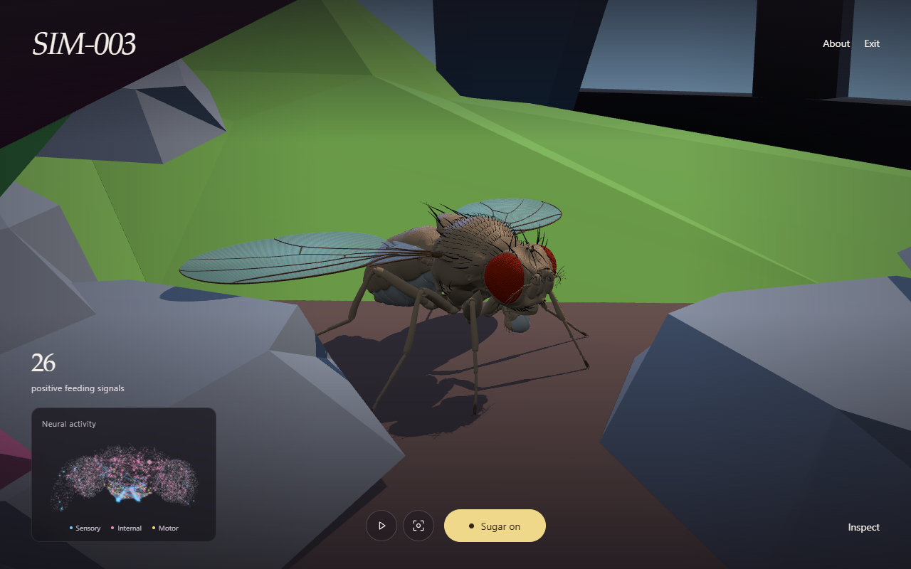
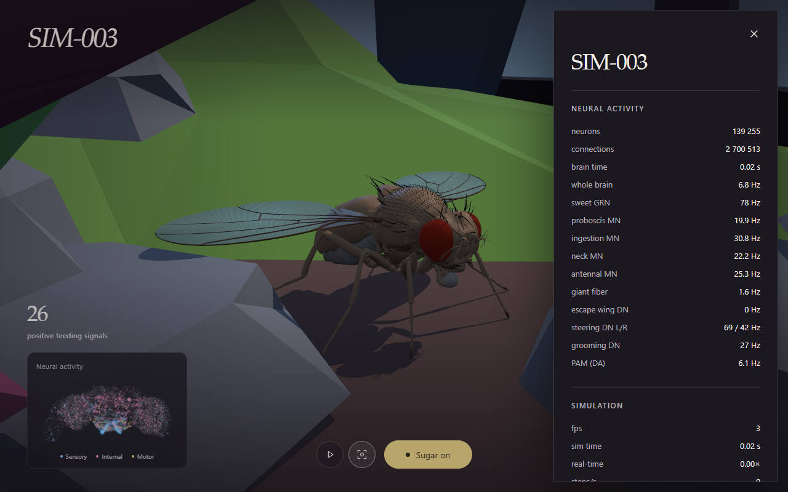

# SIM-003 — cnqso/infinite-sugar

[Результат испытаний](../../REPORT.md#sim-003) · [Все проекты](../README.md)

Исходники: `fdbbd866b203a709a164970b0a8996108edd57a5`.

## Infinite Sugar: браузерная сцена

Скриншот реального Edge/WebGL запуска с поставляемым графом: 139255 нейронов, 2700513 связей. Авторские двигательные паттерны сосуществуют с нейронными выходами; изображение не доказывает биологическую причинность поведения.

Первичный файл: [browser-scene.png](<../../../research/.work/simulator-evaluation/SIM-003/20261005T121548Z-529787/browser-scene.png>).

SHA-256: `71244c7d7f88705ffef90399a13f3504ebe108ecfbf5b9334a4f0502377551dd`.

## Infinite Sugar: инспектор сети

Скриншот реального Edge/WebGL запуска с поставляемым графом: 139255 нейронов, 2700513 связей. Авторские двигательные паттерны сосуществуют с нейронными выходами; изображение не доказывает биологическую причинность поведения.

Первичный файл: [browser-inspector.png](<../../../research/.work/simulator-evaluation/SIM-003/20261005T121548Z-529787/browser-inspector.png>).

SHA-256: `c509ff016d05eac892f26fe3b744c13a9b50138d8f6c9ca3054f987956a9b538`.
