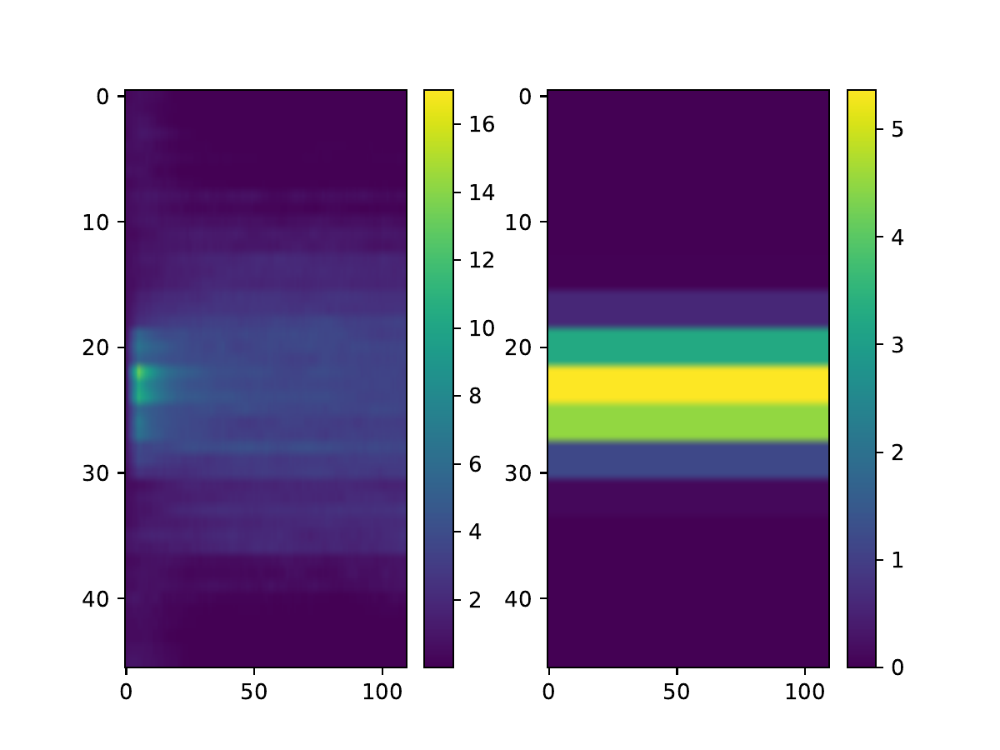
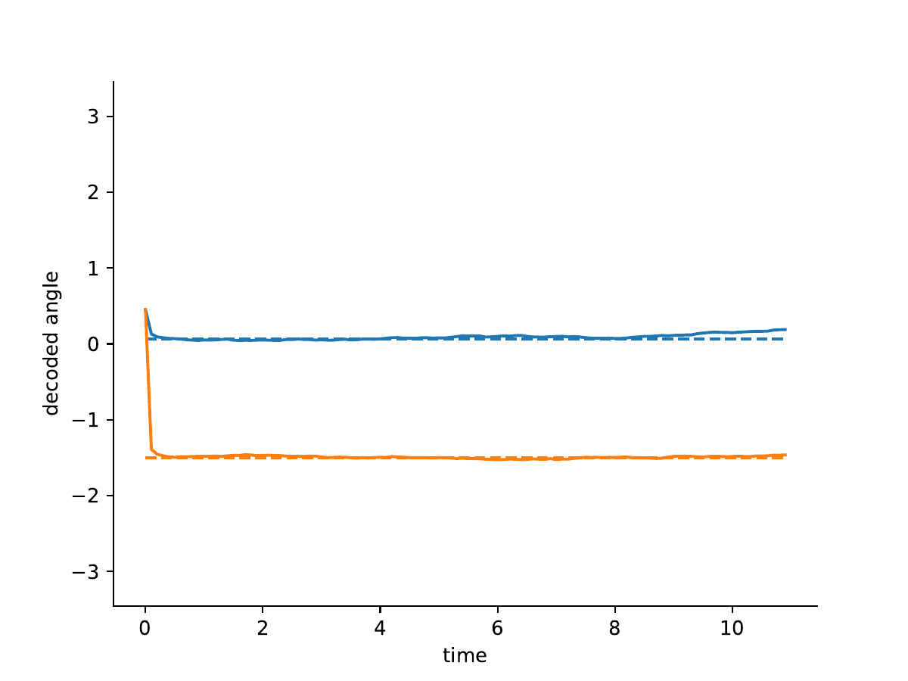

# SIM-005 — emebeiran/connconstr

[Результат испытаний](../../REPORT.md#sim-005) · [Все проекты](../README.md)

Исходники: `f5f397b88f8dd5c2a5c13558ce6039194a284586`.

## connconstr: activity-preview

Вывод авторского сценария connconstr на hemibrain (1500 эпох) либо его PNG-предпросмотр. Сопоставляются обученная модель и целевой паттерн; это не человеческий ECAP и не полноценная модель тела. Точные параметры и происхождение — в квитанциях author_run и extracted-author-data.

Первичный файл: [activity-preview.png](<../../../research/.work/simulator-evaluation/SIM-005/20261005T123535Z-48648e/source/Figs/activity-preview.png>).

SHA-256: `be2380d488a1c395991f606aa213db3984d41d5e0d90a1c23932c3e96e85730a`.

## connconstr: angle-preview

Вывод авторского сценария connconstr на hemibrain (1500 эпох) либо его PNG-предпросмотр. Сопоставляются обученная модель и целевой паттерн; это не человеческий ECAP и не полноценная модель тела. Точные параметры и происхождение — в квитанциях author_run и extracted-author-data.

Первичный файл: [angle-preview.png](<../../../research/.work/simulator-evaluation/SIM-005/20261005T123535Z-48648e/source/Figs/angle-preview.png>).

SHA-256: `7fa3dc58f182b36f372c08f38fecb4f3092eb0d7f84ae1e51eda9ceff07ea770`.

## connconstr: simplering2_matrix_final

Вывод авторского сценария connconstr на hemibrain (1500 эпох) либо его PNG-предпросмотр. Сопоставляются обученная модель и целевой паттерн; это не человеческий ECAP и не полноценная модель тела. Точные параметры и происхождение — в квитанциях author_run и extracted-author-data.

[Открыть simplering2_matrix_final.pdf](simplering2_matrix_final.pdf)

Первичный файл: [simplering2_matrix_final.pdf](<../../../research/.work/simulator-evaluation/SIM-005/20261005T123535Z-48648e/source/Figs/simplering2_matrix_final.pdf>).

SHA-256: `7fd049285498c29a06a5d38603e6eb6ce28735113db6471cf083ee8abe014bf5`.

## connconstr: simplering2_matrix_scatter

Вывод авторского сценария connconstr на hemibrain (1500 эпох) либо его PNG-предпросмотр. Сопоставляются обученная модель и целевой паттерн; это не человеческий ECAP и не полноценная модель тела. Точные параметры и происхождение — в квитанциях author_run и extracted-author-data.

[Открыть simplering2_matrix_scatter.pdf](simplering2_matrix_scatter.pdf)

Первичный файл: [simplering2_matrix_scatter.pdf](<../../../research/.work/simulator-evaluation/SIM-005/20261005T123535Z-48648e/source/Figs/simplering2_matrix_scatter.pdf>).

SHA-256: `918b7b6f242d9809c0f803180c98d351a74a049a43e6ee43112f745d94e51028`.

## connconstr: simplering2_matrix_spect

Вывод авторского сценария connconstr на hemibrain (1500 эпох) либо его PNG-предпросмотр. Сопоставляются обученная модель и целевой паттерн; это не человеческий ECAP и не полноценная модель тела. Точные параметры и происхождение — в квитанциях author_run и extracted-author-data.

[Открыть simplering2_matrix_spect.pdf](simplering2_matrix_spect.pdf)

Первичный файл: [simplering2_matrix_spect.pdf](<../../../research/.work/simulator-evaluation/SIM-005/20261005T123535Z-48648e/source/Figs/simplering2_matrix_spect.pdf>).

SHA-256: `4b23316e4a101d9d0499a0ba8d8272846382e27aad158be505c0f765037b1639`.

## connconstr: simplering2_netAngle_exampleBump_trial_0

Вывод авторского сценария connconstr на hemibrain (1500 эпох) либо его PNG-предпросмотр. Сопоставляются обученная модель и целевой паттерн; это не человеческий ECAP и не полноценная модель тела. Точные параметры и происхождение — в квитанциях author_run и extracted-author-data.

[Открыть simplering2_netAngle_exampleBump_trial_0.pdf](simplering2_netAngle_exampleBump_trial_0.pdf)

Первичный файл: [simplering2_netAngle_exampleBump_trial_0.pdf](<../../../research/.work/simulator-evaluation/SIM-005/20261005T123535Z-48648e/source/Figs/simplering2_netAngle_exampleBump_trial_0.pdf>).

SHA-256: `fac15ce60d242befecaedca4f89ccd4fa9c9f6d5f907182879fcba514744464b`.

## connconstr: simplering2_netAngle_exampleBump_trial_1

Вывод авторского сценария connconstr на hemibrain (1500 эпох) либо его PNG-предпросмотр. Сопоставляются обученная модель и целевой паттерн; это не человеческий ECAP и не полноценная модель тела. Точные параметры и происхождение — в квитанциях author_run и extracted-author-data.

[Открыть simplering2_netAngle_exampleBump_trial_1.pdf](simplering2_netAngle_exampleBump_trial_1.pdf)

Первичный файл: [simplering2_netAngle_exampleBump_trial_1.pdf](<../../../research/.work/simulator-evaluation/SIM-005/20261005T123535Z-48648e/source/Figs/simplering2_netAngle_exampleBump_trial_1.pdf>).

SHA-256: `7b9ba2888a84b39873cb1ff72fa216bc6b97e9f2219aefa5e486e772ca91df85`.

## connconstr: simplering2_netAngle_exampleBump_trialFinal_1

Вывод авторского сценария connconstr на hemibrain (1500 эпох) либо его PNG-предпросмотр. Сопоставляются обученная модель и целевой паттерн; это не человеческий ECAP и не полноценная модель тела. Точные параметры и происхождение — в квитанциях author_run и extracted-author-data.

[Открыть simplering2_netAngle_exampleBump_trialFinal_1.pdf](simplering2_netAngle_exampleBump_trialFinal_1.pdf)

Первичный файл: [simplering2_netAngle_exampleBump_trialFinal_1.pdf](<../../../research/.work/simulator-evaluation/SIM-005/20261005T123535Z-48648e/source/Figs/simplering2_netAngle_exampleBump_trialFinal_1.pdf>).

SHA-256: `3d2b62995203330f7c260acc8428cbc1d114b5ddb614be84bec90da2d93cd7e1`.

## connconstr: simplering2_netAngle_final

Вывод авторского сценария connconstr на hemibrain (1500 эпох) либо его PNG-предпросмотр. Сопоставляются обученная модель и целевой паттерн; это не человеческий ECAP и не полноценная модель тела. Точные параметры и происхождение — в квитанциях author_run и extracted-author-data.

[Открыть simplering2_netAngle_final.pdf](simplering2_netAngle_final.pdf)

Первичный файл: [simplering2_netAngle_final.pdf](<../../../research/.work/simulator-evaluation/SIM-005/20261005T123535Z-48648e/source/Figs/simplering2_netAngle_final.pdf>).

SHA-256: `2125996a75ada21a8768042e587dc5586778c161490357ef10bbe1cb94faf28f`.

## connconstr: simplering2_netAngle_readout_final

Вывод авторского сценария connconstr на hemibrain (1500 эпох) либо его PNG-предпросмотр. Сопоставляются обученная модель и целевой паттерн; это не человеческий ECAP и не полноценная модель тела. Точные параметры и происхождение — в квитанциях author_run и extracted-author-data.

[Открыть simplering2_netAngle_readout_final.pdf](simplering2_netAngle_readout_final.pdf)

Первичный файл: [simplering2_netAngle_readout_final.pdf](<../../../research/.work/simulator-evaluation/SIM-005/20261005T123535Z-48648e/source/Figs/simplering2_netAngle_readout_final.pdf>).

SHA-256: `29444a721b386acd791a70f536f2afdcca99744d25d02e41cc8d5076f7859d39`.

## connconstr: simplering2_synws_hist

Вывод авторского сценария connconstr на hemibrain (1500 эпох) либо его PNG-предпросмотр. Сопоставляются обученная модель и целевой паттерн; это не человеческий ECAP и не полноценная модель тела. Точные параметры и происхождение — в квитанциях author_run и extracted-author-data.

[Открыть simplering2_synws_hist.pdf](simplering2_synws_hist.pdf)

Первичный файл: [simplering2_synws_hist.pdf](<../../../research/.work/simulator-evaluation/SIM-005/20261005T123535Z-48648e/source/Figs/simplering2_synws_hist.pdf>).

SHA-256: `f820b14fb1b2c38be81d204c9250a5cf5b2a865bd6bcd5c44e83af73e5b24799`.
