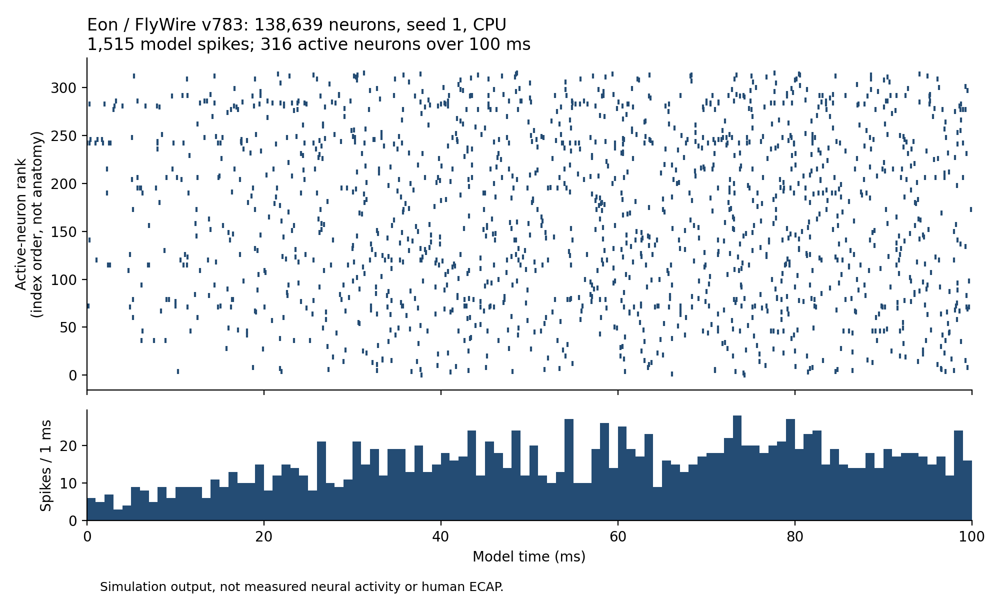

# SIM-006 — eonsystemspbc/fly-brain

[Результат испытаний](../../REPORT.md#sim-006) · [Все проекты](../README.md)

Исходники: `a3db62f9436074e485c0278290c2164ed6150808`.

## Eon: спайковая активность полного FlyWire v783

Фактический CPU-расчёт 138639 нейронов, seed 1, 100 мс: 1515 модельных спайков у 316 активных нейронов. Ось Y — ранг активного нейрона, не анатомическая координата. Это выход модели, не измеренная активность и не ECAP.

Первичный файл: [spike-raster-seed1.png](<../../../research/.work/simulator-evaluation/SIM-006/20261025T103703Z-5caefe/exports/eon/spike-raster-seed1.png>).

SHA-256: `ede256533750e44b889550b2f6304695ab908ac90ee0e510e8148a92f0d6dd26`.

## Eon: спайковая активность полного FlyWire v783

Фактический CPU-расчёт 138639 нейронов, seed 1, 100 мс: 1515 модельных спайков у 316 активных нейронов. Ось Y — ранг активного нейрона, не анатомическая координата. Это выход модели, не измеренная активность и не ECAP.

[Открыть spike-raster-seed1.pdf](spike-raster-seed1.pdf)

Первичный файл: [spike-raster-seed1.pdf](<../../../research/.work/simulator-evaluation/SIM-006/20261025T103703Z-5caefe/exports/eon/spike-raster-seed1.pdf>).

SHA-256: `73d16b0258b0ce40f2fd1196165235dd8af39e6cdacc6fdd9d8b0b4ff18c7d97`.
