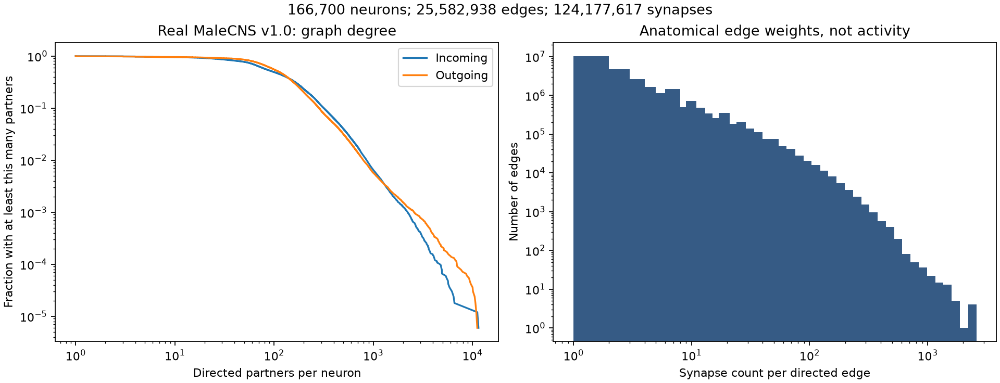

# SIM-007 — erankopel/maleCNS-depth

[Результат испытаний](../../REPORT.md#sim-007) · [Все проекты](../README.md)

Исходники: `e80dcf643beefff08afd936a741ac8cc50723cb4`.

## Распределения входящих/исходящих партнёров и весов реального графа MaleCNS v1.0: 166 700 узлов и 25 582 938 рёбер.

Структурная статистика авторского подготовленного графа с совпавшим content SHA-256; это не активность, спайки или ECAP.

Первичный файл: [graph-statistics.png](<../../../research/.work/simulator-evaluation/SIM-007/20261025T110749Z-7c38a9/exports/malecns-depth/graph-statistics.png>).

SHA-256: `5a72743458603a056f70af0269f55b685d0c009124e3a84b643684a4782d9956`.

## Распределения входящих/исходящих партнёров и весов реального графа MaleCNS v1.0: 166 700 узлов и 25 582 938 рёбер.

Структурная статистика авторского подготовленного графа с совпавшим content SHA-256; это не активность, спайки или ECAP.

[Открыть graph-statistics.svg](graph-statistics.svg)

Первичный файл: [graph-statistics.svg](<../../../research/.work/simulator-evaluation/SIM-007/20261025T110749Z-7c38a9/exports/malecns-depth/graph-statistics.svg>).

SHA-256: `fd3ef4cfed5f27f584741864007d3478d87d09c19b67e468725c855b3d9f5b5b`.
