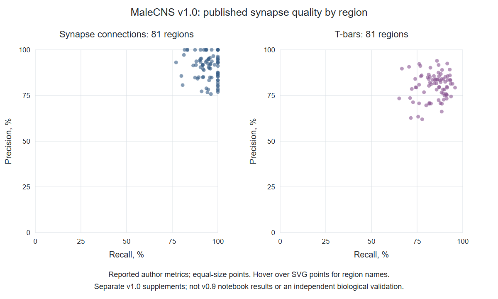

# SIM-008 — flyconnectome/2025malecns

[Результат испытаний](../../REPORT.md#sim-008) · [Все проекты](../README.md)

Исходники: `67767d2233657983993ff6c2be48e836a935863c`.

## Опубликованные авторами precision/recall для 81 области MaleCNS v1.0: синаптические соединения и T-бары.

Чтение и визуализация двух первичных дополнительных таблиц, не независимая оценка качества; это отдельный v1.0-выпуск, не результат незавершённого v0.9-ноутбука.

Первичный файл: [published-synapse-quality.png](<../../../research/.work/simulator-evaluation/SIM-008/20261026T220529Z-412ab7/exports/malecns-notebook/published-synapse-quality.png>).

SHA-256: `8fb9074d987c2c6c1e25af9a51bcdacf442612dd04f2e3606a3c52a0ef3fcb07`.

## Опубликованные авторами precision/recall для 81 области MaleCNS v1.0: синаптические соединения и T-бары.

Чтение и визуализация двух первичных дополнительных таблиц, не независимая оценка качества; это отдельный v1.0-выпуск, не результат незавершённого v0.9-ноутбука.

[Открыть published-synapse-quality.svg](published-synapse-quality.svg)

Первичный файл: [published-synapse-quality.svg](<../../../research/.work/simulator-evaluation/SIM-008/20261026T220529Z-412ab7/exports/malecns-notebook/published-synapse-quality.svg>).

SHA-256: `e395a92045292867efff0ea65069acea38475d3780a5c9bcd2f1e0b8589da3a8`.
