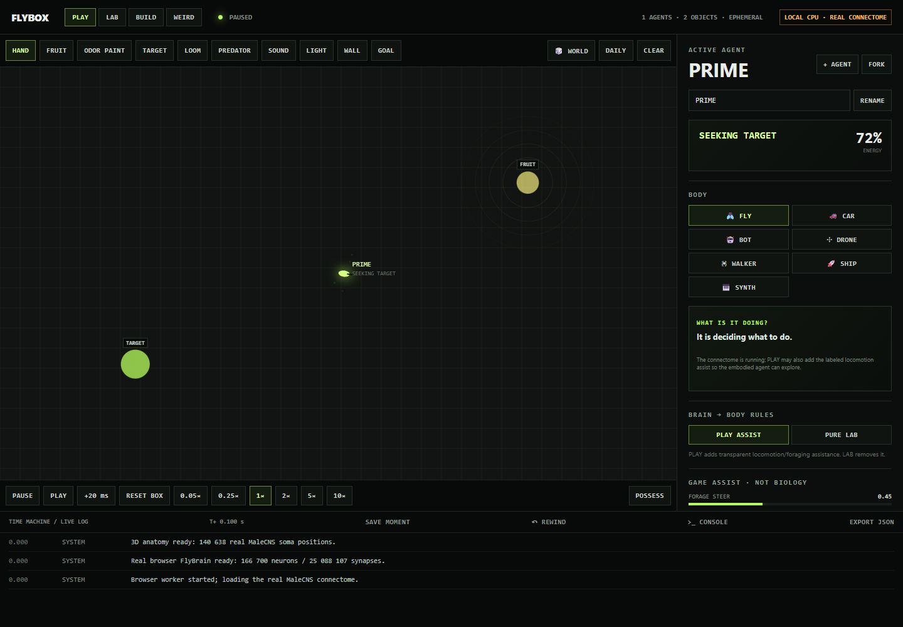
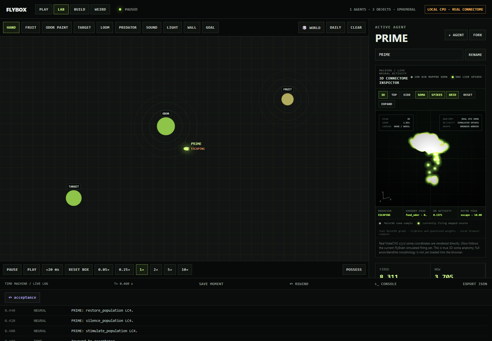

# SIM-009 — gauravvvvvvvvvv/flybox

[Результат испытаний](../../REPORT.md#sim-009) · [Все проекты](../README.md)

Исходники: `5880d221e21b1f3385b7246a6ffc3b2cf0029c2c`.

## FLYBOX: браузерная сцена PLAY

Реальный интерфейс Edge с компактным MaleCNS. PLAY добавляет игровые двигательные эвристики; сцена не доказывает естественное поведение.

Первичный файл: [browser-play.png](<../../../research/.work/simulator-evaluation/SIM-009/20261025T115431Z-143840/exports/flybox/browser-play.png>).

SHA-256: `cf317a463d717073b3a2f8a8f27a23eba29c5948a61970d174b3ca3f610d6587`.

## FLYBOX: нейронная инспекция PURE LAB

Реальный браузерный WebWorker, 166700 нейронов, 25088107 связей; показана выборка soma и модельная активность. Это не ECAP и не экспериментальная запись.

Первичный файл: [browser-lab.png](<../../../research/.work/simulator-evaluation/SIM-009/20261025T115431Z-143840/exports/flybox/browser-lab.png>).

SHA-256: `cf6e86f7116231579db75a5252403c715e129eb394b0d55a31eb3ff851209d12`.
