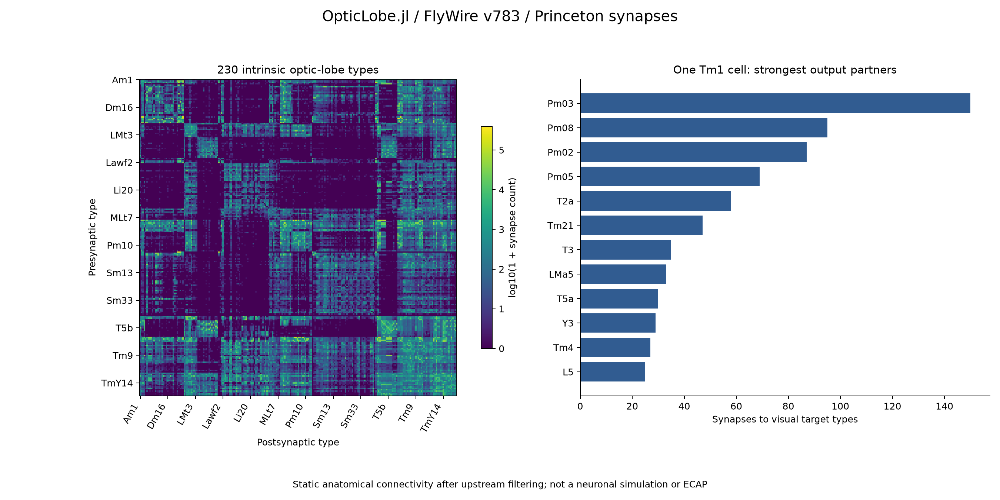
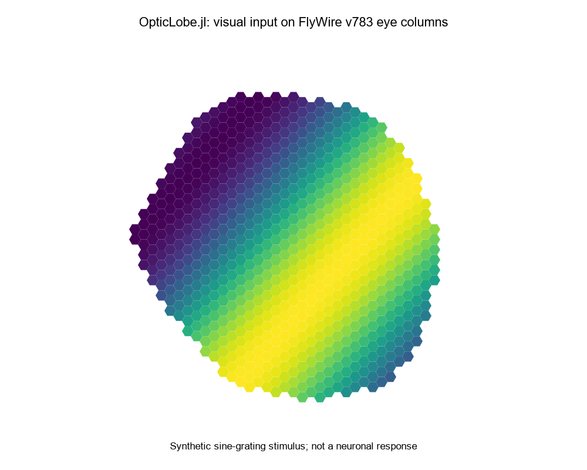
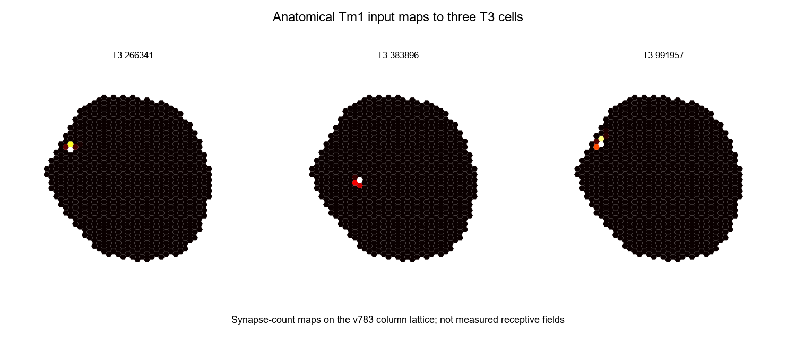

# SIM-010 — hsseung/OpticLobe.jl

[Результат испытаний](../../REPORT.md#sim-010) · [Все проекты](../README.md)

Исходники: `3352e97c37b0f96ab08f27b70b4420f3d4ac2726`.

## Связность 230 типов и партнёры одной клетки Tm1

Диагностический график из реального экспорта Wtt: логарифмическая шкала числа синапсов, оба полушария; справа одна клетка правой стороны. Не нейронная активность. Данные: FlyWire; Matsliah, Yu et al. и Seung, 2024; CC BY-NC 4.0.

Первичный файл: [connectivity-analysis.png](<../../../research/.work/simulator-evaluation/SIM-010/20261025T142101Z-e5aad3/exports/optic-lobe/connectivity-analysis.png>).

SHA-256: `ff3ac5ed8d6f9efeb0387de0aa2f6abdbe5f62b79086d8aa67282fcb74e1f759`.

## Связность и партнёры Tm1 — SVG

Та же диагностика в векторном формате; параметры преобразования и хеши входов сохранены в plot-provenance.json. Данные: FlyWire; Matsliah, Yu et al. и Seung, 2024; CC BY-NC 4.0.

[Открыть connectivity-analysis.svg](connectivity-analysis.svg)

Первичный файл: [connectivity-analysis.svg](<../../../research/.work/simulator-evaluation/SIM-010/20261025T142101Z-e5aad3/exports/optic-lobe/connectivity-analysis.svg>).

SHA-256: `ff401e47049297638cbf1c7a0f374b7371e739643621e6bdecd2e0989131688b`.

## Зрительный стимул на сетке колонок v783

Вывод sine_grating/eyeheat/rect2hex на 796 реальных позициях правого глаза. Синтетический вход, а не измеренный или смоделированный нейронный ответ. Данные: FlyWire; Matsliah, Yu et al. и Seung, 2024; CC BY-NC 4.0.

Первичный файл: [native-hex-grating.png](<../../../research/.work/simulator-evaluation/SIM-010/20261025T142101Z-e5aad3/exports/optic-lobe/native-hex-grating.png>).

SHA-256: `ebe10e7b3552348f6352dda563fa0be9997f88cfaf73c893e077b0a11c923c5a`.

## Зрительный стимул — SVG

Векторный вывод тех же нативных функций на зарегистрированной геометрии v783. Данные: FlyWire; Matsliah, Yu et al. и Seung, 2024; CC BY-NC 4.0.

[Открыть native-hex-grating.svg](native-hex-grating.svg)

Первичный файл: [native-hex-grating.svg](<../../../research/.work/simulator-evaluation/SIM-010/20261025T142101Z-e5aad3/exports/optic-lobe/native-hex-grating.svg>).

SHA-256: `63c8556303683969793cfaaf1b0dfb0cc358d4f9769e6607fe49160f65926353`.

## Анатомические входы Tm1 для трёх клеток T3

Реальные веса и колонковые координаты, полученные tracetypes/inmaps. Каждая карта нормирована на свой максимум; это не экспериментально измеренные рецептивные поля. PNG — целочисленный холст адаптера. Данные: FlyWire; Matsliah, Yu et al. и Seung, 2024; CC BY-NC 4.0.

Первичный файл: [native-Tm1-T3-input-maps.png](<../../../research/.work/simulator-evaluation/SIM-010/20261025T142101Z-e5aad3/exports/optic-lobe/native-Tm1-T3-input-maps.png>).

SHA-256: `d653ba9d9eb5d6bdcc9a672c9dc109a96ade305e0d577fe15a4ad3ca451fe12b`.

## Авторская функция montage — SVG

Нативный векторный montage тех же трёх карт. Подписи показывают окончания root ID; полные ID и суммы сохранены в full-result.json. Данные: FlyWire; Matsliah, Yu et al. и Seung, 2024; CC BY-NC 4.0.

[Открыть native-Tm1-T3-input-maps.svg](native-Tm1-T3-input-maps.svg)

Первичный файл: [native-Tm1-T3-input-maps.svg](<../../../research/.work/simulator-evaluation/SIM-010/20261025T142101Z-e5aad3/exports/optic-lobe/native-Tm1-T3-input-maps.svg>).

SHA-256: `7b2366e748a3a9184bfbeb5660484e62e1c4345fc6011a08fbf41d6c06d0ce1c`.
