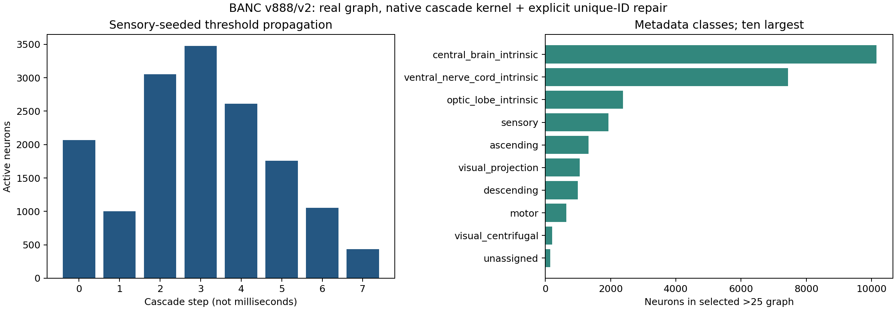

# SIM-011 — htem/BANC-project

[Результат испытаний](../../REPORT.md#sim-011) · [Все проекты](../README.md)

Исходники: `e31a2e26b9937dca72e5ca1c1960df6454d76114`.

## Каскад на зарегистрированном подграфе BANC v888/v2

Результат собственного запуска исходного порогового ядра с явным исправлением уникальности ID. Слева — число активных нейронов по шагам, справа — десять крупнейших классов выбранных 26514 нейронов. Шаг не является миллисекундой; это не ECAP и не биологически проверенная нейродинамика. Источник данных: Bates et al., BANC (2026), DOI 10.7910/DVN/7WTH1N; код e31a2e2, декларация CC BY 4.0.

Первичный файл: [banc-cascade.png](<../../../research/.work/simulator-evaluation/SIM-011/20261025T161359Z-e089f2/export/banc-cascade.png>).

SHA-256: `0fc6018459e8f5708506b6fe5d6be746dc15a6ca604bc0d30b03d0f3d3ed9ca1`.

## Каскад на зарегистрированном подграфе BANC v888/v2 — векторная версия

Результат собственного запуска исходного порогового ядра с явным исправлением уникальности ID. Слева — число активных нейронов по шагам, справа — десять крупнейших классов выбранных 26514 нейронов. Шаг не является миллисекундой; это не ECAP и не биологически проверенная нейродинамика. Источник данных: Bates et al., BANC (2026), DOI 10.7910/DVN/7WTH1N; код e31a2e2, декларация CC BY 4.0.

[Открыть banc-cascade.svg](banc-cascade.svg)

Первичный файл: [banc-cascade.svg](<../../../research/.work/simulator-evaluation/SIM-011/20261025T161359Z-e089f2/export/banc-cascade.svg>).

SHA-256: `982ceec010c89fd698bc6247635ae9f0fc8de264e85e44ec3ca98082fee442c1`.
