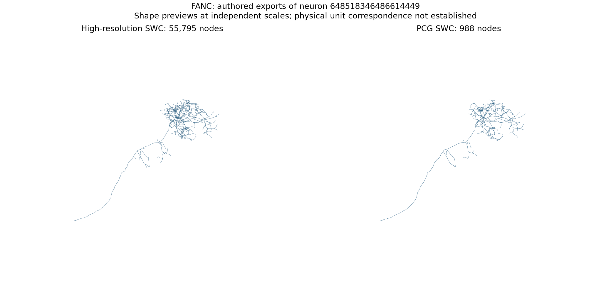
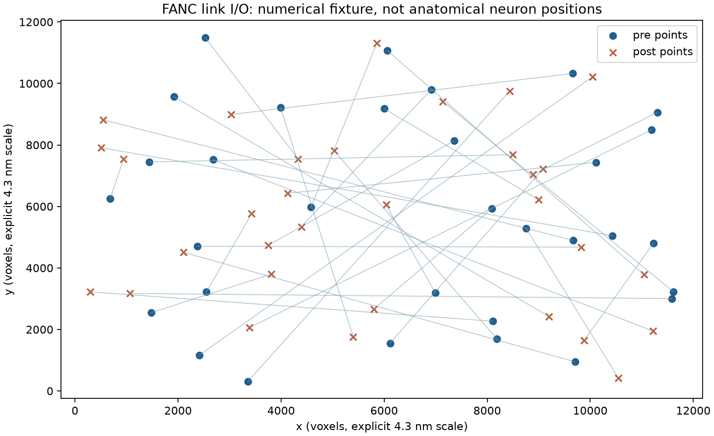

# SIM-012 — htem/FANC_auto_recon

[Результат испытаний](../../REPORT.md#sim-012) · [Все проекты](../README.md)

Исходники: `89d9769457583051e3ec9ec7b34a5f3575537bf5`.

## Два авторских морфологических экспорта FANC

Прочитаны закреплённые авторские SWC нейрона 648518346486614449: 55795 и 988 узлов. Это чтение и отображение готовых файлов, не новая реконструкция. Файлы показаны в независимых масштабах; общие физические единицы и materialization не установлены, v840 не заявляется. Источник: htem/FANC_auto_recon, commit 89d9769, example_notebooks/output; дата заголовка высокого разрешения — 2023-07-31.

Первичный файл: [authored-morphology.png](<../../../research/.work/simulator-evaluation/SIM-012/20261025T170650Z-e6c58b/replay-export/authored-morphology.png>).

SHA-256: `fd6556a68e7e9da38208c91e1783bd85dc2c10df339d52d05f513479645c5a05`.

## Два авторских морфологических экспорта FANC — векторная версия

Прочитаны закреплённые авторские SWC нейрона 648518346486614449: 55795 и 988 узлов. Это чтение и отображение готовых файлов, не новая реконструкция. Файлы показаны в независимых масштабах; общие физические единицы и materialization не установлены, v840 не заявляется. Источник: htem/FANC_auto_recon, commit 89d9769, example_notebooks/output; дата заголовка высокого разрешения — 2023-07-31.

[Открыть authored-morphology.svg](authored-morphology.svg)

Первичный файл: [authored-morphology.svg](<../../../research/.work/simulator-evaluation/SIM-012/20261025T170650Z-e6c58b/replay-export/authored-morphology.svg>).

SHA-256: `46cb56b25d0725238281afd012c7b7780cfeacdbea1d42703262e5dde674c970`.

## Локальная проверка координат и pre/post-аннотаций

Диагностический график из собственных численных примеров: показаны 32 из 64 пар точек seed 1, явный масштаб (4.3,4.3,45) нм/воксель. Это демонстрация преобразования и экспорта, не реальные позиции нейронов, не коннектом и не нейродинамика.

Первичный файл: [coordinate-io.png](<../../../research/.work/simulator-evaluation/SIM-012/20261025T170650Z-e6c58b/replay-export/coordinate-io.png>).

SHA-256: `4bc007cfdc6f9d5c43ae015e712164ffca6a499d8120f035b207ad897950387f`.

## Локальная проверка координат и pre/post-аннотаций — векторная версия

Диагностический график из собственных численных примеров: показаны 32 из 64 пар точек seed 1, явный масштаб (4.3,4.3,45) нм/воксель. Это демонстрация преобразования и экспорта, не реальные позиции нейронов, не коннектом и не нейродинамика.

[Открыть coordinate-io.svg](coordinate-io.svg)

Первичный файл: [coordinate-io.svg](<../../../research/.work/simulator-evaluation/SIM-012/20261025T170650Z-e6c58b/replay-export/coordinate-io.svg>).

SHA-256: `5b8fe268e1984246ab0668ff816f155e7a6c7ac178a38545571fbaa750e67b6e`.
