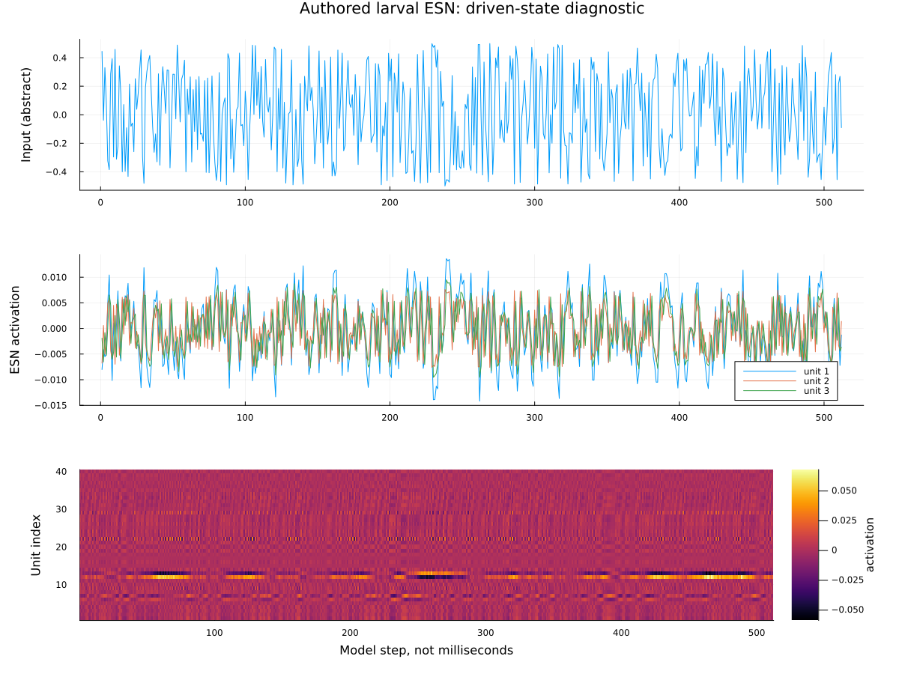
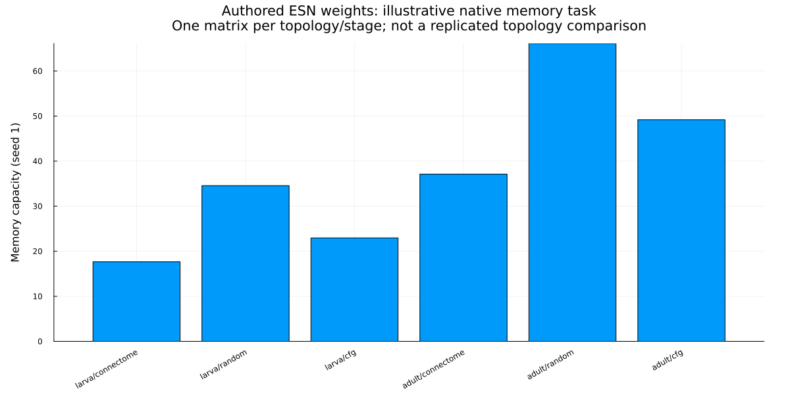
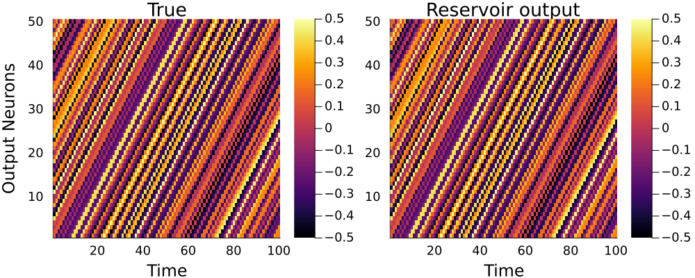

# SIM-013 — jajmcallister/Conn_ESN_Paper

[Результат испытаний](../../REPORT.md#sim-013) · [Все проекты](../README.md)

Исходники: `55b9069b919951c39dfc3a342b7b31e6cb575838`.

## Вход и состояния авторской личиночной ESN

512 дискретных шагов: вход, три активации и карта первых 40 из 178 элементов. Исправленный экспорт ненулевых состояний; точный CSV-повтор в отдельном процессе. Индексы не имеют установленного анатомического соответствия; величины безразмерные, не мембранный потенциал.

Первичный файл: [reservoir-states.png](<../../../research/.work/simulator-evaluation/SIM-013/20261025T190919Z-f9da20/export/reservoir-states.png>).

SHA-256: `a3bef14bf590a3d7028dd9f63c1f8527d9acdc7edb2819371e4d13118ccc7483`.

## Вход и состояния авторской личиночной ESN — векторная версия

512 дискретных шагов: вход, три активации и карта первых 40 из 178 элементов. Исправленный экспорт ненулевых состояний; точный CSV-повтор в отдельном процессе. Индексы не имеют установленного анатомического соответствия; величины безразмерные, не мембранный потенциал.

[Открыть reservoir-states.svg](reservoir-states.svg)

Первичный файл: [reservoir-states.svg](<../../../research/.work/simulator-evaluation/SIM-013/20261025T190919Z-f9da20/export/reservoir-states.svg>).

SHA-256: `784f824a946257a251fb4920e64314b23eaa28b33c53d8c7b7d8101cb74c4c14`.

## Задача памяти на шести авторских матрицах

По одной матрице subnetwork_1/matrix1.csv для стадий larva/adult и вариантов connectome/random/cfg. На рисунке seed 1; численные проверки включают 1/2/3/1 и отдельный процесс. Это иллюстрация исполнения задачи, не статистическое ранжирование топологий и не воспроизведение всей статьи.

Первичный файл: [memory-capacity.png](<../../../research/.work/simulator-evaluation/SIM-013/20261025T190919Z-f9da20/export/memory-capacity.png>).

SHA-256: `d63387bbca125460a8d79f7751aefc154f62d83147a9f8f12bea5de939578a54`.

## Задача памяти на шести авторских матрицах — векторная версия

По одной матрице subnetwork_1/matrix1.csv для стадий larva/adult и вариантов connectome/random/cfg. На рисунке seed 1; численные проверки включают 1/2/3/1 и отдельный процесс. Это иллюстрация исполнения задачи, не статистическое ранжирование топологий и не воспроизведение всей статьи.

[Открыть memory-capacity.svg](memory-capacity.svg)

Первичный файл: [memory-capacity.svg](<../../../research/.work/simulator-evaluation/SIM-013/20261025T190919Z-f9da20/export/memory-capacity.svg>).

SHA-256: `37c061d7bf9e5198202dc3bd90a69e3413d08389dce16e5d356c404dce3f380a`.

## Авторский пример восстановления задержанного входа

Неизменённый скрипт task1_memorycapacity.jl выполнен с REPL.softscope и seed 1: случайная ESN из 300 элементов, 4000/1000 шагов и 200 задержек. Показаны первые 50 выходов и 100 тестовых шагов. Подпись Time означает дискретные шаги, Output Neurons — выходы задачи; это не зарегистрированные нейроны или ЭКАП.

Первичный файл: [native-memory-task.png](<../../../research/.work/simulator-evaluation/SIM-013/20261025T190919Z-f9da20/export/native-memory-task.png>).

SHA-256: `0fd6fe17232d5c91ab1df0a839f590d66e60473162a0c999737036c026daa1fb`.

## Авторский пример восстановления задержанного входа — векторная версия

Неизменённый скрипт task1_memorycapacity.jl выполнен с REPL.softscope и seed 1: случайная ESN из 300 элементов, 4000/1000 шагов и 200 задержек. Показаны первые 50 выходов и 100 тестовых шагов. Подпись Time означает дискретные шаги, Output Neurons — выходы задачи; это не зарегистрированные нейроны или ЭКАП.

[Открыть native-memory-task.svg](native-memory-task.svg)

Первичный файл: [native-memory-task.svg](<../../../research/.work/simulator-evaluation/SIM-013/20261025T190919Z-f9da20/export/native-memory-task.svg>).

SHA-256: `98c5ca31cc9beace9fc3b127b2b07687ececfb56c81b2ea043c8f0c6d8c864e2`.
