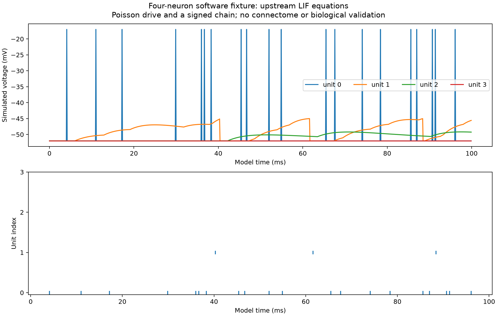

# SIM-014 — JNLiew/flylif_orientation_maps

[Результат испытаний](../../REPORT.md#sim-014) · [Все проекты](../README.md)

Исходники: `d73b18712579c969feba625ecfd3df52f4d328f4`.

## Программный пример на четырёх нейронах: модельные напряжения и спайки при пуассоновском входе; не полный коннектом.

Диагностический график фактического экспорта авторских LIF-функций; биологическая достоверность не проверена.

Первичный файл: [lif-fixture.png](<../../../research/.work/simulator-evaluation/SIM-014/20261025T200210Z-2111f5/export/lif-fixture.png>).

SHA-256: `536429278307ec487fcf0afbdbe83babfe65000ef960311ce5def0e66a8c4bdf`.

## Программный пример на четырёх нейронах: модельные напряжения и спайки при пуассоновском входе; не полный коннектом.

Диагностический график фактического экспорта авторских LIF-функций; биологическая достоверность не проверена.

[Открыть lif-fixture.svg](lif-fixture.svg)

Первичный файл: [lif-fixture.svg](<../../../research/.work/simulator-evaluation/SIM-014/20261025T200210Z-2111f5/export/lif-fixture.svg>).

SHA-256: `90cb68cdd786c7e72f6a582fb6812f406f16fca027ec5758bad6fa852edb724a`.
