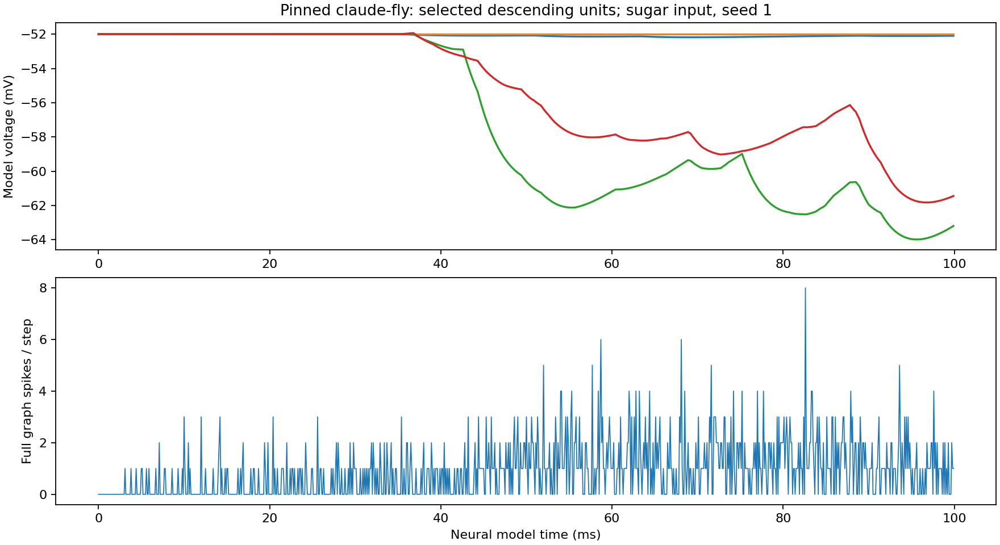
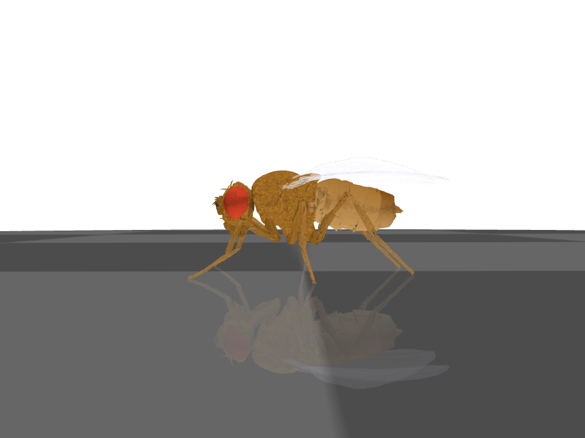

# SIM-015 — legacyindiesubmissions-ai/claude-fly

[Результат испытаний](../../REPORT.md#sim-015) · [Все проекты](../README.md)

Исходники: `3a035275148e97539711728422548bffe2a77566`.

## Динамика полного графа при стимуляции сахарных сенсорных нейронов: первые четыре из 18 наблюдаемых нисходящих элементов и суммарные спайки, seed 1.

Фактический экспорт модели с исходными весами; 100 мс нейронного времени. Имена и индексы 18 столбцов — в независимой проверке экспорта.

Первичный файл: [full-brain.png](<../../../research/.work/simulator-evaluation/SIM-015/20261025T213452Z-3dc2c0/export/full-brain.png>).

SHA-256: `ea98e84545a590535fc69cc1376807c65ce6bf5bd6d8c3a23ca6d94103a3d0f4`.

## Векторная версия графика динамики полного графа; исходные веса, CPU, seed 1.

Модельные напряжения, не электрофизиологические измерения и не ECAP.

[Открыть full-brain.svg](full-brain.svg)

Первичный файл: [full-brain.svg](<../../../research/.work/simulator-evaluation/SIM-015/20261025T213452Z-3dc2c0/export/full-brain.svg>).

SHA-256: `a0091b9882cdec698f07cf8a6b545c49c40344f439e45075abf4a56a794414a4`.

## Снимок сцены MuJoCo после 1000 шагов штатного CLI с телом и нейронным компонентом.

0,1 с времени тела и 10 нейронных шагов. Снимок подтверждает отрисовку, а не воспроизведение поведения.

Первичный файл: [embodied-snapshot.png](<../../../research/.work/simulator-evaluation/SIM-015/20261025T213452Z-3dc2c0/export/embodied-snapshot.png>).

SHA-256: `5e24b4e0c139fd27380b33fe3aea73542921ce8f1fa54ebe32c40cf4fdb88771`.
