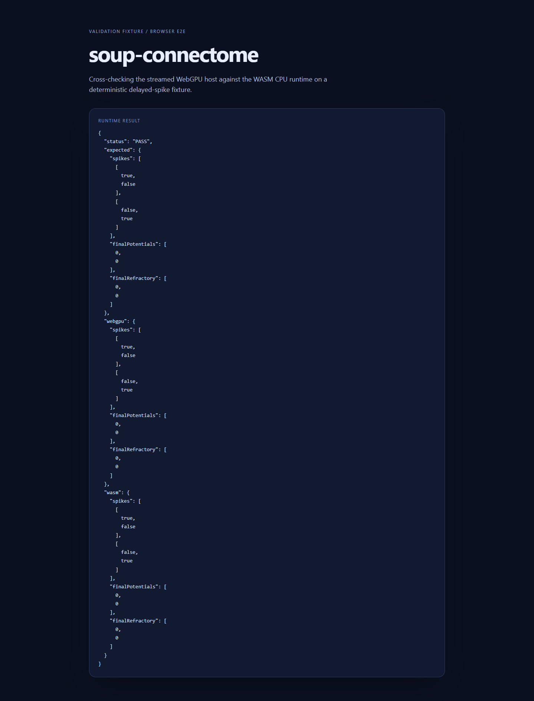
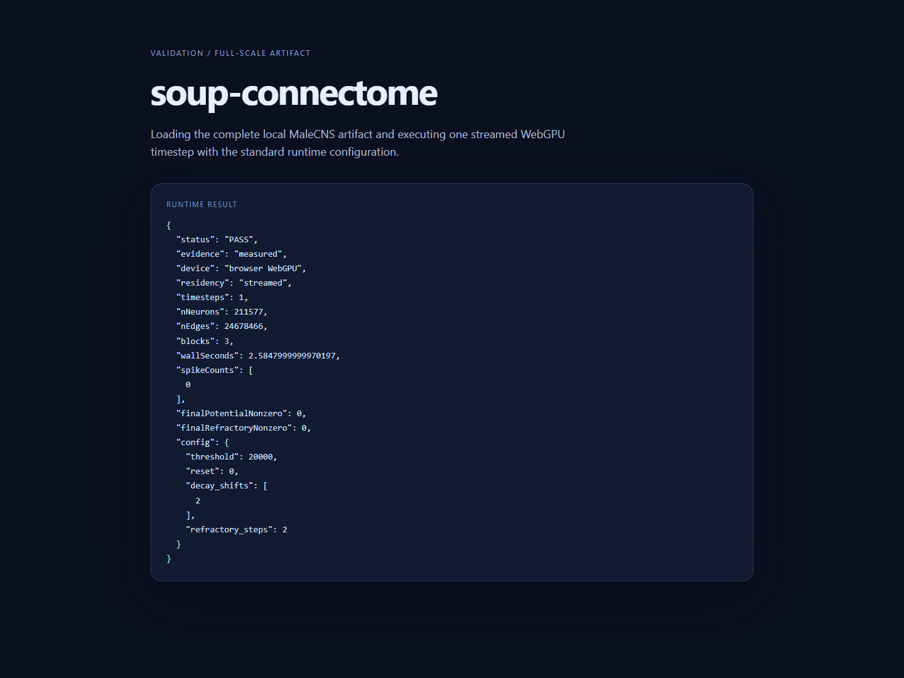
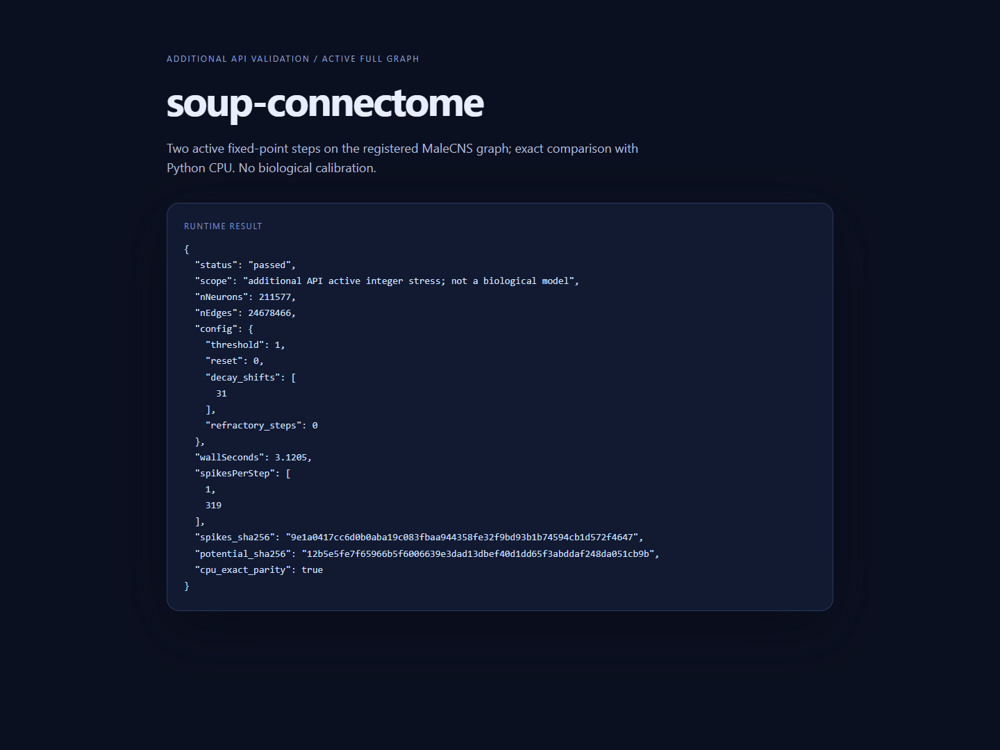

# SIM-016 — MakazhanAlpamys/soup-connectome

[Результат испытаний](../../REPORT.md#sim-016) · [Все проекты](../README.md)

Исходники: `40aa07f87995a7061f75f92f8ddd0465ede89577`.

## Авторская страница проверки: WebGPU и WASM совпали на двухнейронном примере с задержкой.

Реальный снимок установленного Edge; программная проверка, не биологическая модель.

Первичный файл: [browser-fixture.png](<../../../research/.work/simulator-evaluation/SIM-016/20261025T221009Z-8cc70d/exports/browser/browser-fixture.png>).

SHA-256: `f92738bad28060a4e8c1f70b7e2328d25a207e78a5c889809cc9d40f78032e5b`.

## Авторская страница: один нулевой шаг WebGPU на графе 211 577 нейронов и 24 678 466 рёбер.

Реальный снимок; нулевой контроль не проверяет активное распространение.

Первичный файл: [browser-fullscale.png](<../../../research/.work/simulator-evaluation/SIM-016/20261025T221009Z-8cc70d/exports/browser/browser-fullscale.png>).

SHA-256: `984ff9f72f61775655beafd77704210d9ea075b31d28c76315082643dd24cc7f`.

## Дополнительная проверка API: полный граф, два активных шага, 1 → 319 спайков; побайтное совпадение с CPU.

Диагностическая страница использует авторский API и оформление, текст результата подставлен нашим драйвером. Параметры stress не калиброваны биологически.

Первичный файл: [browser-active.png](<../../../research/.work/simulator-evaluation/SIM-016/20261025T221009Z-8cc70d/exports/browser/browser-active.png>).

SHA-256: `13bf40cb6d3d8c8b4c4a00bd69ded3ef38b4b35aa04aca84288287dd0ec624dd`.
