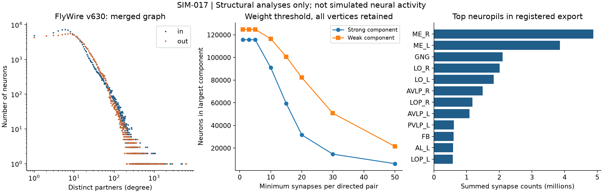
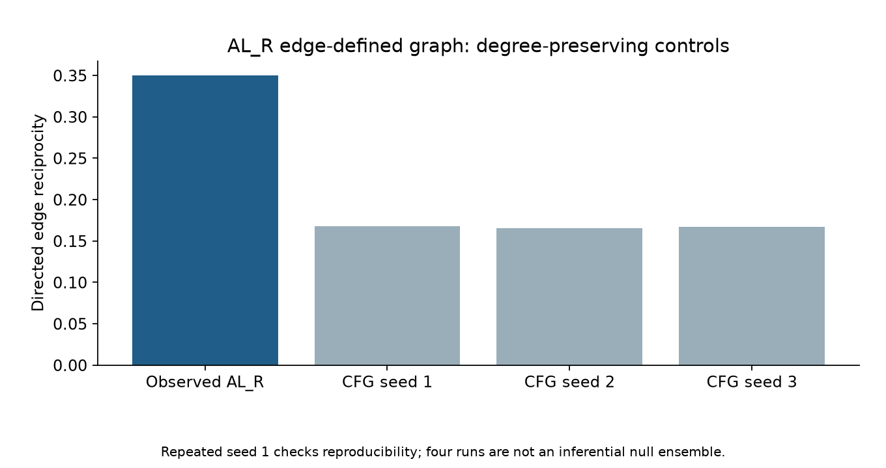

# SIM-017 — murthylab/flywire-network-analysis

[Результат испытаний](../../REPORT.md#sim-017) · [Все проекты](../README.md)

Исходники: `ee4944c03429edf857a6b10bcf98bea7dcef35b8`.

## Коннектом v630: распределение числа партнёров, компоненты при весовых порогах и сумма синапсов по нейропилям.

Диагностический график фактического экспорта; не нейронная активность и не результат проверки биологической функции.

Первичный файл: [v630-network.png](<../../../research/.work/simulator-evaluation/SIM-017/20261026T081925Z-39d3ca/exports/v630-network.png>).

SHA-256: `073e0f5e3d2d66a5c4ffb1c586dfbbfef86aae32adad5009e31d3d33648dc43b`.

## Коннектом v630: распределение числа партнёров, компоненты при весовых порогах и сумма синапсов по нейропилям.

Диагностический график фактического экспорта; не нейронная активность и не результат проверки биологической функции.

[Открыть v630-network.svg](v630-network.svg)

Первичный файл: [v630-network.svg](<../../../research/.work/simulator-evaluation/SIM-017/20261026T081925Z-39d3ca/exports/v630-network.svg>).

SHA-256: `aaaca0b9e901ab6cd4372d96e97264874eef61dd8e830740ad978ecd3973b861`.

## AL_R: взаимные связи до и после перестройки с сохранением степеней; seeds 1, 2, 3, 1. Повтор seed 1 точный.

Диагностический график фактического экспорта; не нейронная активность и не результат проверки биологической функции.

Первичный файл: [v630-controls.png](<../../../research/.work/simulator-evaluation/SIM-017/20261026T081925Z-39d3ca/exports/v630-controls.png>).

SHA-256: `b0ce6114948dd5fe8cbb73b85b6d4f2d8cda412dc39653a585761a3bc6aac8b2`.

## AL_R: взаимные связи до и после перестройки с сохранением степеней; seeds 1, 2, 3, 1. Повтор seed 1 точный.

Диагностический график фактического экспорта; не нейронная активность и не результат проверки биологической функции.

[Открыть v630-controls.svg](v630-controls.svg)

Первичный файл: [v630-controls.svg](<../../../research/.work/simulator-evaluation/SIM-017/20261026T081925Z-39d3ca/exports/v630-controls.svg>).

SHA-256: `fef80c41657f1bc7a0f6119835898c468a4469900c9f4c030a9771a960deac21`.
