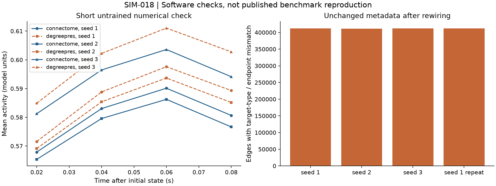
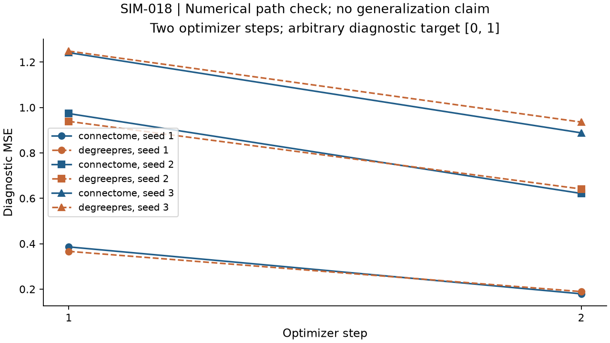

# SIM-018 — nalin-dhiman/Connectome-Constrained-Neural-Networks

[Результат испытаний](../../REPORT.md#sim-018) · [Все проекты](../README.md)

Исходники: `336e0d12a6edd92a7340cfffb71985a3879055ce`.

## Короткий расчёт активности полной настроенной сети и аудит типов целевых узлов после перестройки.

Производный график фактических численных экспортов. Обобщение, биологическая валидность и человеческий перенос не проверены.

Первичный файл: [control-study-checks.png](<../../../research/.work/simulator-evaluation/SIM-018/20261026T093128Z-2622d0/exports/control-study-checks.png>).

SHA-256: `200400669494ae38616948d9b59c9a45f697828f4fd05c33265b788b6256b667`.

## Короткий расчёт активности полной настроенной сети и аудит типов целевых узлов после перестройки.

Производный график фактических численных экспортов. Обобщение, биологическая валидность и человеческий перенос не проверены.

[Открыть control-study-checks.svg](control-study-checks.svg)

Первичный файл: [control-study-checks.svg](<../../../research/.work/simulator-evaluation/SIM-018/20261026T093128Z-2622d0/exports/control-study-checks.svg>).

SHA-256: `17f4a9de7c583d55c72b40ecdbce6a9011b778ef4861c8f31f0888c03a45ab85`.

## Два шага авторского оптимизатора на диагностическом входе для seeds 1, 2, 3; не оценка качества обучения на MovingEdge.

Производный график фактических численных экспортов. Обобщение, биологическая валидность и человеческий перенос не проверены.

Первичный файл: [control-study-training.png](<../../../research/.work/simulator-evaluation/SIM-018/20261026T093128Z-2622d0/exports/control-study-training.png>).

SHA-256: `9c5a776af10ad19c36449629e17fa1045e1f189e0326cc67e73c414c60d8ab00`.

## Два шага авторского оптимизатора на диагностическом входе для seeds 1, 2, 3; не оценка качества обучения на MovingEdge.

Производный график фактических численных экспортов. Обобщение, биологическая валидность и человеческий перенос не проверены.

[Открыть control-study-training.svg](control-study-training.svg)

Первичный файл: [control-study-training.svg](<../../../research/.work/simulator-evaluation/SIM-018/20261026T093128Z-2622d0/exports/control-study-training.svg>).

SHA-256: `7e8c195fafd2b28eff41459a812b854ed9f19a56c5841bb9abdd5a7099f30816`.
