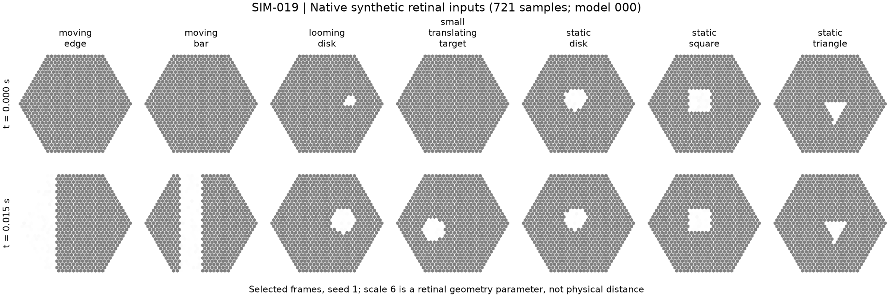
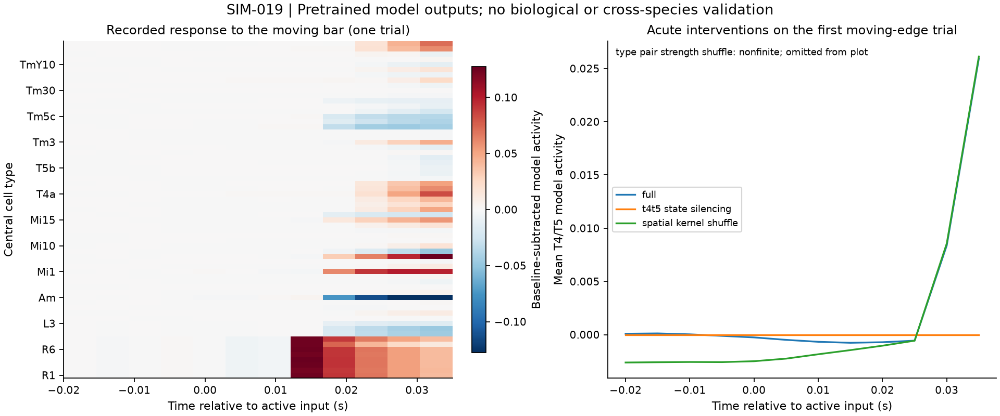

# SIM-019 — nalin-dhiman/ScaleBreak-FlyVis

[Результат испытаний](../../REPORT.md#sim-019) · [Все проекты](../README.md)

Исходники: `24c87489efdca64970ecbe93efc683b68f778cdf`.

## Семь видов синтетических ретинальных стимулов на 721 входе, два реально рассчитанных кадра.

Производные графики фактических массивов; не биологическая валидация и не перенос на ECAP.

Первичный файл: [native-retinal-inputs.png](<../../../research/.work/simulator-evaluation/SIM-019/20261026T101706Z-621602/exports/native-retinal-inputs.png>).

SHA-256: `966f2585ed550add64d4d6639d9ac37d20e17bed53bb0b15deba19f61469824b`.

## Семь видов синтетических ретинальных стимулов на 721 входе, два реально рассчитанных кадра.

Производные графики фактических массивов; не биологическая валидация и не перенос на ECAP.

[Открыть native-retinal-inputs.svg](native-retinal-inputs.svg)

Первичный файл: [native-retinal-inputs.svg](<../../../research/.work/simulator-evaluation/SIM-019/20261026T101706Z-621602/exports/native-retinal-inputs.svg>).

SHA-256: `f0fe69c84421e71ba5f4a68635614bb6ed87f1e79824ebfcb3da06f579752310`.

## Центральные ответы предобученной модели и конечные варианты вмешательств. Нестабильная перестановка явно отмечена и не нарисована как корректная кривая.

Производные графики фактических массивов; не биологическая валидация и не перенос на ECAP.

Первичный файл: [recorded-model-responses.png](<../../../research/.work/simulator-evaluation/SIM-019/20261026T101706Z-621602/exports/recorded-model-responses.png>).

SHA-256: `0af297cb487417829dcefed18275d977eafc6238a040f238d50b892c5e8a40d1`.

## Центральные ответы предобученной модели и конечные варианты вмешательств. Нестабильная перестановка явно отмечена и не нарисована как корректная кривая.

Производные графики фактических массивов; не биологическая валидация и не перенос на ECAP.

[Открыть recorded-model-responses.svg](recorded-model-responses.svg)

Первичный файл: [recorded-model-responses.svg](<../../../research/.work/simulator-evaluation/SIM-019/20261026T101706Z-621602/exports/recorded-model-responses.svg>).

SHA-256: `f3d0cea57509f9b4e4fe32e7c3575409d1297c71b3d544e1151628cdc38af57c`.
