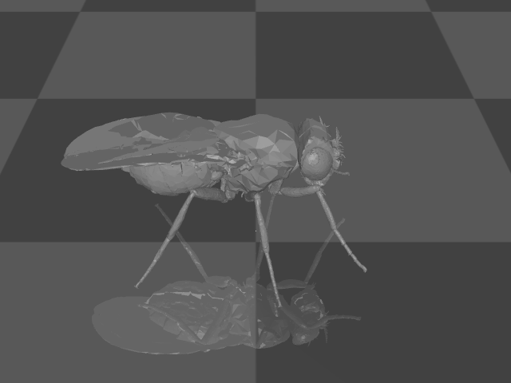
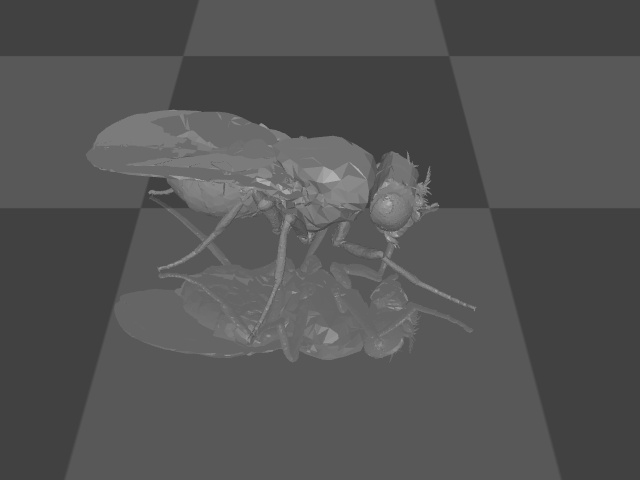
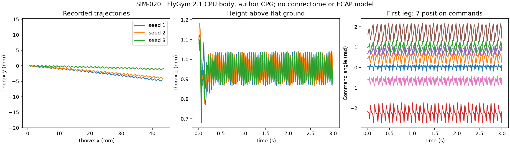

# SIM-020 — NeLy-EPFL/flygym

[Результат испытаний](../../REPORT.md#sim-020) · [Все проекты](../README.md)

Исходники: `38c8ec61034cd59bc5ba0de20688d4a3c0000d60`.

## Начальный кадр штатного MuJoCo-рендера: тело NeuroMechFly на плоской поверхности.

Механика тела и авторский контроллер; не коннектом, не ноцицепция и не ECAP.

Первичный файл: [body-start.png](<../../../research/.work/simulator-evaluation/SIM-020/20261026T104750Z-07b1a3/exports/body-start.png>).

SHA-256: `f40c3733ae0d9903368c66cb51b7427ac1c046dc7187cdf112ddca9c2b1f54f0`.

## Последний кадр трёхсекундного сценария seed 1; тот же штатный tracking camera.

Механика тела и авторский контроллер; не коннектом, не ноцицепция и не ECAP.

Первичный файл: [body-finish.png](<../../../research/.work/simulator-evaluation/SIM-020/20261026T104750Z-07b1a3/exports/body-finish.png>).

SHA-256: `f8c4036bdff260beb73b21bd9db1493bac8d8398e6b33f53146c324d6aead2fa`.

## Траектории и высота тела для трёх seeds; команды семи приводов первой ноги.

Механика тела и авторский контроллер; не коннектом, не ноцицепция и не ECAP.

Первичный файл: [body-recordings.png](<../../../research/.work/simulator-evaluation/SIM-020/20261026T104750Z-07b1a3/exports/body-recordings.png>).

SHA-256: `d9af65c44282b954d1d23a8815c6b5d731d0d6afafdfb7f372825db2f7151c44`.

## Векторный график из сохранённых траекторий и управляющих команд.

Механика тела и авторский контроллер; не коннектом, не ноцицепция и не ECAP.

[Открыть body-recordings.svg](body-recordings.svg)

Первичный файл: [body-recordings.svg](<../../../research/.work/simulator-evaluation/SIM-020/20261026T104750Z-07b1a3/exports/body-recordings.svg>).

SHA-256: `e6bb08416614818ae9da881c7f7d4bf1edc612b6386a58b24278977a25fe5601`.

## Видеозапись трёх секунд движения с авторским CPG-контроллером, seed 1.

Механика тела и авторский контроллер; не коннектом, не ноцицепция и не ECAP.

[Открыть locomotion-seed-1.mp4](locomotion-seed-1.mp4)

Первичный файл: [locomotion-seed-1.mp4](<../../../research/.work/simulator-evaluation/SIM-020/20261026T104750Z-07b1a3/exports/locomotion-seed-1.mp4>).

SHA-256: `ea6bdb7e4da534c9d575c1f0fd41a7051d45c74b1187cde80d61b3afff2380be`.
