# SIM-021 — NeLy-EPFL/flygym-gymnasium

[Результат испытаний](../../REPORT.md#sim-021) · [Все проекты](../README.md)

Исходники: `d285260a1c8a7b3494150cd1590f2c9fe4b5e06b`.

## Начальный кадр штатного рендера тела: legacy FlyGym Gymnasium.

Тело и гибридный контроллер; не коннектомная, ноцицептивная или человеческая ECAP-модель.

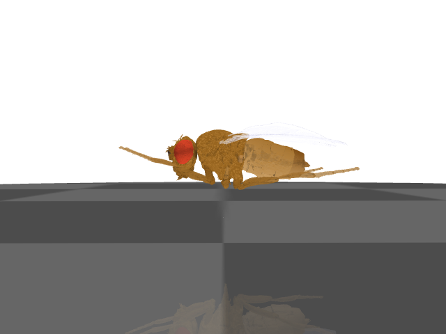

Первичный файл: [body-start.png](<../../../research/.work/simulator-evaluation/SIM-021/20261026T110550Z-38a5d9/exports/body-start.png>).

SHA-256: `fab995aad67e554840f0eb81c1068ea5fea72cc2ee3d4704753f4ee32be6c87f`.

## Конечный кадр секундного сценария с авторским гибридным контроллером, seed 1.

Тело и гибридный контроллер; не коннектомная, ноцицептивная или человеческая ECAP-модель.

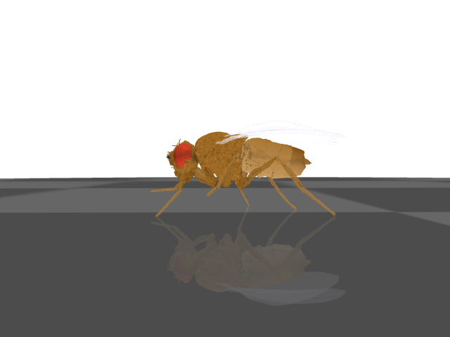

Первичный файл: [body-finish.png](<../../../research/.work/simulator-evaluation/SIM-021/20261026T110550Z-38a5d9/exports/body-finish.png>).

SHA-256: `6fdb671cf8f87c31b0f84a97aadd661557ca905d64fbded0399cf4988054b44d`.

## Траектории, высота тела и измеренные углы суставов; три seeds.

Тело и гибридный контроллер; не коннектомная, ноцицептивная или человеческая ECAP-модель.

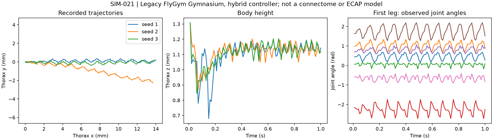

Первичный файл: [hybrid-recordings.png](<../../../research/.work/simulator-evaluation/SIM-021/20261026T110550Z-38a5d9/exports/hybrid-recordings.png>).

SHA-256: `4d428f45bbf7d161c654c840e8f0653dd9ecb1ccedae545945497d855f763ea0`.

## Векторный график фактических численных экспортов.

Тело и гибридный контроллер; не коннектомная, ноцицептивная или человеческая ECAP-модель.

[Открыть hybrid-recordings.svg](hybrid-recordings.svg)

Первичный файл: [hybrid-recordings.svg](<../../../research/.work/simulator-evaluation/SIM-021/20261026T110550Z-38a5d9/exports/hybrid-recordings.svg>).

SHA-256: `cd303a973a816eed774571170cd28485d3b551c8104e813369d7c95ff663c9f5`.

## Видеозапись секундного сценария, 25 кадров/с; все кадры декодированы.

Тело и гибридный контроллер; не коннектомная, ноцицептивная или человеческая ECAP-модель.

[Открыть hybrid-walk-seed-1.mp4](hybrid-walk-seed-1.mp4)

Первичный файл: [hybrid-walk-seed-1.mp4](<../../../research/.work/simulator-evaluation/SIM-021/20261026T110550Z-38a5d9/exports/hybrid-walk-seed-1.mp4>).

SHA-256: `fc721b04d075ac9e54de9aea4c8a80ff357b10ac6efbeb54f45dd1880b1c7767`.

## Штатный тест: fly_flip_detection/flipped.mp4

Визуальный вывод авторского программного теста; не самостоятельная биологическая валидация.

[Открыть native-8d59474155-flipped.mp4](native-8d59474155-flipped.mp4)

Первичный файл: [native-8d59474155-flipped.mp4](<../../../research/.work/simulator-evaluation/SIM-021/20261026T110550Z-38a5d9/exports/native-tests/native-8d59474155-flipped.mp4>).

SHA-256: `edf868d475f6f4b853f9d639c80e9674ad3994ca29e36bc9aab5fde47ce3e1e1`.

## Штатный тест: fly_flip_detection/not_flipped.mp4

Визуальный вывод авторского программного теста; не самостоятельная биологическая валидация.

[Открыть native-487f57971a-not_flipped.mp4](native-487f57971a-not_flipped.mp4)

Первичный файл: [native-487f57971a-not_flipped.mp4](<../../../research/.work/simulator-evaluation/SIM-021/20261026T110550Z-38a5d9/exports/native-tests/native-487f57971a-not_flipped.mp4>).

SHA-256: `0bb444eed13956d5cb3495512260597f552395a5f95829f0201fee1068e0086b`.

## Штатный тест: mujoco_basic_untethered_sinewave/plot.png/fly_pos_ts.png

Визуальный вывод авторского программного теста; не самостоятельная биологическая валидация.

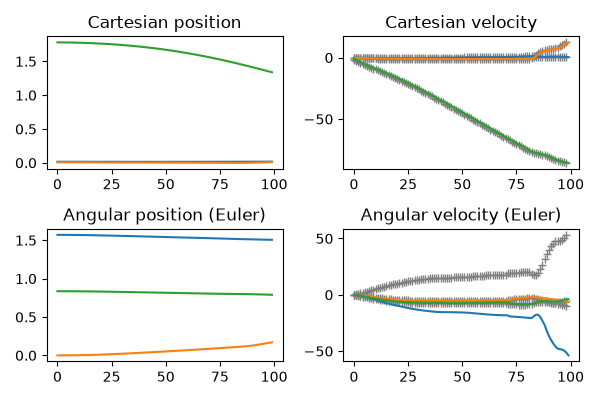

Первичный файл: [native-8d1b536fc0-fly_pos_ts.png](<../../../research/.work/simulator-evaluation/SIM-021/20261026T110550Z-38a5d9/exports/native-tests/native-8d1b536fc0-fly_pos_ts.png>).

SHA-256: `63c7561426f9f01ce91d449f75a84647b7f6578f97bc74cc9def0ba129ccd76e`.

## Штатный тест: mujoco_basic_untethered_sinewave/plot.png/joints_ts.png

Визуальный вывод авторского программного теста; не самостоятельная биологическая валидация.

Первичный файл: [native-2488db1c81-joints_ts.png](<../../../research/.work/simulator-evaluation/SIM-021/20261026T110550Z-38a5d9/exports/native-tests/native-2488db1c81-joints_ts.png>).

SHA-256: `ae3e913e4c921ba979c0977812f362b3e5bb69483937d399c9c1e44f9760053d`.

## Штатный тест: mujoco_stretched_pose/fly_pos_ts.png

Визуальный вывод авторского программного теста; не самостоятельная биологическая валидация.

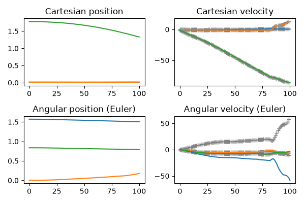

Первичный файл: [native-e9a10490f4-fly_pos_ts.png](<../../../research/.work/simulator-evaluation/SIM-021/20261026T110550Z-38a5d9/exports/native-tests/native-e9a10490f4-fly_pos_ts.png>).

SHA-256: `f8cbcf5d3106123dbc858236e00938ee078d05f49f36c20f99b798e915f58d05`.

## Штатный тест: mujoco_stretched_pose/joints_ts.png

Визуальный вывод авторского программного теста; не самостоятельная биологическая валидация.

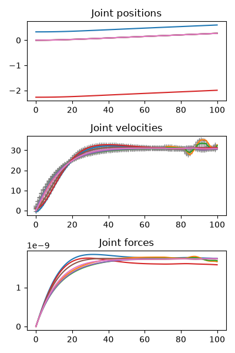

Первичный файл: [native-7016b752ec-joints_ts.png](<../../../research/.work/simulator-evaluation/SIM-021/20261026T110550Z-38a5d9/exports/native-tests/native-7016b752ec-joints_ts.png>).

SHA-256: `f41b65cff59ed16fbca1457c46cb00d5c4f1dc683d78f93c286de561ac9e85e8`.

## Штатный тест: mujoco_tripod_pose/fly_pos_ts.png

Визуальный вывод авторского программного теста; не самостоятельная биологическая валидация.

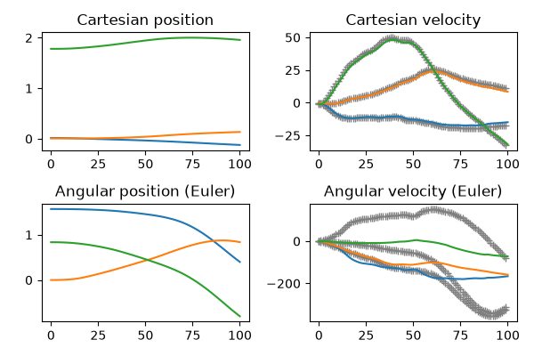

Первичный файл: [native-3ad17d9806-fly_pos_ts.png](<../../../research/.work/simulator-evaluation/SIM-021/20261026T110550Z-38a5d9/exports/native-tests/native-3ad17d9806-fly_pos_ts.png>).

SHA-256: `a15ed7cfed89f4fb864a357ebf773b62d391ee5a322f728d775e8ebbf819d056`.

## Штатный тест: mujoco_tripod_pose/joints_ts.png

Визуальный вывод авторского программного теста; не самостоятельная биологическая валидация.

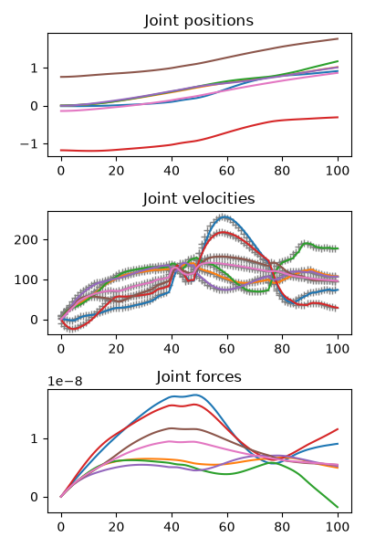

Первичный файл: [native-40a979508c-joints_ts.png](<../../../research/.work/simulator-evaluation/SIM-021/20261026T110550Z-38a5d9/exports/native-tests/native-40a979508c-joints_ts.png>).

SHA-256: `c6a130ad50d743452c6d8f2b88fef29f83c77ee75403d716a5d20b8ab548be64`.

## Штатный тест: mujoco_zero_pose/fly_pos_ts.png

Визуальный вывод авторского программного теста; не самостоятельная биологическая валидация.

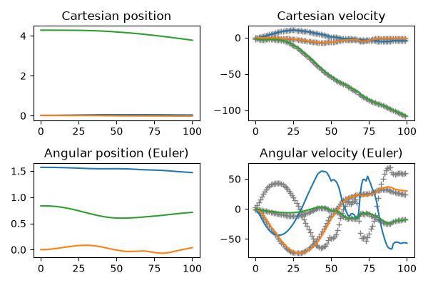

Первичный файл: [native-6980dc6b72-fly_pos_ts.png](<../../../research/.work/simulator-evaluation/SIM-021/20261026T110550Z-38a5d9/exports/native-tests/native-6980dc6b72-fly_pos_ts.png>).

SHA-256: `6ab9bc5118a4a314f8302986f87704f2d0ef49d2be5b6db98fc931d1f18edcd5`.

## Штатный тест: mujoco_zero_pose/joints_ts.png

Визуальный вывод авторского программного теста; не самостоятельная биологическая валидация.

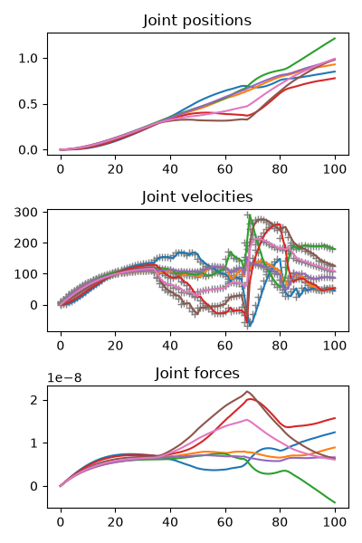

Первичный файл: [native-81e1b6d69a-joints_ts.png](<../../../research/.work/simulator-evaluation/SIM-021/20261026T110550Z-38a5d9/exports/native-tests/native-81e1b6d69a-joints_ts.png>).

SHA-256: `f5c3401a56e53bfee2b149f98a592c90558eff71df7dd8f28be79cb9551e2d2d`.

## Штатный тест: vision/eyes.mp4

Визуальный вывод авторского программного теста; не самостоятельная биологическая валидация.

[Открыть native-93ae565c0e-eyes.mp4](native-93ae565c0e-eyes.mp4)

Первичный файл: [native-93ae565c0e-eyes.mp4](<../../../research/.work/simulator-evaluation/SIM-021/20261026T110550Z-38a5d9/exports/native-tests/native-93ae565c0e-eyes.mp4>).

SHA-256: `ceefdaea09c5025b8189867a90c74c4b47b499e590fab0d918c0ef53b2adf0e4`.

## Первый декодированный кадр штатного видео: native-487f57971a-not_flipped.mp4

Просмотр видеовывода программного теста; не отдельный функциональный эксперимент.

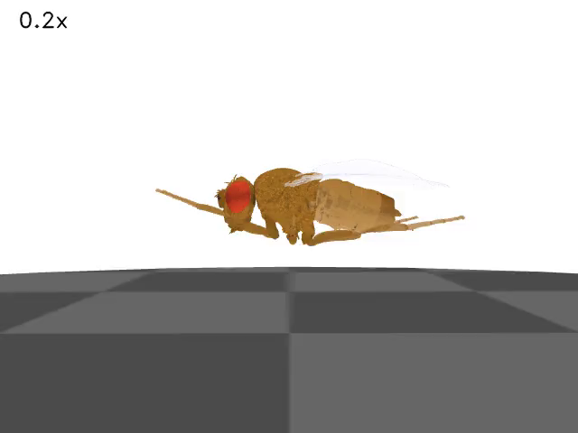

Первичный файл: [native-487f57971a-not_flipped-preview.png](<../../../research/.work/simulator-evaluation/SIM-021/20261026T110550Z-38a5d9/exports/native-487f57971a-not_flipped-preview.png>).

SHA-256: `81efa23ed4f1d593ccfccdd66d0c53a84d42b8f08847dd4bc7da03a02c6c4077`.

## Первый декодированный кадр штатного видео: native-8d59474155-flipped.mp4

Просмотр видеовывода программного теста; не отдельный функциональный эксперимент.

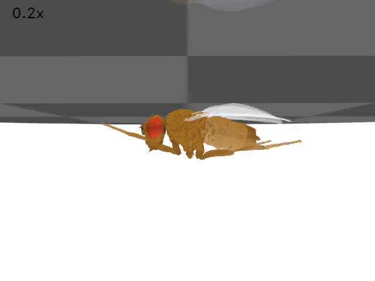

Первичный файл: [native-8d59474155-flipped-preview.png](<../../../research/.work/simulator-evaluation/SIM-021/20261026T110550Z-38a5d9/exports/native-8d59474155-flipped-preview.png>).

SHA-256: `b20311189a680d875c71858c967b22bdd92792508418906ab55d8c7d42a3ec23`.

## Первый декодированный кадр штатного видео: native-93ae565c0e-eyes.mp4

Просмотр видеовывода программного теста; не отдельный функциональный эксперимент.

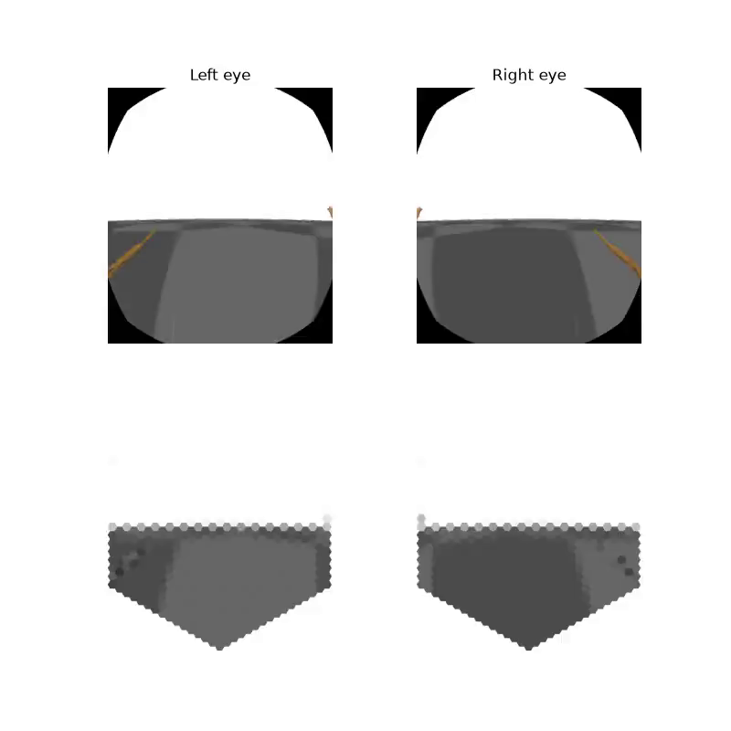

Первичный файл: [native-93ae565c0e-eyes-preview.png](<../../../research/.work/simulator-evaluation/SIM-021/20261026T110550Z-38a5d9/exports/native-93ae565c0e-eyes-preview.png>).

SHA-256: `81db4c15b60406add3a44f0b6319772c4ced854774d9fe998f06b93cdd47fae1`.
