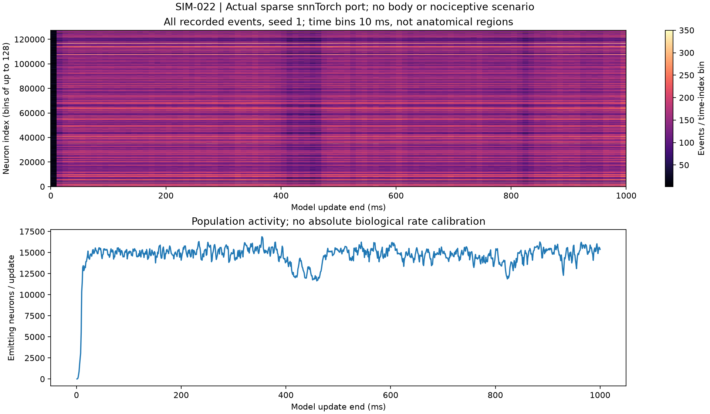
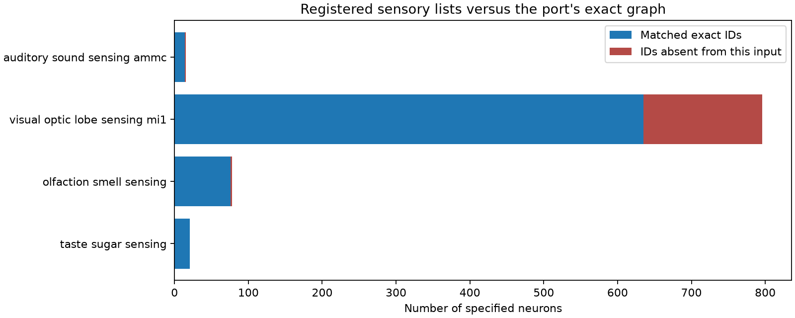
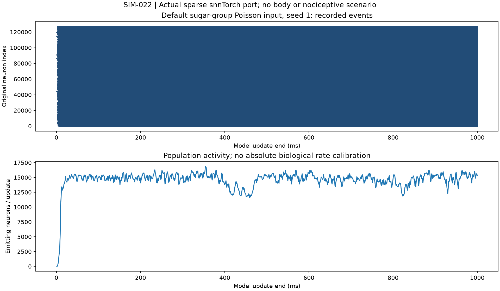

# SIM-022 — Neuromorphicism/fly-brain-snntorch

[Результат испытаний](../../REPORT.md#sim-022) · [Все проекты](../README.md)

Исходники: `fe55fb0cff275a2b6b54926524c8d831838e32fc`.

## Все 14 617 575 событий seed 1: тепловая карта по 10 мс и группам до 128 индексов; ниже — число активных элементов за обновление.

Вычисленные события упрощённого порта и аудит ID; не биологическая калибровка и не ноцицепция.

Первичный файл: [spike-recordings.png](<../../../research/.work/simulator-evaluation/SIM-022/20261026T115750Z-789c8f/exports/spike-recordings.png>).

SHA-256: `af6732a2706b6be4f00ee9236adf2fe97913ad2ed8bb550dfe11658164addfc9`.

## Компактная SVG-версия полного распределения событий; сумма всех ячеек сверена с числом событий.

Вычисленные события упрощённого порта и аудит ID; не биологическая калибровка и не ноцицепция.

[Открыть spike-recordings.svg](spike-recordings.svg)

Первичный файл: [spike-recordings.svg](<../../../research/.work/simulator-evaluation/SIM-022/20261026T115750Z-789c8f/exports/spike-recordings.svg>).

SHA-256: `f45c74a779c74f1969ccf92d3c6482618cf7d9b62527fdaf492f32ac405987aa`.

## Сопоставление сенсорных списков с точными ID графа: вкус 21/21, обоняние 76/78, зрение 635/796, слух 14/15.

Вычисленные события упрощённого порта и аудит ID; не биологическая калибровка и не ноцицепция.

Первичный файл: [sensory-id-coverage.png](<../../../research/.work/simulator-evaluation/SIM-022/20261026T115750Z-789c8f/exports/sensory-id-coverage.png>).

SHA-256: `03df5c60693a22a311cde2a5dc9aac7f197c61229a32ce56fa269f5d2922f303`.

## Векторная диаграмма покрытия ID; отсутствующие идентификаторы не заменены другими версиями.

Вычисленные события упрощённого порта и аудит ID; не биологическая калибровка и не ноцицепция.

[Открыть sensory-id-coverage.svg](sensory-id-coverage.svg)

Первичный файл: [sensory-id-coverage.svg](<../../../research/.work/simulator-evaluation/SIM-022/20261026T115750Z-789c8f/exports/sensory-id-coverage.svg>).

SHA-256: `7b455e400959807dafbd5737b043a2f81cc22cf24d781ad06d551e82eaba9e06`.

## Ранняя визуализация всех событий отдельными точками: плотность делает растр неразличимым. Сохранена как диагностический вывод; для анализа использовать тепловую карту.

Диагностический PNG предыдущего численного прогона; незавершённый гигабайтный SVG удалён с отдельной квитанцией.

Первичный файл: [spike-scatter-unbinned.png](<../../../research/.work/simulator-evaluation/SIM-022/20261026T114822Z-a75d76/exports/spike-scatter-unbinned.png>).

SHA-256: `e3d6bdebcfeb2eef0e00e4a7dbd510ff74f1691595b0a3b0baae27c5f0b632f2`.
