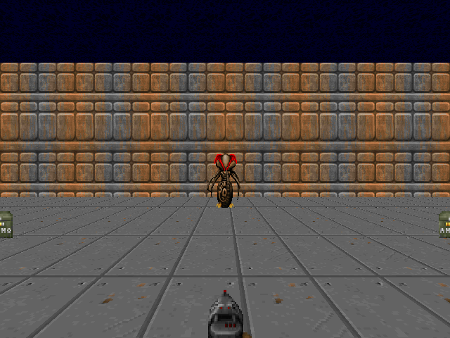
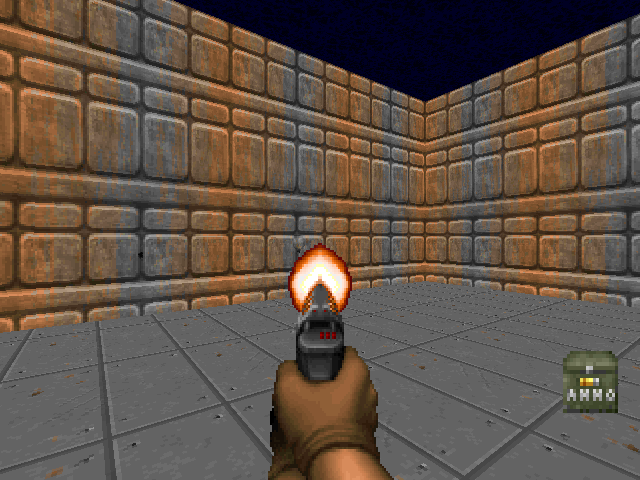
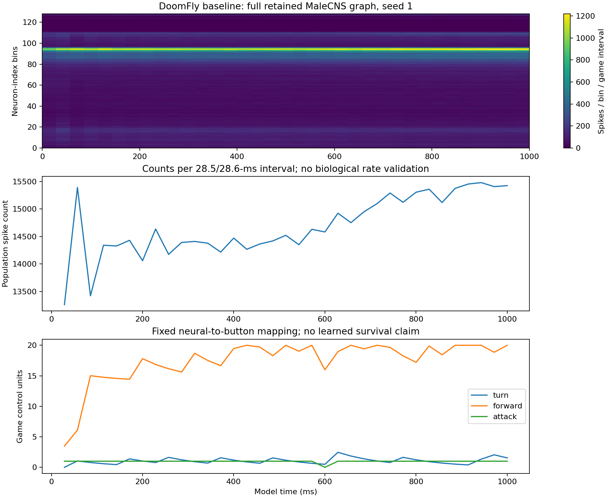
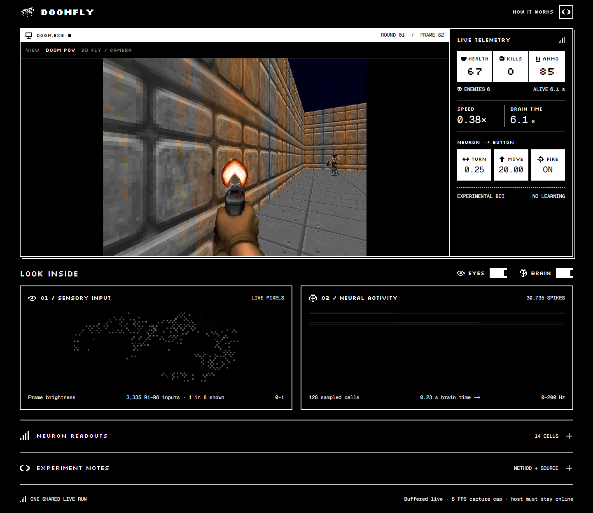
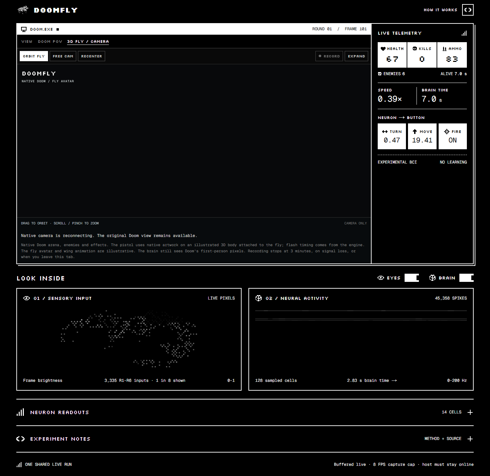
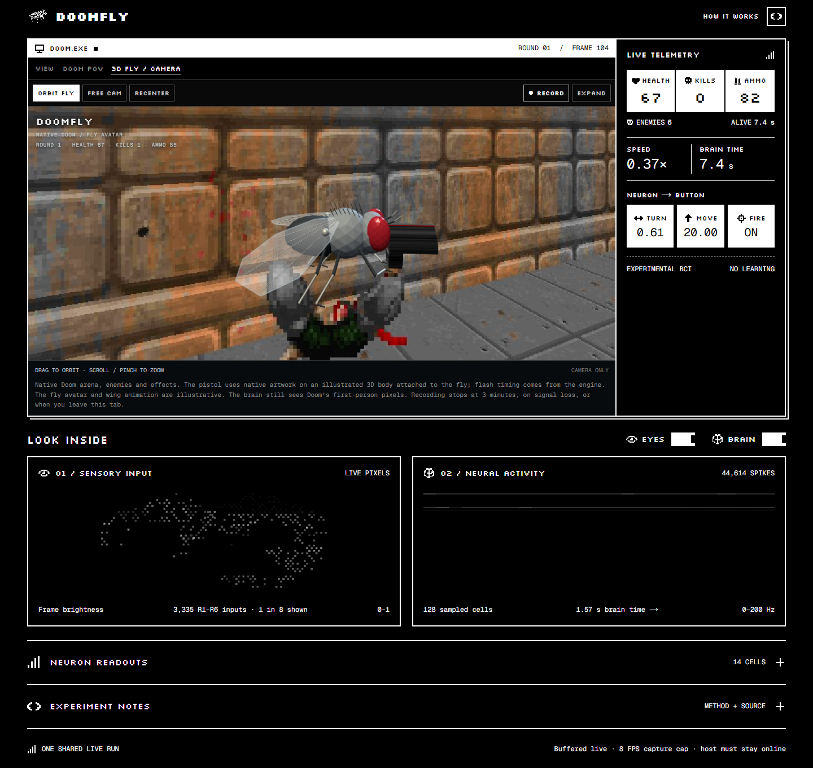

# SIM-023 — nftechie/doomfly

[Результат испытаний](../../REPORT.md#sim-023) · [Все проекты](../README.md)

Исходники: `71ecf53d78eaffaf1a57ed7b0ccf5d458abc9f33`.

## Начальный RGB-кадр реального ViZDoom, seed 1.

Записанный программный сценарий; одна реконструкция MaleCNS, инженерный BCI. Не подтверждение полезного зрения, ноцицепции или субъективной боли.

Первичный файл: [game-input-00.png](<../../../research/.work/simulator-evaluation/SIM-023/20261026T145746Z-02de46/exports/game-input-00.png>).

SHA-256: `781c9778add9c40d425db102aa93494abc0599cf71cc314ed4bcf933afe5245c`.

## Предшествующий действию RGB-кадр 35-го такта, seed 1.

Записанный программный сценарий; одна реконструкция MaleCNS, инженерный BCI. Не подтверждение полезного зрения, ноцицепции или субъективной боли.

Первичный файл: [game-input-34.png](<../../../research/.work/simulator-evaluation/SIM-023/20261026T145746Z-02de46/exports/game-input-34.png>).

SHA-256: `7ada5139ccc007e1fb4b960c529a60e33d075a3acf4844c59a556450dfabc7d7`.

## Все 166 700 нейронов: числа событий по индексным группам и игровым интервалам; ниже — фиксированные команды декодера.

Записанный программный сценарий; одна реконструкция MaleCNS, инженерный BCI. Не подтверждение полезного зрения, ноцицепции или субъективной боли.

Первичный файл: [neural-game-recordings.png](<../../../research/.work/simulator-evaluation/SIM-023/20261026T145746Z-02de46/exports/neural-game-recordings.png>).

SHA-256: `2688b0f20ec97e799f2361248fed61fcbfb1f72cb1193925462b54a908fa70f5`.

## Векторная версия записанной нейронной активности и игровых команд.

Записанный программный сценарий; одна реконструкция MaleCNS, инженерный BCI. Не подтверждение полезного зрения, ноцицепции или субъективной боли.

[Открыть neural-game-recordings.svg](neural-game-recordings.svg)

Первичный файл: [neural-game-recordings.svg](<../../../research/.work/simulator-evaluation/SIM-023/20261026T145746Z-02de46/exports/neural-game-recordings.svg>).

SHA-256: `2b565bfd833150727e515af481727246e474395614c3e6d6a5d9359b4501a164`.

## Живой авторский интерфейс: первое лицо, сетевые счётчики, зрительный вход и телеметрия; baseline без обучения.

Записанный программный сценарий; одна реконструкция MaleCNS, инженерный BCI. Не подтверждение полезного зрения, ноцицепции или субъективной боли.

Первичный файл: [live-viewer.png](<../../../research/.work/simulator-evaluation/SIM-023/20261026T145746Z-02de46/exports/browser/live-viewer.png>).

SHA-256: `6da2c89769c111a2f006c72510e9caadf7ed24ca464df0de647d56c64b35f43f`.

## Исходная недоступность дополнительной 3D-камеры: HTTP 503 до её отдельной сборки. Основной поток продолжал работать.

Записанный программный сценарий; одна реконструкция MaleCNS, инженерный BCI. Не подтверждение полезного зрения, ноцицепции или субъективной боли.

Первичный файл: [before-native-spectator-viewer.png](<../../../research/.work/simulator-evaluation/SIM-023/20261026T145746Z-02de46/exports/browser/before-native-spectator-viewer.png>).

SHA-256: `ead4070c3bca44e196edf56753e4dca3ebba6cf8c696e5f4db10ea819263f769`.

## Живая нативная камера после сборки и проверки изоляции: реальная игровая сцена и иллюстративный аватар мухи; не биомеханика.

Записанный программный сценарий; одна реконструкция MaleCNS, инженерный BCI. Не подтверждение полезного зрения, ноцицепции или субъективной боли.

Первичный файл: [spectator-viewer.png](<../../../research/.work/simulator-evaluation/SIM-023/20261026T145746Z-02de46/exports/browser/spectator-viewer.png>).

SHA-256: `fe0f2c13cc171c56bdb0379bbbb5a788b01786159bc0ba111be215a52f63654e`.
