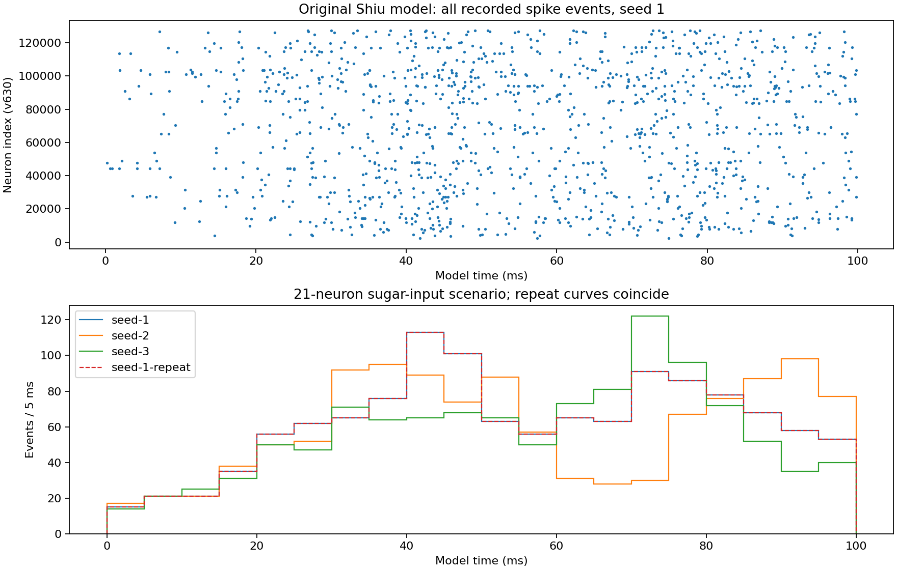
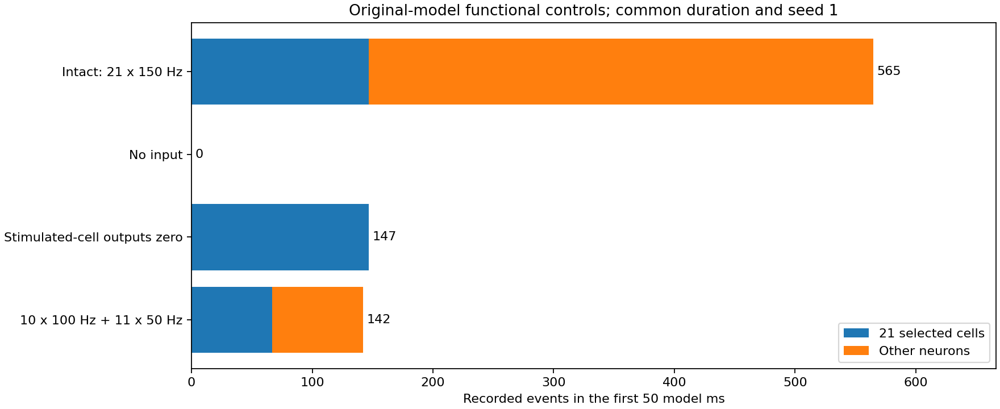
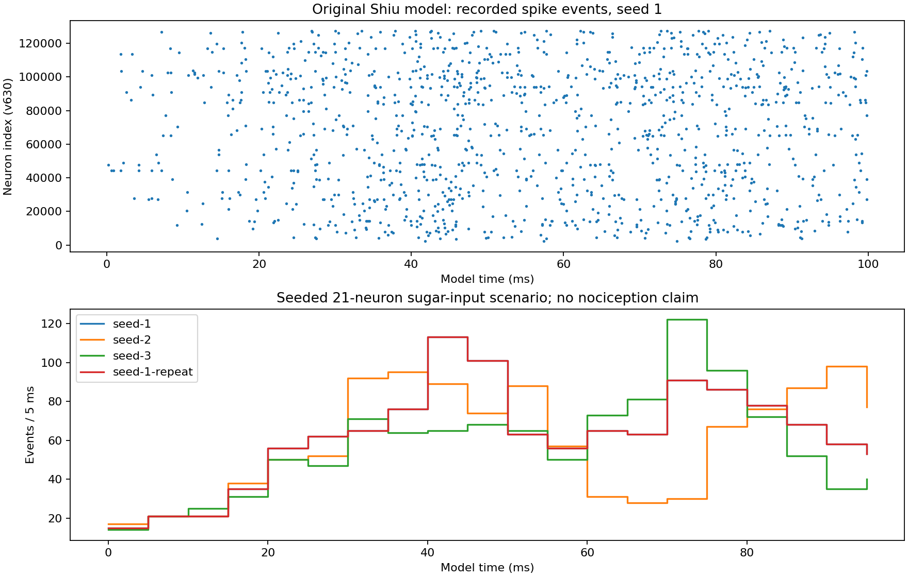

# SIM-024 — philshiu/Drosophila_brain_model

[Результат испытаний](../../REPORT.md#sim-024) · [Все проекты](../README.md)

Исходники: `91bdd1e7dcf193f3e7ca5a8933497fcef63b7960`.

## Все 1246 событий seed 1 за 100 мс; ниже — гистограммы seeds 1/2/3/1. Последний интервал 95–100 мс показан полностью; повтор совпадает.

Исходная Brian2-модель v630 и программная стимуляция; без тела, калиброванного повреждающего стимула или физического CAP/ECAP-оператора.

Первичный файл: [original-lif-events.png](<../../../research/.work/simulator-evaluation/SIM-024/20261026T160249Z-76b072/exports/original-lif-events.png>).

SHA-256: `07ac374a07e586c82929fd405015df60199f810d68f06ff1053e8190db2da847`.

## Векторная версия исходных спайковых событий и гистограмм; сумма всех интервалов сверена с числом событий.

Исходная Brian2-модель v630 и программная стимуляция; без тела, калиброванного повреждающего стимула или физического CAP/ECAP-оператора.

[Открыть original-lif-events.svg](original-lif-events.svg)

Первичный файл: [original-lif-events.svg](<../../../research/.work/simulator-evaluation/SIM-024/20261026T160249Z-76b072/exports/original-lif-events.svg>).

SHA-256: `5200b3df986bef0a1d9ddedd761ce19dd76566c377b789ec708e7fcfd2ccea46`.

## Сопоставимые первые 50 мс при seed 1: интактная сеть 565 событий, нулевой вход 0, нулевые выходы стимулируемых клеток 147, две частоты 142. Отдельно показаны выбранные клетки и остальные нейроны.

Исходная Brian2-модель v630 и программная стимуляция; без тела, калиброванного повреждающего стимула или физического CAP/ECAP-оператора.

Первичный файл: [original-lif-controls.png](<../../../research/.work/simulator-evaluation/SIM-024/20261026T160249Z-76b072/exports/original-lif-controls.png>).

SHA-256: `f44931aac74e9eb700ce62f4deb615ebd34cc50ae5fd5ffdd74b8802abc8ff65`.

## Векторная диаграмма программных контролей. Разряды выбранных клеток не объявляются прямым счётчиком внешних пуассоновских событий.

Исходная Brian2-модель v630 и программная стимуляция; без тела, калиброванного повреждающего стимула или физического CAP/ECAP-оператора.

[Открыть original-lif-controls.svg](original-lif-controls.svg)

Первичный файл: [original-lif-controls.svg](<../../../research/.work/simulator-evaluation/SIM-024/20261026T160249Z-76b072/exports/original-lif-controls.svg>).

SHA-256: `0bd6e86ff307f76ff18b06b20e35a9c654b2443547300ed0ddc9cf120d90f11b`.

## Исходная диагностическая отрисовка: последний 5-мс интервал не показан линией полностью. Численные данные сохранны; исправленная основная диаграмма находится выше.

Исходная Brian2-модель v630 и программная стимуляция; без тела, калиброванного повреждающего стимула или физического CAP/ECAP-оператора.

Первичный файл: [initial-step-plot.png](<../../../research/.work/simulator-evaluation/SIM-024/20261026T160249Z-76b072/exports/initial-step-plot.png>).

SHA-256: `103d08add0157a01005f3393b00c9c7825523ad5da43048e066473a9f7bd40c3`.

## Векторный исходник ранней диагностической отрисовки; сохранён отдельно от исправленного основного рисунка.

Исходная Brian2-модель v630 и программная стимуляция; без тела, калиброванного повреждающего стимула или физического CAP/ECAP-оператора.

[Открыть initial-step-plot.svg](initial-step-plot.svg)

Первичный файл: [initial-step-plot.svg](<../../../research/.work/simulator-evaluation/SIM-024/20261026T160249Z-76b072/exports/initial-step-plot.svg>).

SHA-256: `449cca8e5bd15ed481928b091db6d14f74237f0c7675b107be4fba2c59bebdc5`.
