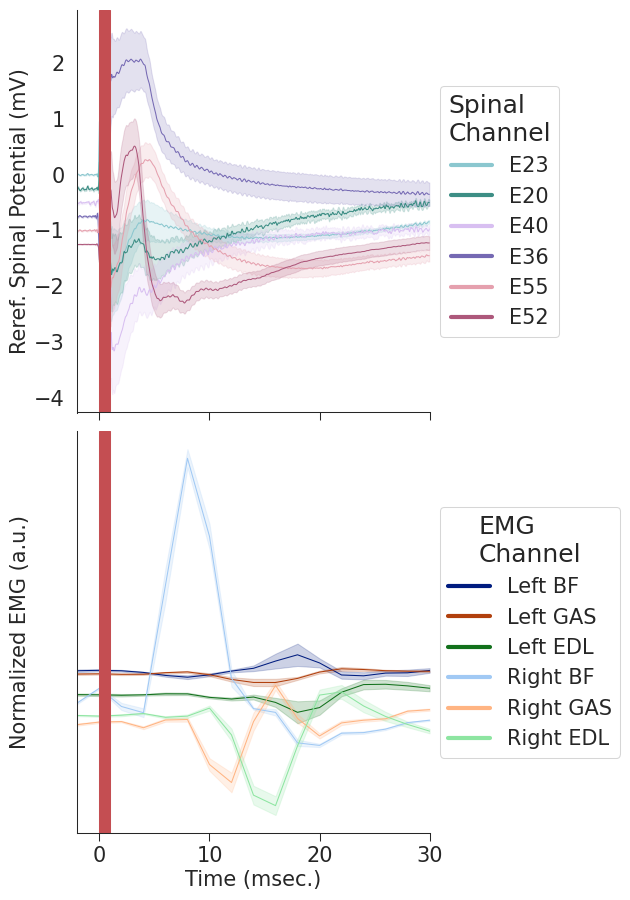
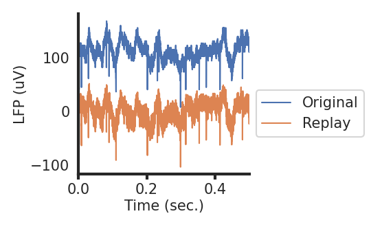
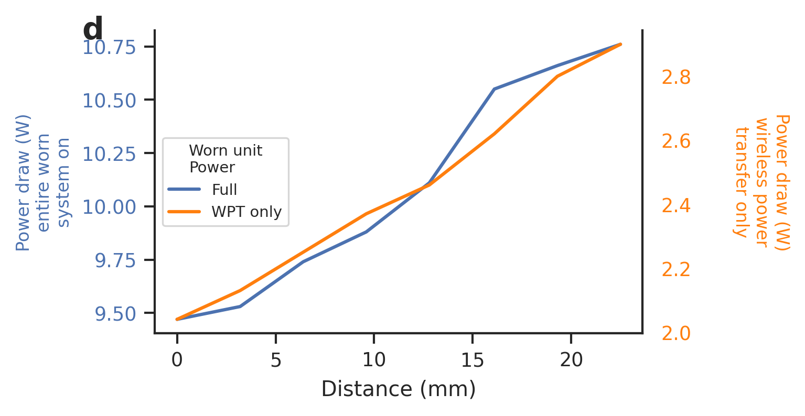
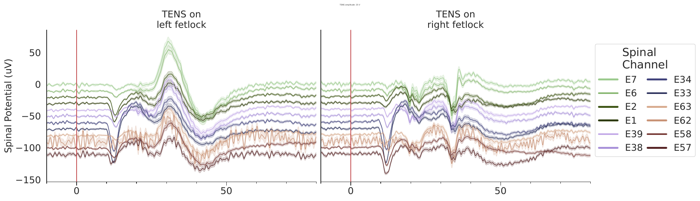
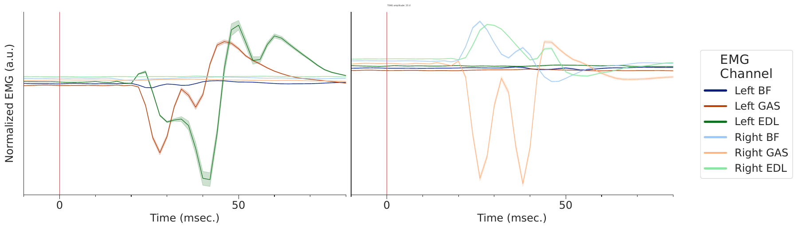
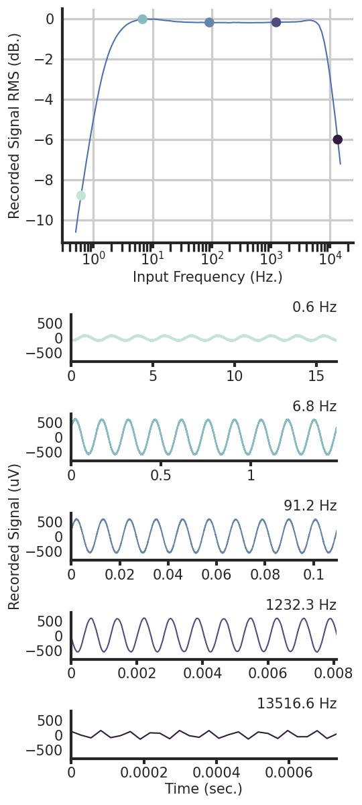
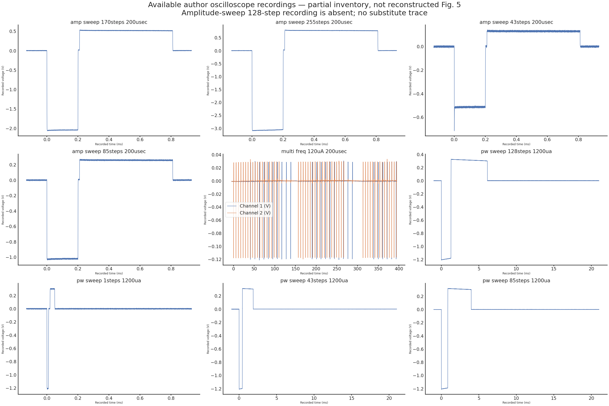

# SIM-025 — rdarie/modular-bionic-interface-2026

[Результат испытаний](../../REPORT.md#sim-025) · [Все проекты](../README.md)

Исходники: `604d17fe1d39a6618fd8f26694922a823aeed8c8`.

## Авторские спинальные потенциалы и EMG после стимуляции; красная полоса обозначает участок 0–1 мс, исключённый автором из LFP. PDF.

Авторские записи OSF 9hxwe и штатная обработка. Не симуляция нейронной сети и не подтверждение человеческого ECAP; код Radu Darie, MIT, данные CC BY 4.0.

[Открыть emg_latency_reref_zoom_in.pdf](emg_latency_reref_zoom_in.pdf)

Первичный файл: [emg_latency_reref_zoom_in.pdf](<../../../research/.work/simulator-evaluation/SIM-025/20261026T165830Z-b48bcf/exports/emg_latency_reref_zoom_in.pdf>).

SHA-256: `7c3bd38017010e2bc2355ab5c3db878a47776fc2edf9730329166d952b64c915`.

## Авторские спинальные потенциалы и EMG после стимуляции; красная полоса обозначает участок 0–1 мс, исключённый автором из LFP. PNG.

Авторские записи OSF 9hxwe и штатная обработка. Не симуляция нейронной сети и не подтверждение человеческого ECAP; код Radu Darie, MIT, данные CC BY 4.0.

Первичный файл: [emg_latency_reref_zoom_in.png](<../../../research/.work/simulator-evaluation/SIM-025/20261026T165830Z-b48bcf/exports/emg_latency_reref_zoom_in.png>).

SHA-256: `eb8729caa965c3785179e5ae8cc115152fade71fc74e9f078e4645c3f6d553a3`.

## Авторское сопоставление исходной записи и воспроизведения LFP; исходная кривая отображена со смещением +100 мкВ. PDF.

Авторские записи OSF 9hxwe и штатная обработка. Не симуляция нейронной сети и не подтверждение человеческого ECAP; код Radu Darie, MIT, данные CC BY 4.0.

[Открыть lfp_replay.pdf](lfp_replay.pdf)

Первичный файл: [lfp_replay.pdf](<../../../research/.work/simulator-evaluation/SIM-025/20261026T165830Z-b48bcf/exports/lfp_replay.pdf>).

SHA-256: `7e0f78c4097c60225add2fb2bffbab544fd976e445aaf2a2a0022dbe0e1bed50`.

## Авторское сопоставление исходной записи и воспроизведения LFP; исходная кривая отображена со смещением +100 мкВ. PNG.

Авторские записи OSF 9hxwe и штатная обработка. Не симуляция нейронной сети и не подтверждение человеческого ECAP; код Radu Darie, MIT, данные CC BY 4.0.

Первичный файл: [lfp_replay.png](<../../../research/.work/simulator-evaluation/SIM-025/20261026T165830Z-b48bcf/exports/lfp_replay.png>).

SHA-256: `b4c62b2da2e7e9b0b7fe84de40d0b521b7617c5374be3883cf3507ceb269f70b`.

## Авторский график мощности и расстояния: все восемь измерений; две независимые вертикальные шкалы. PDF.

Авторские записи OSF 9hxwe и штатная обработка. Не симуляция нейронной сети и не подтверждение человеческого ECAP; код Radu Darie, MIT, данные CC BY 4.0.

[Открыть power_vs_distance.pdf](power_vs_distance.pdf)

Первичный файл: [power_vs_distance.pdf](<../../../research/.work/simulator-evaluation/SIM-025/20261026T165830Z-b48bcf/exports/power_vs_distance.pdf>).

SHA-256: `20e403cebd2fd0dbab0486576a3f15e337cb47e84db2ced0f7970de04f85491e`.

## Авторский график мощности и расстояния: все восемь измерений; две независимые вертикальные шкалы. PNG.

Авторские записи OSF 9hxwe и штатная обработка. Не симуляция нейронной сети и не подтверждение человеческого ECAP; код Radu Darie, MIT, данные CC BY 4.0.

Первичный файл: [power_vs_distance.png](<../../../research/.work/simulator-evaluation/SIM-025/20261026T165830Z-b48bcf/exports/power_vs_distance.png>).

SHA-256: `9b741202474cc1aaf5daaa7ec8b81667f65236d386e23460d4b6cb9d6b2660f3`.

## Авторский рисунок нормированной TENS-EMG при 25 В; это не независимая межучастническая оценка. PDF.

Авторские записи OSF 9hxwe и штатная обработка. Не симуляция нейронной сети и не подтверждение человеческого ECAP; код Radu Darie, MIT, данные CC BY 4.0.

[Открыть tens_epoched_emg_per_amp.pdf](tens_epoched_emg_per_amp.pdf)

Первичный файл: [tens_epoched_emg_per_amp.pdf](<../../../research/.work/simulator-evaluation/SIM-025/20261026T165830Z-b48bcf/exports/tens_epoched_emg_per_amp.pdf>).

SHA-256: `5983ecd3b34fb64cd8e76f8eddb4cad5de9de589c76774c2183ce36656f59c85`.

## Авторский рисунок TENS-потенциалов для config_c при 25 В; усреднение и стандартная ошибка по записанным эпохам. PDF.

Авторские записи OSF 9hxwe и штатная обработка. Не симуляция нейронной сети и не подтверждение человеческого ECAP; код Radu Darie, MIT, данные CC BY 4.0.

[Открыть tens_epoched_lfp_per_amp_config_c.pdf](tens_epoched_lfp_per_amp_config_c.pdf)

Первичный файл: [tens_epoched_lfp_per_amp_config_c.pdf](<../../../research/.work/simulator-evaluation/SIM-025/20261026T165830Z-b48bcf/exports/tens_epoched_lfp_per_amp_config_c.pdf>).

SHA-256: `85373d93cbb3c9fb42cec64b4804e8f559c215308d507bb616c7a374840c8447`.

## Авторский рисунок TENS-потенциалов для config_c при 25 В; усреднение и стандартная ошибка по записанным эпохам. Предпросмотр одной страницы исходного PDF.

Авторские записи OSF 9hxwe и штатная обработка. Не симуляция нейронной сети и не подтверждение человеческого ECAP; код Radu Darie, MIT, данные CC BY 4.0.

Первичный файл: [tens_epoched_lfp_per_amp_config_c-preview.png](<../../../research/.work/simulator-evaluation/SIM-025/20261026T165830Z-b48bcf/exports/tens_epoched_lfp_per_amp_config_c-preview.png>).

SHA-256: `204711b238550e854a19443878111be9594a76f391ed75e042da491d71e31799`.

## Авторский рисунок нормированной TENS-EMG при 25 В; это не независимая межучастническая оценка. Предпросмотр одной страницы исходного PDF.

Авторские записи OSF 9hxwe и штатная обработка. Не симуляция нейронной сети и не подтверждение человеческого ECAP; код Radu Darie, MIT, данные CC BY 4.0.

Первичный файл: [tens_epoched_emg_per_amp-preview.png](<../../../research/.work/simulator-evaluation/SIM-025/20261026T165830Z-b48bcf/exports/tens_epoched_emg_per_amp-preview.png>).

SHA-256: `64a40b383328e71dc45d401e3646638103688c5fe65245149d9fec2da2bd00d0`.

## Частотная характеристика на всех 95 555 844 отсчётах и 100 частотах; отдельно проверенная адаптация памяти.

Изменены только диагностические построения и время освобождения массивов. Формулы автора сохранены: sqrt(median(x²)) и 10 log10 относительного значения. Исходный запуск завершился OOM; это не его незаметная замена.

[Открыть clinc_spectrum.pdf](clinc_spectrum.pdf)

Первичный файл: [clinc_spectrum.pdf](<../../../research/.work/simulator-evaluation/SIM-025/20261026T165830Z-b48bcf/supplement-bc1a62b324/exports/clinc_spectrum.pdf>).

SHA-256: `df960e8c1815daf3847b61f9a0cd9f6995f7123bbdef56bc8bf59a7e5ebfdf6d`.

## Частотная характеристика на всех 95 555 844 отсчётах и 100 частотах; отдельно проверенная адаптация памяти.

Изменены только диагностические построения и время освобождения массивов. Формулы автора сохранены: sqrt(median(x²)) и 10 log10 относительного значения. Исходный запуск завершился OOM; это не его незаметная замена.

[Открыть clinc_spectrum_w_examples.pdf](clinc_spectrum_w_examples.pdf)

Первичный файл: [clinc_spectrum_w_examples.pdf](<../../../research/.work/simulator-evaluation/SIM-025/20261026T165830Z-b48bcf/supplement-bc1a62b324/exports/clinc_spectrum_w_examples.pdf>).

SHA-256: `0916e0aa6778195583e1cb83b5ea171ccb5366cdb2007f5f5370510f75efb02b`.

## Частотная характеристика на всех 95 555 844 отсчётах и 100 частотах; отдельно проверенная адаптация памяти.

Изменены только диагностические построения и время освобождения массивов. Формулы автора сохранены: sqrt(median(x²)) и 10 log10 относительного значения. Исходный запуск завершился OOM; это не его незаметная замена.

Первичный файл: [clinc_spectrum_w_examples.png](<../../../research/.work/simulator-evaluation/SIM-025/20261026T165830Z-b48bcf/supplement-bc1a62b324/exports/clinc_spectrum_w_examples.png>).

SHA-256: `0cecf71c44ecb13491328ee503a4fe31317ca6daa8be88670c15955baed679eb`.

## Девять доступных осциллографических записей: формы импульсов, sweep и два канала. Недостающий amplitude sweep 128 не подменён.

Отдельная обзорная визуализация первичных CSV, не воспроизведённый авторский рис. 5. Оси — зарегистрированное время и напряжение; названия содержат исходные steps, без вымышленных значений тока.

Первичный файл: [available-stimulation-recordings.png](<../../../research/.work/simulator-evaluation/SIM-025/20261026T165830Z-b48bcf/supplement-bc1a62b324/exports/available-stimulation-recordings.png>).

SHA-256: `90628ade4482f58a58395cc4279f749508664691d849488b70c39a3b0e5f638d`.

## Девять доступных осциллографических записей: формы импульсов, sweep и два канала. Недостающий amplitude sweep 128 не подменён.

Отдельная обзорная визуализация первичных CSV, не воспроизведённый авторский рис. 5. Оси — зарегистрированное время и напряжение; названия содержат исходные steps, без вымышленных значений тока.

[Открыть available-stimulation-recordings.svg](available-stimulation-recordings.svg)

Первичный файл: [available-stimulation-recordings.svg](<../../../research/.work/simulator-evaluation/SIM-025/20261026T165830Z-b48bcf/supplement-bc1a62b324/exports/available-stimulation-recordings.svg>).

SHA-256: `fab0db049a13cd742c51e01665d66cdfa1f63b16490e5227dd252c5cd5691b1c`.
