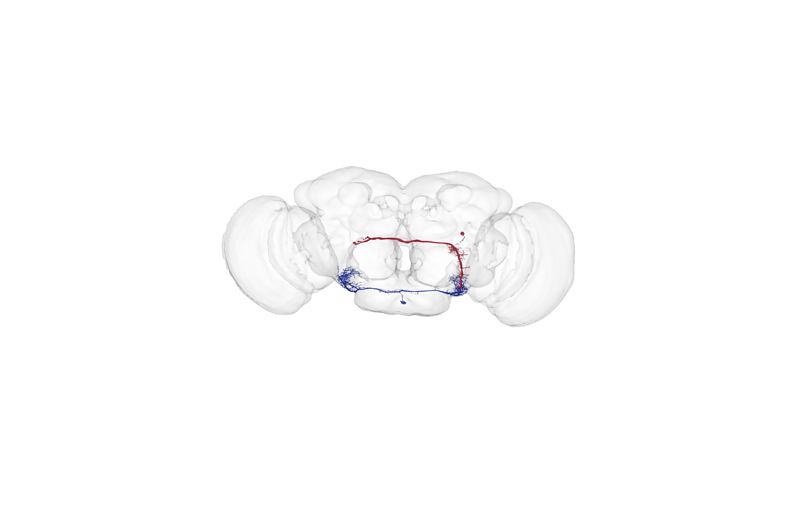
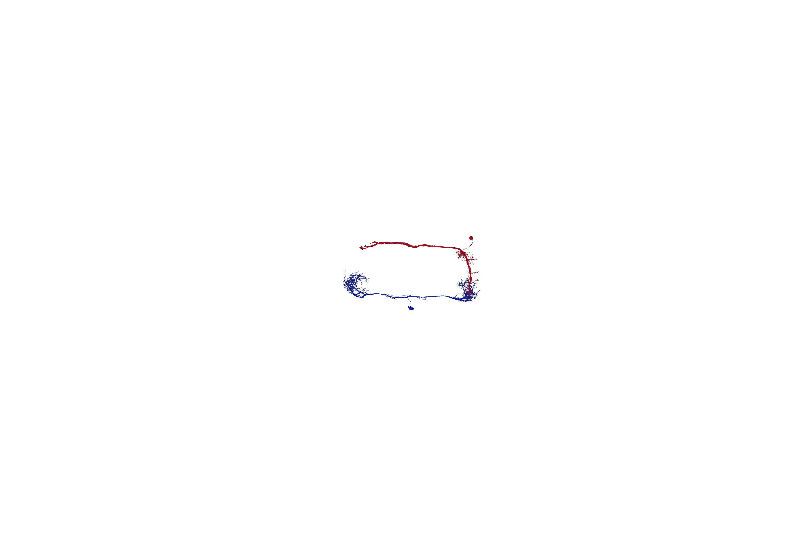
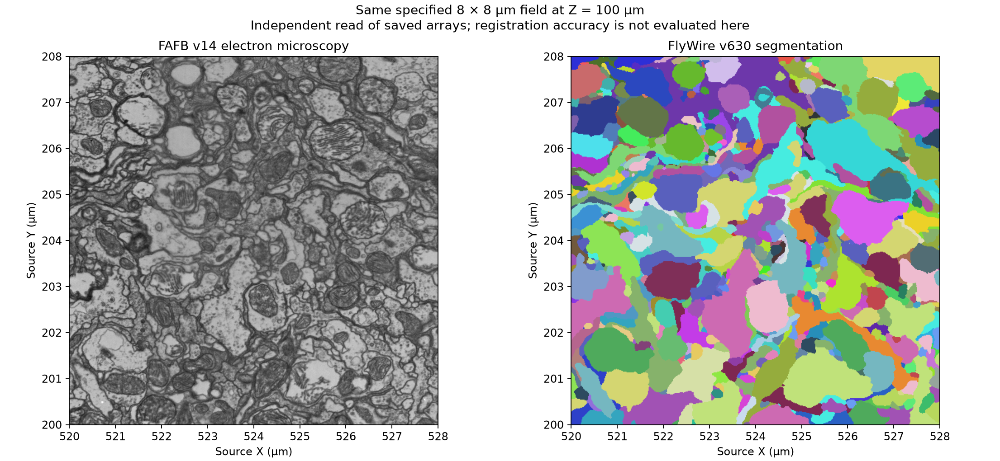
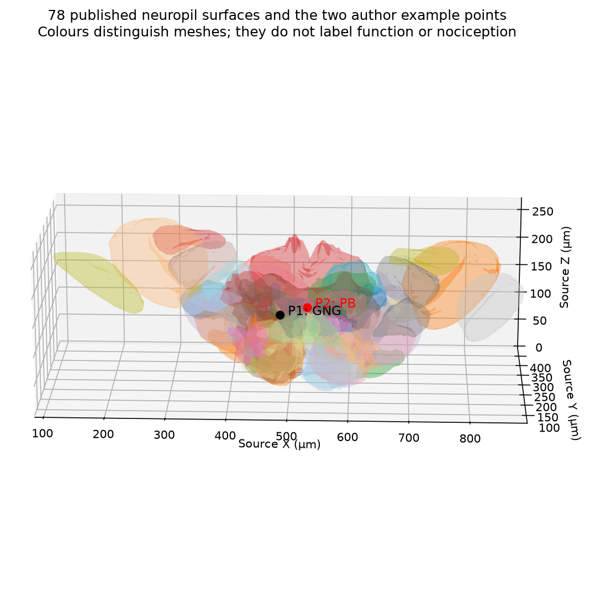
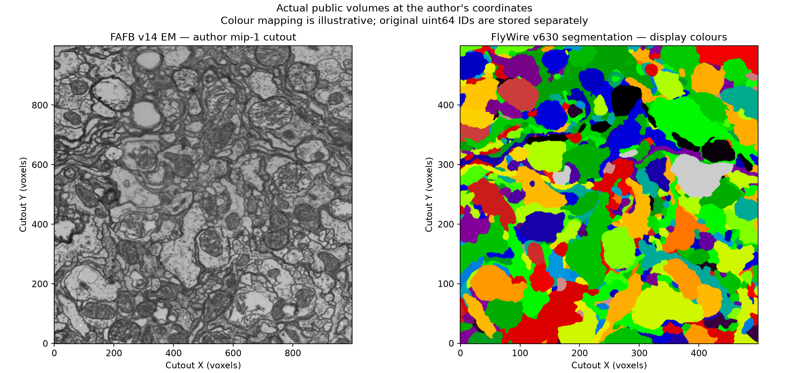
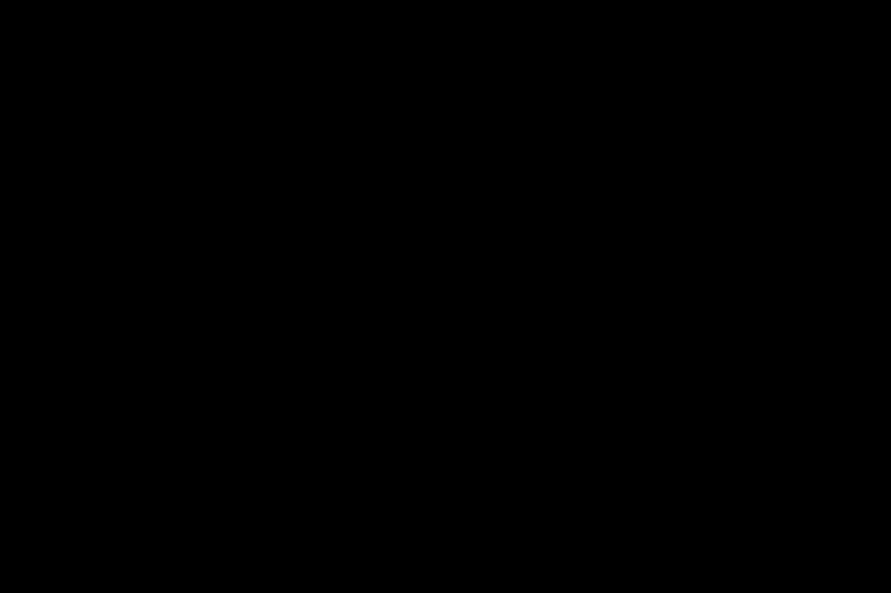

# SIM-026 — seung-lab/FlyConnectome

[Результат испытаний](../../REPORT.md#sim-026) · [Все проекты](../README.md)

Исходники: `9b1790b5553082e1f57921790564c7aae7c9c99a`.

## Две выбранные морфологии v783 внутри контура нейропиля; авторская камера и масштаб 4×, FXAA явно отключён.

Реальные данные из зарегистрированных маршрутов FlyWire/FAFB. Это анатомическая геометрия, не нейродинамика и не ноцицептивная или CAP-модель. Версии и исходные ID сохранены в квитанциях.

Первичный файл: [headless-neurons-with-neuropil.png](<../../../research/.work/simulator-evaluation/SIM-026/20261026T173755Z-9cb9e6/check-de4deb7341/exports/headless-neurons-with-neuropil.png>).

SHA-256: `cfaa0a71a90cf906412a3e835ac75e19d1c953f837f27f3b355c401716177dd0`.

## Те же две полные поверхности без контура мозга. Повтор PNG совпал побайтно; это статические поверхности, не активность сети.

Реальные данные из зарегистрированных маршрутов FlyWire/FAFB. Это анатомическая геометрия, не нейродинамика и не ноцицептивная или CAP-модель. Версии и исходные ID сохранены в квитанциях.

Первичный файл: [headless-neurons.png](<../../../research/.work/simulator-evaluation/SIM-026/20261026T173755Z-9cb9e6/check-de4deb7341/exports/headless-neurons.png>).

SHA-256: `0d31db642bab58c38042586a5c214ce75f0416ce7636e470209a018c361e64fe`.

## EM FAFB v14 и сегментация FlyWire v630: заданная область 8 × 8 мкм на Z=100 мкм; физические оси согласованы.

Независимое чтение NPY. Совпадение заданных координат не является отдельной оценкой точности регистрации. uint64 ID хранятся независимо от цвета.

Первичный файл: [registered-cutout-preview.png](<../../../research/.work/simulator-evaluation/SIM-026/20261026T173755Z-9cb9e6/check-de4deb7341/exports/registered-cutout-preview.png>).

SHA-256: `07dea4c5f7ee8f95ea054b350e83065fcc6277707498109e75c3f7683cdc073a`.

## Все 78 поверхностей областей и две точки из авторского примера: GNG и PB.

Положения пересчитаны по сохранённым поверхностям. Название области не является подтверждением функции или ноцицептивной роли. Метки точек наложены поверх прозрачных поверхностей для читаемости.

Первичный файл: [neuropil-atlas-preview.png](<../../../research/.work/simulator-evaluation/SIM-026/20261026T173755Z-9cb9e6/check-de4deb7341/exports/neuropil-atlas-preview.png>).

SHA-256: `16ea245328a7f27c92e4468bcacdcd48191fddd8e453f5465ba4424f90b3b341`.

## Первичный просмотр срезов в координатах вокселей: EM 1000×1000 и сегментация 500×500 на одной заданной физической области.

Реальные данные из зарегистрированных маршрутов FlyWire/FAFB. Это анатомическая геометрия, не нейродинамика и не ноцицептивная или CAP-модель. Версии и исходные ID сохранены в квитанциях. Раскраска использует неизменённую функцию remap_seg notebook; цветовые числа не заменяют исходные ID.

Первичный файл: [public-em-and-segmentation.png](<../../../research/.work/simulator-evaluation/SIM-026/20261026T173755Z-9cb9e6/exports/public-em-and-segmentation.png>).

SHA-256: `72548ec08941229fc172a4ab93300a9b27d16d31c3d05080763bf289ea4fa81e`.

## Диагностика: штатный FXAA записал чёрное изображение при успешном коде возврата.

Неуспешная визуализация сохранена отдельно от исправленного результата. Пиксельная проверка не обнаружила ожидаемой красной и синей геометрии.

Первичный файл: [native-neuron-render.png](<../../../research/.work/simulator-evaluation/SIM-026/20261026T173755Z-9cb9e6/exports/native-neuron-render.png>).

SHA-256: `b14cba1167640922627e2752bb841443b6c809dc0548c256a03c132e99a20479`.

## Диагностика: второй исходный чёрный кадр с контуром нейропиля; это не успешный результат.

Наличие файла и код возврата 0 не использованы как доказательство работоспособного рендера.

Первичный файл: [native-neuron-render-with-neuropil.png](<../../../research/.work/simulator-evaluation/SIM-026/20261026T173755Z-9cb9e6/exports/native-neuron-render-with-neuropil.png>).

SHA-256: `db19d2c5f261b3d76b1d9cab4e94eeabea996e596066978189b183678c66e0e8`.
