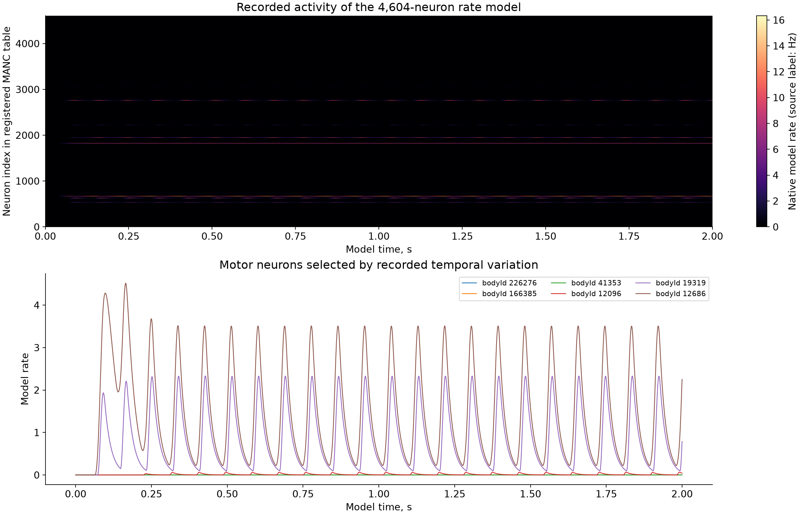
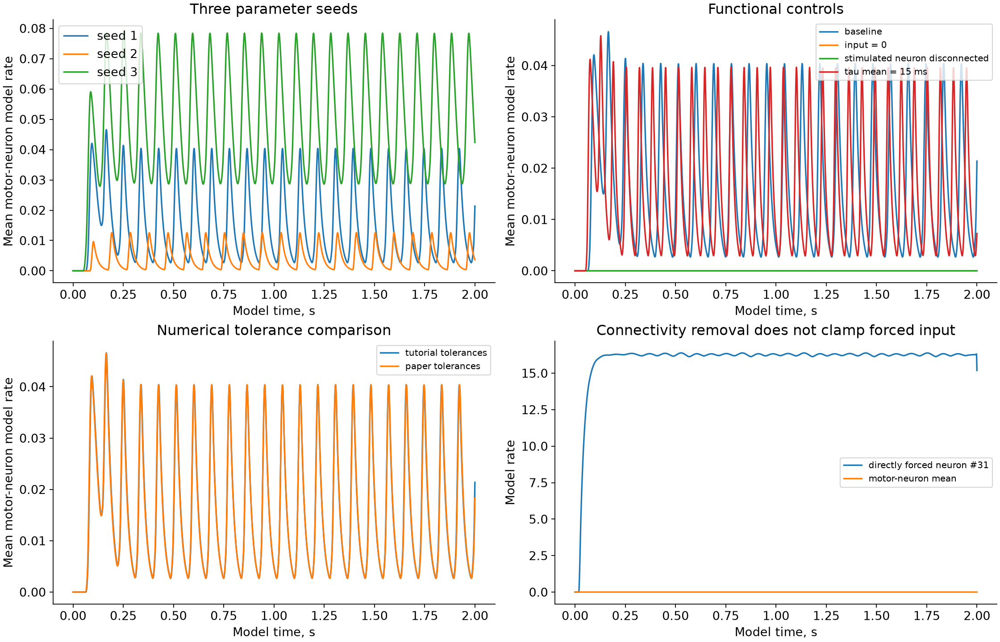
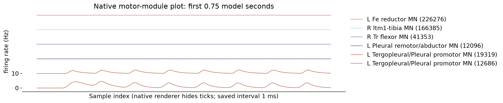

# SIM-027 — smpuglie/Pugliese_2026

[Результат испытаний](../../REPORT.md#sim-027) · [Все проекты](../README.md)

Исходники: `10e7661bf414ba7b4c2edf795cd36d0f878c17c0`.

## Записанная активность 4604 нейронов и выбранных моторных нейронов за две модельные секунды.

Вычислительные частоты активности native rate-модели; не спайки, не экспериментальные записи мухи, не ноцицепция и не CAP/ECAP. Физическая калибровка частоты и входного воздействия не проверена.

Первичный файл: [manc-rate-recordings.png](<../../../research/.work/simulator-evaluation/SIM-027/20261026T184640Z-a562e6/exports/manc-rate-recordings.png>).

SHA-256: `eba713440c69cbef093891c1b27e6071c7acb2ba1126df2f3432ba87a297b9ea`.

## Записанная активность 4604 нейронов и выбранных моторных нейронов за две модельные секунды.

Вычислительные частоты активности native rate-модели; не спайки, не экспериментальные записи мухи, не ноцицепция и не CAP/ECAP. Физическая калибровка частоты и входного воздействия не проверена.

[Открыть manc-rate-recordings.svg](manc-rate-recordings.svg)

Первичный файл: [manc-rate-recordings.svg](<../../../research/.work/simulator-evaluation/SIM-027/20261026T184640Z-a562e6/exports/manc-rate-recordings.svg>).

SHA-256: `1c062c999580bce0a8ced7798cd6afd32eafe8a1a4fa12926295851a6406c6ee`.

## Разные seeds, отсутствие входа, отключение связей стимулируемого нейрона, временная константа и допуски решателя.

Вычислительные частоты активности native rate-модели; не спайки, не экспериментальные записи мухи, не ноцицепция и не CAP/ECAP. Физическая калибровка частоты и входного воздействия не проверена.

Первичный файл: [manc-rate-controls.png](<../../../research/.work/simulator-evaluation/SIM-027/20261026T184640Z-a562e6/exports/manc-rate-controls.png>).

SHA-256: `87f0de6b348e0071f82c368c870a404c6fe2cd4338629c36807ba0cd786c2252`.

## Разные seeds, отсутствие входа, отключение связей стимулируемого нейрона, временная константа и допуски решателя.

Вычислительные частоты активности native rate-модели; не спайки, не экспериментальные записи мухи, не ноцицепция и не CAP/ECAP. Физическая калибровка частоты и входного воздействия не проверена.

[Открыть manc-rate-controls.svg](manc-rate-controls.svg)

Первичный файл: [manc-rate-controls.svg](<../../../research/.work/simulator-evaluation/SIM-027/20261026T184640Z-a562e6/exports/manc-rate-controls.svg>).

SHA-256: `64f940e3458a4a528462b3f1e7a403345ee1f2450fa121f526318c9aa5cb4ca7`.

## Штатный график motor module для шести моторных нейронов, первые 0,75 модельной секунды.

Вычислительные частоты активности native rate-модели; не спайки, не экспериментальные записи мухи, не ноцицепция и не CAP/ECAP. Физическая калибровка частоты и входного воздействия не проверена.

Первичный файл: [native-motor-modules.png](<../../../research/.work/simulator-evaluation/SIM-027/20261026T184640Z-a562e6/exports/native-motor-modules.png>).

SHA-256: `c9382d5b1b09b8c49362ac797e0dec0ddb6d802b76a7bc4e1a023d1c2ac9572c`.

## Штатный график motor module для шести моторных нейронов, первые 0,75 модельной секунды.

Вычислительные частоты активности native rate-модели; не спайки, не экспериментальные записи мухи, не ноцицепция и не CAP/ECAP. Физическая калибровка частоты и входного воздействия не проверена.

[Открыть native-motor-modules.svg](native-motor-modules.svg)

Первичный файл: [native-motor-modules.svg](<../../../research/.work/simulator-evaluation/SIM-027/20261026T184640Z-a562e6/exports/native-motor-modules.svg>).

SHA-256: `4eb1b3d38757c8c378fba1eef3362f353da6e034b5215cb56eb2f28de88666bc`.
