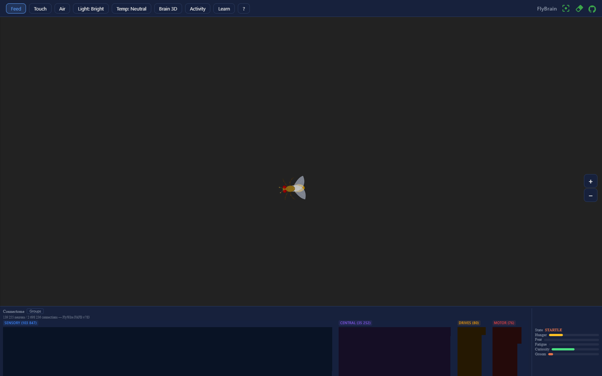
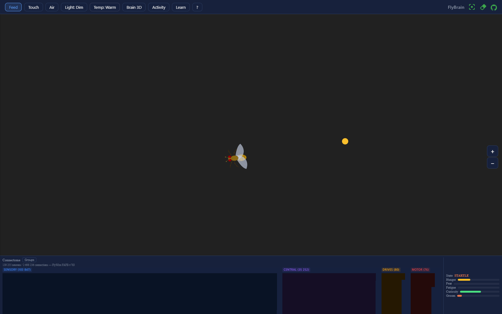
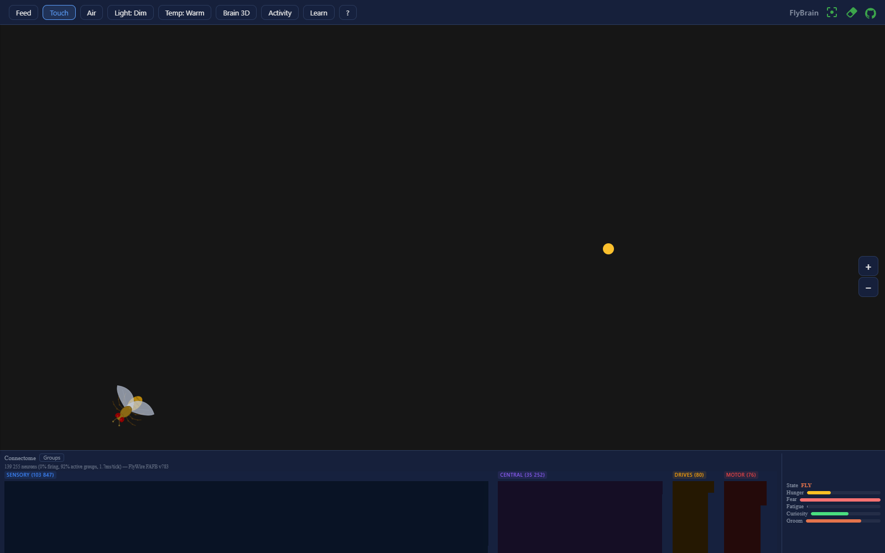
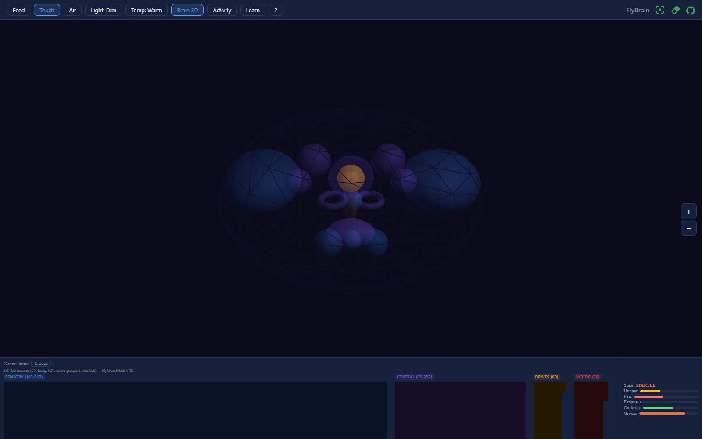
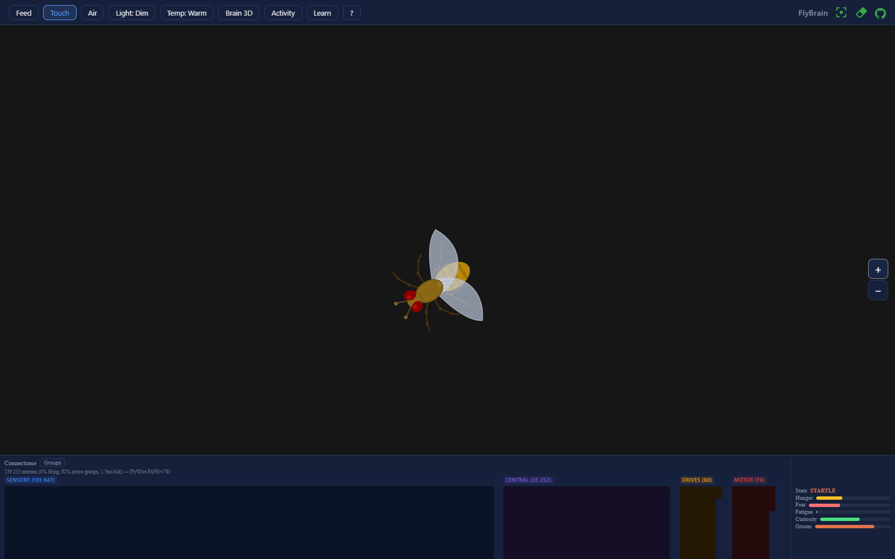
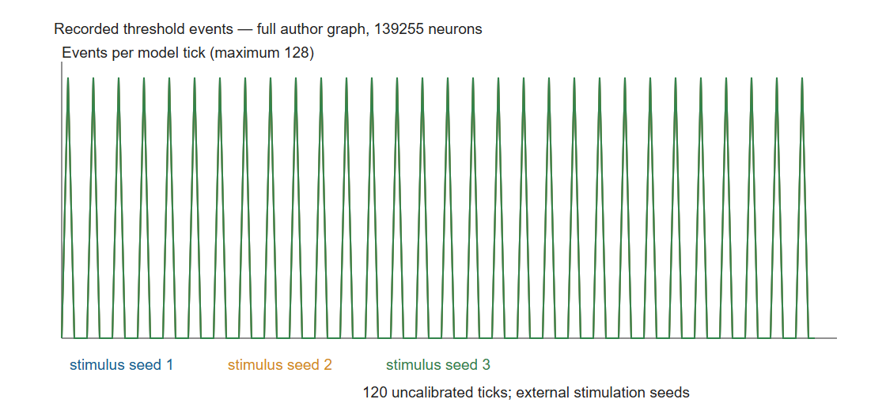
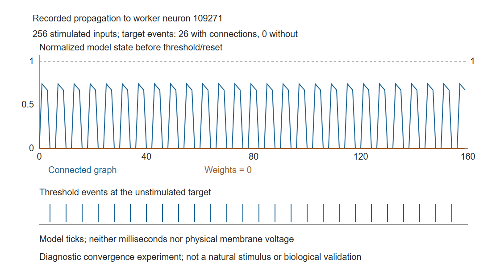
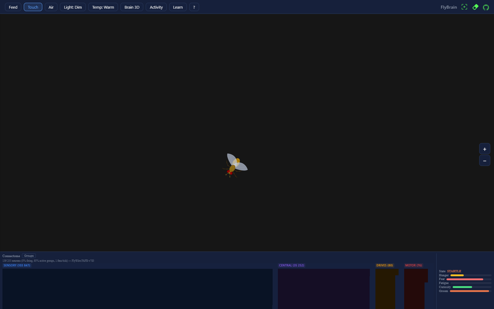

# SIM-029 — snedea/flybrain

[Результат испытаний](../../REPORT.md#sim-029) · [Все проекты](../README.md)

Исходники: `9191824d17871b7851645782d53d23f213ddb938`.

## Исходный браузерный интерфейс с загруженным полным авторским бинарником; fallback на 59 групп исключён проверкой workerReady и размера состояния.

Реальный программный интерфейс и записанные модельные события. Единицы потенциала нормированы, время — некалиброванный такт; нет подтверждения биологической боли, CAP или человеческого ECAP.

Первичный файл: [browser-full-connectome.png](<../../../research/.work/simulator-evaluation/SIM-029/20261026T190409Z-3f94ab/exports/browser-6336d2e44d/browser-full-connectome.png>).

SHA-256: `552ddef0a672acb08975f1296f5aa88b6457fd27d546b501f26fb6bcc95ff962`.

## Проверены размещение еды, смена освещения и температуры через настоящие элементы интерфейса.

Реальный программный интерфейс и записанные модельные события. Единицы потенциала нормированы, время — некалиброванный такт; нет подтверждения биологической боли, CAP или человеческого ECAP.

Первичный файл: [browser-environment-controls.png](<../../../research/.work/simulator-evaluation/SIM-029/20261026T190409Z-3f94ab/exports/browser-6336d2e44d/browser-environment-controls.png>).

SHA-256: `6a482b6350396e159c94bac3d8de8ceca6a0ed98e9ec7d72c5d84f683505fefe`.

## Авторский интерфейс после касания: состояние startle. Это программная поведенческая реакция, не доказательство боли или ноцицепции.

Реальный программный интерфейс и записанные модельные события. Единицы потенциала нормированы, время — некалиброванный такт; нет подтверждения биологической боли, CAP или человеческого ECAP.

Первичный файл: [browser-touch-state.png](<../../../research/.work/simulator-evaluation/SIM-029/20261026T190409Z-3f94ab/exports/browser-6336d2e44d/browser-touch-state.png>).

SHA-256: `e195f11a7fb3fbe5b2e90a728c2c1b8844d24d7b57a097d0f6caa0e68898dde6`.

## Штатная схематическая 3D-визуализация программных областей из геометрических примитивов; это не реальные нейронные поверхности.

Реальный программный интерфейс и записанные модельные события. Единицы потенциала нормированы, время — некалиброванный такт; нет подтверждения биологической боли, CAP или человеческого ECAP.

Первичный файл: [browser-brain3d.png](<../../../research/.work/simulator-evaluation/SIM-029/20261026T190409Z-3f94ab/exports/browser-6336d2e44d/browser-brain3d.png>).

SHA-256: `d4b394a24ab03342d667ef395ad5495371a0c4d7470da5f7cafa7f04ffcdd197`.

## Тело, нарисованное Canvas, увеличено штатным управлением. Биомеханика и контактная физика не воспроизводились.

Реальный программный интерфейс и записанные модельные события. Единицы потенциала нормированы, время — некалиброванный такт; нет подтверждения биологической боли, CAP или человеческого ECAP.

Первичный файл: [browser-body-zoom.png](<../../../research/.work/simulator-evaluation/SIM-029/20261026T190409Z-3f94ab/exports/browser-6336d2e44d/browser-body-zoom.png>).

SHA-256: `d5d835289aa18a38ea7b90ed81252e66db8b1b7a4d64e52ab948eb8751579906`.

## Числа пороговых событий при трёх наборах стимулируемых нейронов совпадают; идентичности стимулируемых нейронов различаются. Событий вне входов в этом сценарии не было.

Реальный программный интерфейс и записанные модельные события. Единицы потенциала нормированы, время — некалиброванный такт; нет подтверждения биологической боли, CAP или человеческого ECAP.

Первичный файл: [recorded-events.png](<../../../research/.work/simulator-evaluation/SIM-029/20261026T190409Z-3f94ab/exports/browser-6336d2e44d/recorded-events.png>).

SHA-256: `177993efc642938e5cacfc074fa0413e3b940ead7e405941337b34c0f9cbbaab`.

## Записанный ответ нестимулируемого нейрона при согласованных сходящихся входах; с весами 26 событий в целевом нейроне, без весов — ноль.

Реальный программный интерфейс и записанные модельные события. Единицы потенциала нормированы, время — некалиброванный такт; нет подтверждения биологической боли, CAP или человеческого ECAP.

Первичный файл: [recorded-propagation.png](<../../../research/.work/simulator-evaluation/SIM-029/20261026T190409Z-3f94ab/exports/browser-6336d2e44d/recorded-propagation.png>).

SHA-256: `6049586f6414ea2ddde53da2210670cd775df0be295c79ae0c98768883d0400b`.

## Числа пороговых событий при трёх наборах стимулируемых нейронов совпадают; идентичности стимулируемых нейронов различаются. Событий вне входов в этом сценарии не было.

Векторный график численного экспорта; не экспериментальные записи.

[Открыть recorded-events.svg](recorded-events.svg)

Первичный файл: [recorded-events.svg](<../../../research/.work/simulator-evaluation/SIM-029/20261026T190409Z-3f94ab/exports/recorded-events.svg>).

SHA-256: `77fa6d602ef508c1d5c46a2b6f0b4cf61bd748cc3b2cfac6e816e54a0c976ab2`.

## Записанный ответ нестимулируемого нейрона при согласованных сходящихся входах; с весами 26 событий в целевом нейроне, без весов — ноль.

Векторный график численного экспорта; не экспериментальные записи.

[Открыть recorded-propagation.svg](recorded-propagation.svg)

Первичный файл: [recorded-propagation.svg](<../../../research/.work/simulator-evaluation/SIM-029/20261026T190409Z-3f94ab/exports/recorded-propagation.svg>).

SHA-256: `4b8c6c7eea7d3f9b0e8c256f3e141b3ffc64445cb97841ccb08ff7f78d9a6ddc`.

## Диагностика первой проверки паузы: наблюдатель ошибочно требовал исчезновения последнего кадра; последующая проверка подтверждает прекращение новых сообщений.

Историческая неудачная проверка наблюдателя, не доказательство отказа функции паузы.

Первичный файл: [browser-failure.png](<../../../research/.work/simulator-evaluation/SIM-029/20261026T190409Z-3f94ab/exports/browser/browser-failure.png>).

SHA-256: `daf911bb183ce3fd85ceabb36c8ee4afdc84ea98b4d1c420fe915148813b20ac`.
