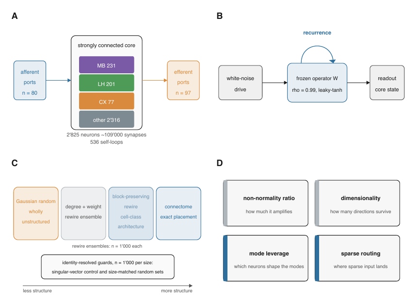
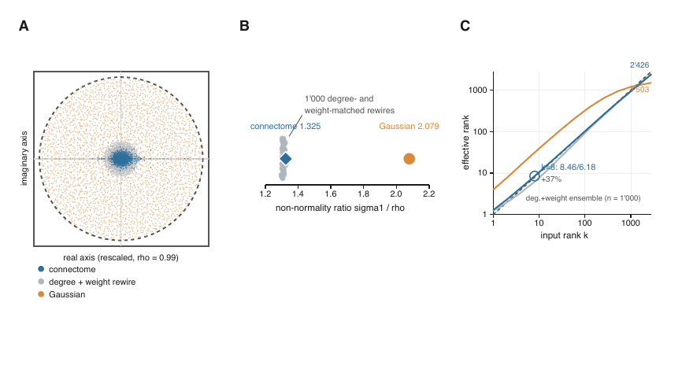
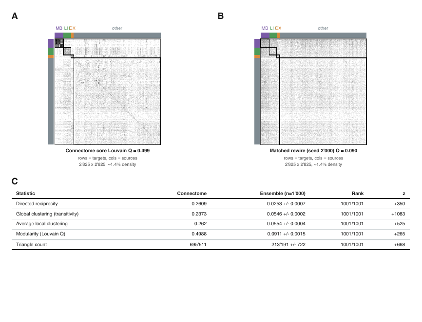
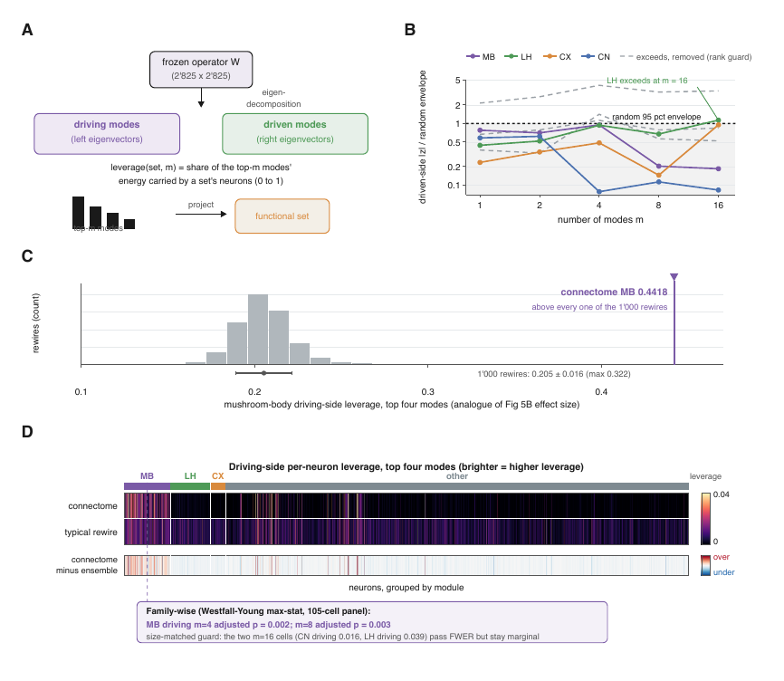
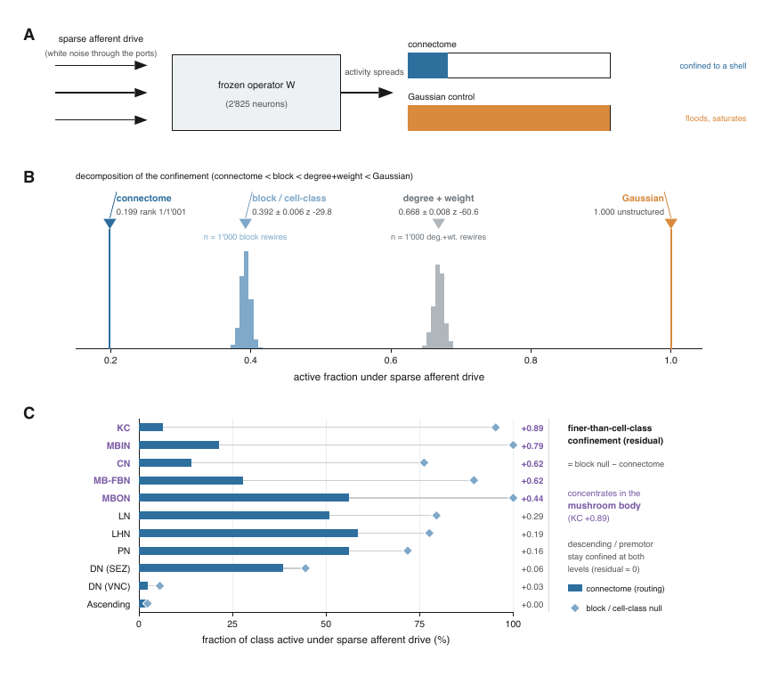
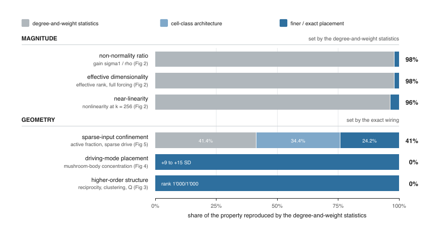

# SIM-030 — Stavros963/fcta

[Результат испытаний](../../REPORT.md#sim-030) · [Все проекты](../README.md)

Исходники: `af8e451d9010294c185b966c953616b212f0294c`.

## Авторская схема frozen-оператора, входных портов и семейств нулевых моделей.

Stavros Therianos, arXiv:2606.17745, исходный пакет Stavros963/fcta af8e451; CC BY 4.0 согласно README. Оригинальный авторский PDF или его прямое отображение Poppler 24.04.0. Численный pipeline и построение рисунка из графа здесь не воспроизведены.

[Открыть native-figure-1.pdf](native-figure-1.pdf)

Первичный файл: [figure1.pdf](<../../../research/.work/simulator-evaluation/SIM-030/assets/bundle/figures/figure1.pdf>).

SHA-256: `2dd2d5090e948a6fffc95a844041aab4de8323a8c30d44c330adc4dac00df022`.

## Авторская схема frozen-оператора, входных портов и семейств нулевых моделей.

Stavros Therianos, arXiv:2606.17745, исходный пакет Stavros963/fcta af8e451; CC BY 4.0 согласно README. Оригинальный авторский PDF или его прямое отображение Poppler 24.04.0. Численный pipeline и построение рисунка из графа здесь не воспроизведены.

Первичный файл: [native-figure-1.png](<../../../research/.work/simulator-evaluation/SIM-030/20261026T193144Z-95260c/exports/figures/native-figure-1.png>).

SHA-256: `7a04c15ab69f6cbfbc5deecb3831379f1b39471b81aa01859992a18ecd314566`.

## Авторские спектры, отношение сингулярного значения к спектральному радиусу и эффективная размерность.

Stavros Therianos, arXiv:2606.17745, исходный пакет Stavros963/fcta af8e451; CC BY 4.0 согласно README. Оригинальный авторский PDF или его прямое отображение Poppler 24.04.0. Численный pipeline и построение рисунка из графа здесь не воспроизведены.

[Открыть native-figure-2.pdf](native-figure-2.pdf)

Первичный файл: [figure2.pdf](<../../../research/.work/simulator-evaluation/SIM-030/assets/bundle/figures/figure2.pdf>).

SHA-256: `61b0e1843cb5a631b8d5a7bfbe1dbd9b3a23e6355af89d6f0b6cba669e9204b7`.

## Авторские спектры, отношение сингулярного значения к спектральному радиусу и эффективная размерность.

Stavros Therianos, arXiv:2606.17745, исходный пакет Stavros963/fcta af8e451; CC BY 4.0 согласно README. Оригинальный авторский PDF или его прямое отображение Poppler 24.04.0. Численный pipeline и построение рисунка из графа здесь не воспроизведены.

Первичный файл: [native-figure-2.png](<../../../research/.work/simulator-evaluation/SIM-030/20261026T193144Z-95260c/exports/figures/native-figure-2.png>).

SHA-256: `1abd2563fb81d844867e2e44178193b4c5814a007e060bb030f365c8a367dda9`.

## Авторские матрицы и сравнение структурных статистик коннектома с ансамблем.

Stavros Therianos, arXiv:2606.17745, исходный пакет Stavros963/fcta af8e451; CC BY 4.0 согласно README. Оригинальный авторский PDF или его прямое отображение Poppler 24.04.0. Численный pipeline и построение рисунка из графа здесь не воспроизведены.

[Открыть native-figure-3.pdf](native-figure-3.pdf)

Первичный файл: [figure3.pdf](<../../../research/.work/simulator-evaluation/SIM-030/assets/bundle/figures/figure3.pdf>).

SHA-256: `dad1c3573373a0d408bd3ef0195b4c58477bfceac6497e1445bdfe31d355b933`.

## Авторские матрицы и сравнение структурных статистик коннектома с ансамблем.

Stavros Therianos, arXiv:2606.17745, исходный пакет Stavros963/fcta af8e451; CC BY 4.0 согласно README. Оригинальный авторский PDF или его прямое отображение Poppler 24.04.0. Численный pipeline и построение рисунка из графа здесь не воспроизведены.

Первичный файл: [native-figure-3.png](<../../../research/.work/simulator-evaluation/SIM-030/20261026T193144Z-95260c/exports/figures/native-figure-3.png>).

SHA-256: `047045a03b3ce937cc9a74250ffde22d06c7ae9ac6b27a7a890983bdaa89afca`.

## Авторские анализ мод и семейная поправка множественных сравнений.

Stavros Therianos, arXiv:2606.17745, исходный пакет Stavros963/fcta af8e451; CC BY 4.0 согласно README. Оригинальный авторский PDF или его прямое отображение Poppler 24.04.0. Численный pipeline и построение рисунка из графа здесь не воспроизведены.

[Открыть native-figure-4.pdf](native-figure-4.pdf)

Первичный файл: [figure4.pdf](<../../../research/.work/simulator-evaluation/SIM-030/assets/bundle/figures/figure4.pdf>).

SHA-256: `6bf4d726bc1cf60adb7daca987651d4623fd03d3c32a86cf50a3b8ce0d1cd4ac`.

## Авторские анализ мод и семейная поправка множественных сравнений.

Stavros Therianos, arXiv:2606.17745, исходный пакет Stavros963/fcta af8e451; CC BY 4.0 согласно README. Оригинальный авторский PDF или его прямое отображение Poppler 24.04.0. Численный pipeline и построение рисунка из графа здесь не воспроизведены.

Первичный файл: [native-figure-4.png](<../../../research/.work/simulator-evaluation/SIM-030/20261026T193144Z-95260c/exports/figures/native-figure-4.png>).

SHA-256: `c2a7c2bb64ba627aeac7a43df1751f35b3ccd1f1c9884734396fb9e4bcaa0a80`.

## Авторское сопоставление маршрутизации активности при разреженном входе и разных уровнях контроля.

Stavros Therianos, arXiv:2606.17745, исходный пакет Stavros963/fcta af8e451; CC BY 4.0 согласно README. Оригинальный авторский PDF или его прямое отображение Poppler 24.04.0. Численный pipeline и построение рисунка из графа здесь не воспроизведены.

[Открыть native-figure-5.pdf](native-figure-5.pdf)

Первичный файл: [figure5.pdf](<../../../research/.work/simulator-evaluation/SIM-030/assets/bundle/figures/figure5.pdf>).

SHA-256: `41f6731b549ab20bf3f8aaa211c32bbe764f68ca6899696c5101466be04dbeeb`.

## Авторское сопоставление маршрутизации активности при разреженном входе и разных уровнях контроля.

Stavros Therianos, arXiv:2606.17745, исходный пакет Stavros963/fcta af8e451; CC BY 4.0 согласно README. Оригинальный авторский PDF или его прямое отображение Poppler 24.04.0. Численный pipeline и построение рисунка из графа здесь не воспроизведены.

Первичный файл: [native-figure-5.png](<../../../research/.work/simulator-evaluation/SIM-030/20261026T193144Z-95260c/exports/figures/native-figure-5.png>).

SHA-256: `105edab91ebbb46a8d1d29a0ba662bdb19bd78fe7c7f31de031a089a76ddb56e`.

## Авторская итоговая сводка статистических и структурных вкладов. Это не наша оценка объяснённой дисперсии или пользы переноса.

Stavros Therianos, arXiv:2606.17745, исходный пакет Stavros963/fcta af8e451; CC BY 4.0 согласно README. Оригинальный авторский PDF или его прямое отображение Poppler 24.04.0. Численный pipeline и построение рисунка из графа здесь не воспроизведены.

[Открыть native-figure-6.pdf](native-figure-6.pdf)

Первичный файл: [figure6.pdf](<../../../research/.work/simulator-evaluation/SIM-030/assets/bundle/figures/figure6.pdf>).

SHA-256: `18be50e5f86e8ca47af1c30dae9384edef592347a3e55b37b69c548d22965add`.

## Авторская итоговая сводка статистических и структурных вкладов. Это не наша оценка объяснённой дисперсии или пользы переноса.

Stavros Therianos, arXiv:2606.17745, исходный пакет Stavros963/fcta af8e451; CC BY 4.0 согласно README. Оригинальный авторский PDF или его прямое отображение Poppler 24.04.0. Численный pipeline и построение рисунка из графа здесь не воспроизведены.

Первичный файл: [native-figure-6.png](<../../../research/.work/simulator-evaluation/SIM-030/20261026T193144Z-95260c/exports/figures/native-figure-6.png>).

SHA-256: `fea538da4d04b32b579993e831e060610ff2e1636ff03c69f6c2f0e64df79cfa`.
