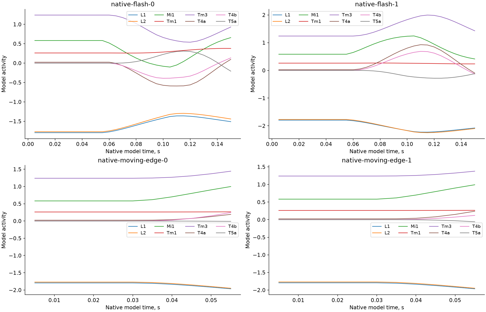
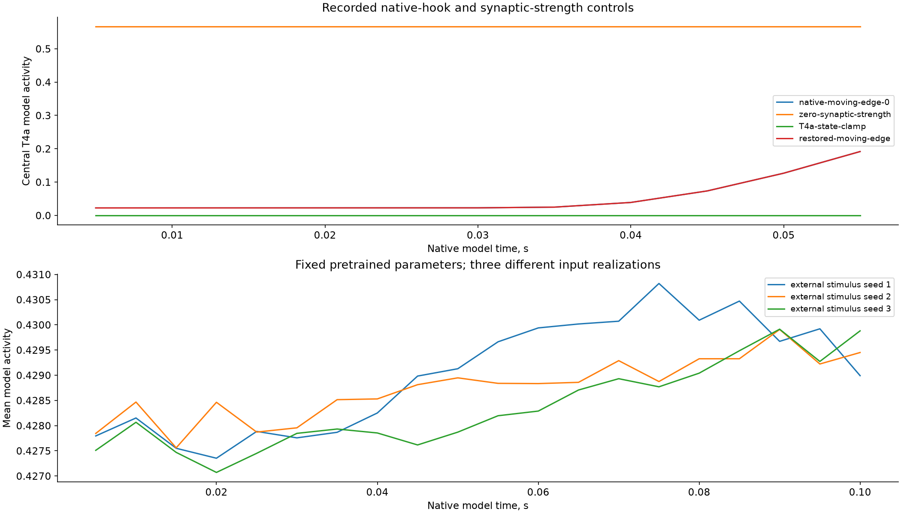
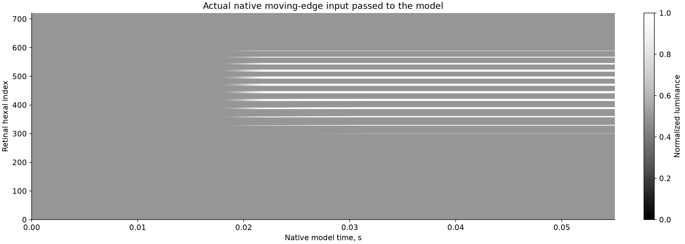

# SIM-031 — TuragaLab/flyvis

[Результат испытаний](../../REPORT.md#sim-031) · [Все проекты](../README.md)

Исходники: `92b3845cc426dd309a1a0e1b3890156c42e14021`.

## Новые отклики восьми центральных типов клеток на два штатных стимула-вспышки и два движущихся края; закреплённые код и авторские веса.

Наши графики реально записанных откликов в закреплённом Flyvis; физическая калибровка и биологическая достоверность независимо не установлены. Модельное время в секундах; активность без приписанных мВ/Гц.

Первичный файл: [native-visual-responses.png](<../../../research/.work/simulator-evaluation/SIM-031/20261026T201503Z-affed1/exports/native-visual-responses.png>).

SHA-256: `4f8b916bdddbe612e34001ee2aa88addf1d2480c7c6c7ccb58f7440b9868a729`.

## Новые отклики восьми центральных типов клеток на два штатных стимула-вспышки и два движущихся края; закреплённые код и авторские веса.

Наши графики реально записанных откликов в закреплённом Flyvis; физическая калибровка и биологическая достоверность независимо не установлены. Модельное время в секундах; активность без приписанных мВ/Гц.

[Открыть native-visual-responses.svg](native-visual-responses.svg)

Первичный файл: [native-visual-responses.svg](<../../../research/.work/simulator-evaluation/SIM-031/20261026T201503Z-affed1/exports/native-visual-responses.svg>).

SHA-256: `6f8defdef7c23786e53e2cadb9932d5f59995635237fb9884105f712a52d42ba`.

## Записанные эффекты обнуления synaptic strength, штатного clamp всех T4a и восстановления, а также три реализации внешнего случайного входа.

Наши графики реально записанных откликов в закреплённом Flyvis; физическая калибровка и биологическая достоверность независимо не установлены. Модельное время в секундах; активность без приписанных мВ/Гц.

Первичный файл: [optic-lobe-controls.png](<../../../research/.work/simulator-evaluation/SIM-031/20261026T201503Z-affed1/exports/optic-lobe-controls.png>).

SHA-256: `0ae6a32e57dad8c21c932a0ee2db9b5f7fb98728f8c5a64c598650369f54a09b`.

## Записанные эффекты обнуления synaptic strength, штатного clamp всех T4a и восстановления, а также три реализации внешнего случайного входа.

Наши графики реально записанных откликов в закреплённом Flyvis; физическая калибровка и биологическая достоверность независимо не установлены. Модельное время в секундах; активность без приписанных мВ/Гц.

[Открыть optic-lobe-controls.svg](optic-lobe-controls.svg)

Первичный файл: [optic-lobe-controls.svg](<../../../research/.work/simulator-evaluation/SIM-031/20261026T201503Z-affed1/exports/optic-lobe-controls.svg>).

SHA-256: `e05b6b21c2c523324166d638f3f154f1bc2afdd6c615c930d9fe6d783715fe7e`.

## Фактическая освещённость 721 ретинального элемента, поданная в модель для штатного движущегося края.

Наши графики реально записанных откликов в закреплённом Flyvis; физическая калибровка и биологическая достоверность независимо не установлены. Модельное время в секундах; активность без приписанных мВ/Гц.

Первичный файл: [native-retinal-input.png](<../../../research/.work/simulator-evaluation/SIM-031/20261026T201503Z-affed1/exports/native-retinal-input.png>).

SHA-256: `11483baec48d51dca163c65e127f29504205e7519455c447cc8bd5ee651410b1`.

## Фактическая освещённость 721 ретинального элемента, поданная в модель для штатного движущегося края.

Наши графики реально записанных откликов в закреплённом Flyvis; физическая калибровка и биологическая достоверность независимо не установлены. Модельное время в секундах; активность без приписанных мВ/Гц.

[Открыть native-retinal-input.svg](native-retinal-input.svg)

Первичный файл: [native-retinal-input.svg](<../../../research/.work/simulator-evaluation/SIM-031/20261026T201503Z-affed1/exports/native-retinal-input.svg>).

SHA-256: `fa5e91178d45a0d1f991d4d42e4f9e507dfe57c49a60b5b9630cf08496ba72ef`.
