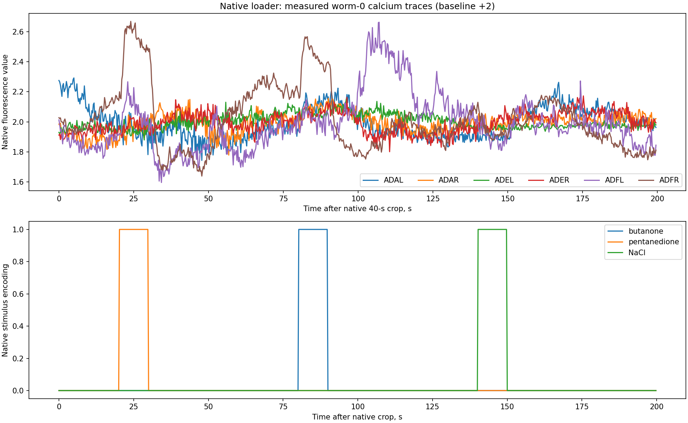
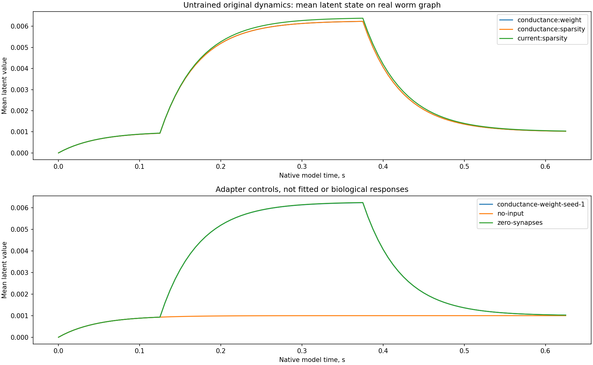

# SIM-032 — TuragaLab/wormvae

[Результат испытаний](../../REPORT.md#sim-032) · [Все проекты](../README.md)

Исходники: `15b58bff08bdf4eb04709434d766fca6835d7d79`.

## Фактические кальциевые трассы первого животного и три химических воздействия после штатной загрузки; показаны шесть именованных клеток, crop 40 с и baseline +2 обозначены.

Наше отображение реальных авторских входов и отдельно помеченных модельных проб. Латентные состояния не калиброваны в мВ; наличия субъективной боли, физического тела или CAP/ECAP эти материалы не показывают.

Первичный файл: [recorded-calcium-inputs.png](<../../../research/.work/simulator-evaluation/SIM-032/20261026T203551Z-ec0d2c/exports/recorded-calcium-inputs.png>).

SHA-256: `89ec6df3d8358286a100db19a96f36b1fc0c9b9b4df941ce4ca4bf8d70d04ee3`.

## Фактические кальциевые трассы первого животного и три химических воздействия после штатной загрузки; показаны шесть именованных клеток, crop 40 с и baseline +2 обозначены.

Наше отображение реальных авторских входов и отдельно помеченных модельных проб. Латентные состояния не калиброваны в мВ; наличия субъективной боли, физического тела или CAP/ECAP эти материалы не показывают.

[Открыть recorded-calcium-inputs.svg](recorded-calcium-inputs.svg)

Первичный файл: [recorded-calcium-inputs.svg](<../../../research/.work/simulator-evaluation/SIM-032/20261026T203551Z-ec0d2c/exports/recorded-calcium-inputs.svg>).

SHA-256: `3cca5b5d998c648c811afe41d812986b23818e4acc1ee8f25ec12bee3b6fe3db`.

## Новые записи исходных conductance/current-компонентов на настоящем графе C. elegans; это необученные параметры, адаптерный прямой сенсорный вход и контроль с нулевыми связями, а не биологически подтверждённые ответы.

Наше отображение реальных авторских входов и отдельно помеченных модельных проб. Латентные состояния не калиброваны в мВ; наличия субъективной боли, физического тела или CAP/ECAP эти материалы не показывают.

Первичный файл: [untrained-worm-dynamics.png](<../../../research/.work/simulator-evaluation/SIM-032/20261026T203551Z-ec0d2c/exports/untrained-worm-dynamics.png>).

SHA-256: `4aa9f87c0bde158b0c2c2bf3819771d1fb27bdda0f2771cd58d1f1724de41671`.

## Новые записи исходных conductance/current-компонентов на настоящем графе C. elegans; это необученные параметры, адаптерный прямой сенсорный вход и контроль с нулевыми связями, а не биологически подтверждённые ответы.

Наше отображение реальных авторских входов и отдельно помеченных модельных проб. Латентные состояния не калиброваны в мВ; наличия субъективной боли, физического тела или CAP/ECAP эти материалы не показывают.

[Открыть untrained-worm-dynamics.svg](untrained-worm-dynamics.svg)

Первичный файл: [untrained-worm-dynamics.svg](<../../../research/.work/simulator-evaluation/SIM-032/20261026T203551Z-ec0d2c/exports/untrained-worm-dynamics.svg>).

SHA-256: `505c608c2c367b0e9b6ac6f6dcaacb60e5f345edc9cf5ace9909d97b347cd054`.
