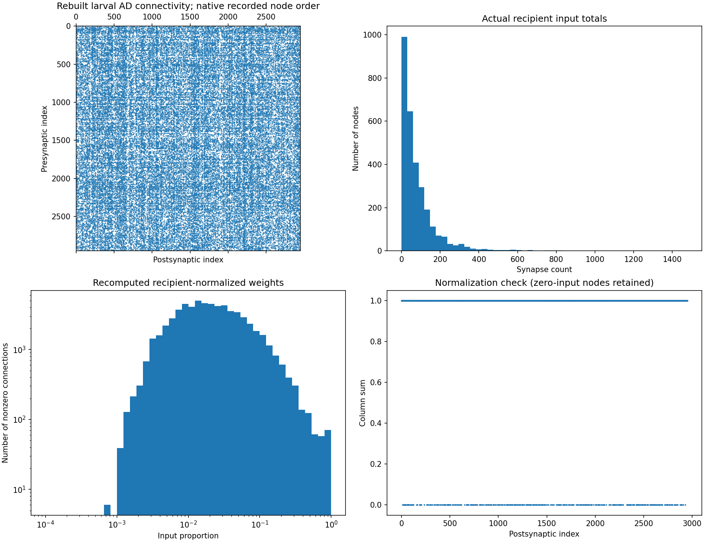

# SIM-033 — YijieYin/connectome_data_prep

[Результат испытаний](../../REPORT.md#sim-033) · [Все проекты](../README.md)

Исходники: `a4df3b0d5345d2a34dac813f897d8427f6a6eb45`.

## Фактически восстановленная AD-связность, сумма входных контактов, нормированные веса и проверка сумм столбцов; порядок узлов сохранён в отдельном CSV.

Наши графики реально подготовленных авторских матриц личиночного коннектома; это не результат симуляции активности и не биофизическая калибровка. Строки — presynaptic, столбцы — postsynaptic.

Первичный файл: [larval-preparation-checks.png](<../../../research/.work/simulator-evaluation/SIM-033/20261026T204919Z-e980a6/exports/larval-preparation-checks.png>).

SHA-256: `61c649d280cac897beb1d1b0d13365f2c1717c5327939cf7a8a4da67675e7261`.

## Фактически восстановленная AD-связность, сумма входных контактов, нормированные веса и проверка сумм столбцов; порядок узлов сохранён в отдельном CSV.

Наши графики реально подготовленных авторских матриц личиночного коннектома; это не результат симуляции активности и не биофизическая калибровка. Строки — presynaptic, столбцы — postsynaptic.

[Открыть larval-preparation-checks.svg](larval-preparation-checks.svg)

Первичный файл: [larval-preparation-checks.svg](<../../../research/.work/simulator-evaluation/SIM-033/20261026T204919Z-e980a6/exports/larval-preparation-checks.svg>).

SHA-256: `35c096c0b77e857acb0cc9340941565a3a8f5a6f78b1c5d757383ad7b21b101a`.
